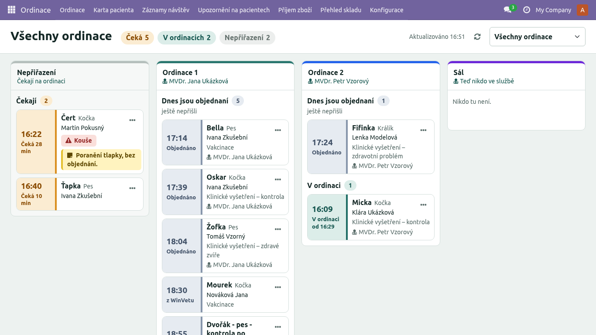
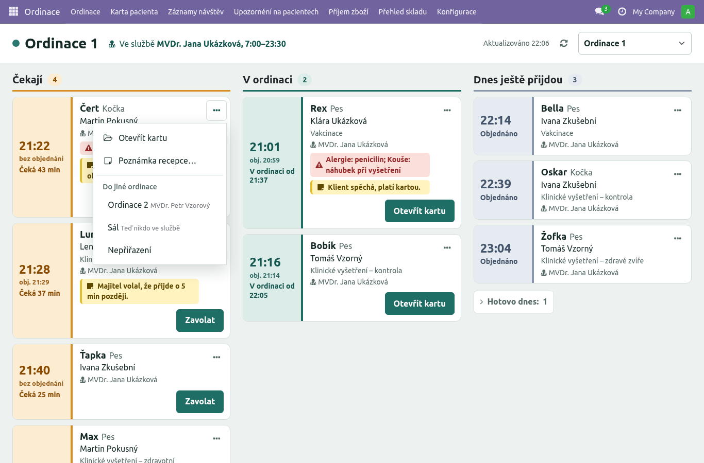
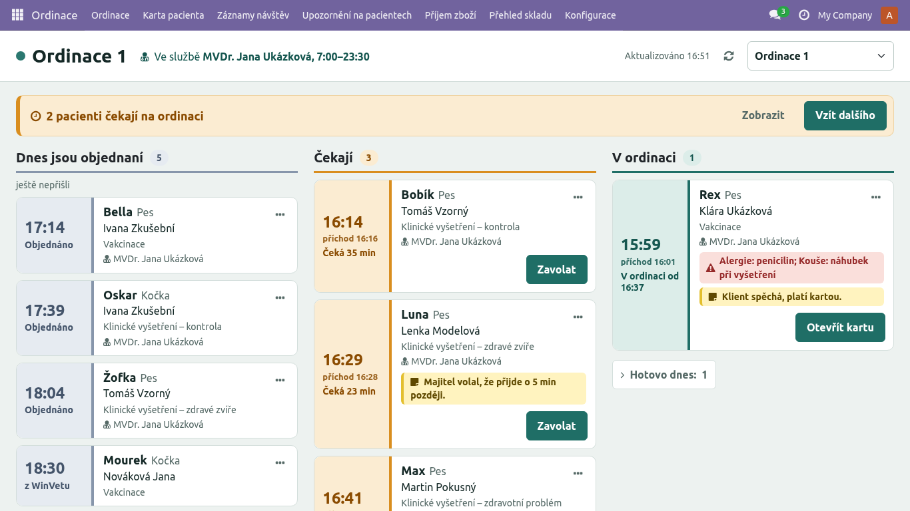
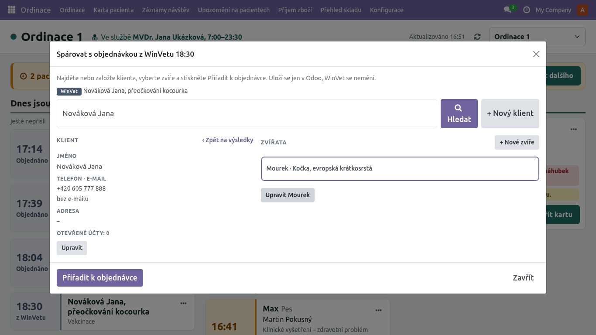
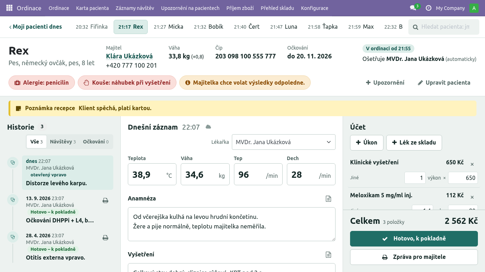

# The Ordinace screen: guide for consulting rooms, reception and management

The Odoo screens stay in Czech, so this guide gives every screen label in Czech in bold, with an
English translation in brackets the first time it appears in a chapter.

The **Ordinace** (Consulting rooms) screen shows today's patients split by the consulting room they
are assigned to, and the patients who have no room yet (**Nepřiřazení**, Unassigned). Open it in the
menu **Ordinace › Ordinace** (first item). Doctors, nurses, reception and management can all see it.

## 1. Consulting room account

A consulting room can have one shared account, for example "Ordinace 1" and "Ordinace 2". It is
logged in on the computer in that room and used by all doctors who work there. Besides that, each
team member can have **their own account** (chapter 6), which is not tied to a room.

- After login the **Ordinace** (Consulting rooms) screen opens directly on **its own room**, every time.
- The account has a doctor's rights: patient card, visit records and reservations, but no till and
  no stock.
- Who is recorded as the doctor of a visit comes from **Rozpis lékařů** (Doctors' roster, see
  chapter 4), not from the account. The room account stays recorded for the call-in and check-in.
  That is fine.

**Setup (management):** **Nastavení › Uživatelé** (Settings › Users) › new user (for example
"Ordinace 1"). In the **Přístupová práva** (Access rights) tab:

1. Set the role to **Lékařka** (Doctor) or **Sestra** (Nurse).
2. In the **Elite Vet** part, pick the room in the **Ordinace** (Consulting room) field.

The home screen is set automatically. If you clear the **Ordinace** field, the account goes back to
the patient card.

## 2. Header and switcher

At the top you see the room name and **who is on duty there now** with the shift time ("Ve službě
MVDr. …, 7:00–14:00", on duty). If nobody is on duty, it says "Teď nikdo ve službě" (nobody on duty
now) and today's shifts. On the right are the time of the last update, the ⟳ button and the **room
switcher** (a drop-down list; the first item is **Všechny ordinace**, All consulting rooms). The
browser remembers your choice. A room account always starts on its own room, though. A doctor's or
nurse's own account starts on the room where the roster shows her shift (chapter 6).

A **patient** looks the same everywhere, on the **Ordinace** screen and in **Moji pacienti dnes**
(My patients today):

- on the left a **coloured strip with the time**. The colour shows the state: **orange is waiting**,
  **green is in the room**, **blue-grey is booked** (not arrived yet), **grey is done**. The big
  time is the booked time (for a client without a booking, the arrival). Under it is "příchod 9:20"
  (arrival) once the client has arrived, or "bez objednání" (no booking), and then the state:
  **Čeká 12 min** (Waiting 12 min) / **V ordinaci od 9:25** (In the room since 9:25) / **Objednáno**
  (Booked; for a WinVet appointment **z WinVetu**, from WinVet) / **Hotovo** (Done);
- on the right the pet (species), owner, procedure and doctor;
- **alerts** on the patient in red (bites, allergy…);
- the **reception note** in yellow with a note icon: what reception wrote at check-in, for example
  "Klient spěchá" (client in a hurry). It is internal, the client never sees it;
- one **main button** depending on the state: **Zavolat** (Call in) for a waiting patient,
  **Otevřít kartu** (Open card) for a patient in the room. Everything else is in the **…** menu:
  **Otevřít kartu** (for waiting and booked patients), **Spárovat…** (Pair…, a WinVet appointment
  without a card, chapter 5), **Poznámka recepce…** (Reception note…, edit or delete) and **Do jiné
  ordinace** (To another room: the rooms are listed right in the menu, plus **Nepřiřazení**).

The screen refreshes itself: straight after every change (check-in, call-in, move, Done) and at the
latest every 30 seconds. The ⟳ button refreshes it at once.

**Read-only mode.** While the clinic works in WinVet, there may be a yellow strip at the top: "Jen
pro čtení. Pracuje se ve WinVetu, data se sem přenášejí. Změny může dělat jen správce rezervací."
(Read-only. Work is done in WinVet and the data is transferred here. Only the reservation manager
can make changes.) The screen then shows data but saves nothing: the **Zavolat** button is missing,
and **Vzít dalšího** (Take next), moving a patient to a room, notes and **Spárovat…** end with an
error message. The reservation manager works as usual. The guide
[Reception at the till](recepce-v-pokladne.md#read-only-mode) describes the whole mode.

## 3. All consulting rooms

At the top of **Všechny ordinace** (All consulting rooms) is a summary: how many patients are
waiting (**Čeká**), how many are in the rooms (**V ordinacích**) and how many are unassigned
(**Nepřiřazení**). Below it are the **Nepřiřazení** column and then one room next to the other. The
head of each room shows who is **on duty there now** (from **Rozpis lékařů**, Doctors' roster), or
"Teď nikdo ve službě" (nobody on duty now). A click on a room's head opens that room (chapter 4).
To go back, use the **Všechny ordinace** button with the arrow above the room name.

A column has the same parts in the same order as a single room:

- **Dnes jsou objednaní** (Booked today; ještě nepřišli, not arrived yet): today's bookings of this
  room, the client has not arrived or reception has not checked them in. These cards cannot be
  moved,
- **Čekají** (Waiting): the patient has arrived and reception has checked them in,
- **V ordinaci** (In the room): the patient has been called in,
- **Hotovo dnes: N** (Done today: N): finished visits, collapsed; a click expands them.

An empty part is not shown. A room where someone is still due today or has already been, but nobody
is waiting or inside right now, says "Nikdo tu není." (Nobody here.)

**Column widths.** A room with anyone in it today (booked, waiting, in the room or done) has a wide
column, at least 360 px, and the columns share any spare space. A room with **nobody** today is just
a narrow strip (name, who is on duty and "nikdo", nobody). The same goes for **Nepřiřazení** when
nobody is waiting for a room ("nikdo nečeká", nobody waiting). You can drag a patient into a narrow
column just like a wide one; the column then widens. When the wide columns do not fit on the screen
they do not shrink: the screen scrolls **sideways** (scrollbar at the bottom, mouse wheel with Shift,
or with a finger). The column heads stay on top when you scroll down. Long WinVet text is cut to
2–3 lines on the card ("…"); hover over the card to see all of it.

**Moving to a room:** drag a patient who has already arrived (waiting or in the room) with the mouse
into the column of another room. Dragging into **Nepřiřazení** removes the room. On a touch screen,
use the **…** menu › **Do jiné ordinace** (To another room) and pick the room.

*This is an older picture: the columns are now in the order **Dnes jsou objednaní**, **Čekají**, **V ordinaci**, and the line under the big time says "příchod", not "obj.".*

The move changes only the room of the visit. **The reservation stays in its room**, so the
reservation calendar keeps showing the original room.

## 4. One consulting room

When checked-in patients without a room are waiting (typically clients without a booking), there is
an orange strip at the top, for example "**2 pacienti čekají na ordinaci**" (2 patients waiting for
a room):

- **Vzít dalšího** (Take next) brings into this room the patient who has been waiting **longest**;
- **Zobrazit** (Show) expands the list; each patient has **Vzít do této ordinace** (Take into this room).

Below the strip are three columns from left to right, following the day: **Dnes jsou objednaní**
(Booked today; not arrived yet) | **Čekají** (Waiting; by booked time, clients without a booking by
arrival) | **V ordinaci** (In the room). Under the last one is the collapsed **Hotovo dnes: N** (Done
today: N). An empty column has just a short line ("Všichni objednaní už přišli.", everyone booked
has arrived; "Nikdo nečeká.", nobody waiting). Someone who has arrived is no longer among the booked
patients: they are under **Čekají** or **V ordinaci**.

On a narrower screen (tablet, including 1024 px landscape) the columns are stacked and **Čekají comes
first**, then **V ordinaci** (with **Hotovo dnes**) and finally **Dnes jsou objednaní**. When space
is short, the patients who are already waiting matter most.

- **Zavolat** (Call in, for a waiting patient): the patient goes to the state **V ordinaci** and into
  this room.
- **Otevřít kartu** (Open card, for a patient in the room; for others in the … menu): opens the
  patient card on today's visit, just like in **Moji pacienti dnes** (My patients today). This does
  not move the patient into the room, only **Zavolat** does. To get back, use the arrow button
  **Ordinace** at the top left of the card.
- The visit is closed in the patient card as before: **Hotovo, k pokladně** (Done, to the till).

### Who is recorded as the doctor

When a patient has no doctor and gets a room (**Zavolat**, **Vzít do této ordinace**, dragging), the
doctor who is **on duty in that room now** according to **Rozpis lékařů** (Doctors' roster) is recorded.

- One doctor on duty: she is recorded.
- Two on duty: the screen asks **Kdo pacienta převezme?** (Who takes the patient?), also after
  **Vzít dalšího**. You can pick **Zatím nevybírat** (Don't choose yet) and fill in the doctor in the
  patient card.
- Nobody on duty: the doctor stays empty. Fill her in in the patient card (field **Lékařka**, Doctor).
- A patient who already has a doctor (from the reservation or from check-in) **keeps** her, even when
  moved to another room. You can change her at any time in the patient card.
- A doctor logged in with **her own account** (chapter 6) is recorded automatically when she calls
  the patient in or takes them into a room (also **Vzít dalšího**), even in place of a doctor filled
  in automatically (from the roster or the reservation). A doctor chosen by hand is not changed.

## 5. Reception

- A booked client gets the room of their reservation after **Přijmout** (Check in).
- **+ Bez objednání** (+ Without booking): you can pick a room (field **Ordinace**, Consulting room),
  but you don't have to. Without one the patient is under **Nepřiřazení** (Unassigned) and a room
  takes them.
- At the till, in the **Dnes** (Today) tab, in the **Čekárna a ordinace** (Waiting room and consulting
  rooms) column, a patient shows their room if they have one.
- On the **Ordinace** screen reception can move patients between rooms and edit the reception note
  (the **…** menu). Only a nurse or doctor can use **Zavolat** (Call in).

**WinVet bookings without a card.** A WinVet booking that has only text (no patient) is under **Dnes
jsou objednaní** (Booked today) with the WinVet text. The **…** menu has **Spárovat…** (Pair…): it opens
**Kartotéka** (Client file, the same one as at the till), where you find or create the client and pet
and press **Přiřadit k objednávce** (Assign to booking). The booking then has a pet, and the menu has
**Otevřít kartu** (Open card).

Reception, nurses and doctors can all pair. The pairing is stored only in Odoo (see the guide
[Reception at the till](recepce-v-pokladne.md), "Booked in WinVet").

**Moji pacienti dnes** (My patients today) in the patient card shows a doctor with her own account
her patients of the day. Room accounts use the **Ordinace** screen.

## 6. Team member accounts

Every team member (**Rozpis služeb › Lékařky**, Shift schedule › Doctors: doctors, nurses and
reception) can have their own login. The account is **not tied to a room**: a doctor logs in anywhere
and works in any room. The link is in the **Účet** (Account) column (one account = one team member).
The user form shows a read-only **Člen týmu** (Team member) under **Přístupová práva › Elite Vet**
(Access rights › Elite Vet).

**What a linked account does:**

- After login, doctors and nurses land on the **Ordinace** screen, with the room of their **current
  shift** in **Rozpis lékařů** (Doctors' roster) selected. If they have no shift now, the room of their
  **next shift today**, otherwise **Všechny ordinace** (All consulting rooms). A manual switch lasts
  while they work on the screen (also after coming back from a patient card with the back button at
  the top left of the card). On the next opening (new login, page reload, the browser's Back button)
  the room comes from the shift again.
- **Who took the patient:** when a doctor (role **Lékařka**) calls a patient in, takes them into a room
  or drags them into a room, she is recorded as their doctor, if the patient has no doctor or only
  an automatic one (from the roster or the reservation). A doctor chosen by hand is not overwritten.
  A nurse, reception and a room account do not set the doctor (it still comes from the roster). This
  applies to team members with *Lékařka – přijímá rezervace* (Doctor, accepts reservations) ticked.
- **Treating doctor in the patient card:** when a doctor with her own account changes something in
  the visit record (vitals, **Záznam z vyšetření**, the note for reception, bill items, Done), she is
  recorded as the doctor of the record, again only in place of an empty or automatic one. The first
  stays; other doctors who edit the record are shown as "upravovaly také" (also edited) and are in
  the record's history. The card header says "**Ošetřuje** MVDr. …" (Treated by), with "(automaticky)"
  (automatically) for a doctor filled in automatically. A nurse and reception do not change the doctor
  by editing.
- **Moji pacienti dnes** (My patients today) in the patient card follows the link. An account without
  a link is matched to a doctor with the same name, if the match is unique.
- Reception with its own account still starts at the till, management on its overview.

**Creating accounts (management):** **Rozpis služeb › Lékařky** (Shift schedule › Doctors) › the
**Vytvořit účty** (Create accounts) button (or **Akce › Vytvořit účty**, Action › Create accounts). A
list of active team members without an account opens:

- **Přihlašovací jméno** (Login) = the e-mail from their card in **Náš tým** (Our team). Someone
  without an e-mail has an empty row: fill it in, otherwise the account cannot be created.
- **Role**: **Lékařka** (Doctor) for those who accept reservations, otherwise **Sestra** (Nurse). You
  can change it to **Recepce** (Reception) / **Sestra** / **Lékařka** / **Správce rezervací**
  (Reservation manager).
- **Vytvořit** (Create): the ticked rows are created. Logins must differ from all other accounts; if
  not, the window says which row.
- **Poslat pozvánku e-mailem** (Send invitation by e-mail, off by default): when ticked, each new
  account gets the standard Odoo invitation with a link to set a password. When not ticked, nothing is
  sent and management sets the password (**Nastavení › Uživatelé** › the account › **Akce › Změnit
  heslo**; Settings › Users › Action › Change password).

New accounts get Czech as their language, the time zone Europe/Prague and no password. The role sets
the home screen and the till automatically (only **Recepce** gets the till). At the end the window
shows how many accounts were created, how many rows were skipped and why.

## 7. Patient card

*This is an older picture: the header is lower now, and instead of the Anamnéza and Vyšetření fields there is one **Záznam z vyšetření** field with a **Šablona** button.*

- The **header** has two rows. At the top: the pet's name, species, breed, sex and age, the state of
  today's visit ("**V ordinaci od 9:25**", in the room since; "Čeká od 9:05", waiting since; "Hotovo,
  čeká u pokladny", done, waiting at the till), the booked time ("objednáno na 9:00", booked for;
  or "bez objednání", no booking), **Ošetřuje MVDr. …** (Treated by), and on the right **Upozornění**
  (Alert) and **Upravit pacienta** (Edit patient). Below: the owner with phone, weight, chip,
  vaccination (and **Záloha: 2 000 Kč**, Deposit, when the owner has a deposit balance in WinVet) and
  red alert labels (bites, allergy…), which you click to edit. An important note on the patient is an
  orange label (the full text is in the tooltip).
- **Opening the card** of a waiting patient changes nothing: they stay under **Čekají** (Waiting)
  until someone calls them in.
- **Dnešní záznam** (Today's record) is in the middle: the **Lékařka** (Doctor) field, four large
  vitals fields with units, and below them one large field **Záznam z vyšetření** (Examination
  record): history, findings, diagnosis, treatment and recommendations in one text. The field grows
  with the text. Write as you like; headings such as "Anamnéza:" are up to you. The record saves
  itself: a cloud icon means nothing is unsaved, then "Ukládám…" (Saving), then "✓ Uloženo 9:31"
  (Saved).
- **Templates** (the **Šablona**, Template, button at the top right of the **Záznam z vyšetření** field):
  - It offers all text templates. At the top is a search by name and by template text. The ↑ ↓ arrows
    select, Enter inserts, Esc closes.
  - The template is inserted **whole, at the cursor**: click in the text where it should go, then on
    **Šablona**. In the middle of a line it goes on its own line.
  - If there was no cursor in the field, or it is at the end of the text, the template is added **at
    the end after a blank line**. An empty field gets just the template text.
  - Nothing is overwritten, not even selected text. The cursor then stands after the inserted text,
    so you can keep typing.
  - The button also works from the keyboard: Tab to **Šablona**, Enter, type a search, Enter.
- **Older records** from the time when a record had three fields: at the update the texts were joined
  into one field with the headings "Anamnéza:", "Vyšetření:", "Diagnóza a doporučení:" (filled parts
  only). A record with just one filled part has that text without a heading. In the card history, the
  first line is the first sentence of the text (without a heading).
- **Účet** (Bill) is on the right: at the top **Úkon** (Procedure) and **Lék ze skladu** (Medicine
  from stock), below them the items, **Poznámka pro recepci** (Note for reception), and at the bottom
  the total, **Hotovo, k pokladně** (Done, to the till) and **Zpráva pro majitele** (Report for the
  owner). The **Přidat balíček** (Add bundle) button is under the record.
- **Historie** (History) is on the left, with the filter **Vše** (All), **Návštěvy** (Visits),
  **Očkování** (Vaccinations). WinVet tables (lab results) appear as tables, with their rows and
  columns kept. On a smaller screen (under 1280 px) it is collapsed under the record and the bill;
  expand it with the arrow by the heading. On a tablet in portrait everything is stacked: record,
  bill, history.
- **Column widths** (screen 1280 px and wider): there is a vertical divider between **Historie**,
  **Dnešní záznam** and **Účet**. Drag it with the mouse or a finger; or click it (Tab) and use the ←
  → arrows (with Shift in bigger steps), Home/End = narrowest/widest. A **double-click** restores the
  original width. **Dnešní záznam** is always at least 440 px wide. The browser remembers the widths
  (each computer and tablet separately); in a private window they last only until the page is
  reloaded.
- **Read-only mode** (chapter 2): there is a yellow strip at the top of the card, you cannot write in
  the record or the bill, and the **Upozornění**, **Upravit pacienta**, **Hotovo, k pokladně** and
  **Šablona** buttons are not shown.

## 8. Printing the report

**Zpráva z vyšetření** (Examination report) is a PDF for the owner (A4, in Czech). Reception, nurses,
doctors and management can print it.

**Where to print it:**

- **Karta pacienta** (Patient card), today's record: the **Zpráva pro majitele** (Report for the owner)
  button next to *Hotovo, k pokladně*. Anything unsaved is saved first, and the PDF opens in a new
  browser tab, from where you print or save it. The button is grey ("Nejdřív vyplňte záznam", fill in
  the record first) while the record has no text, no vitals and no bill item.
- **Karta pacienta › Historie** (Patient card › History): the printer icon next to every earlier
  visit recorded in Odoo and also next to a **visit taken over from WinVet** (if it has text, a
  diagnosis, measurements or items).
- **WinVet data › Návštěvy** (WinVet data › Visits), the form or list of a WinVet visit: **Tisk ›
  Zpráva z vyšetření** (Print › Examination report).
- **Ordinace › Záznamy návštěv** (Ordinace › Visit records), the form or list: the **Tisk › Zpráva
  z vyšetření** menu. The file downloads as `Zprava_<pet>_<date>.pdf`. From the list you can print
  several records at once.
- **Pokladna › Dnes › K pokladně** (Till › Today › To pay): the printer icon by the bill, so reception
  can hand over the report at the desk.

**What the report contains** (only filled-in data; empty parts are left out):

- **clinic header**: name, address, company ID, VAT ID, phone, e-mail and website. It comes from
  **Nastavení › Společnosti** (Settings › Companies); whatever is missing there (phone, e-mail,
  address) is filled in from the website settings. Only the clinic's own logo is used, never the
  default Odoo logo;
- **patient**: name, species, breed, sex, date of birth and age on the day of the visit ("3 roky
  2 měsíce", 3 years 2 months), colour, chip, tattoo, passport number;
- **owner**: name, address, phone;
- **visit**: date and time, treating doctor with title and **KVL number** (Veterinary Chamber number).
  The title comes from the team card, otherwise from the doctor's name. The KVL number is in
  **Rozpis služeb › Lékařky** (Shift schedule › Doctors);
- **Záznam z vyšetření** (Examination record): one part. At the top a line with temperature, weight,
  heart rate and breathing with units, below it the record text. Lines of the text stay as they were
  written, and long text continues on the next page. For a WinVet visit these are the measurements
  and the clinical notes, with **Diagnóza** (Diagnosis) below;
- **Provedené výkony a podané léky** (Procedures performed and medicines given): name and quantity with
  unit, **no prices**. Medicines show the batch and expiry once the bill is paid at the till (the
  batch comes from the stock issue);
- **Další termíny** (Next dates): the pet's next vaccination and deworming;
- **Místo a datum** (Place and date, the day of printing), a box for the **signature and stamp of the
  doctor** and page numbers. The report calls the doctor "Ošetřující lékař/ka" (Treating doctor).

**A report from a WinVet visit** has the same header, patient, owner and signature. The **Záznam
z vyšetření** part has the WinVet measurements (time, temperature, weight, heart rate, breathing,
blood pressure) and the record text (*Dekurz*, clinical notes) as written in WinVet (including its
headings "Anamnéza:", "Klinické vyšetření:" and lab result tables). Then come **Diagnóza** (Diagnosis;
and *Případ*, Case, if it differs), **Provedené výkony a podané léky** from the bill of that WinVet
visit (name and quantity, no prices; money transfers such as "Převod nedoplatku…" are left out) and
**Další termíny**. The treating doctor appears only if the WinVet user who recorded the visit is
linked to a doctor in Odoo (**WinVet data › Uživatelé WinVet**, WinVet users); otherwise the report
has no name, because a nurse may also have made the entry.

**What is never in the report:** the reception note, the note for reception, alerts on the pet (bites,
allergy…), prices and amounts, payment state, who wrote the record, the pet's note from WinVet (*Poznámka*
in the pet card is internal) and "Důležité" (Important) on the pet.
