# Reception at the till and Moji pacienti dnes: guide for reception, doctors and management

**What this guide is for.** It describes one working day: reception works only in the **Recepce**
(Reception) till (arrivals, waiting room, client file, booking, payment), doctors and nurses in **Moji
pacienti dnes** (My patients today) and the patient card. The last part is for **management** (roles,
employees with a PIN). Technical details for administrators are in the
[module README](../../README.md), part "Pro správce".

The Odoo screens stay in Czech, so this guide gives every screen label in Czech in bold, with an
English translation in brackets the first time it appears in a chapter.

Related guides:

- [Till and stock](../../../elite_vet_sale/doc/en/pokladna-a-sklad.md): invoice, deposit, refund,
  cash closing, goods receipt,
- [Reservations: guide for reception](../../../elite_vet_reservation/doc/en/recepce.md): calendar, web
  requests, reservation wizard,
- [The Ordinace screen](ordinace.md): one account per consulting room, patients by room, assigning to
  a room and **Zavolat** (Call in).

The path of a visit:

| State | Who | Where |
|---|---|---|
| **Objednáno** (Booked) | web or reception | reservation (**Objednat**, Book, tab; calendar; web) |
| **Čeká** (Waiting) | reception | **Přijmout** (Check in) in the **Dnes** (Today) tab, or **+ Bez objednání** (+ Without booking) in the same tab |
| **V ordinaci** (In the room) | doctor / nurse | **Zavolat** (Call in) on the **Ordinace** screen or in **Moji pacienti dnes** |
| **K pokladně** (To pay) | doctor | **Hotovo, k pokladně** (Done, to the till) in the patient card |
| **Zaplaceno** (Paid) | reception | **Zaplatit** (Pay) in the **Dnes** tab |

## Read-only mode

While the clinic works in WinVet, Odoo may be switched to **Jen pro čtení** (Read-only) mode. You can
tell by the yellow **Jen pro čtení** label in the top bar of the till and the yellow strip at the top
of the **Ordinace** screen and the patient card: "Jen pro čtení. Pracuje se ve WinVetu, data se sem
přenášejí. Změny může dělat jen správce rezervací." (Read-only. Work is done in WinVet and the data is
transferred here. Only the reservation manager can make changes.)

- **You can view everything:** **Dnes** (Today), **Kartotéka** (Client file), **Objednat** (Book),
  **Pokladna** (Till), **Kalendář** (Calendar), the **Ordinace** screen and the patient card. The data
  comes from WinVet.
- **Nothing can be saved.** Buttons such as **Přijmout** (Check in), **+ Bez objednání** (+ Without
  booking), **Poznámka** (Note), **Spárovat…** (Pair…), **Objednat** (Book), **Přesunout** (Move),
  **Zrušit rezervaci** (Cancel reservation), **Nedorazil** (No-show) and edits in **Kartotéka** are
  visible, but a click shows the message "Ordinace, karty a pokladna jsou zatím jen pro čtení – pracuje
  se ve WinVetu, odkud se data přenášejí. Změny může dělat jen správce rezervací." (Consulting rooms,
  cards and the till are read-only for now.)
- **Pokladna** (Till) opens and you can start a bill, but **Potvrdit** (Confirm) on the payment screen
  shows the window "Pokladna je zatím jen pro čtení – prodává se ve WinVetu. Účet se neuloží." (The
  till is read-only for now, sales are made in WinVet. The bill will not be saved.)
- The **Ordinace** screen has no **Zavolat** (Call in) button (in **Moji pacienti dnes** it ends with
  the message). The **patient card** is read-only: you cannot write in the record or the bill, and
  the **Upozornění** (Alert) and **Upravit pacienta** (Edit patient) buttons are missing.
- **Still running:** the transfer from WinVet and new reservations from the web and from the
  **Rezervace** (Reservations) app (**Nová rezervace**, New reservation).
- The **Správce rezervací** (Reservation manager, management) works as usual. Chapter 10 says how the
  mode is switched on.

---

# Part A: reception

## 1. Start of the day

After logging in to Odoo, reception goes straight to the **Recepce** (Reception) till, with nothing to
look for. If not, open the **Prodejní místa** (Point of Sale) app › the **Recepce** till › **Otevřít
pokladnu** (Open till), or **Pokračovat v prodeji** (Continue selling).

1. **Log in with your PIN.** On the locked screen click **Odblokovat pokladnu** (Unlock till) or
   **Otevřít pokladnu**, type your PIN and press Enter. Your name then appears at the top right of the
   till: every check-in and every payment is recorded under your name.

   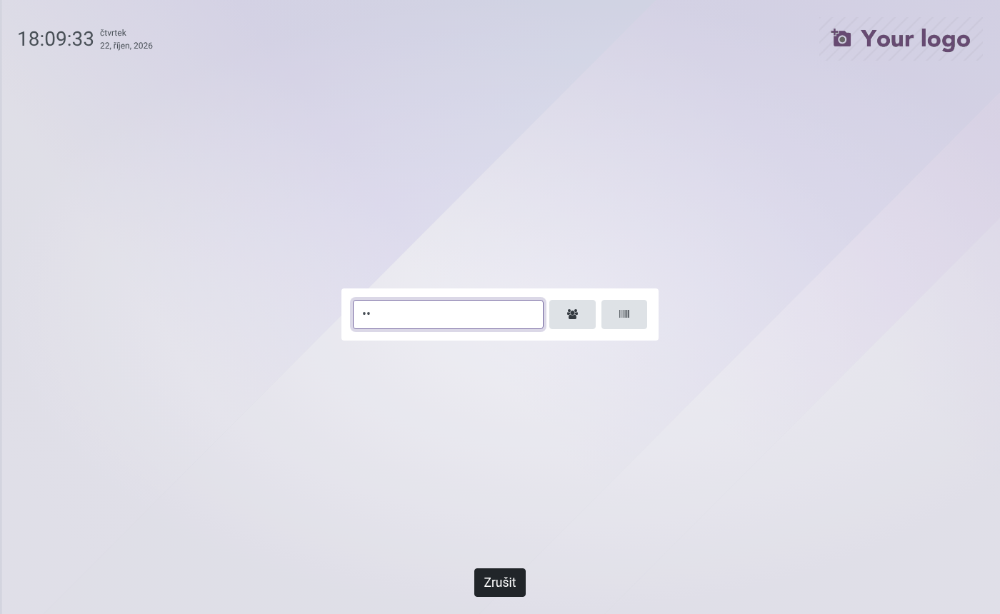

2. **Opening cash.** The first person to open the till that day gets the **Otevření hotovosti** (Cash
   opening) window: count the cash in the drawer, enter it (or confirm the suggested amount) and click
   **Otevřít pokladnu**. Until the till is open, **Zaplatit** (Pay) does nothing and shows a warning.

The till opens on the **Dnes** (Today) tab. The bar at the top:

| Button | What it does |
|---|---|
| **Dnes** (Today) | overview of the day: who is coming, who is waiting, what is to be paid |
| **Kartotéka…** (Client file) | window with clients and pets: only search, viewing, new client and edits |
| **Objednat** (Book) | booking an appointment |
| **Pokladna** (Till) | the normal till screen (selling goods, the **Klient** (Client) button on the bill, which shows the bill's customer, e.g. "Klient: Jana Nováková"; **Akce** (Actions), **Nabídka/Objednávka** (Quotation/Order) …) |
| **Kalendář** (Calendar) | the day calendar of the consulting rooms in a window above the till (chapter 5) |
| lock | locks the till (chapter 7) |
| ☰ | till menu (closing, orders …) |

## 2. The Dnes tab

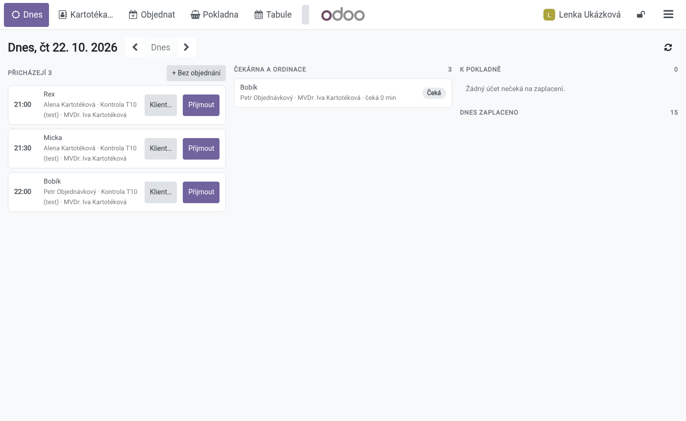

*The till pictures still show the old name **Tabule** in the bar. The button is now called **Kalendář** (Calendar).*

The **Dnes** (Today) tab has three columns:

- **Přicházejí** (Arriving): today's confirmed reservations that have not arrived yet, by time: time,
  pet, owner, procedure, doctor. If a reservation has a **Popis** (Description), it comes before the
  pet's name. Reservations from the web (including the web chat) have a blue **WEB** label by the pet.
  A red **Klient žádá o zrušení** (Client asks to cancel) label means the client asked to cancel
  through the link in an e-mail. The reservation stays valid; the decision is made in the **Rezervace**
  (Reservations) app ([Reservations guide](../../../elite_vet_reservation/doc/en/recepce.md)).
- **Čekárna a ordinace** (Waiting room and consulting rooms): checked-in clients: room, doctor (for
  clients without a booking possibly "kterákoli lékařka", any doctor), how long they have been waiting
  (for a patient in the room, the arrival time) and the label **Čeká** (Waiting) or **V ordinaci** (In
  the room).
- **K pokladně** (To pay): bills the doctor has closed and that are waiting for payment, with the
  amount. The printer icon opens the examination report for the owner
  ([Ordinace, 8. Printing the report](ordinace.md#8-printing-the-report)). Under the bills is **Dnes
  zaplaceno** (Paid today) with a count.

On a public holiday there is a red label by the day heading, for example "Státní svátek: Den vzniku
samostatného československého státu" (Public holiday). It is only a reminder, nothing is blocked.

The overview refreshes itself: when a doctor calls a patient in or closes a bill, the till shows the
change within a few seconds (and refreshes every 30 s to be safe). The arrow at the top right refreshes
it by hand.

The **‹ ›** arrows by the date show the previous / next day (for example who is booked tomorrow),
**Dnes** takes you back. On any day other than today, the **Přijmout** (Check in) and **+ Bez objednání**
(+ Without booking) buttons are not there: only today's visit can be checked in.

### Checking in a booked client (Přijmout)

1. The client arrives. Find them in the **Přicházejí** (Arriving) column.
2. Click **Přijmout** (Check in). A small window opens with the field **Interní poznámka pro ordinaci
   (nepovinné)** (Internal note for the room, optional), for example "Klient spěchá" (client in a
   hurry), "Kouše, opatrně" (bites, take care), "Přinesl vzorek moči" (brought a urine sample). You can
   leave it empty.
3. Click **Přijmout do čekárny** (Check in to the waiting room), or press Enter (a new line in the note
   is Shift+Enter). **Zrušit** (Cancel) closes the window and the client stays in **Přicházejí**.
4. The client moves to **Čekárna a ordinace** (Waiting room and consulting rooms) with the label **Čeká**
   (Waiting). The doctor sees them at once in her **Čekají** (Waiting) list.

The **Poznámka recepce** (Reception note) is internal: it shows in yellow in the consulting room, in
**Moji pacienti dnes** (My patients today), on the **Ordinace** screen and at the top of the patient
card for that visit. The client never sees it, and it is not on the receipt or invoice. For a patient
in **Čekárna a ordinace** it is also visible at the till, and with the **Poznámka** (Note, pencil)
button you can add, correct or delete it (empty field = delete) until the doctor closes the visit.
**Přijmout** in the **Kalendář** (Calendar) has the same window (chapter 5).

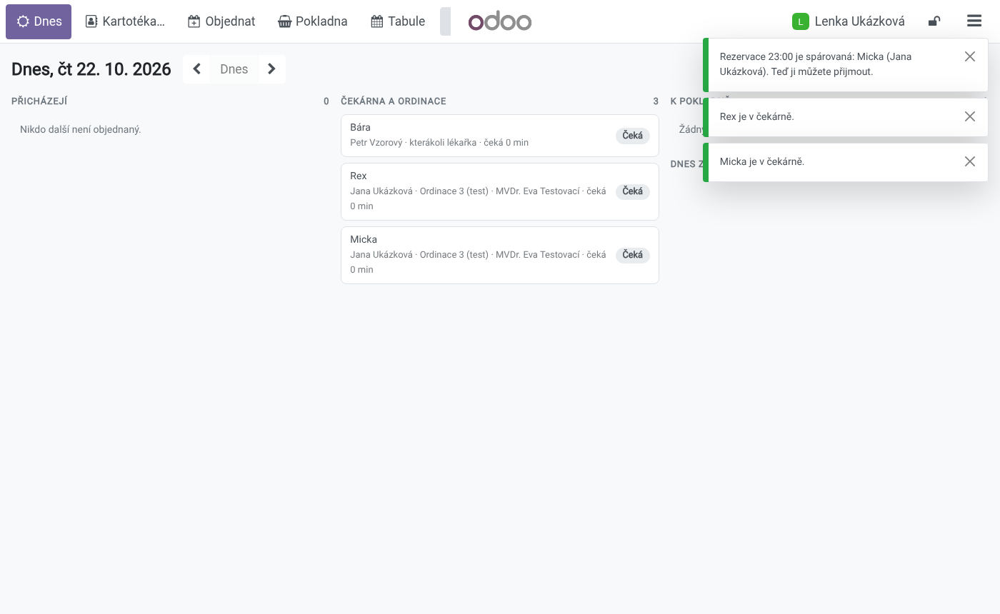

*This is an older picture: the **Poznámka** and **Zrušit přijetí** buttons are not on it yet.*

If the doctor opened the card before you checked the client in, **Přijmout** does not create a
duplicate: the existing record is used.

### Undoing a check-in (Zrušit přijetí)

Did you check in the wrong client, or did the client leave before being called? A patient with the
**Čeká** (Waiting) label in the **Čekárna a ordinace** (Waiting room and consulting rooms) column has a
**Zrušit přijetí** (Undo check-in) button with a back arrow.

1. Click **Zrušit přijetí**. The till asks: "Zrušit přijetí Rex? Pacient se vrátí mezi Přicházejí."
   (Undo check-in of Rex? The patient goes back to Arriving.) For a client without a booking: "…
   Pacient zmizí z čekárny." (The patient disappears from the waiting room.)
2. **Zrušit přijetí** confirms; **Ponechat** (Keep) closes the window and nothing changes.
3. A booked client (an Odoo reservation or a WinVet entry) is back in **Přicházejí** (Arriving) and can
   be checked in again with **Přijmout**: a new visit is created. A client without a booking disappears
   from the waiting room.

The cancelled visit is not deleted: it stays as **Zrušeno** (Cancelled), and its history (and the
reservation's) has the note "Přijetí zrušila recepce (jméno)" (Check-in undone by reception, name).
Nothing is sent to the client.

You can only undo **today's** check-in, while the patient is **waiting** and the visit is empty:

- the patient is already in the room (label **V ordinaci**): "Pacient už je v ordinaci – přijetí už
  nejde zrušit." (The patient is already in the room, the check-in can no longer be undone; the button
  is not there);
- the visit already has something from the room, such as the examination record, temperature, weight,
  heart rate, breathing, a bill item or a note for reception: "Záznam už má zápis od lékaře/ky – zrušit
  ho může ordinace." (The record already has an entry from the doctor, the room can cancel it.) Your own
  reception note does not prevent undoing.

### Booked in WinVet (WinVet label)

While appointments are also booked in WinVet, **Přicházejí** (Arriving) also lists all of today's
bookings from the WinVet calendar (with a **WinVet** label): entries with a time that have a client,
a pet or a WinVet activity. Staff notes ("Oběd", lunch; "Příjmy", income; an empty entry), all-day entries
and entries marked as done in WinVet are not shown.

- **With a pet from the client file** (a patient was chosen in WinVet when booking): **Přijmout** (Check
  in) works as for a reservation. It creates (or reuses today's open) visit of the pet, in the room
  given by the WinVet calendar, and the client is in the waiting room.
- **Without a card** (WinVet has only text, for example "Nováková Jana, přeočkování"): the row shows the
  WinVet text and the label **bez karty** (no card), and instead of **Přijmout** there is **Spárovat…**
  (Pair…). It opens **Kartotéka** (Client file) with the search prefilled from the start of the text (the
  first words before a comma or dash; you can change it; if nothing is found, it tries just the first
  word). Find the client, or create them (**+ Nový klient**, + New client; **+ Nové zvíře**, + New pet),
  pick the pet and press **Přiřadit k objednávce** (Assign to booking). You can pair a new client with
  a pet in one click: **+ Nový klient**, fill in the pet right in the form and press **Uložit a přiřadit
  k objednávce** (Save and assign to booking). The row then has a pet and **Přijmout** like the others;
  the **Ordinace** screen offers **Otevřít kartu** (Open card) for the booking, and **Kalendář**
  (Calendar) shows the pet's name.

  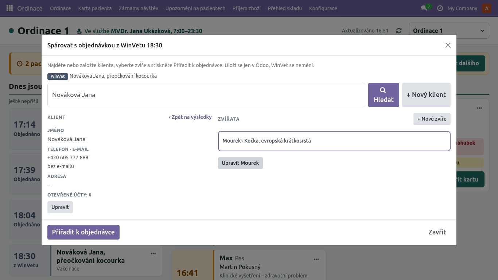

  (The picture shows the same window opened from the **Ordinace** screen.)
- The pairing is stored **only in Odoo**. Nothing changes in WinVet, and the next transfer from WinVet
  does not overwrite it. If WinVet later adds a patient to the booking, the WinVet one applies.
- **Zrušit spárování** (Undo pairing, on a paired row) puts the booking back among those "bez karty",
  but only until the client is checked in (after that, use **Zrušit přijetí** first).
- A deceased pet cannot be paired.

> **Tip for the clinic:** always pick the patient when booking in WinVet. The booking then pairs itself
> in Odoo and reception has nothing to do.

**Klient…** (Client…) is not available here: the booking can only be changed in WinVet.

### Checking in without a booking (+ Bez objednání)

The client came without a reservation:

1. Click **+ Bez objednání** (+ Without booking) by the **Přicházejí** (Arriving) heading. **Kartotéka**
   (Client file) opens with the title "Přijmout bez objednání" (Check in without booking).
2. Find the client (or create them with **+ Nový klient**, + New client, chapter 3) and click the pet.
3. Pick the **Lékařka** (Doctor): a specific one, or **kterákoli** (any). All doctors see such a patient
   under **Čekají** (Waiting) with the note "kterákoli lékařka", and whoever calls them in takes them.
4. Optionally pick the **Ordinace** (Consulting room). Without one, the patient is under **Nepřiřazení**
   (Unassigned) on the **Ordinace** screen and a room takes them ([The Ordinace screen](ordinace.md)).
   Optionally write an **Interní poznámka pro ordinaci** (Internal note for the room), the same
   reception note as with **Přijmout** (Check in).
5. Click **Přijmout**. The window closes and the pet is in **Čekárna a ordinace** (Waiting room and
   consulting rooms) with the label **Čeká** (Waiting; a patient with a room also shows the room).

   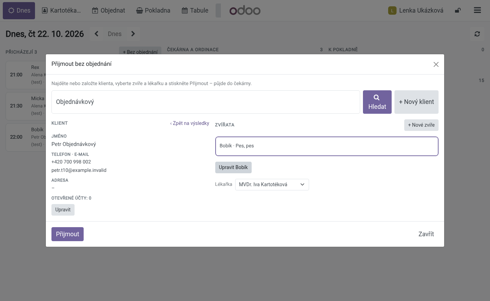

   *This is an older picture: the **Ordinace** and **Interní poznámka pro ordinaci** fields are not on it yet.*

### Client for a reservation: Klient… and Spárovat

Every reservation in **Přicházejí** (Arriving) has a **Klient…** (Client…) button. If a different pet or
owner comes than the reservation says, you correct it here. A web reservation that nobody has assigned
to a client in the client file yet has the note **nespárováno** (not paired) and, instead of **Klient…**
and **Přijmout** (Check in), a **Spárovat** (Pair) button.

1. Click **Klient…** (or **Spárovat**). **Kartotéka** (Client file) opens with a title such as "Klient
   k rezervaci 21:00 Kontrola" (Client for reservation, with the time and procedure). For a reservation
   with a client, their card is already open with the reservation's pet selected:

   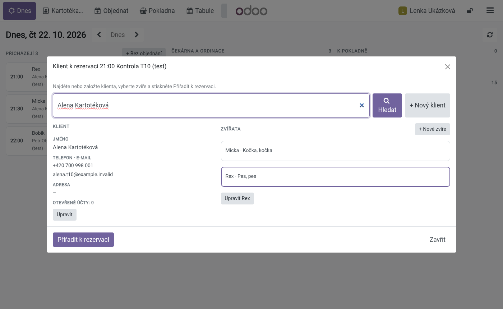

   For a web reservation without a client, **Kartotéka** searches by the name from the web:

   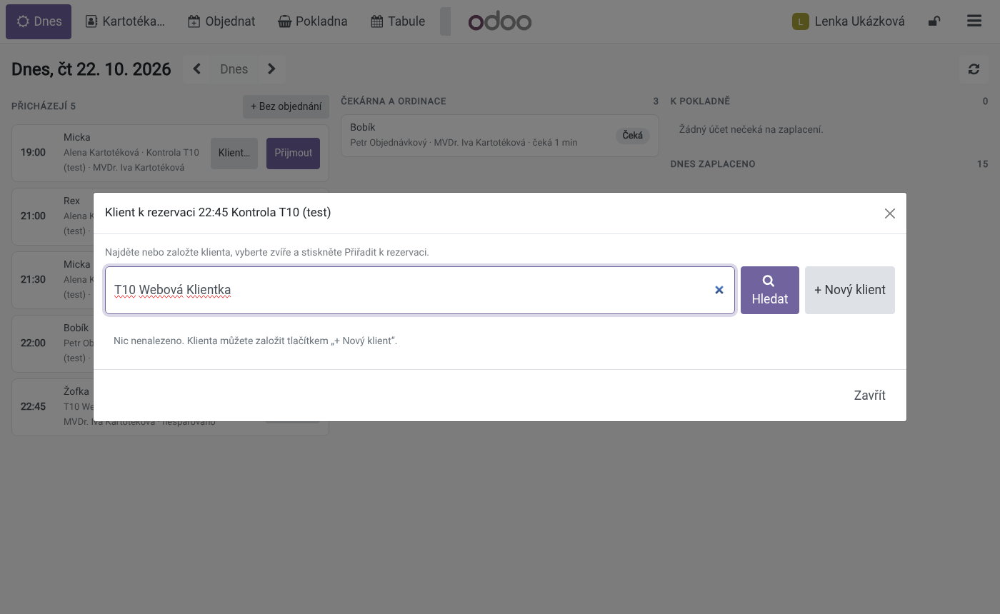

2. Pick the right pet: another of the owner's pets by clicking it, another client by searching. If the
   client is not in the client file, create them with **+ Nový klient** (+ New client, chapter 3).
3. Click **Přiřadit k rezervaci** (Assign to reservation, the only main button of the window). "Klient je
   přiřazený k rezervaci …" (Client assigned to reservation) appears, the window closes and **Dnes**
   (Today) shows the reservation with the new client and pet (a web reservation now has **Přijmout**).

A reservation that already has a visit (the client is checked in or the doctor opened the card) cannot
be assigned to another pet: "Rezervace už má návštěvu jiného zvířete." (The reservation already has a
visit of another pet.)

### Paying (Zaplatit)

1. In the **K pokladně** (To pay) column, click **Zaplatit** (Pay) by the client.

   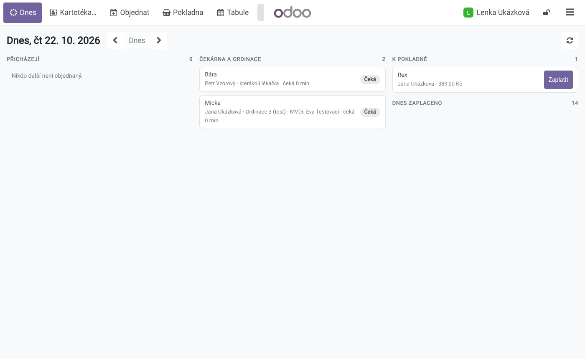

   If the room wrote a **poznámka pro recepci** (note for reception) on the bill (for example "Platí
   převodem", pays by transfer; "Doplatí zítra", will pay the rest tomorrow; "Objednat na kontrolu za 14
   dní", book a check-up in 14 days), it shows in yellow under the client in **K pokladně**, and after
   clicking **Zaplatit** it first appears in the **Poznámka z ordinace** (Note from the room) window.
   Read it and click **Pokračovat k platbě** (Continue to payment); **Zpět** (Back) does not open the
   payment. The note is internal: it is not on the receipt or invoice. It is also visible in **Kartotéka**
   (Client file) with the client's open bills.

2. The till loads the bill with the customer (the owner) and opens the payment. You don't have to
   look for anything under **Akce → Nabídka/Objednávka** (Actions → Quotation/Order).
3. Choose the payment method (**Kartou**, by card; **Hotově**, cash; **Převodem**, transfer), optionally
   turn on **Faktura** (Invoice), and click **Potvrdit** (Confirm). For a card, type the amount into the
   bank terminal.

   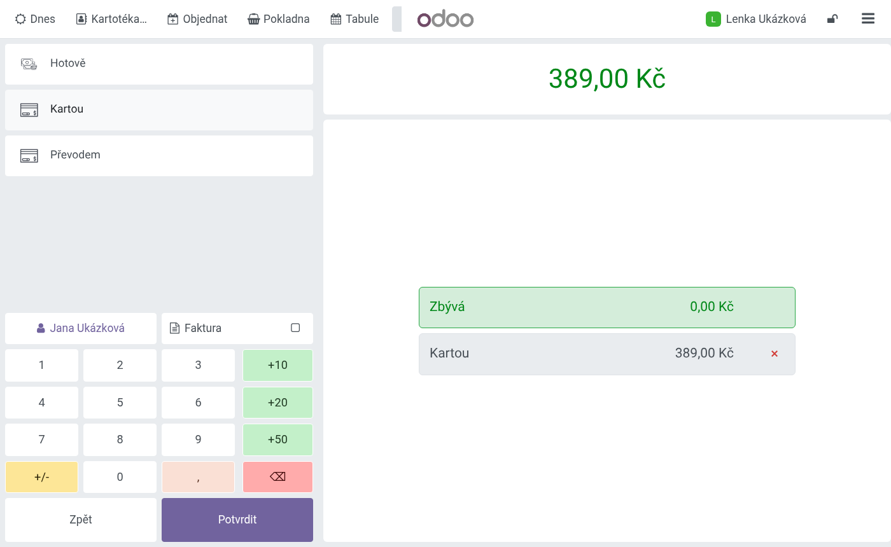

4. **Platba byla úspěšná** (Payment successful) and the receipt appear. The **Dnes** (Today) button takes
   you back to the overview; the client disappears from **K pokladně** and **Dnes zaplaceno** (Paid today)
   goes up.

   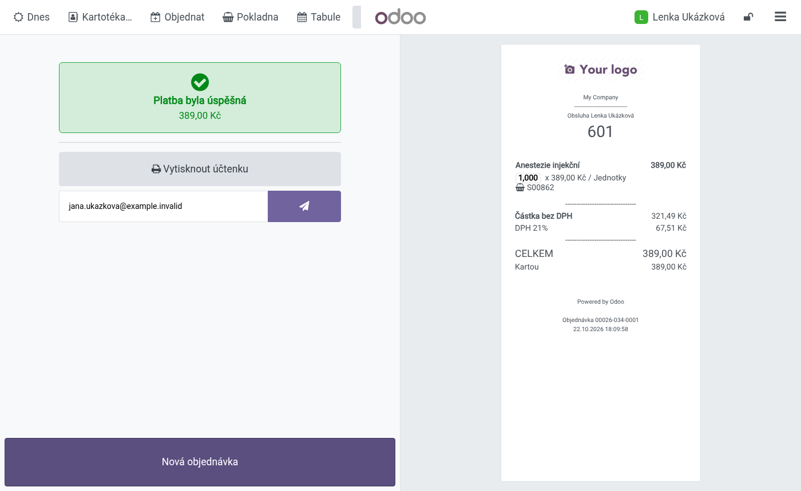

Good to know:

- **Older bills.** **K pokladně** (To pay) has all unpaid bills, including those from earlier days. They
  show "z 21. 10." (from 21 Oct) by the amount. So a client who pays tomorrow does not disappear from
  the till.
- **Deposit** (**Částečně zaplaceno**, Partly paid) stays in **K pokladně** with the remaining amount;
  **Zaplatit** pays the rest.
- **Every bill has its own receipt.** If another purchase is in progress at the till, **Zaplatit**
  creates a new order; two clients are never mixed on one receipt. A bill that is already in an open
  order opens there.
- Invoices, deposits, refunds and correcting a paid bill are covered in the guide
  [Till and stock](../../../elite_vet_sale/doc/en/pokladna-a-sklad.md) (chapters 3–6).

## 3. Kartotéka

**Kartotéka** (Client file) is a window above the till (a purchase in progress stays as it was). It
always does just **one thing**, depending on where you open it from. The top of the window says what
you are picking the client for, and at the bottom there is at most **one main button** (and **Zavřít**,
Close):

| Opened from | Window title | Main button and what it does |
|---|---|---|
| the **Kartotéka…** button in the bar | Kartotéka | none: only search, viewing, new client and edits |
| **Objednat** (Book), step **Klient a zvíře** (Client and pet) › **+ Nový klient** (+ New client) / **Upravit** (Edit) / owner without a pet | Vybrat klienta a zvíře pro objednání (Pick client and pet for booking) | **Vybrat** (Select): the client and pet go into the **Objednat** form (chapter 4) |
| **Pokladna** (Till), the **Klient** (Client) button on the bill | Klient k účtu v pokladně (Client for the bill at the till) | **Vybrat k účtu** (Select for bill): the client becomes the customer of the bill in progress |
| **Dnes** (Today), **Klient…** / **Spárovat** on a reservation; detail in **Kalendář** (Calendar) › **Klient…** | Klient k rezervaci 21:00 Kontrola (Client for reservation) | **Přiřadit k rezervaci** (Assign to reservation): the client and pet go on that reservation (chapter 2) |
| **Dnes**, **+ Bez objednání** (+ Without booking) | Přijmout bez objednání (Check in without booking) | **Přijmout** (Check in), with a choice of doctor: the pet goes to the waiting room (chapter 2) |
| **Dnes**, **Spárovat…** (Pair…) on a WinVet booking; **Ordinace** screen, **…** menu › **Spárovat…** | Spárovat s objednávkou z WinVetu 18:30 (Pair with WinVet booking) | **Přiřadit k objednávce** (Assign to booking): the pet is paired with the booking (chapter 2) |

The buttons that need a pet (**Vybrat**, **Přiřadit k rezervaci**, **Přijmout**, **Přiřadit k objednávce**)
stay grey until you pick a pet ("Vyberte zvíře.", pick a pet; for a client with no pets "Přidejte zvíře
(+ Nové zvíře).", add a pet). They do not work with a deceased pet.

### Searching

Type the name of the owner or pet, a phone number or a chip number and press **Enter** (or **Hledat**,
Search). 2 characters are enough. The results show pets (paw icon) and owners without pets (person
icon). A click opens the owner's card.

### Owner's card

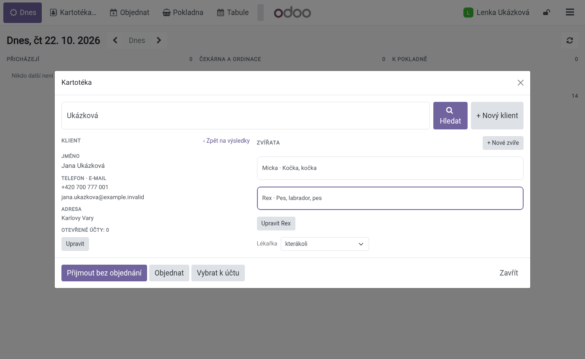

- On the left the **client**: name, phone and e-mail, address, number of **Otevřené účty** (Open bills)
  and the **Upravit** (Edit) button. If the client **did not show up** for a reservation in the last 12
  months, there is a red label **Nedorazil 2×** (No-show 2×) by the name (hover for details) and a list
  under it: date, procedure, pet. The pet has a label **nedorazil 1×**. This is counted automatically
  from reservations in the state **Nedorazil**; nothing is entered by hand.
- If the client has a **deposit** with a balance in WinVet, there is a discreet line under the address,
  **Záloha: 2 000 Kč** (Deposit; the balance according to WinVet, deposits are still taken and used in
  WinVet).
- On the right the **pets**: species, breed, sex, birth (or just the year), chip, weight, next
  vaccination and deworming, alerts and **Důležité** (Important, red labels). Deceased pets are at the
  end, faded; you cannot do anything with them.
- A click selects a pet (a frame around it). Below it is **Upravit <name>** (Edit <name>), and with
  **Přijmout bez objednání** also the **Lékařka** (Doctor) choice.
- **‹ Zpět na výsledky** (Back to results) returns you to the search.

### New client, new pet, edits

1. **+ Nový klient** (+ New client): fill in the name (required), phone, mobile, e-mail, address. You
   can enter the **first pet** with all its details right away: it is the same form as **+ Nové zvíře**
   (+ New pet, point 3: at the top name, species, sex, breed, birth, chip, then **Další údaje**, More
   details, and **Upozornění**, Alerts). The pet is optional; if you enter one, fill in at least its name
   and species. You can add more pets afterwards.

   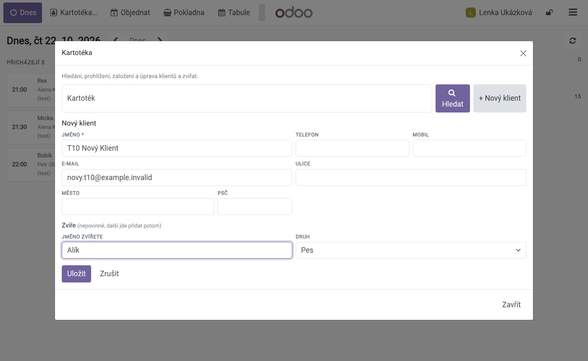

2. **Uložit klienta** (Save client). The client and the pet are saved together, and the new client's card
   opens with the pet selected. If there is a mistake in the pet's details (for example weight "hodně",
   or a birth date in the future), **nothing** is saved: the error shows in red in the form, everything
   you typed stays, just correct it and save again. In **Kartotéka** opened through **Spárovat…** (Pair…,
   a WinVet booking) the button is **Uložit a přiřadit k objednávce** (Save and assign to booking) when you
   also enter a pet: one click creates the client and pet and pairs the booking.
3. **+ Nové zvíře** (+ New pet): only **Jméno** (Name) and **Druh** (Species) are required, you can leave
   everything else empty.
   - At the top: name, species, sex, breed, birth, chip. For the species **Jiné** (Other) the field **Jiný
     druh** (Other species) appears (for example ferret).
   - **Další údaje** (More details; click to expand; closed for a new pet, opens by itself when editing
     if something is in it): **Rok narození** (Year of birth, when you don't know the exact date),
     **Hmotnost (kg)** (Weight; decimal comma or point, e.g. 12,5), **Barva** (Colour), **Tetování**
     (Tattoo), **Číslo pasu** (Passport number), **Příští vakcinace** (Next vaccination), **Příští
     odčervení** (Next deworming), **Důležité** (Important, a short text shown on the owner's card as a
     red label by the pet) and **Poznámka** (Note).
   - **Upozornění** (Alerts): **+ Upozornění** adds a row: the type (Kouše, bites; Alergie, allergy; Jiné,
     other; the same as in the patient card) and a note (for example muzzle, penicillin). The bin removes
     the row. Alerts show as labels on the owner's card and in the patient card.
4. **Upravit** (Edit, for the client) and **Upravit <name>** (for the pet) open the same form with the
   details filled in. **Uložit** (Save; for the client **Uložit klienta**) writes the changes, **Zrušit**
   (Cancel) discards them.
5. Only when editing a pet (not when registering it), **Uhynulý** (Deceased) and then **Datum úhynu**
   (Date of death) are at the bottom. After **Uložit**, **Kartotéka** asks "Označit … jako uhynulé?"
   (Mark … as deceased?). A deceased pet cannot be booked or checked in. Marked by mistake: untick
   **Uhynulý** and save (the date of death is cleared).

> **Running alongside WinVet.** While the client file is transferred from WinVet (the bridge every 15
> minutes and a full daily run), the transfer overwrites these fields with the WinVet values for pets
> that **came from WinVet**: name, owner, species and other species, breed, sex, colour, birth, year of
> birth, chip, tattoo, passport number, weight, deceased, date of death, next vaccination, next
> deworming, **Důležité** (Important), and active / registered. This happens when the pet **changes in
> WinVet** (its last-change time in WinVet changes); for a pet with no change time in WinVet, at every
> transfer. Otherwise the transfer leaves your Odoo edit alone. So make changes to these fields in
> WinVet as well. **Poznámka** (Note; the WinVet note has its own field) and **Upozornění** (Alerts) are
> never overwritten from WinVet: they exist only in Odoo. The transfer does not change pets created in
> Odoo.

The same phone or e-mail as another client is no problem: nothing is merged. Contacts of employees and
companies cannot be edited in the client file ("Tento kontakt není klient kliniky.", this contact is
not a client of the clinic).

### Vybrat k účtu (Pokladna › Klient)

A sale without a visit (for example pet food) in a client's name: on the **Pokladna** (Till) tab, ring up
the goods and click **Klient** (Client) on the bill. **Kartotéka** (Client file) shows the bill's current
customer (if any); find the client and click **Vybrat k účtu** (Select for bill). Items rung up without a
customer stay and get this client. A bill with items of **another** client is not overwritten: a new bill
is created (two clients are never mixed on one receipt).

The button shows the bill's customer ("Klient: Jana Nováková"); without a customer, just "Klient". The
**Recepce** till has no standard customer button; **Zákazník** (Customer) on the payment screen (and the
customer prompt for an invoice) also opens this **Kartotéka** with the same rules.

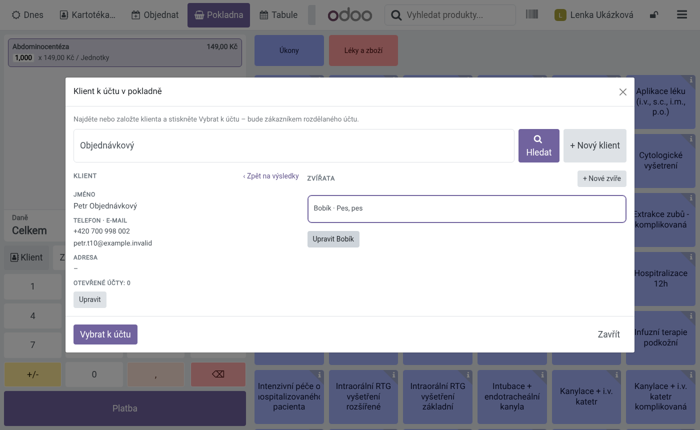

## 4. Objednat

**Objednat** (Book) goes through numbered steps from top to bottom. A finished step has a coloured
number, and the next step appears once the previous one is filled in.

1. **Klient a zvíře** (Client and pet): type straight into the search field in the step (name, phone,
   chip or pet's name, at least 2 characters). Results appear under the field by themselves, one row per
   pet, for example "Rex (pes) · Jana Nováková · 777 123 456" (deceased pets and staff are not offered).
   A click on the row (or Enter on the first one) selects the pet and the step keeps "Rex · Jana
   Nováková". If the client did not show up in the last 12 months, there is a yellow warning under them,
   "Klient 2× nedorazil, naposledy 12. 10" (client did not show up twice, last on 12 Oct; hover for the
   list). This is for information only, you can book as usual. **Změnit** (Change) opens the search
   again, **Upravit** (Edit) opens **Kartotéka** (Client file) on this client (edit the contact or pet,
   then **Vybrat**, Select).
   New client: **+ Nový klient** (+ New client) next to the field opens **Kartotéka** straight on the new
   client form (with the first pet); after saving, click **Vybrat**. An owner without a pet has a row
   "bez zvířete – přidat zvíře…" (no pet, add a pet) in the search, which opens the new pet form.
2. **Úkon** (Procedure): the most frequent procedures of the last 30 days are big buttons (each with its
   length), just click one. Others are under **Jiný úkon…** (Other procedure; a list with a search); the
   chosen procedure then shows highlighted next to the frequent ones.
3. **Den** (Day): above the row of days is a green button with the **earliest free time**, for example
   "Nejdřív: dnes 14:30 · Ordinace 2 · MVDr. Malá" (Earliest: today). One click fills in the day, room and
   time, and all that's left is to book. The row of seven days shows the number of free times for each
   ("10 volných", 10 free); **"nic volného"** (nothing free) is an open but fully booked day, a grey
   **"zavřeno"** (closed) is a day when the procedure cannot be done at all (room closed, an all-day block,
   or nobody on duty when a doctor is needed), and you cannot click it. If the chosen day has nothing free
   after you pick a procedure, the selection jumps by itself to the first day in the row with free times.
   A public holiday has a red frame in the row of days and the word **svátek** (holiday; hover for its
   name); you can select it normally. The **‹ ›** arrows move by a week (not earlier than today), and the
   date field under them picks another date. If the chosen day has nothing free, a button with the
   **next free day** appears.
   If the client wants a specific doctor, click **jen lékařka…** (only doctor…) on the right and pick her;
   days, rooms, times and the earliest free time are then calculated for her only. The cross by her name
   removes the filter.
4. **Ordinace** (Consulting room): only when the procedure has free times that day in several rooms. Each
   room shows its doctor (if one doctor has it all day) and the number of free times. If only one room is
   free, it is selected by itself and this step does not appear. The chosen room stays after you change
   the day.
5. **Čas** (Time): the free times of the chosen room, split into morning and afternoon. They are calculated
   the same way as in the calendar and on the web.
   Below them is the row **Obsazený čas:** (Taken time) for a time that is not offered because another
   reservation or a WinVet entry is already there. Enter the time, pick the room and click **Vybrat**
   (Select). After **Objednat** (Book) the window **Termín je obsazený** (The time is taken) opens and says
   what is there: **Přesto objednat** (Book anyway) saves the reservation, **Zpět** (Back) saves nothing.
   This does not work over a full block. A time with nothing in it where the procedure is simply not
   offered is refused ("Čas … se pro tento úkon v této ordinaci nenabízí – vyberte jiný.", this time is
   not offered for this procedure in this room, pick another).

At the bottom is a one-sentence **summary** of the whole booking, for example "Rex · Kontrola · čt 22. 10.
2026 9:30 · Ordinace 2 · MVDr. Malá" (on a public holiday with a red notice "Státní svátek: …"; you can
book as usual), under it an optional **poznámka** (note) and the **Objednat** (Book) button. Check the
summary and click. A confirmation appears, "Objednáno: čt 22. 10. 2026 9:30 · Rex" (Booked); the
reservation is confirmed and is in **Kalendář** (Calendar) and under **Přicházejí** (Arriving) on that day.

Then the **form empties** for the next client (client and pet, procedure, doctor, room, time, note); only
the day stays. The green confirmation disappears as soon as you start the next booking.

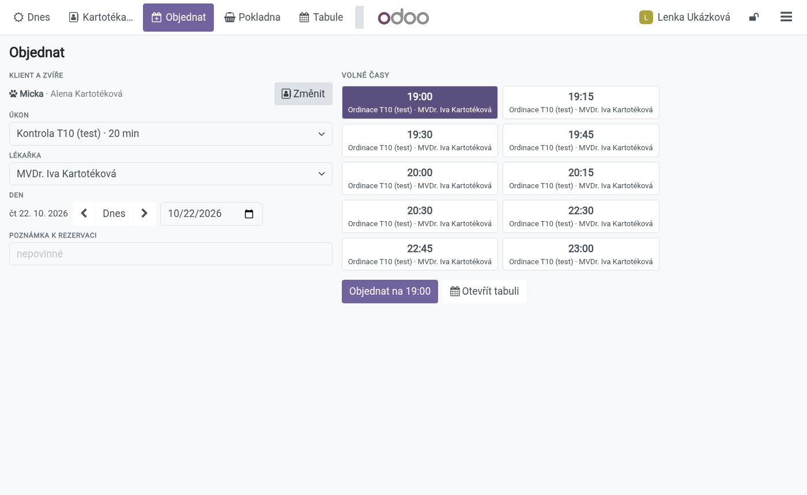

**E-mail to the client:** if the owner has an e-mail in the client file, they get the reservation
confirmation automatically (the same as from the wizard in the **Rezervace** app). Without an e-mail nothing
is sent, so tell them the time.

If another reservation took the time in the meantime (web, a colleague), the same **Termín je obsazený**
(The time is taken) window appears: pick another time, or click **Přesto objednat** (Book anyway). If a
full block has appeared there in the meantime, you get "Termín … už mezitím někdo obsadil – vyberte jiný."
(Someone has already taken this time, pick another) and the times reload. A deceased pet cannot be booked.

**Kalendář** (Calendar) next to **Objednat** opens the calendar of the chosen day in a window above the
till (chapter 5); the chosen client stays.

In **Přesunout rezervaci** (Move reservation) mode, started from **Kalendář**, **Nepřesouvat** (Don't move)
or another click on **Objednat** in the bar takes you back to normal booking. The procedure and time of
the moved reservation are dropped, and the form starts from choosing a procedure.
When moving, the **Klient a zvíře** step is missing; the summary shows the pet being moved and the button
is **Přesunout** (Move).

## 5. Kalendář

The **Kalendář** (Calendar) button in the bar (or **Kalendář** next to **Objednat**, Book, on that tab) opens
a large window with the day's calendar right above the till. The till and any bill in progress underneath
do not change, and nothing switches to another page.

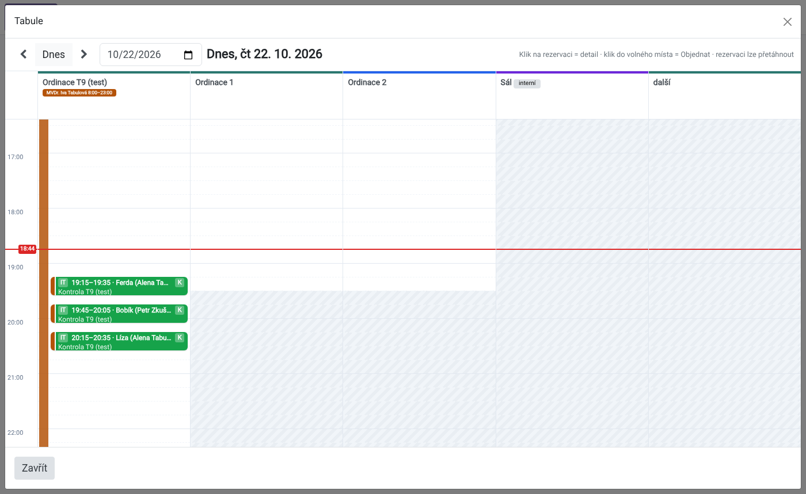

*This is an older picture: the title is now **Kalendář**, the **Vše | Web | Klinika** switch with its legend has been added, and reservations are white cards with coloured stripes.*

- **Columns** are the consulting rooms (each with the doctors on duty and their times), with a time axis on
  the left; the red line is now. Hatching means outside opening hours, grey hatched bars are blocks ("jen
  web", web only, are light: reception may book there). Reservations that were in the time of a full
  block before it lie over it and stay valid; nothing new can be booked there.
- Yellow lines above the shifts are **room notes for the day** (written in the Rezervace app, read-only
  at the till).
- A vertical coloured bar at the left edge of a column is a **doctor's shift** (initials and time).
- **Web or clinic:** under the top bar is the **Vše | Web | Klinika** (All | Web | Clinic) switch and a
  one-line legend:

  | Label on the left of the card | Meaning |
  |---|---|
  | Blue **WEB** | Reservation from the web: the client booked themselves. |
  | White label with initials, e.g. **JN** | Created by someone at the clinic. On hover: "Založil(a): Jana Nováková, 26. 10. 2026 9:12" (Created by). |
  | Grey **WinVet** | Entry from the WinVet calendar, read-only. |

  **Web** shows only web reservations, **Klinika** only those created at the clinic; WinVet entries are
  only under **Vše**, blocks are always visible. The browser remembers the choice (the till separately
  from the calendar in the **Rezervace** app). When the filter hides something, "skryto: N" (hidden: N)
  shows on the right; hidden time is still taken.
- **Reservations** are white cards with a stripe on the right in the procedure's colour, a stripe on the
  left in the doctor's colour, the WEB label or the initials of whoever created it, the doctor's initials,
  the time, pet (owner), the procedure's short code and the label **k pokladně** (to pay) / **zaplaceno**
  (paid). If a reservation has a **Popis** (Description), it comes before the pet's name. Past reservations
  are faded; reservations marked Nedorazil (No-show) are not in the calendar (the time is free). A red outline means the client asks to cancel (chapter 2). Reservations that
  overlap stand side by side.
- **WinVet entries** are light grey cards with a **WinVet** label (a stripe in the WinVet colour; the pet
  and owner from the client file, otherwise the WinVet text). They are read-only: they cannot be dragged and
  a click does nothing (on hover they show the time and activity). Their time is taken, so **Objednat** does
  not offer it. All-day WinVet entries are "WinVet · …" labels in the room's head and block nothing.
- On a public holiday there is a red label by the date, "Státní svátek: …" (if the web does not take
  bookings on holidays, with "· web neobjednává", the web does not book).
- **‹ Dnes ›** (Today) and the date field switch the day; the calendar scrolls to "now" (today) or, for
  another day, to the start. With many rooms the calendar also scrolls sideways.
- The calendar refreshes itself (a change from the web, a colleague or the **Rezervace** app shows at once,
  with a fallback every 30 s).
- **Zavřít** (Close) or the cross takes you back to where you were.

### Clicking a reservation

A window with the detail opens: client (and phone), pet, procedure, doctor, time and room, state and **Zdroj**
(Source: "WEB z webu – objednal(a) se klient sám", from the web, the client booked themselves; or "Klinika –
založil(a) Jana Nováková", clinic, created by, with the date and time). When filled in, **Popis**
(Description), **Důvod návštěvy** (Reason for visit) and **Poznámka** (Note) are there too.

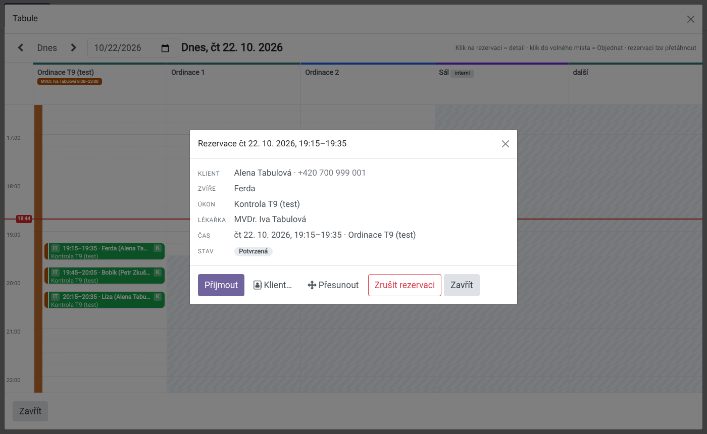

*This is an older picture: the **Zdroj** row and the **Nedorazil** button are missing from it.*

- **Přijmout** (Check in): only for today's reservation that has no visit yet; the pet then goes to the
  waiting room (the same as **Přijmout** on the **Dnes** tab, including the window for the internal note for
  the room). A web reservation without a paired client can be checked in only after **Klient…**.
- **Klient…** (Client…): **Kartotéka** (Client file) for this reservation (the same as **Klient…** on the
  **Dnes** tab, chapter 2): pick the client and pet and **Přiřadit k rezervaci** (Assign to reservation). The
  calendar stays open underneath. Past reservations and no-shows have no **Klient…**.
- **Přesunout** (Move): the window closes and the **Objednat** (Book) tab opens in **Přesunout rezervaci**
  (Move reservation) mode: the procedure and doctor are prefilled; pick the day and a free time and click
  **Přesunout**. **Nepřesouvat** (Don't move) ends the mode.
- **Zrušit rezervaci** (Cancel reservation): asks once more in the window ("Opravdu zrušit? Klientovi odejde
  e-mail o zrušení.", really cancel? The client will get a cancellation e-mail; without an e-mail, "Opravdu
  zrušit tuto rezervaci?") and after **Ano, zrušit rezervaci** (Yes, cancel reservation) cancels it. **Ne**
  (No) leaves everything as it was. The cancellation e-mail goes out just as when cancelling in the
  **Rezervace** app, only if the reservation has an e-mail. In that case the window also has the field
  **Zpráva klientovi (nepovinné)** (Message to the client, optional), for example the reason or an offer of
  another time; the text goes into the e-mail.
- **Nedorazil** (No-show): on a confirmed reservation from today or earlier where the client did not come
  (no visit yet). It asks "Označit Rex · Jana Nováková v 9:00 jako nedorazil?" (Mark as no-show?), and after
  **Ano, nedorazil** (Yes, no-show) gives the reservation the state **Nedorazil**, just like the **Nedorazil**
  button in the **Rezervace** app; nothing is sent to the client. The calendar refreshes and the client has
  the label **Nedorazil N×** in **Kartotéka**. A future reservation, a checked-in client and a copy in a
  second room have no such button (the copy is marked together with the main reservation).

A reservation that already has a visit (the client is checked in) cannot be moved or cancelled: **Přesunout**
and **Zrušit rezervaci** are not shown. For a joint procedure of two doctors, only the main reservation is
moved and the copy in the second room moves with it (the copy has neither **Přesunout** nor dragging).

### Dragging a reservation

You can drag a confirmed reservation with the mouse to another time or room (on a touch screen, use
**Přesunout**, Move, in the detail). When you let go, the window "Přesunout rezervaci?" (Move reservation?)
opens with the fields **Datum** (Date), **Od** (From), **Do** (To) and **Ordinace** (Consulting room),
prefilled from where you dropped it, and a sentence "Přesunout … z … na …?" (Move … from … to …?). If you
missed, correct the time (in booking steps), day or room right in the window; the sentence changes with them.
**Do** moves with **Od** (the length stays); overwriting **Do** makes the reservation longer or shorter. If
the client would get an e-mail about the changed time, the window says so and shows **Poslat klientovi e-mail
o změně** (Send the client an e-mail about the change), ticked; when unticked, this move happens without an
e-mail (the reservation history keeps "Klient nebyl o změně informován.", the client was not told). Only
**Přesunout** moves the reservation; **Zrušit** (Cancel) leaves everything as it was. The same rules apply as
in the calendar in the **Rezervace** app: a doctor who does the procedure should be on duty in the room (if
the current doctor is not on duty there, she is replaced by the one who is), and the time should be free. If
that is not possible, a message in Czech appears in the window (for example "Termín … je obsazený", the time
is taken), the window stays open and the reservation stays where it was. Pick another time, or click **Přesto
přesunout** (Move anyway): the move goes through and the reservation history keeps a note. This button
appears when the problem is another reservation, a WinVet entry or the doctor on duty. A reservation cannot
be moved over a full block.
When the time changes, the client gets an e-mail about the move, if they have one and you did not untick it.

### Clicking a free spot

The window closes and **Objednat** (Book) opens with the day prefilled and, at the top, a strip "Z kalendáře:
ordinace, den, čas" (From the calendar: room, day, time). Pick the procedure: if that time is free for it, it
is selected at once ("Čas je vybraný.", the time is selected); otherwise pick from the day's free times. The
chosen client (if you came from **Objednat**) stays.

Web requests and new blocks are handled in the calendar in the **Rezervace** app
([Reservations guide](../../../elite_vet_reservation/doc/en/recepce.md)); this cannot be done at the till.

## 6. End of the day: cash closing

1. Check that nobody who has already left and should have paid remains in **K pokladně** (To pay; unpaid
   bills stay there tomorrow too).
2. Do the closing according to the guide
   [Till and stock](../../../elite_vet_sale/doc/en/pokladna-a-sklad.md), chapter 7:
   ☰ → **Zavřít pokladnu** (Close till), count the cash, **Zavřít relaci** (Close session).

**Zavřít pokladnu** in the ☰ menu is visible only to an employee with **pokročilé oprávnění** (advanced
rights, set by management, chapter 11) or an employee linked to the Odoo user under which the till is open.
If you don't see it in the menu, log in with the PIN of the employee who does the closing.

## 7. Switching the operator and locking

- **Locking:** the lock icon at the top right (next to the name). The till locks, and nobody can do anything
  without a PIN. Lock it when you leave the till.
- **Switching the operator:** lock it, and your colleague logs in with her PIN (**Odblokovat pokladnu**,
  Unlock till). The till returns to **Dnes** (Today), or to **Pokladna** (Till) if you were there. Orders in
  progress stay.
- Who checked the client in is recorded on the visit; who took the payment is on the receipt ("Obsluha …",
  Served by).

---

# Part B: doctors and nurses

## 8. Moji pacienti dnes

After login, doctors and nurses get **Karta pacienta** (Patient card) in the **Ordinace** (Consulting rooms)
app. A room account and an account linked to a team member start on the **Ordinace** screen and find **Karta
pacienta** in the menu. Under the search field is **Moji pacienti dnes** (My patients today): an account
paired with a doctor sees her patients (booked and without a booking), an account without pairing sees
everyone.

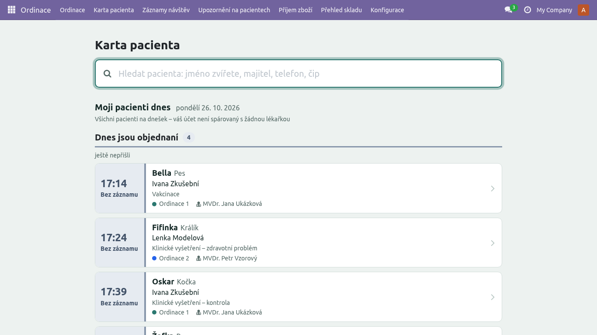

A patient looks the same as on the **Ordinace** screen: on the left a coloured strip with time and state
(orange waiting, green in the room, blue-grey booked, grey done), on the right the pet, owner, procedure, room
and doctor (the doctor only where the list shows all patients). A click on the patient opens their card.

| Group | Who is in it |
|---|---|
| **Dnes jsou objednaní** (Booked today; ještě nepřišli, not arrived yet) | today's reservations reception has not checked in yet (WinVet bookings appear only after check-in) |
| **Čekají** (Waiting) | checked in by reception, by arrival: the booked time in large type (for clients without a booking, the arrival), under it "příchod 18:05" (arrival), "Čeká 6 min" (waiting 6 min), the **Zavolat** (Call in) button. Clients without a booking have "bez objednání"; those with no doctor have "**Kterákoli lékařka**" (Any doctor) and all doctors see them. |
| **V ordinaci** (In the room) | called in, "V ordinaci od 18:15" (in the room since) |
| **Hotovo dnes** (Done today) | closed visits (**Hotovo, k pokladně**, Done, to the till) |

The order is the same as on the **Ordinace** screen; on a narrower screen (under 1100 px) **Čekají** comes
first, then **V ordinaci**, **Dnes jsou objednaní** and **Hotovo dnes**.

The list refreshes itself as soon as reception checks someone in (with a fallback every 30 s).

If reception wrote a **poznámka recepce** (reception note) at check-in, it is shown by the patient in yellow
(with a note icon), and in the patient card as a yellow strip under the header, "Poznámka recepce …". It is
internal, the client does not see it.

## 9. Calling in and treatment

1. For a patient under **Čekají** (Waiting), click **Zavolat** (Call in). The patient moves to **V ordinaci**
   (In the room) and their card opens. A "kterákoli lékařka" (any doctor) patient becomes yours: from then on
   they are only in your list.
2. Reception sees **V ordinaci** at once by the patient. Note: if you only open the card of a waiting patient
   (by clicking in the list or from the search), the patient is not moved into the room and stays under
   **Čekají**.

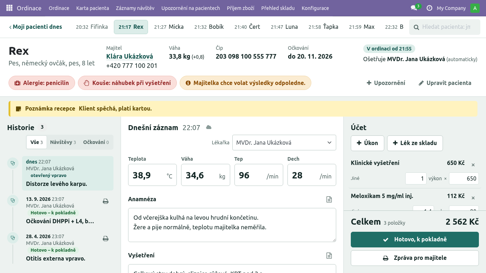

*This is an older picture: the record now has one **Záznam z vyšetření** field instead of the Anamnéza and Vyšetření fields, and the card header is lower.*

3. Record the visit and the bill in the patient card (**Úkon**, Procedure; **Lék ze skladu**, Medicine from
   stock; **Přidat balíček**, Add bundle). The layout of the card is described in
   [Ordinace, 7. Patient card](ordinace.md#7-patient-card).
4. Above the **Hotovo, k pokladně** (Done, to the till) button you can write a **Poznámka pro recepci** (Note
   for reception; internal, the client will not see it). Reception sees it on the bill under **K pokladně**
   (To pay) and before the payment. It saves itself; you can correct or delete it even after the record is
   closed (as long as it is not cancelled).
5. At the end click **Hotovo, k pokladně** and confirm. The patient moves to **Hotovo dnes** (Done today) and
   reception sees them at once in the **K pokladně** column. For details (labels, reopening, a bill in
   progress at the till), see the guide
   [Till and stock](../../../elite_vet_sale/doc/en/pokladna-a-sklad.md), chapter 1.

---

# Part C: management

## 10. Roles and home screens

Roles are assigned in **Nastavení → Uživatelé** (Settings → Users; the Elite Vet groups: **Recepce** <
**Sestra** < **Lékařka** < **Správce rezervací**, that is Reception < Nurse < Doctor < Reservation manager =
management). A higher role has everything a lower one has, except the till and stock (see below).

| Role | After login | Menu |
|---|---|---|
| **Recepce** (Reception) | the **Recepce** till | **Prodejní místa** (Point of Sale, the till), from the **Ordinace** app only the **Ordinace** screen, **Rezervace** (Reservations), **Diskuze** (Discuss), from **Sklad** (Inventory) only **Přehled skladu** (Stock overview) and **Příjem zboží** (Goods receipt) |
| **Sestra**, **Lékařka** (Nurse, Doctor) | **Karta pacienta** (**Moji pacienti dnes**); a room account and an account linked to a team member: the **Ordinace** screen | **Ordinace**, **Rezervace**, **Diskuze**, without the till and stock |
| Management | **Přehled tržeb a výdajů** (Revenue and expense overview) | everything |

- **Pokladna a sklad (recepce)** (Till and stock, reception) is a separate field on the user form (section
  "Elite Vet – pokladna"), outside the role selection. It gives the till, quotations, **Přehled skladu** and
  **Příjem zboží**. When you set a user's role to **Recepce**, they get it automatically; when you change the
  role to **Sestra** or **Lékařka**, it is removed (with the till and stock rights). If a nurse should also
  receive goods, turn it on by hand **after** setting the role; a manual change stays. Management always has it.
- Doctors and nurses still close bills (**Hotovo, k pokladně**, Done, to the till) and see the payment state
  in the patient card and in the calendar; they cannot get into the till or the stock.
- The home screen is set automatically when you give a user a role (or change it). A custom home screen the
  user has set by hand is not overwritten.
- **Nastavit výchozí obrazovky** (Set home screens): **Nastavení → Uživatelé** → tick any user in the list →
  **Akce → Nastavit výchozí obrazovky** (Action → Set home screens). It sets the home screens of **all**
  internal users by role, not only the ticked ones (custom ones stay). Use it when you changed members directly
  on the group form.
- **Hidden menus:** **Prodej** (Sales), **Fakturace** (Invoicing), **Zaměstnanci** (Employees), **WinVet data**,
  **Rozpis služeb** (Shift schedule), **Web** and **Přehledy** (Dashboards) are visible only to management,
  **Aplikace** (Apps) only to the system administrator. Reception sees only the **Ordinace** screen in the
  **Ordinace** app. Nurses and doctors do not see **Prodejní místa** or **Sklad**. Doctors see shifts in the
  calendar.
- **The accountant** needs the management role: **Fakturace** is for management only.
- Everyone who **opens the till** in the morning must have an **e-mail** filled in on their user. Without it
  Odoo refuses to open ("nakonfigurujte e-mailovou adresu odesílatele", configure the sender's e-mail address).
- **Read-only mode:** **Nastavení › Elite Vet › Provoz** (Settings › Elite Vet › Operation) › **Ordinace, karty
  a pokladna jen pro čtení** (Consulting rooms, cards and till read-only). Only the system administrator sees
  the switch. When on, it applies to everyone except the **Správce rezervací** role. What it does is described
  under [Read-only mode](#read-only-mode).

## 11. Employees with a PIN

Anyone who logs in to the till with a PIN must be an **employee** in the **Zaměstnanci** (Employees) app.

1. **Zaměstnanci → Nové** (Employees → New): the name (this shows at the till and on the receipt).
2. **Nastavení** (Settings) tab → **PIN kód** (PIN code): four digits the employee remembers. The field
   **Příslušný uživatel** (Related user) links the employee to their Odoo login (optional).
3. **Uložit** (Save).

   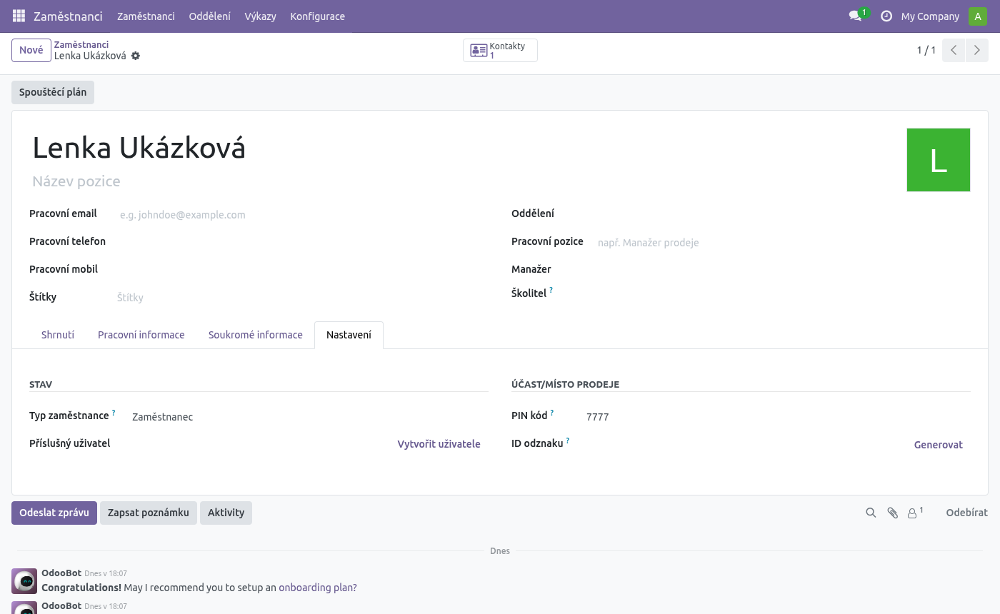

4. Allow them on the till: **Prodejní místa → Konfigurace → Nastavení** (Point of Sale → Configuration →
   Settings), pick the **Recepce** till at the top, section **Rozhraní PoS** (PoS interface) → **Přihlásit se
   jako zaměstnanec** (Log in as employee):
   - **Základní oprávnění** (Basic rights): receptionists (check in, book, take payments),
   - **Pokročilé oprávnění** (Advanced rights): who may do the closing, correct payments, and put in and take
     out cash (management, possibly the head of reception).

   When both fields are empty, every employee of the company can log in.
5. **Uložit** (top left). The new employee appears at the till after it is reloaded.

   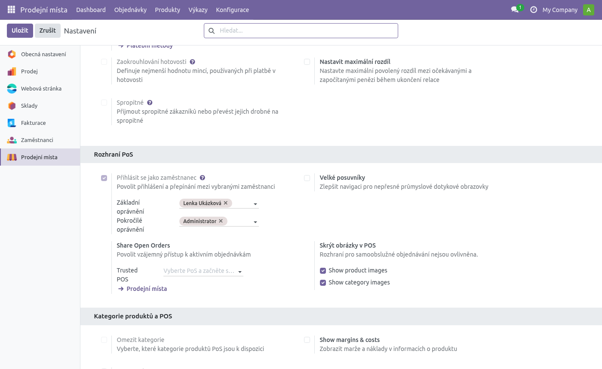

**Close the till (cash closing) before updating modules.** While the till is open, PIN login cannot be switched
on or changed, and the update only writes this to the log.
