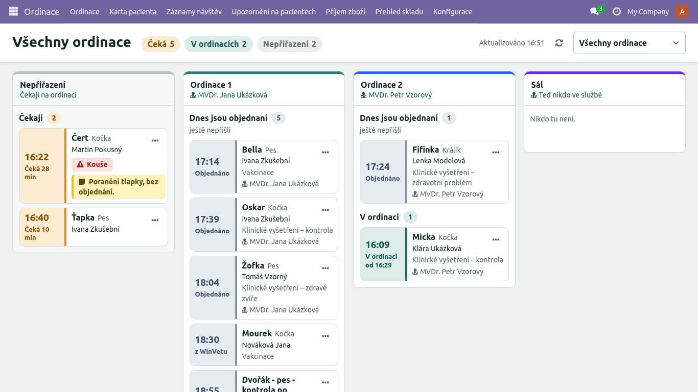
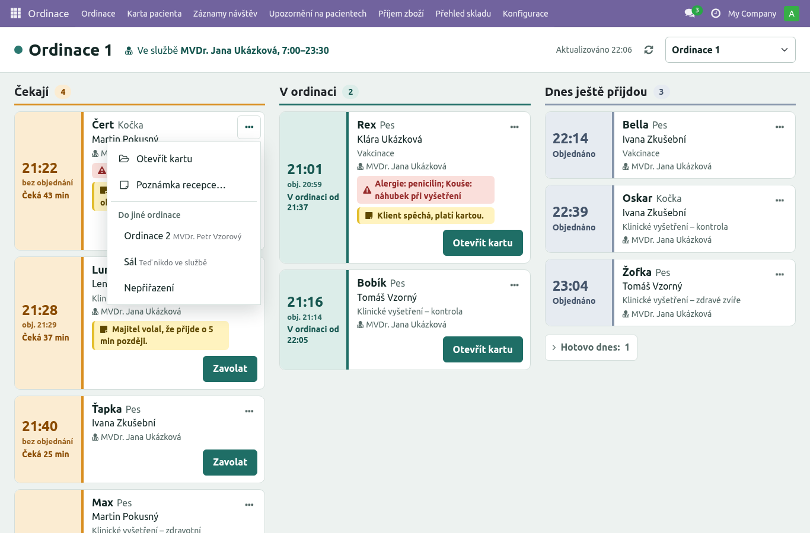
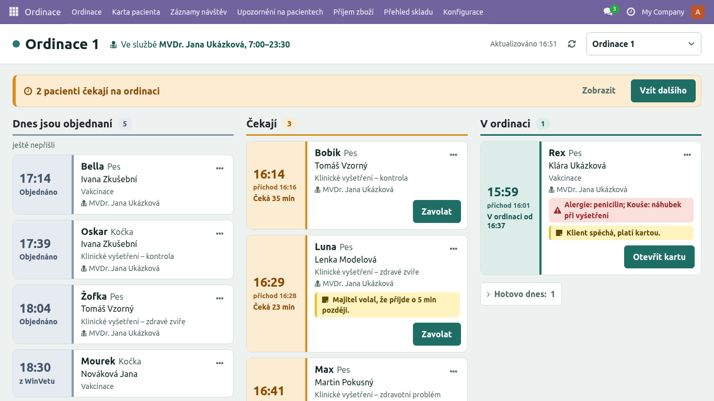

# Obrazovka Ordinace – návod pro ordinace, recepci a vedení

Obrazovka **Ordinace** ukazuje dnešní pacienty rozdělené podle ordinace, do které jsou přiřazení,
a pacienty, kteří ještě žádnou ordinaci nemají (**Nepřiřazení**). Otevře se v menu
**Ordinace › Ordinace** (první položka). Vidí ji lékařky, sestry, recepce i vedení.

## 1. Účet ordinace

Ordinace může mít jeden společný účet, například „Ordinace 1“ a „Ordinace 2“. Přihlásí se na
počítači v ordinaci a používají ho všechny lékařky, které v ní slouží. Vedle toho může mít každý
člen týmu **vlastní účet** (kapitola 6) – ten není svázaný s ordinací.

- Po přihlášení se otevře obrazovka Ordinace rovnou na **své ordinaci**, a to pokaždé.
- Účet má práva lékařky: kartu pacienta, záznamy návštěv a rezervace, ale ne pokladnu a sklad.
- Kdo je u návštěvy zapsaný jako lékařka, se bere z **Rozpisu lékařů** (viz bod 4), ne z účtu.
  U zavolání a přijetí zůstává zapsaný účet ordinace. To je v pořádku.

**Nastavení (vedení):** Nastavení › Uživatelé › nový uživatel (např. „Ordinace 1“). V záložce
**Přístupová práva**:

1. Roli dejte **Lékařka** (nebo Sestra).
2. V části **Elite Vet** vyberte v poli **Ordinace** tu ordinaci.

Výchozí obrazovka se nastaví sama. Když pole Ordinace smažete, účet se vrátí na kartu pacienta.

## 2. Záhlaví a přepínač

Nahoře je název ordinace a **kdo v ní teď slouží** i s časem služby („Ve službě MVDr. …,
7:00–14:00“). Když teď nikdo neslouží, je tam „Teď nikdo ve službě“ a dnešní služby. Vpravo je
čas poslední aktualizace, tlačítko ⟳ a **přepínač ordinací** (rozbalovací seznam, první je
**Všechny ordinace**). Prohlížeč si volbu pamatuje. Účet ordinace ale vždy začne na své
ordinaci. Vlastní účet lékařky nebo sestry začne na ordinaci, kde má podle Rozpisu lékařů službu
(kapitola 6).

**Pacient** vypadá všude stejně – na obrazovce Ordinace i v Moji pacienti dnes:

- vlevo **barevný pruh s časem**: barva říká stav – **oranžová čeká**, **zelená je v ordinaci**,
  **modrošedá je objednaná** (ještě nepřišla), **šedá je hotová**. Velký čas je příchod (u toho,
  kdo ještě nepřišel, čas rezervace), pod ním „obj. 9:20“, když přišel jindy než na objednaný čas,
  nebo „bez objednání“, a stav: **Čeká 12 min** / **V ordinaci od 9:25** / **Objednáno** / **Hotovo**;
- vpravo zvíře (druh), majitel, úkon a lékařka;
- **upozornění** na pacientovi červeně (kouše, alergie…);
- **poznámka recepce** žlutě s lístečkem – co recepce napsala při příjmu, např. „Klient
  spěchá“. Je interní, klient ji nevidí;
- jedno **hlavní tlačítko** podle stavu: u čekajícího **Zavolat**, u pacienta v ordinaci
  **Otevřít kartu**. Všechno ostatní je v nabídce **…**: **Otevřít kartu** (u čekajícího
  a objednaného), **Poznámka recepce…** (upravit nebo smazat) a **Do jiné ordinace** (seznam
  ordinací přímo v nabídce, a Nepřiřazení).

Obrazovka se obnovuje sama: hned po každé změně (příjem, zavolání, přesun, Hotovo) a nejpozději
každých 30 sekund. Tlačítkem ⟳ ji obnovíte hned.

## 3. Všechny ordinace

Nahoře je souhrn: kolik pacientů **čeká**, kolik je **v ordinacích** a kolik je **nepřiřazených**.
Pod ním jsou sloupce **Nepřiřazení** a pak jedna ordinace vedle druhé. V hlavičce ordinace je,
kdo v ní **teď slouží** (podle Rozpisu lékařů), nebo „Teď nikdo ve službě“.

Ve sloupci jsou části ve stejném pořadí jako v jedné ordinaci:
- **Dnes jsou objednaní** (ještě nepřišli): dnešní objednávky této ordinace, klient ještě nedorazil
  nebo ho recepce ještě nepřijala. Tyto karty nejdou přesouvat,
- **Čekají**: pacient přišel a recepce ho přijala,
- **V ordinaci**: pacient je zavolaný,
- **Hotovo dnes: N**: uzavřené návštěvy, sbalené; klikem se rozbalí.

Prázdná část se neukazuje; prázdná ordinace má jen „Nikdo tu není.“

**Přesun do ordinace:** pacienta, který už přišel (Čeká nebo V ordinaci), přetáhněte myší do
sloupce jiné ordinace. Přetažením do **Nepřiřazení** ordinaci zrušíte. Na dotykové obrazovce
použijte nabídku **…** › **Do jiné ordinace** a vyberte ordinaci.

Přesun mění jen ordinaci návštěvy. **Rezervace zůstane ve své ordinaci**, takže tabule rezervací
ukazuje pořád původní ordinaci.

## 4. Jedna ordinace

Když na ordinaci čekají přijatí pacienti bez ordinace (typicky klienti bez objednání), je nahoře
oranžový pruh „**2 pacienti čekají na ordinaci**“:
- **Vzít dalšího** vezme do této ordinace toho, kdo čeká **nejdéle**;
- **Zobrazit** rozbalí jejich seznam; u každého je **Vzít do této ordinace**.

Pod pruhem jsou zleva doprava tři sloupce, jak den plyne: **Dnes jsou objednaní** (ještě
nepřišli) | **Čekají** (nejdéle čekající nahoře) | **V ordinaci**. Pod posledním je sbalené
**Hotovo dnes: N**. Prázdný sloupec má jen krátký řádek („Všichni objednaní už přišli.“,
„Nikdo nečeká.“). Kdo přišel, už mezi objednanými není – je v Čekají nebo V ordinaci.

Na užší obrazovce (tablet, i 1024 px na šířku) jsou sloupce pod sebou a **Čekají jsou první**,
pak V ordinaci (s Hotovo dnes) a nakonec Dnes jsou objednaní – když je málo místa, jsou
nejdůležitější pacienti, kteří už čekají.

- **Zavolat** (u čekajícího): pacient jde do stavu V ordinaci a do této ordinace.
- **Otevřít kartu** (u pacienta v ordinaci, ostatní v nabídce …): otevře kartu pacienta na dnešní
  návštěvě, stejně jako v „Moji pacienti dnes“. Zpět se vrátíte drobečkovou navigací nahoře
  (Ordinace).
- Návštěvu uzavírá karta pacienta jako dosud: **Hotovo, k pokladně**.

### Kdo je zapsaný jako lékařka

Když pacient nemá lékařku a dostane ordinaci (Zavolat, Vzít do této ordinace, přetažení), zapíše se
lékařka, která v té ordinaci **teď slouží** podle Rozpisu lékařů.

- Slouží jedna lékařka: zapíše se ona.
- Slouží dvě: obrazovka se zeptá **Kdo pacienta převezme?** (i po Vzít dalšího). Můžete zvolit „Zatím nevybírat“
  a lékařku doplnit v kartě pacienta.
- Neslouží nikdo: lékařka zůstane prázdná. Doplňte ji v kartě pacienta (pole Lékařka).
- Pacient, který lékařku už má (z rezervace nebo z příjmu), ji **nezmění** ani při přesunu do jiné
  ordinace. Změnit ji jde kdykoli v kartě pacienta.
- Lékařka přihlášená **vlastním účtem** (kapitola 6) se zapíše sama, když pacienta zavolá nebo vezme
  do ordinace (i Vzít dalšího) – i místo lékařky, která se doplnila automaticky (z rozpisu nebo z rezervace). Ručně
  vybranou lékařku nemění.

## 5. Recepce

- Objednaný klient po **Přijmout** dostane ordinaci ze své rezervace.
- **+ Bez objednání**: ordinaci můžete vybrat (pole **Ordinace**), ale nemusíte. Bez ní je pacient
  v Nepřiřazení a ordinace si ho vezme.
- V pokladně v záložce Dnes, ve sloupci **Čekárna a ordinace**, je u pacienta jeho ordinace, pokud
  ji má.
- Na obrazovce Ordinace může recepce pacienty přesouvat mezi ordinacemi a upravit poznámku recepce
  (nabídka …). Zavolat může jen sestra nebo lékařka.

**Objednávky z WinVetu bez karty.** Objednávka z WinVetu, ve které je jen text (bez pacienta),
je v „Dnes jsou objednaní“ s textem z WinVetu. V nabídce **…** je **Spárovat…**: otevře Kartotéku
(stejnou jako v pokladně), kde najdete nebo založíte klienta a zvíře a stisknete **Přiřadit
k objednávce**. Pak je u objednávky zvíře a v nabídce **Otevřít kartu**.

 Spárovat můžou recepce,
sestra i lékařka; uloží se jen v Odoo (viz návod Recepce v pokladně › Objednaní ve WinVetu).

„Moji pacienti dnes“ v kartě pacienta ukazují lékařce s vlastním účtem její dnešní pacienty.
Účty ordinací používají obrazovku Ordinace.

## 6. Účty členů týmu

Každý člen týmu (Rozpis služeb › **Lékařky** – lékařky, sestry i recepce) může mít vlastní
přihlašovací účet. Účet **není svázaný s ordinací**: lékařka se přihlásí kdekoli a pracuje v kterékoli
ordinaci. Propojení je ve sloupci **Účet** (jeden účet = jeden člen týmu). Na formuláři uživatele
je v Přístupových právech › Elite Vet jen pro čtení **Člen týmu**.

**Co propojený účet dělá:**
- Lékařka a sestra po přihlášení přistanou na obrazovce **Ordinace**, předvybraná je ordinace, kde
  mají **teď službu** podle Rozpisu lékařů. Když teď službu nemají, pak ordinace jejich **další
  dnešní služby**, jinak **Všechny ordinace**. Ruční přepnutí platí, dokud v obrazovce pracují (i po
  návratu z karty pacienta tlačítkem zpět vlevo nahoře v kartě). Při dalším otevření – nové
  přihlášení, obnovení stránky, tlačítko Zpět prohlížeče – je zase ordinace ze služby.
- **Kdo pacienta převzal:** když lékařka (role Lékařka) pacienta zavolá, vezme do ordinace nebo
  přetáhne do ordinace, zapíše se jako jeho lékařka – pokud pacient lékařku nemá nebo ji má jen
  automaticky (z rozpisu nebo z rezervace). Ručně vybranou lékařku nepřepíše. Sestra, recepce
  a účet ordinace lékařku dál neurčují (zapisuje se podle rozpisu). Platí pro členy týmu se
  zaškrtnutým *Lékařka – přijímá rezervace*.
- **Ošetřující lékařka v kartě pacienta:** když lékařka s vlastním účtem v záznamu návštěvy něco
  změní (vitální hodnoty, anamnéza, vyšetření, diagnóza, poznámka pro recepci, položky účtu, Hotovo),
  zapíše se jako lékařka záznamu – zase jen místo prázdné nebo automatické. Kdo byl první, zůstává;
  další lékařky, které záznam upraví, se ukážou jako „upravovaly také“ a jsou v historii záznamu.
  Nad záznamem je „**Ošetřuje:** MVDr. …“. Sestra a recepce lékařku úpravou nemění.
- **Moji pacienti dnes** v kartě pacienta jsou podle propojení (dřív se lékařka hledala podle jména
  uživatele).
- Recepce s vlastním účtem dál začíná v pokladně, vedení na svém přehledu.

**Vytvořit účty (vedení):** Rozpis služeb › Lékařky › tlačítko **Vytvořit účty** (nebo Akce ›
Vytvořit účty). Otevře se seznam aktivních členů týmu, kteří ještě účet nemají:
- **Přihlašovací jméno** = e-mail z jejich karty v Náš tým. Kdo e-mail nemá, má řádek prázdný –
  doplňte ho, jinak ho nejde vytvořit.
- **Role**: Lékařka u těch, kdo přijímají rezervace, jinak Sestra. Jde změnit na Recepce / Sestra /
  Lékařka / Správce rezervací.
- **Vytvořit**: zaškrtnuté řádky se založí. Přihlašovací jména musí být jiná než u všech ostatních
  účtů; když ne, okno řekne, u kterého řádku.
- **Poslat pozvánku e-mailem** (vypnuté): po zaškrtnutí dostane každý nový účet standardní pozvánku
  Odoo s odkazem na nastavení hesla. Bez zaškrtnutí se nic neposílá a heslo nastaví vedení
  (Nastavení › Uživatelé › účet › Akce › Změnit heslo).

Nové účty dostanou jazyk čeština, časové pásmo Europe/Prague a žádné heslo. Role nastaví samo
výchozí obrazovku a pokladnu (pokladnu dostane jen Recepce). Na konci se ukáže, kolik účtů vzniklo
a kolik řádků se přeskočilo a proč.

## 7. Karta pacienta

- **Záhlaví** má dva řádky: nahoře jméno zvířete, druh, plemeno, pohlaví a věk, stav dnešní
  návštěvy („**V ordinaci od 9:25**“, „Čeká od 9:05“, „Hotovo, čeká u pokladny“),
  **Ošetřuje MVDr. …** a vpravo **Upozornění** a **Upravit pacienta**; pod tím majitel
  s telefonem, váha, čip, očkování a červené štítky upozornění (kouše, alergie…) – klikem se
  upraví. Důležitá poznámka u pacienta je oranžový štítek (celý text v bublině).
- **Dnešní záznam** je uprostřed: čtyři velká pole vitálních hodnot s jednotkami, Anamnéza,
  Vyšetření, Diagnóza a doporučení. Šablonu textu vložíte ikonou listu vpravo nad polem.
  Záznam se ukládá sám: ikona mráčku = nic neuloženého, „Ukládám…“, pak „✓ Uloženo 9:31“.
- **Účet** je vpravo: nahoře **Úkon** a **Lék ze skladu**, pod nimi položky, **Poznámka pro
  recepci**, dole celkem, **Hotovo, k pokladně** a **Zpráva pro majitele**.
- **Historie** je vlevo. Na menší obrazovce (pod 1280 px) je sbalená pod záznamem a účtem –
  rozbalí se šipkou u nadpisu. Na tabletu na výšku je všechno pod sebou: záznam, účet, historie.
- **Šířka sloupců** (obrazovka 1280 px a širší): mezi Historií, Dnešním záznamem a Účtem je
  svislý dělič. Chyťte ho myší nebo prstem a táhněte; nebo na něj klikněte (Tab) a použijte
  šipky ← → (se Shiftem po větších krocích), Home/End = nejužší/nejširší. **Dvojklik** vrátí
  původní šířku. Dnešní záznam má vždy aspoň 440 px. Šířky si pamatuje prohlížeč (každý počítač
  a tablet zvlášť); v anonymním okně platí jen do obnovení stránky.

## 8. Tisk zprávy

**Zpráva z vyšetření** je PDF pro majitele (A4, česky). Tisknout ji může recepce, sestra, lékařka
i vedení.

**Kde se tiskne:**
- **Karta pacienta**, dnešní záznam: tlačítko **Zpráva pro majitele** vedle *Hotovo, k pokladně*.
  Nejdřív se uloží, co je rozepsané, a PDF se otevře v nové záložce prohlížeče. Odtud se tiskne
  nebo ukládá. Tlačítko je šedé („Nejdřív vyplňte záznam“), dokud záznam nemá žádný text,
  vitální hodnotu ani položku účtu.
- **Karta pacienta › Historie**: ikona tiskárny u každé dřívější návštěvy zapsané v Odoo
  i u **návštěvy převzaté z WinVetu** (když má text, diagnózu, měření nebo položky).
- **WinVet data › Návštěvy**, formulář nebo seznam návštěvy z WinVetu: **Tisk › Zpráva
  z vyšetření**.
- **Ordinace › Záznamy návštěv**, formulář nebo seznam: menu **Tisk › Zpráva z vyšetření**. Soubor
  se stáhne jako `Zprava_<zvíře>_<datum>.pdf`. Ze seznamu jde vytisknout víc záznamů najednou.
- **Pokladna › Dnes › K pokladně**: ikona tiskárny u účtu, aby recepce mohla zprávu předat
  u přepážky.

**Co ve zprávě je** (jen vyplněné údaje, prázdné oddíly se vynechají):
- **hlavička kliniky**: název, adresa, IČO, DIČ, telefon, e-mail a web. Bere se z Nastavení ›
  Společnosti; co tam chybí (telefon, e-mail, adresa), doplní se z Nastavení webu. Logo jen
  vlastní, ne výchozí logo Odoo;
- **pacient**: jméno, druh, plemeno, pohlaví, datum narození a věk v den návštěvy („3 roky
  2 měsíce“), barva, čip, tetování, číslo pasu;
- **majitel**: jméno, adresa, telefon;
- **návštěva**: datum a čas, ošetřující lékař s titulem a **číslem KVL**. Titul se bere z karty
  v týmu, jinak ze jména lékařky. Číslo KVL je v Rozpis služeb › Lékařky;
- **Anamnéza**, **Klinické vyšetření** (teplota, hmotnost, tep a dech s jednotkami + text
  vyšetření) a **Diagnóza a doporučení**. Řádky textu zůstanou, jak byly napsané, a dlouhý text
  pokračuje na další stránce;
- **Provedené výkony a podané léky**: název a množství s jednotkou, **bez cen**. U léků je
  šarže a exspirace, jakmile je účet zaplacený v pokladně (šarže se vezme z výdeje ze skladu);
- **Další termíny**: příští vakcinace a odčervení zvířete;
- **Místo a datum** (den tisku), rámeček pro **podpis a razítko lékaře/ky** a čísla stránek.
  Lékař se ve zprávě jmenuje „Ošetřující lékař/ka“.

**Zpráva z návštěvy z WinVetu** má stejnou hlavičku, pacienta, majitele a podpis. Místo
Anamnézy a Vyšetření je oddíl **Záznam z vyšetření**: měření z WinVetu (čas, teplota,
hmotnost, tep, dech, tlak) a text záznamu (*Dekurz*) tak, jak je ve WinVetu napsaný (i s jeho
nadpisy „Anamnéza:“, „Klinické vyšetření:“). Pak **Diagnóza** (a *Případ*, liší-li se),
**Provedené výkony a podané léky** z účtu té návštěvy ve WinVetu – název a množství, bez cen;
převody peněz („Převod nedoplatku…“) se vynechají – a Další termíny. Ošetřující lékař/ka se
uvede, jen když je uživatel WinVetu, který návštěvu zapsal, propojený s lékařkou v Odoo
(WinVet data › Uživatelé WinVet); jinak zpráva jméno nemá, protože zapisovat mohla i sestra.

**Co ve zprávě nikdy není:** poznámka recepce, poznámka pro recepci, upozornění na zvířeti
(kouše, alergie…), ceny a částky, stav platby, kdo záznam zapsal, poznámka zvířete
z WinVetu (*Poznámka* v kartě zvířete je interní) a „Důležité“ u zvířete.
