# Recepce v pokladně a Moji pacienti dnes – návod pro recepci, lékařky a vedení

**K čemu je tento návod.** Popisuje jeden pracovní den: recepce pracuje jen v pokladně **Recepce**
(příchody, čekárna, kartotéka, objednávání, placení), lékařka a sestra v **Moji pacienti dnes**
a kartě pacienta. Poslední část je pro **vedení** (role, zaměstnanci s PINem). Technické
podrobnosti pro správce jsou v [README modulu](../README.md), část „Pro správce“.

Navazující návody:

- [Pokladna a sklad](../../elite_vet_sale/doc/pokladna-a-sklad.md) – faktura, záloha, vratka,
  uzávěrka, příjem zboží,
- [Rezervace – návod pro recepci](../../elite_vet_reservation/doc/recepce.md) – tabule, žádosti
  z webu, průvodce rezervací,
- [Obrazovka Ordinace](ordinace.md) – účet pro každou ordinaci, pacienti podle ordinací, přiřazení
  do ordinace a Zavolat.

Cesta návštěvy:

| Stav | Kdo | Kde |
|---|---|---|
| Objednáno | web nebo recepce | rezervace (záložka **Objednat**, tabule, web) |
| Čeká | recepce | **Přijmout** v záložce Dnes, nebo **+ Bez objednání** v záložce Dnes |
| V ordinaci | lékařka / sestra | **Zavolat** na obrazovce Ordinace nebo v Moji pacienti dnes, nebo otevření karty pacienta |
| K pokladně | lékařka | **Hotovo, k pokladně** v kartě pacienta |
| Zaplaceno | recepce | **Zaplatit** v záložce Dnes |

---

# Část A – recepce

## 1. Začátek dne

Po přihlášení do Odoo se recepci rovnou otevře **pokladna Recepce** (nic nehledáte). Kdyby ne,
otevřete aplikaci **Prodejní místa** → pokladna **Recepce** → **Otevřít pokladnu**
(nebo **Pokračovat v prodeji**).

1. **Přihlaste se PINem.** Na zamčené obrazovce klikněte na **Odblokovat pokladnu** (nebo
   **Otevřít pokladnu**), napište svůj PIN a stiskněte Enter. Vpravo nahoře v pokladně pak vidíte
   své jméno – každé přijetí a každá platba se zapíše na vás.

   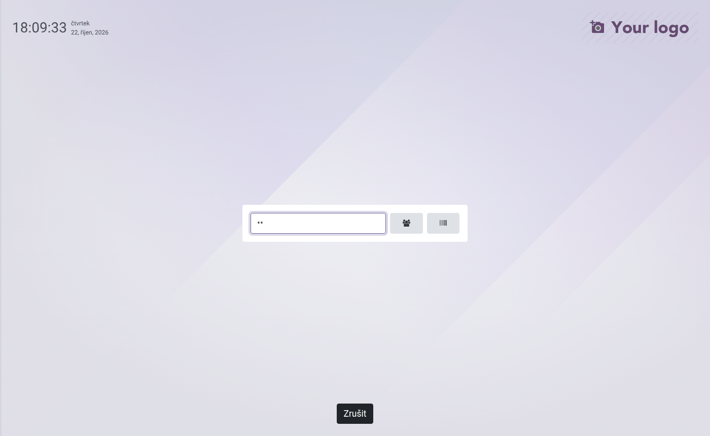

2. **Počáteční stav hotovosti.** První, kdo pokladnu ten den otevře, dostane okno **Otevření
   hotovosti**: spočítejte hotovost v šuplíku, zapište ji (nebo potvrďte navrženou částku)
   a klikněte **Otevřít pokladnu**. Dokud pokladna otevřená není, **Zaplatit** nic neudělá
   a ukáže upozornění.

Pokladna se otevře na záložce **Dnes**. Nahoře je lišta:

| Tlačítko | Co dělá |
|---|---|
| **Dnes** | přehled dne: kdo přichází, kdo čeká, co se platí |
| **Kartotéka…** | okno s klienty a zvířaty – jen hledání, prohlížení, nový klient a úpravy |
| **Objednat** | objednání termínu |
| **Pokladna** | běžná obrazovka pokladny (prodej zboží, tlačítko **Klient** u účtu – ukazuje jméno zákazníka účtu, např. „Klient: Jana Nováková“; Akce, Nabídka/Objednávka …) |
| **Tabule** | denní tabule ordinací v okně nad pokladnou (kapitola 5) |
| zámek | zamkne pokladnu (kapitola 7) |
| ☰ | menu pokladny (uzávěrka, objednávky …) |

## 2. Záložka Dnes

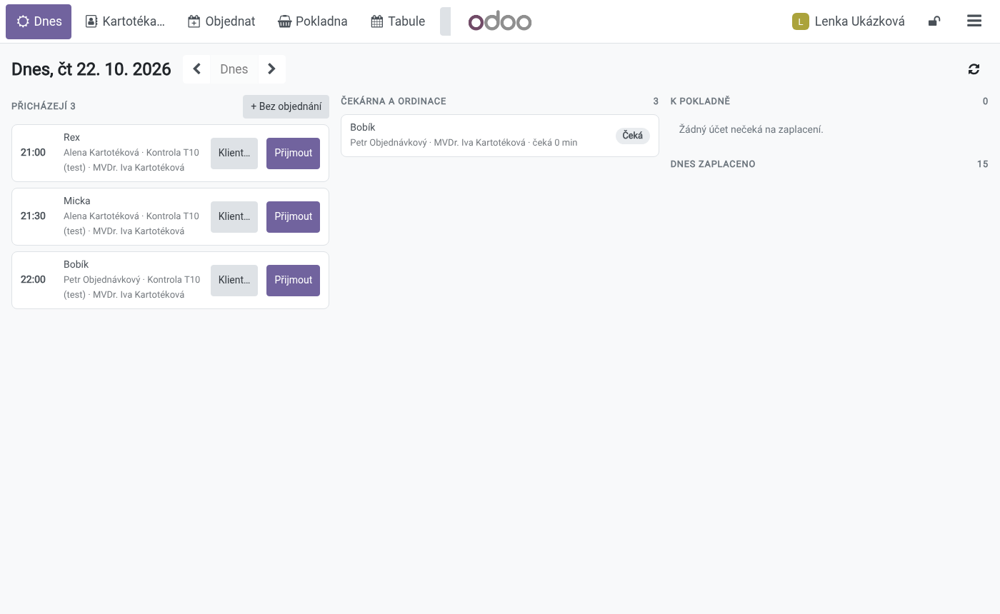

Tři sloupce:

- **Přicházejí** – dnešní potvrzené rezervace, které ještě nepřišly, podle času: čas, zvíře,
  majitel, úkon, lékařka. Rezervace z webu (i z chatu na webu) mají u zvířete modrý štítek
  **WEB**.
- **Čekárna a ordinace** – přijatí klienti: ordinace, lékařka (u neobjednaných případně
  „kterákoli lékařka“), jak dlouho čekají, a štítek **Čeká** nebo **V ordinaci**.
- **K pokladně** – účty, které lékařka uzavřela a které čekají na zaplacení, s částkou.

Ve státní svátek je u nadpisu dne červený štítek, např. „Státní svátek: Den vzniku samostatného
československého státu“. Je to jen připomínka, nic se neblokuje.
  Pod nimi je **Dnes zaplaceno** (počet).

Přehled se obnovuje sám: když lékařka zavolá pacienta nebo uzavře účet, změna je v pokladně
během pár vteřin (pro jistotu se navíc obnoví každých 30 s). Ručně ho obnoví šipka vpravo nahoře.

Šipky **‹ ›** vedle data ukážou předchozí / další den (např. kdo je objednaný zítra),
**Dnes** vás vrátí. U jiného dne než dneška tlačítka Přijmout a + Bez objednání nejsou – přijmout
jde jen dnešní návštěvu.

### Přijmout objednaného klienta

1. Klient přijde – najděte ho ve sloupci **Přicházejí**.
2. Klikněte **Přijmout**. Otevře se malé okno s polem **Interní poznámka pro ordinaci
   (nepovinné)** – např. „Klient spěchá“, „Kouše, opatrně“, „Přinesl vzorek moči“. Poznámku
   můžete nechat prázdnou.
3. Klikněte **Přijmout do čekárny** (nebo stiskněte Enter; nový řádek v poznámce je
   Shift+Enter). **Zrušit** okno zavře a klient zůstane v Přicházejí.
4. Klient se přesune do **Čekárny a ordinace** se štítkem **Čeká**. Lékařka ho hned vidí
   ve svém seznamu **Čekají**.

**Poznámka recepce** je interní: ukáže se žlutě v ordinaci – v Moji pacienti dnes, na obrazovce
Ordinace a nahoře v kartě pacienta u té návštěvy. Klient ji nikde nevidí, na účtence ani faktuře
není. U pacienta v **Čekárně a ordinaci** je vidět i v pokladně a tlačítkem **Poznámka**
(tužka) ji doplníte, opravíte nebo smažete (prázdné pole = smazat), dokud lékařka návštěvu
neuzavře. Stejné okno má **Přijmout** v tabuli (kapitola 5).

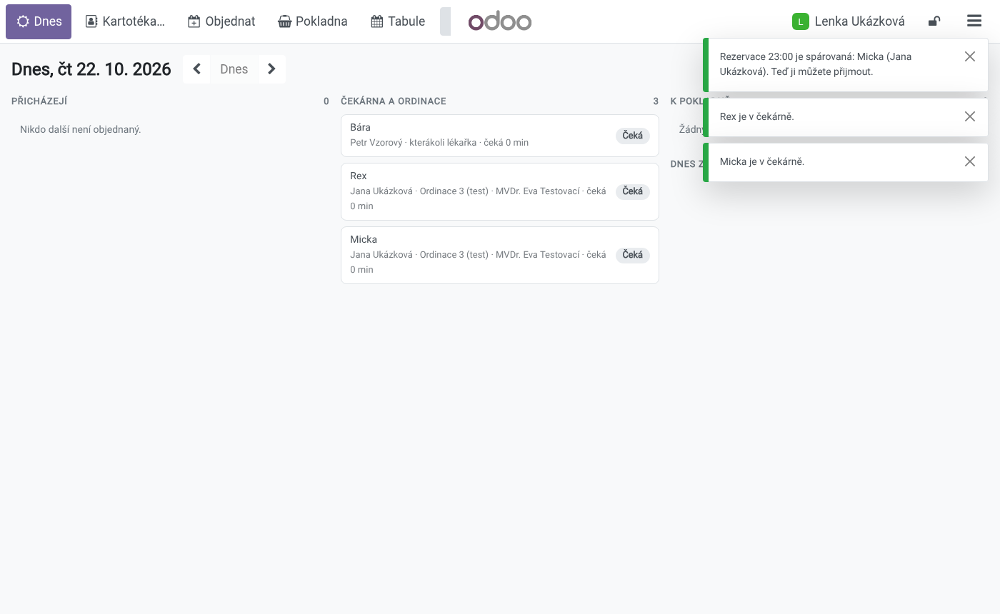

Když lékařka kartu otevřela dřív, než jste klienta přijali, Přijmout nic nezdvojí – použije se
záznam, který už existuje.

### Zrušit přijetí (přijato omylem)

Přijali jste špatného klienta nebo klient odešel dřív, než ho zavolali? U pacienta se štítkem
**Čeká** ve sloupci **Čekárna a ordinace** je tlačítko **Zrušit přijetí** (šipka zpět).

1. Klikněte **Zrušit přijetí**. Pokladna se zeptá: „Zrušit přijetí Rex? Pacient se vrátí mezi
   Přicházejí.“ – u klienta bez objednání „… Pacient zmizí z čekárny.“
2. **Zrušit přijetí** potvrdí, **Ponechat** okno zavře a nic se nemění.
3. Objednaný klient (rezervace v Odoo i záznam z WinVetu) je zase v **Přicházejí** a jde znovu
   **Přijmout** – vznikne nová návštěva. Klient bez objednání z čekárny zmizí.

Zrušená návštěva se nemaže: zůstane jako **Zrušeno** a v její historii (i u rezervace) je
poznámka „Přijetí zrušila recepce (jméno)“. Klientovi nic nechodí.

Zrušit jde jen **dnešní** přijetí, dokud pacient **čeká** a v návštěvě nic není:

- pacient už je v ordinaci (štítek **V ordinaci**) → „Pacient už je v ordinaci – přijetí už nejde
  zrušit.“ (tlačítko tam není);
- v návštěvě už je cokoli z ordinace – záznam z vyšetření, teplota, hmotnost, tep,
  dech, položka účtu nebo poznámka pro recepci → „Záznam už má zápis od lékaře/ky – zrušit ho
  může ordinace.“ Vaše vlastní poznámka recepce zrušení nebrání.

### Objednaní ve WinVetu (štítek WinVet)

Dokud se objednává i ve WinVetu, jsou v **Přicházejí** i všechny dnešní objednávky z kalendáře
WinVetu (se štítkem **WinVet**): záznamy s časem, které mají klienta, zvíře nebo činnost WinVetu.
Poznámky personálu („Oběd“, „Příjmy“, prázdný záznam), celodenní záznamy a záznamy označené ve
WinVetu jako vyřízené se neukazují.

- **Se zvířetem z kartotéky** (ve WinVetu vybrali při objednání pacienta): **Přijmout** funguje
  jako u rezervace – založí (nebo použije dnešní otevřenou) návštěvu zvířete v ordinaci podle
  kalendáře WinVetu a klient je v Čekárně.
- **Bez karty** (ve WinVetu je jen text, např. „Nováková Jana, přeočkování“): řádek ukazuje text
  z WinVetu a štítek **bez karty**, místo Přijmout je **Spárovat…**. Otevře Kartotéku s hledáním
  předvyplněným ze začátku textu (první slova před čárkou nebo pomlčkou, dá se přepsat; když
  nic nenajde, zkusí jen první slovo). Najděte klienta, nebo ho založte (**+ Nový klient**,
  **+ Nové zvíře**), vyberte zvíře a stiskněte **Přiřadit k objednávce**. Nového klienta i se
  zvířetem spárujete jedním klikem: **+ Nový klient**, zvíře vyplňte rovnou ve formuláři
  a stiskněte **Uložit a přiřadit k objednávce**. Potom má řádek zvíře
  a **Přijmout** jako ostatní; obrazovka Ordinace u objednávky nabídne Otevřít kartu a tabule
  ukazuje jméno zvířete.

  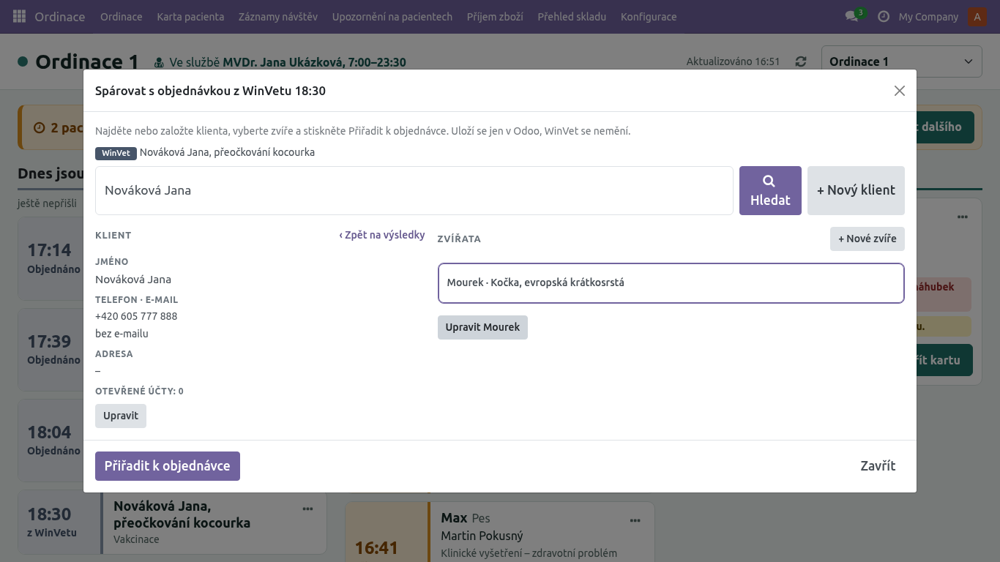

  (Na obrázku je stejný dialog otevřený z obrazovky Ordinace.)
- Spárování se uloží **jen v Odoo**, ve WinVetu se nic nemění a další přenos z WinVetu ho
  nepřepíše. Když ve WinVetu objednávce pacienta doplní, platí ten z WinVetu.
- **Zrušit spárování** (u spárovaného řádku a v dialogu Spárovat…) vrátí objednávku mezi
  „bez karty“ – jen dokud klient není přijatý (potom nejdřív **Zrušit přijetí**).
- Uhynulé zvíře spárovat nejde.

> **Tip pro kliniku:** ve WinVetu při objednávání vždy vyberte pacienta. Pak se objednávka
> v Odoo spáruje sama a recepce nemusí nic dělat.

Klient… tu není – objednávka se mění jen ve WinVetu.

### Přijmout bez objednání (+ Bez objednání)

Klient přišel bez rezervace:

1. Klikněte **+ Bez objednání** u nadpisu **Přicházejí**. Otevře se Kartotéka s nadpisem
   „Přijmout bez objednání“.
2. Najděte klienta (nebo ho založte tlačítkem **+ Nový klient**, kapitola 3) a klikněte na zvíře.
3. Vyberte **Lékařku**: konkrétní, nebo **kterákoli** – takového pacienta vidí v Čekají všechny
   lékařky s poznámkou „kterákoli lékařka“ a ujme se ho ta, která ho zavolá.
4. Volitelně vyberte **Ordinaci**. Bez ní je pacient na obrazovce Ordinace v části Nepřiřazení
   a ordinace si ho vezme ([Obrazovka Ordinace](ordinace.md)).
   Volitelně napište **Interní poznámku pro ordinaci** (stejná poznámka recepce jako u Přijmout).
5. Klikněte **Přijmout**. Okno se zavře a zvíře je v **Čekárně a ordinaci** se štítkem **Čeká**
   (u pacienta s ordinací je vidět i ordinace).

   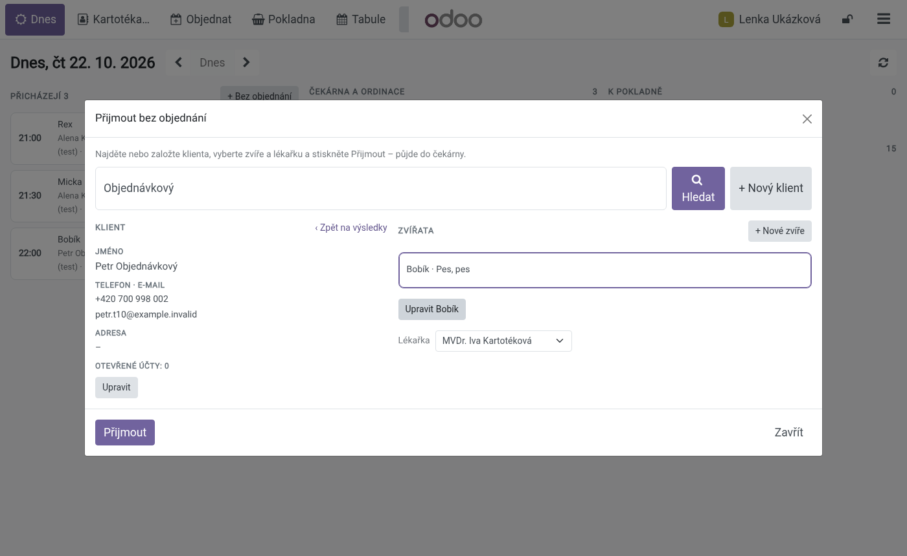

### Klient k rezervaci: Klient… a Spárovat

Každá rezervace v **Přicházejí** má tlačítko **Klient…** – když přijde jiné zvíře nebo jiný
majitel, než je v rezervaci, opravíte to tady. Rezervace z webu, kterou ještě nikdo nepřiřadil
ke klientovi v kartotéce, má poznámku **nespárováno** a místo Klient… a Přijmout tlačítko
**Spárovat**.

1. Klikněte **Klient…** (nebo **Spárovat**). Otevře se Kartotéka s nadpisem „Klient k rezervaci
   21:00 Kontrola“ (čas a úkon rezervace). U rezervace s klientem je rovnou otevřená jeho karta
   s vybraným zvířetem z rezervace:

   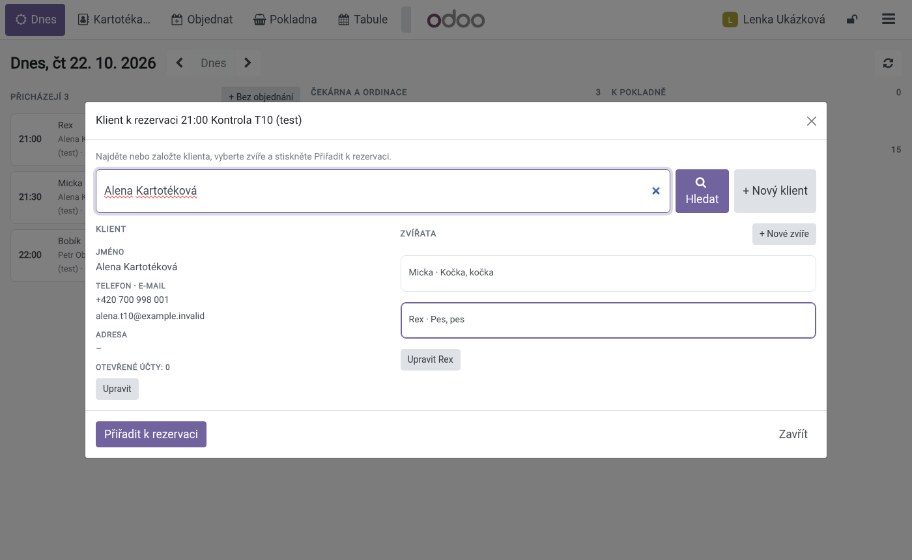

   U webové rezervace bez klienta Kartotéka hledá podle jména z webu:

   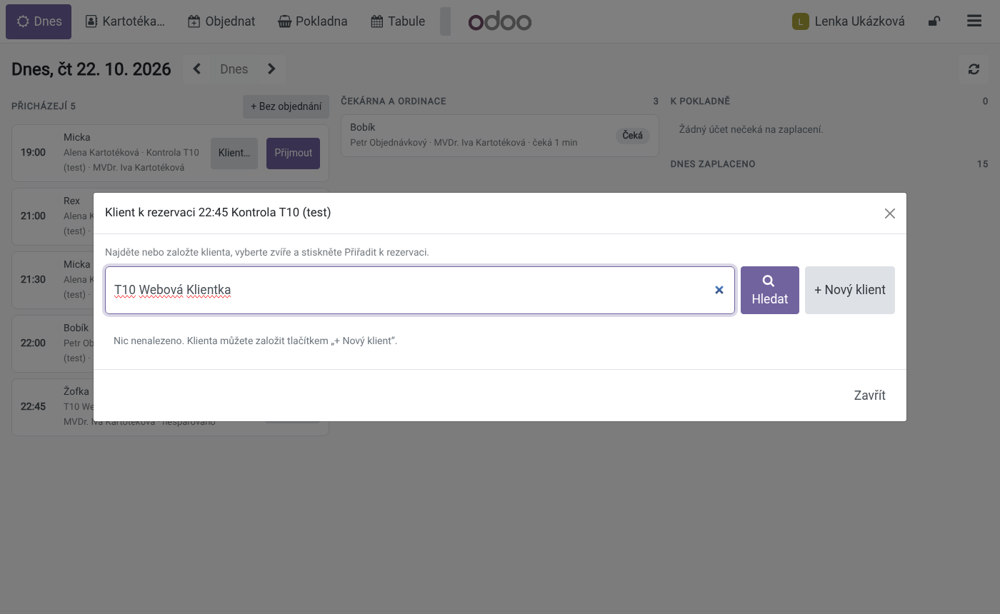

2. Vyberte správné zvíře – jiné zvíře majitele kliknutím, jiného klienta hledáním. Když klient
   v kartotéce není, založte ho tlačítkem **+ Nový klient** (kapitola 3).
3. Klikněte **Přiřadit k rezervaci** (jediné hlavní tlačítko okna). Zobrazí se „Klient je přiřazený k rezervaci …“, okno se
   zavře a Dnes ukáže rezervaci s novým klientem a zvířetem (webová už má **Přijmout**).

Rezervaci, ke které už je návštěva (klient je přijatý nebo lékařka otevřela kartu), nejde přiřadit
jinému zvířeti – „Rezervace už má návštěvu jiného zvířete.“

### Zaplatit

1. Ve sloupci **K pokladně** klikněte u klienta na **Zaplatit**.

   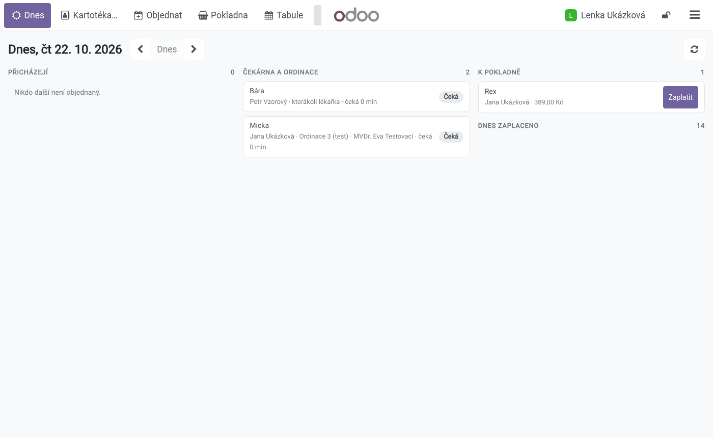

   Když ordinace k účtu napsala **poznámku pro recepci** (např. „Platí převodem“, „Doplatí
   zítra“, „Objednat na kontrolu za 14 dní“), je žlutě pod klientem už v K pokladně a po
   kliknutí na Zaplatit se nejdřív ukáže v okně **Poznámka z ordinace**. Přečtěte ji
   a klikněte **Pokračovat k platbě** (**Zpět** platbu neotevře). Poznámka je interní – na účtence
   ani faktuře není. Je vidět i v Kartotéce u otevřených účtů klienta.

2. Pokladna sama načte účet i se zákazníkem (majitelem) a otevře platbu – nic nehledáte
   v Akce → Nabídka/Objednávka.
3. Zvolte způsob platby (**Kartou**, **Hotově**, **Převodem**), případně zapněte **Faktura**,
   a klikněte **Potvrdit**. U karty opište částku do terminálu banky.

   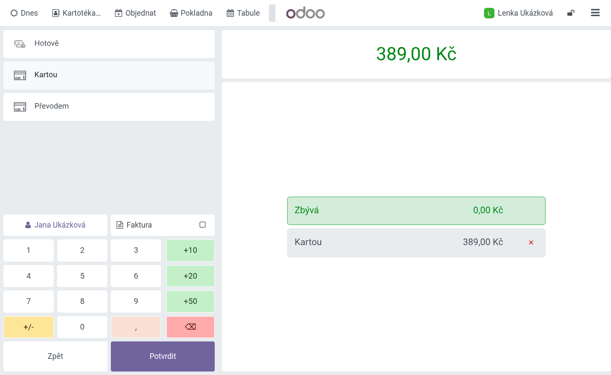

4. Zobrazí se **Platba byla úspěšná** a účtenka. Tlačítkem **Dnes** se vrátíte na přehled;
   klient z K pokladně zmizí a **Dnes zaplaceno** se zvýší.

   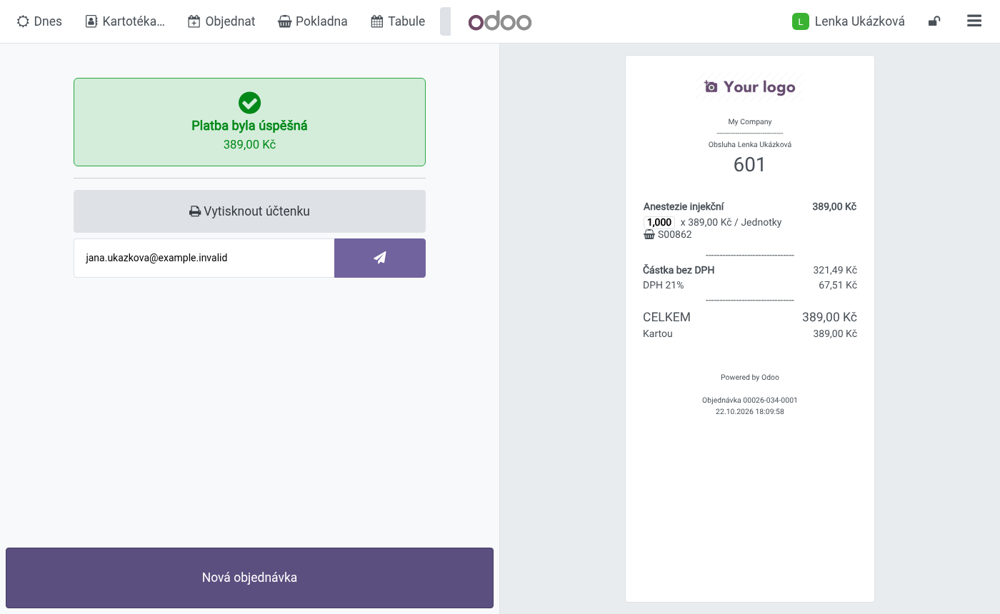

Dobré vědět:

- **Starší účty.** V K pokladně jsou všechny nezaplacené účty, i ze dřívějších dnů – ty mají
  u částky „z 21. 10.“. Klient, který zaplatí až zítra, tedy z pokladny nezmizí.
- **Záloha** (**Částečně zaplaceno**) zůstává v K pokladně se zbývající částkou; Zaplatit
  doplatí zbytek.
- **Každý účet má vlastní účtenku.** Když máte v pokladně rozdělaný jiný nákup, Zaplatit založí
  novou objednávku; dva klienti se na jedné účtence nikdy nesmíchají. Účet, který už je
  v některé otevřené objednávce, se otevře v ní.
- Fakturu, zálohu, vratku a opravu zaplaceného účtu popisuje návod
  [Pokladna a sklad](../../elite_vet_sale/doc/pokladna-a-sklad.md) (kapitoly 3–6).

## 3. Kartotéka

Kartotéka je okno nad pokladnou (rozdělaný nákup v pokladně zůstává, jak byl). Vždy dělá jen
**jednu věc** – podle toho, odkud ho otevřete. Nahoře v okně je napsané, k čemu klienta
vybíráte, a dole je nejvýš **jedno hlavní tlačítko** (a Zavřít):

| Odkud otevřete | Nadpis okna | Hlavní tlačítko – co udělá |
|---|---|---|
| lišta **Kartotéka…** | Kartotéka | žádné – jen hledání, prohlížení, nový klient a úpravy |
| **Objednat**, krok Klient a zvíře › **+ Nový klient** / **Upravit** / majitel bez zvířete | Vybrat klienta a zvíře pro objednání | **Vybrat** – klient a zvíře se zapíšou do formuláře Objednat (kapitola 4) |
| **Pokladna**, tlačítko **Klient** u účtu | Klient k účtu v pokladně | **Vybrat k účtu** – klient bude zákazníkem rozdělaného účtu |
| **Dnes**, **Klient…** / **Spárovat** u rezervace; detail na **tabuli** › **Klient…** | Klient k rezervaci 21:00 Kontrola | **Přiřadit k rezervaci** – klient a zvíře se zapíšou k té rezervaci (kapitola 2) |
| **Dnes**, **+ Bez objednání** | Přijmout bez objednání | **Přijmout** – s výběrem lékařky; zvíře jde do čekárny (kapitola 2) |

Tlačítka, která potřebují zvíře (Vybrat, Přiřadit k rezervaci, Přijmout), jsou šedá, dokud
zvíře nevyberete („Vyberte zvíře.“, u klienta bez zvířat „Přidejte zvíře (+ Nové zvíře).“);
s uhynulým zvířetem nejdou.

### Hledání

Napište jméno majitele nebo zvířete, telefon nebo číslo čipu a stiskněte **Enter** (nebo
**Hledat**). Stačí 2 znaky. Ve výsledcích jsou zvířata (ikona tlapky) a majitelé bez zvířat
(ikona osoby). Kliknutím otevřete kartu majitele.

### Karta majitele

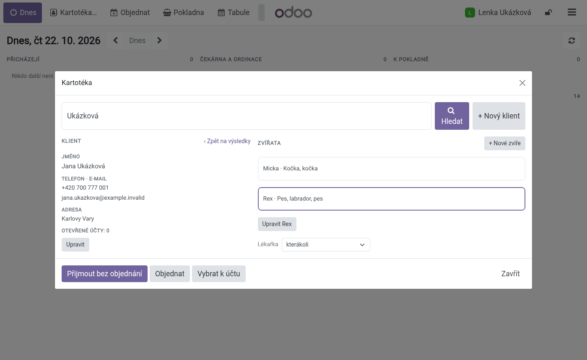

- Vlevo **klient**: jméno, telefon a e-mail, adresa, počet **otevřených účtů**, tlačítko
  **Upravit**. Když klient v posledních 12 měsících **nedorazil** na rezervaci, je u jména
  červený štítek **Nedorazil 2×** (najetím myší podrobnosti) a pod ním seznam: datum, úkon,
  zvíře. U zvířete je štítek **nedorazil 1×**. Počítá se to samo z rezervací ve stavu
  Nedorazil, nic se nezapisuje ručně.
- Když má klient ve WinVetu **zálohu** se zůstatkem, je pod adresou nenápadný řádek
  **Záloha: 2 000 Kč** (zůstatek podle WinVetu; zálohy se dál přijímají a čerpají ve WinVetu).
- Vpravo **zvířata**: druh, plemeno, pohlaví, narození (nebo jen rok), čip, hmotnost, příští
  očkování a odčervení, upozornění a **Důležité** (červené štítky). Uhynulá zvířata jsou na konci, vybledlá; s nimi nejde nic dělat.
- Kliknutím vyberete zvíře (rámeček) – pod ním je **Upravit <jméno>** (při Přijmout bez
  objednání i výběr **Lékařka**).
- **‹ Zpět na výsledky** vás vrátí k hledání.

### Nový klient, nové zvíře, úpravy

1. **+ Nový klient**: vyplňte jméno (povinné), telefon, mobil, e-mail, adresu. Rovnou můžete
   zapsat i **první zvíře** se všemi údaji – je tu stejný formulář jako u **+ Nové zvíře** (bod 3:
   nahoře jméno, druh, pohlaví, plemeno, narození, čip, pak **Další údaje** a **Upozornění**).
   Zvíře je nepovinné; když ho zadáváte, vyplňte aspoň jméno a druh. Další zvířata přidáte potom.

   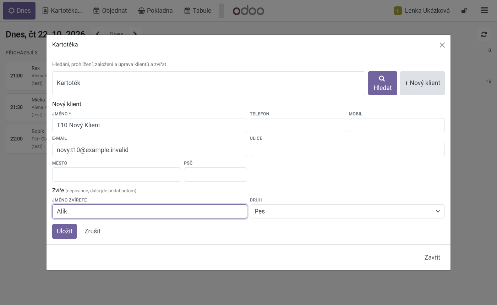

2. **Uložit klienta.** Klient i zvíře se uloží najednou a otevře se karta nového klienta
   s vybraným zvířetem. Když je v údajích zvířete chyba (např. hmotnost „hodně“, narození
   v budoucnosti), neuloží se **nic** – chyba je červeně ve formuláři, všechno napsané zůstává,
   stačí ji opravit a uložit znovu. V Kartotéce otevřené přes **Spárovat…** (objednávka
   z WinVetu) je tlačítko **Uložit a přiřadit k objednávce**, když zadáte i zvíře: jedním klikem
   se klient a zvíře založí a objednávka spáruje.
3. **+ Nové zvíře**: povinné jsou jen **jméno** a **druh**, všechno ostatní můžete nechat prázdné.
   - Nahoře: jméno, druh, pohlaví, plemeno, narození, čip. U druhu **Jiné** se objeví pole
     **Jiný druh** (např. fretka).
   - **Další údaje** (klepnutím rozbalíte; u nového zvířete jsou zavřené, při úpravě se otevřou
     samy, když v nich něco je): **Rok narození** (když přesné datum neznáte), **Hmotnost (kg)**
     (desetinná čárka i tečka, např. 12,5), **Barva**, **Tetování**, **Číslo pasu**, **Příští
     vakcinace**, **Příští odčervení**, **Důležité** (krátký text – na kartě majitele je to
     červený štítek u zvířete) a **Poznámka**.
   - **Upozornění**: **+ Upozornění** přidá řádek – druh (Kouše, Alergie, Jiné – stejné jako
     v kartě pacienta) a poznámka (např. náhubek, penicilin). Koš řádek odebere. Upozornění se
     ukazují jako štítky v kartě majitele, na tabuli i v kartě pacienta.
4. **Upravit** (u klienta) a **Upravit <jméno>** (u zvířete) otevřou stejný formulář s vyplněnými
   údaji. **Uložit** (u klienta **Uložit klienta**) změny zapíše, **Zrušit** je zahodí.
5. Jen při úpravě zvířete (ne při registraci) je dole **Uhynulý** a pak **Datum úhynu**. Po
   Uložit se Kartotéka zeptá „Označit … jako uhynulé?“. Uhynulé zvíře nejde objednat ani přijmout.
   Omylem označené: odškrtněte Uhynulý a uložte (datum úhynu se smaže).

> **Souběh s WinVetem.** Dokud se kartotéka přenáší z WinVetu (most každých 15 minut a denní
> plný běh), přenos u zvířat, která **přišla z WinVetu**, přepíše tato pole hodnotou z WinVetu:
> jméno, majitel, druh a jiný druh, plemeno, pohlaví, barva, narození, rok narození, čip,
> tetování, číslo pasu, hmotnost, uhynulý, datum úhynu, příští vakcinace, příští odčervení,
> Důležité (a aktivní / registrován). Stane se to, když se zvíře **ve WinVetu změní** (změní se
> mu čas poslední úpravy ve WinVetu); u zvířete, které ve WinVetu čas úpravy nemá, při každém
> přenosu. Jinak přenos úpravu z Odoo nechá. Změnu těchto polí proto udělejte i ve WinVetu. Z WinVetu se nikdy
> nepřepisují **Poznámka** (poznámka z WinVetu má vlastní pole) a **Upozornění** – ta jsou jen
> v Odoo. Zvířata založená v Odoo přenos nemění.

Stejný telefon nebo e-mail jako jiný klient nevadí – nic se neslučuje. Kontakty zaměstnanců
a firem v kartotéce upravit nejde („Tento kontakt není klient kliniky.“).

### Vybrat k účtu (Pokladna › Klient)

Prodej bez návštěvy (např. krmivo) na jméno klienta: na záložce **Pokladna** naúčtujte zboží
a klikněte **Klient** u účtu. Kartotéka ukáže dosavadního zákazníka účtu (když nějaký je);
najděte klienta a klikněte **Vybrat k účtu**. Položky naúčtované bez zákazníka zůstanou a dostanou
tohoto klienta. Účet s položkami **jiného** klienta se nepřepíše – vznikne nový účet (dva klienti
se nikdy nesmíchají na jedné účtence).

Na tlačítku je jméno zákazníka účtu („Klient: Jana Nováková“), bez zákazníka jen „Klient“.
Standardní tlačítko zákazníka pokladny Recepce nemá; i **Zákazník** na obrazovce platby (a dotaz
na zákazníka u faktury) otevře tuto Kartotéku se stejnými pravidly.

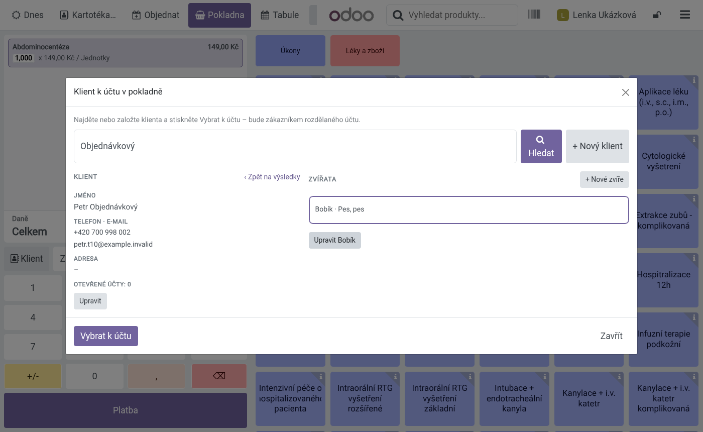

## 4. Objednat

Objednání jde po očíslovaných krocích shora dolů. Hotový krok má číslo vybarvené, další krok
se ukáže, až je předchozí vyplněný.

1. **Klient a zvíře** – pište rovnou do pole hledání v kroku (jméno, telefon, čip nebo jméno
   zvířete, aspoň 2 znaky). Výsledky se ukážou pod polem samy, za každé zvíře jeden řádek, třeba
   „Rex (pes) · Jana Nováková · 777 123 456“ (uhynulá zvířata ani personál se nenabízejí).
   Kliknutím na řádek (nebo Enter na prvním) je zvíře vybrané a v kroku zůstane „Rex · Jana
   Nováková“. Když klient za posledních 12 měsíců nedorazil, je pod ním žluté upozornění
   „Klient 2× nedorazil, naposledy 12. 10“ (najetím myší seznam) – jen pro informaci, objednat
   jde normálně. **Změnit** otevře hledání znovu, **Upravit** otevře Kartotéku na tomto klientovi
   (úprava kontaktu nebo zvířete, pak **Vybrat**).
   Nový klient: **+ Nový klient** vedle pole otevře Kartotéku rovnou na formuláři nového klienta
   (i s prvním zvířetem); po uložení klikněte **Vybrat**. Majitel bez zvířete má v hledání řádek
   „bez zvířete – přidat zvíře…“ – otevře formulář nového zvířete.
2. **Úkon** – nejčastější úkony posledních 30 dní jsou velká tlačítka (u každého délka), stačí
   kliknout. Ostatní najdete pod **Jiný úkon…** (seznam s hledáním); vybraný úkon se pak ukáže
   zvýrazněný vedle častých.
3. **Den** – nad řadou dnů je zelené tlačítko s **nejbližším volným časem**, třeba „Nejdřív: dnes
   14:30 · Ordinace 2 · MVDr. Malá“ – jedním kliknutím vyplní den, ordinaci i čas a stačí
   objednat. Řada sedmi dnů ukazuje u každého počet volných časů („10 volných“); **„nic
   volného“** je otevřený, ale plně obsazený den, šedé **„zavřeno“** den, kdy úkon nejde vůbec
   (ordinace zavřená, celodenní blokace, nebo nikdo ze služby, když je lékařka potřeba) – na ten
   kliknout nejde. Když vybraný den po výběru úkonu volno nemá, přeskočí výběr sám na první den
   řady s volnem. Státní svátek má v řadě dnů červený rámeček a nápis **svátek** (najetím myší
   jeho název); vybrat ho jde normálně. Šipky **‹ ›** posunou o týden (nejdřív na dnešek), kalendář pod nimi vybere jiné
   datum. Když vybraný den nemá volno, objeví se tlačítko s **nejbližším dalším volným dnem**.
   Chce-li klient konkrétní lékařku, klikněte vpravo na **jen lékařka…** a vyberte ji; dny,
   ordinace, časy i nejbližší volný čas se pak počítají jen pro ni. Křížkem u jejího jména filtr
   zrušíte.
4. **Ordinace** – jen když má úkon ten den volno ve více ordinacích. U každé je lékařka (pokud ji
   má celý den jedna) a počet volných časů. Když je volno jen v jedné, vybere se sama a tento krok
   se neukáže. Vybraná ordinace zůstane i po změně dne.
5. **Čas** – volné časy vybrané ordinace, rozdělené na dopoledne a odpoledne. Počítají se stejně
   jako na tabuli a na webu.

Dole je **souhrn** celé objednávky jednou větou, třeba „Rex · Kontrola · čt 22. 10. 2026 9:30 ·
Ordinace 2 · MVDr. Malá“ (ve státní svátek s červeným upozorněním „Státní svátek: …“ – objednat
jde normálně), pod ním nepovinná **poznámka** a jediné tlačítko **Objednat**. Zkontrolujte
souhrn a klikněte. Objeví se potvrzení „Objednáno: čt 22. 10. 2026 9:30 · Rex“; rezervace je
potvrzená a je na tabuli i v Přicházejí toho dne.

Potom se **formulář vyprázdní** pro dalšího klienta (klient a zvíře, úkon, lékařka, ordinace,
čas, poznámka); zůstane jen den. Zelené potvrzení zmizí, jakmile začnete další objednání.

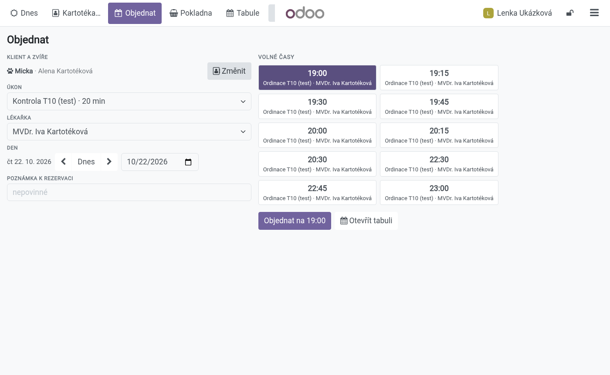

**E-mail klientovi:** když má majitel v kartotéce e-mail, dostane potvrzení rezervace
automaticky (stejné jako z průvodce na tabuli). Bez e-mailu se nic neposílá – termín mu řekněte.

Když mezitím termín obsadil někdo jiný (web, kolegyně), objeví se „Termín … už mezitím někdo
obsadil – vyberte jiný.“ a časy se načtou znovu. Uhynulé zvíře objednat nejde.

**Tabule** vedle Objednat otevře tabuli vybraného dne v okně nad pokladnou (kapitola 5); vybraný
klient zůstane.

V režimu **Přesunout rezervaci** (z tabule) vás zpět k běžnému objednání vrátí **Nepřesouvat**
nebo znovu kliknutí na **Objednat** v liště. Úkon a čas přesouvané rezervace se přitom zruší –
formulář začíná od výběru úkonu.
Při přesouvání chybí krok Klient a zvíře; souhrn ukazuje přesouvané zvíře a tlačítko je **Přesunout**.

## 5. Tabule

Tlačítko **Tabule** v liště (nebo **Tabule** vedle Objednat na záložce Objednat) otevře velké okno
s tabulí dne přímo nad pokladnou – pokladna ani rozepsaný účet pod ním se nemění a nic se
nepřepíná do jiné stránky.

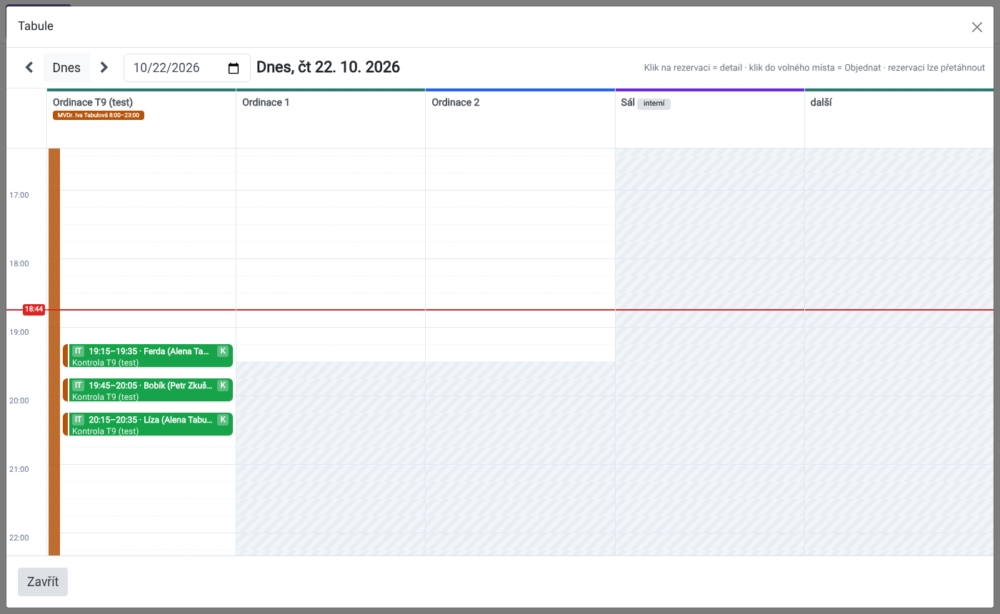

- **Sloupce** jsou ordinace (u každé lékařky ve službě s časem), vlevo časová osa, červená čára
  je teď. Šrafované je mimo ordinační dobu, šedé šrafované pruhy jsou blokace („jen web“ jsou
  světlé – recepce tam objednat smí).
- Svislý barevný pruh u levého okraje sloupce je **služba lékařky** (iniciály a čas).
- **Web, nebo klinika** – pod lištou tabule je přepínač **Vše | Web | Klinika** a jednořádková
  legenda:

  | Štítek vlevo na kartě | Význam |
  |---|---|
  | Modrý **WEB** + modrý čárkovaný obrys | Rezervace z webu – objednal(a) se klient sám. |
  | Bílý štítek s iniciálami, např. **JN** | Rezervaci založil(a) někdo z kliniky. Najetím: „Založil(a): Jana Nováková, 26. 10. 2026 9:12“. |
  | Šedý **WinVet** | Záznam z kalendáře WinVetu, jen pro čtení. |

  **Web** ukáže jen webové rezervace, **Klinika** jen ty založené na klinice; záznamy z WinVetu
  jsou jen ve **Vše**, blokace jsou vidět vždy. Volbu si pamatuje prohlížeč (pokladna zvlášť
  od backendové tabule). Když filtr něco skrývá, je vpravo „skryto: N“ – skrytý čas je pořád
  obsazený.
- **Rezervace** mají barvu úkonu, proužek vlevo v barvě lékařky, štítek WEB / iniciály toho, kdo
  ji založil, iniciály lékařky, čas,
  zvíře (majitel), zkratku úkonu a štítek **k pokladně** / **zaplaceno**. Proběhlé a nedorazivší
  jsou bledé.
- **Záznamy z WinVetu** jsou šedé šrafované karty se štítkem **WinVet** (proužek v barvě
  WinVetu, zvíře a majitel z kartotéky, jinak text z WinVetu). Jen pro čtení: nejdou přetáhnout,
  klik na ně nic nedělá (po najetí ukážou čas a činnost). Jejich čas je obsazený – Objednat ho
  nenabídne. Celodenní záznamy WinVetu jsou štítky „WinVet · …“ v hlavičce ordinace a nic
  neblokují.
- Ve státní svátek je u data červený štítek „Státní svátek: …“ (když web ve svátky neobjednává,
  s „· web neobjednává“).
- **‹ Dnes ›** a pole s datem přepínají den; tabule se posune na „teď“ (dnes), u jiného dne na
  začátek. Při hodně ordinacích se tabule posouvá i do stran.
- Tabule se sama obnovuje (změna z webu, od kolegyně nebo z backendu se ukáže hned, záložně
  každých 30 s).
- **Zavřít** (nebo křížek) vás vrátí tam, kde jste byli.

### Klik na rezervaci

Otevře se okno s detailem: klient (a telefon), zvíře, úkon, lékařka, čas a ordinace, stav
a **Zdroj** („WEB z webu – objednal(a) se klient sám“, nebo „Klinika – založil(a) Jana
Nováková“ s datem a časem založení).

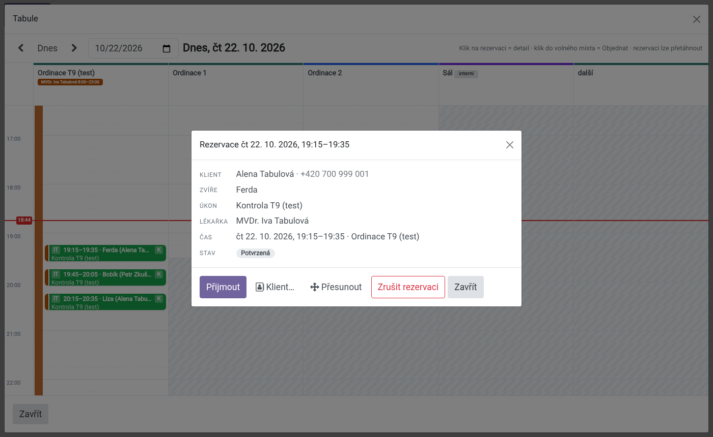

- **Přijmout** – jen u dnešní rezervace, která ještě nemá návštěvu; zvíře je pak v čekárně
  (stejně jako Přijmout na záložce Dnes, i s oknem pro interní poznámku pro ordinaci). Webová rezervace bez spárovaného klienta se přijme až
  po **Klient…**.
- **Klient…** – Kartotéka pro tuto rezervaci (stejné jako Klient… na záložce Dnes, kapitola 2):
  vyberte klienta a zvíře a **Přiřadit k rezervaci**. Tabule zůstane otevřená pod ním.
  U proběhlé a nedorazivší rezervace Klient… není.
- **Přesunout** – okno se zavře a otevře se záložka Objednat v režimu **Přesunout rezervaci**:
  úkon a lékařka jsou předvyplněné, vyberte den a volný čas a klikněte **Přesunout**.
  **Nepřesouvat** režim ukončí.
- **Zrušit rezervaci** – zeptá se ještě v okně („Opravdu zrušit? Klientovi odejde e-mail
  o zrušení.“, nebo bez e-mailu „Opravdu zrušit tuto rezervaci?“) a po **Ano, zrušit rezervaci**
  rezervaci zruší. E-mail o zrušení odejde stejně jako při zrušení v backendu – jen když má
  rezervace e-mail.
- **Nedorazil** – u potvrzené rezervace z dneška nebo dřívějška, na kterou klient nepřišel
  (ještě nemá návštěvu). Zeptá se „Označit Rex · Jana Nováková v 9:00 jako nedorazil?“ a po
  **Ano, nedorazil** dá rezervaci stav Nedorazil – stejně jako tlačítko Nedorazil v backendu,
  klientovi nic neodejde. Tabule se obnoví a klient má v Kartotéce štítek **Nedorazil N×**.
  U budoucí rezervace, u přijatého klienta a u kopie ve druhé ordinaci tlačítko není (kopie se
  označí s hlavní rezervací).

Rezervace, která už má návštěvu (klient je přijatý), se přesunout ani zrušit nedá – Přesunout
a Zrušit rezervaci se u ní neukážou. U společného zákroku dvou lékařek se přesouvá jen hlavní
rezervace – kopie ve druhé ordinaci se posune s ní (u kopie Přesunout ani přetažení nejsou).

### Přetažení rezervace

Potvrzenou rezervaci můžete myší přetáhnout na jiný čas nebo do jiné ordinace (na dotykové
obrazovce použijte **Přesunout** v detailu). Po puštění se otevře okno „Přesunout rezervaci?“
s políčky **Datum**, **Od**, **Do** a **Ordinace** předvyplněnými podle místa puštění a větou
„Přesunout … z … na …?“ – když jste se netrefili, opravte čas (po krocích rezervací), den nebo
ordinaci přímo v okně, věta se mění s nimi. **Do** se posouvá s **Od** (délka zůstane);
přepsáním **Do** rezervaci prodloužíte nebo zkrátíte. Dostane-li klient e-mail o změně termínu, okno to
napíše a ukáže zaškrtnuté **Poslat klientovi e-mail o změně**; po odškrtnutí proběhne tento
přesun bez e-mailu (v historii rezervace zůstane „Klient nebyl o změně informován.“). Teprve
**Přesunout** rezervaci přesune; **Zrušit** nechá vše, jak bylo. Platí stejná pravidla jako na backendové tabuli:
v ordinaci musí sloužit lékařka, která úkon dělá (jinak se lékařka vymění za tu, která tam
slouží), a čas musí být volný. Když to nejde, objeví se česká hláška (např. „Termín … je
obsazený“) přímo v okně, okno zůstane otevřené a rezervace tam, kde byla – zvolte jiný čas.
Při změně času dostane klient e-mail o přesunu, pokud ho má a pokud ho neodškrtnete.

### Klik do volného místa

Okno se zavře a otevře se **Objednat** s předvyplněným dnem a nahoře s pruhem „Z tabule:
ordinace, den, čas“. Vyberte úkon: když je ten čas pro úkon volný, je hned vybraný („Čas je
vybraný.“), jinak vyberte z volných časů dne. Vybraný klient (když jste přišli z Objednat)
zůstane.

Žádosti z webu, nové blokace a plánování dopředu zůstávají na backendové tabuli (vedení,
[návod Rezervace](../../elite_vet_reservation/doc/recepce.md)).

## 6. Konec dne – uzávěrka

1. Zkontrolujte, že v **K pokladně** nezůstal nikdo, kdo už odešel a měl platit (nezaplacené účty
   tam zůstanou i zítra).
2. Udělejte uzávěrku podle návodu
   [Pokladna a sklad – 7. Uzávěrka](../../elite_vet_sale/doc/pokladna-a-sklad.md#7-uzávěrka-konec-dne):
   ☰ → **Zavřít pokladnu**, spočítat hotovost, **Zavřít relaci**.

**Zavřít pokladnu** v menu ☰ vidí jen zaměstnanec s **pokročilým oprávněním** (nastavuje vedení,
kapitola 11) nebo zaměstnanec propojený s uživatelem Odoo, pod kterým je pokladna otevřená.
Když ho v menu nevidíte, přihlaste se PINem zaměstnance, který uzávěrku dělá.

## 7. Přepnutí obsluhy a zamčení

- **Zamčení:** ikona zámku vpravo nahoře (vedle jména). Pokladna se zamkne; nikdo nemůže nic
  udělat bez PINu. Zamykejte, když od pokladny odcházíte.
- **Přepnutí obsluhy:** zamkněte a druhá kolegyně se přihlásí svým PINem (**Odblokovat
  pokladnu**). Pokladna se vrátí na Dnes (nebo na Pokladnu, když jste byli tam). Rozdělané
  objednávky zůstávají.
- Kdo klienta přijal, je zapsané u návštěvy; kdo platbu přijal, je na účtence („Obsluha …“).

---

# Část B – lékařky a sestry

## 8. Moji pacienti dnes

Po přihlášení se lékařce a sestře otevře **Karta pacienta** (aplikace **Ordinace**). Pod polem
pro hledání je **Moji pacienti dnes** – lékařka vidí své pacienty (objednané i neobjednané),
sestra a účet bez spárované lékařky vidí všechny.

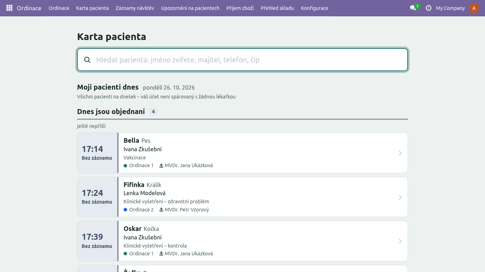

Pacient vypadá stejně jako na obrazovce Ordinace: vlevo barevný pruh s časem a stavem
(oranžová čeká, zelená v ordinaci, modrošedá objednaný, šedá hotovo), vpravo zvíře, majitel,
úkon, ordinace a lékařka. Klik na pacienta otevře jeho kartu.

| Skupina | Kdo v ní je |
|---|---|
| **Dnes jsou objednaní** (ještě nepřišli) | dnešní rezervace, které recepce ještě nepřijala |
| **Čekají** | recepce je přijala, podle příchodu: velký čas příchodu, „Čeká 6 min“, tlačítko **Zavolat**. Neobjednaní mají „bez objednání“; neobjednaní bez lékařky mají „**Kterákoli lékařka**“ a vidí je všechny lékařky. |
| **V ordinaci** | zavolaní, „V ordinaci od 18:15“ |
| **Hotovo dnes** | uzavřené návštěvy (Hotovo, k pokladně) |

Pořadí je stejné jako na obrazovce Ordinace; na užší obrazovce (pod 1100 px) jsou Čekají první,
pak V ordinaci, Dnes jsou objednaní a Hotovo dnes.

Seznam se obnovuje sám, jakmile recepce někoho přijme (záložně každých 30 s).

Když recepce při příjmu napsala **poznámku recepce**, je u pacienta žlutě (s ikonou lístečku)
a v kartě pacienta žlutý pruh pod záhlavím „Poznámka recepce …“. Je interní, klient ji nevidí.

## 9. Zavolat a ošetření

1. U pacienta v **Čekají** klikněte **Zavolat**. Pacient přejde do **V ordinaci**
   a otevře se jeho karta. Pacienta „kterákoli lékařka“ si tím vezmete vy – od té chvíle je
   jen ve vašem seznamu.
2. Stejně funguje, když kartu pacienta, který čeká, otevřete jinak (ze seznamu, z tabule,
   z hledání) – pacient se sám přesune do V ordinaci.
3. V recepci se u pacienta hned ukáže **V ordinaci**.

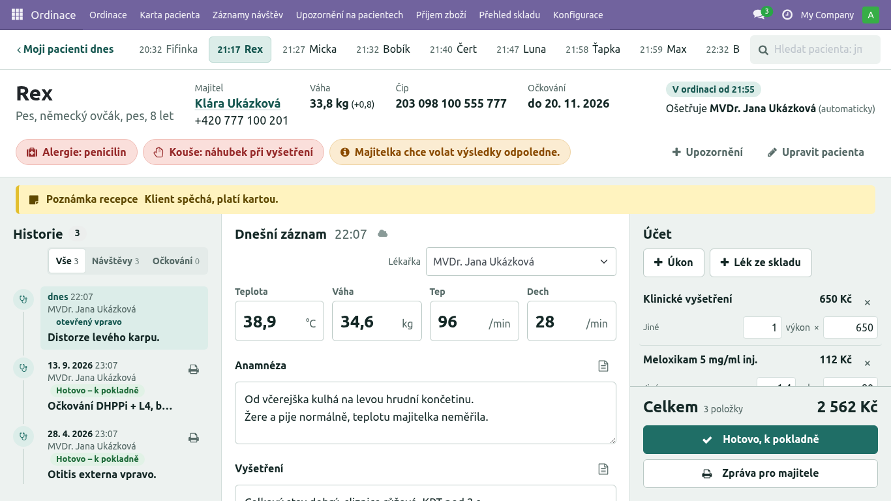

4. Zapište návštěvu a účet v kartě pacienta (**Úkon**, **Lék ze skladu**, **Přidat balíček**).
   Jak je karta rozvržená, popisuje [Ordinace – 7. Karta pacienta](ordinace.md#7-karta-pacienta).
5. Pro recepci můžete nad tlačítkem **Hotovo, k pokladně** napsat **Poznámku pro recepci**
   (interní, klient ji neuvidí) – recepce ji uvidí u účtu v K pokladně a před platbou. Ukládá
   se sama; opravit nebo smazat ji jde i po uzavření záznamu (dokud není zrušený).
6. Na konci klikněte **Hotovo, k pokladně** a potvrďte. Pacient přejde do **Hotovo dnes**
   a recepce ho hned vidí ve sloupci **K pokladně**. Podrobně (štítky, znovuotevření,
   rozpracovaný účet v pokladně) to popisuje
   [Pokladna a sklad – 1. Jak se účet dostane k pokladně](../../elite_vet_sale/doc/pokladna-a-sklad.md#1-jak-se-účet-dostane-k-pokladně).

---

# Část C – vedení

## 10. Role a výchozí obrazovky

Role se přidělují v **Nastavení → Uživatelé** (skupiny Elite Vet: Recepce < Sestra < Lékařka <
Správce = Vedení; vyšší role má vše, co nižší – kromě pokladny a skladu, viz níže).

| Role | Po přihlášení | Menu |
|---|---|---|
| Recepce | pokladna Recepce | Prodejní místa (pokladna), Rezervace, Diskuze, ze Skladu jen Přehled skladu a Příjem zboží |
| Sestra, Lékařka | Karta pacienta (Moji pacienti dnes) | Ordinace, Rezervace, Diskuze – bez pokladny a skladu |
| Vedení | Přehled tržeb a výdajů | vše |

- **Pokladna a sklad (recepce)** je samostatné pole ve formuláři uživatele (oddíl „Elite Vet –
  pokladna“), mimo výběr role. Dává pokladnu, nabídky, Přehled skladu a Příjem zboží. Když
  uživateli nastavíte roli **Recepce**, dostane ho sám; když roli změníte na **Sestra** nebo
  **Lékařka**, odebere se (i s právy pokladny a skladu). Má-li zboží přijímat i sestra, zapněte
  jí ho ručně **po** nastavení role – ruční změna zůstane. Vedení ho má vždy.
- Lékařka a sestra dál uzavírají účty (**Hotovo, k pokladně**) a vidí stav platby v kartě
  pacienta i na tabuli; do pokladny ani do skladu se nedostanou.

- Výchozí obrazovka se nastaví sama, když uživateli přidělíte roli (nebo ji změníte). Vlastní
  výchozí obrazovku, kterou uživatel má nastavenou ručně, to nepřepíše.
- **Nastavit výchozí obrazovky:** Nastavení → Uživatelé → v seznamu zaškrtněte libovolného
  uživatele → **Akce → Nastavit výchozí obrazovky**. Nastaví výchozí obrazovky **všem** interním
  uživatelům podle role, nejen zaškrtnutým (vlastní zůstanou). Použijte, když jste měnili členy přímo ve formuláři skupiny.
- **Skrytá menu:** Prodej, Fakturace, Zaměstnanci, WinVet data, Rozpis služeb, Web a Přehledy
  vidí jen vedení, Aplikace jen správce systému; recepce nevidí Ordinaci; sestra a lékařka nevidí
  Prodejní místa ani Sklad. Lékařky vidí služby na tabuli.
- **Účetní** potřebuje roli **Vedení** – Fakturace je jen pro vedení.
- Každý, kdo ráno **otevírá pokladnu**, musí mít u svého uživatele vyplněný **e-mail**. Bez něj
  Odoo otevření odmítne („nakonfigurujte e-mailovou adresu odesílatele“).

## 11. Zaměstnanci s PINem

Kdo se do pokladny přihlašuje PINem, musí být **zaměstnanec** v aplikaci **Zaměstnanci**.

1. **Zaměstnanci → Nové**: jméno (to se ukazuje v pokladně a na účtence).
2. Záložka **Nastavení** → **PIN kód**: čtyři číslice, které si zaměstnanec pamatuje. Pole
   **Příslušný uživatel** propojí zaměstnance s jeho přihlášením do Odoo (nepovinné).
3. **Uložit.**

   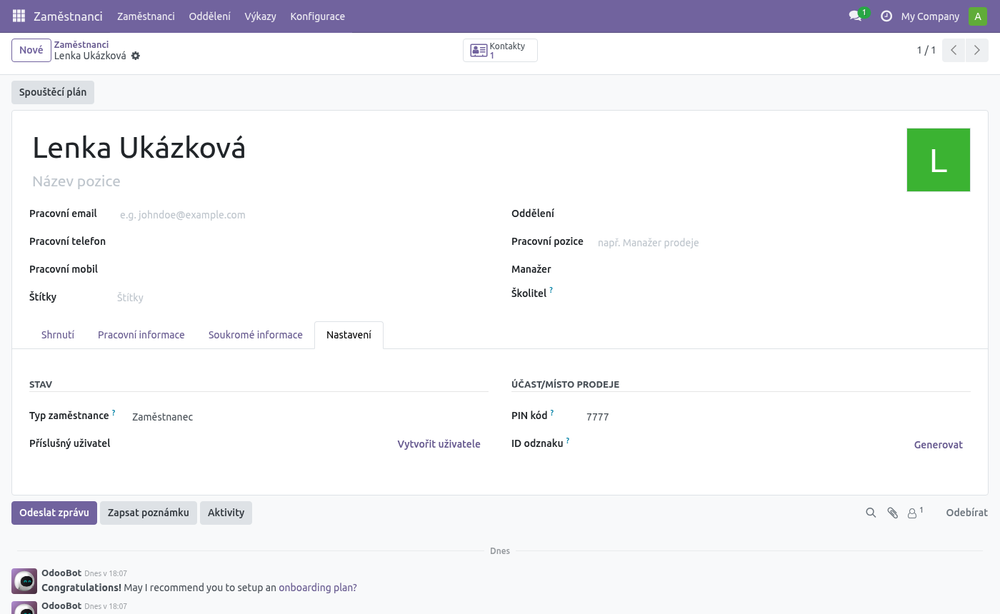

4. Povolte ho na pokladně: **Prodejní místa → Konfigurace → Nastavení**, nahoře vyberte
   pokladnu **Recepce**, část **Rozhraní PoS** → **Přihlásit se jako zaměstnanec**:
   - **Základní oprávnění** – recepční (přijímají, objednávají, platí),
   - **Pokročilé oprávnění** – kdo smí dělat uzávěrku, opravovat platby, vkládat a vybírat
     hotovost (vedení, případně vedoucí recepce).

   Když jsou obě pole prázdná, přihlásit se může každý zaměstnanec firmy.
5. **Uložit** (nahoře vlevo). Nový zaměstnanec se objeví v pokladně po jejím znovunačtení.

   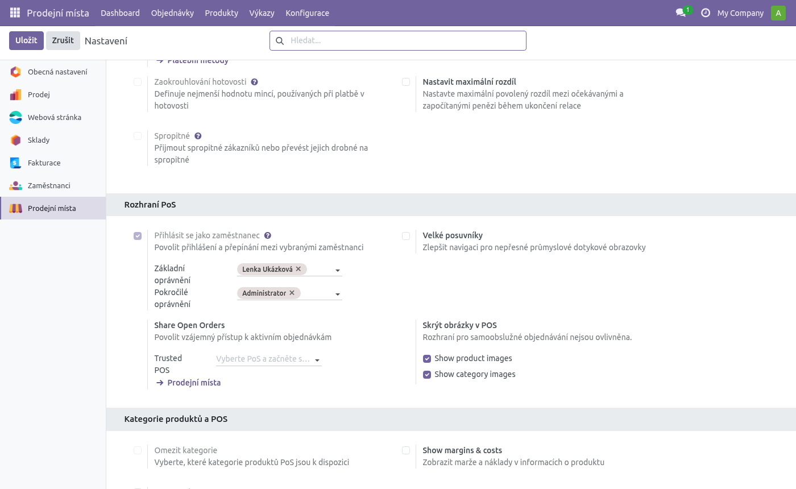

**Před aktualizací modulů zavřete pokladnu** (uzávěrka). Za otevřené pokladny nejde přihlášení
PINem zapnout ani změnit a aktualizace to jen zapíše do logu.
