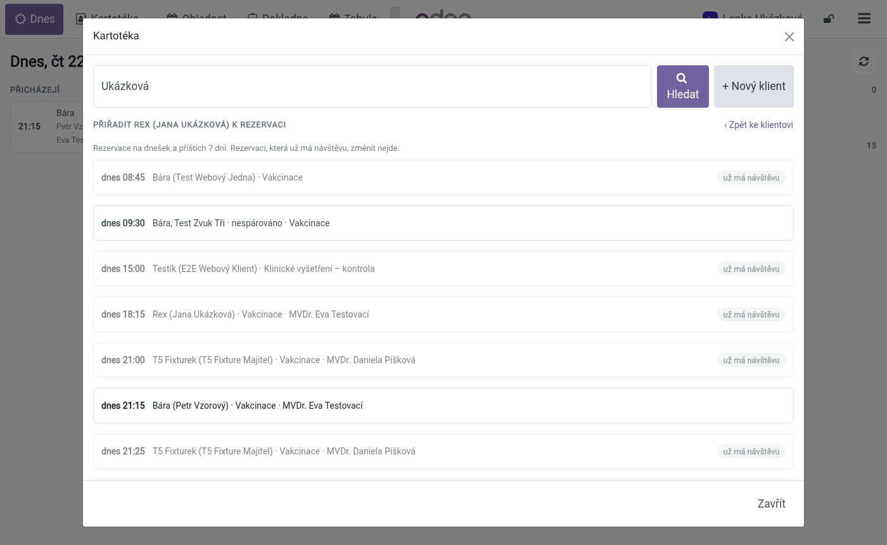

# Recepce v pokladně a Moji pacienti dnes – návod pro recepci, lékařky a vedení

**K čemu je tento návod.** Popisuje jeden pracovní den: recepce pracuje jen v pokladně **Recepce**
(příchody, čekárna, kartotéka, objednávání, placení), lékařka a sestra v **Moji pacienti dnes**
a kartě pacienta. Poslední část je pro **vedení** (role, zaměstnanci s PINem). Technické
podrobnosti pro správce jsou v [README modulu](../README.md), část „Pro správce“.

Navazující návody:

- [Pokladna a sklad](../../elite_vet_sale/doc/pokladna-a-sklad.md) – faktura, záloha, vratka,
  uzávěrka, příjem zboží,
- [Rezervace – návod pro recepci](../../elite_vet_reservation/doc/recepce.md) – tabule, žádosti
  z webu, průvodce rezervací.

Cesta návštěvy:

| Stav | Kdo | Kde |
|---|---|---|
| Objednáno | web nebo recepce | rezervace (záložka **Objednat**, tabule, web) |
| Čeká | recepce | **Přijmout** v záložce Dnes, nebo **Přijmout bez objednání** v Kartotéce |
| V ordinaci | lékařka / sestra | **Zavolat** v Moji pacienti dnes, nebo otevření karty pacienta |
| K pokladně | lékařka | **Hotovo, k pokladně** v kartě pacienta |
| Zaplaceno | recepce | **Zaplatit** v záložce Dnes |

---

# Část A – recepce

## 1. Začátek dne

Po přihlášení do Odoo se recepci rovnou otevře **pokladna Recepce** (nic nehledáte). Kdyby ne,
otevřete aplikaci **Prodejní místa** → pokladna **Recepce** → **Otevřít pokladnu**
(nebo **Pokračovat v prodeji**).

1. **Přihlaste se PINem.** Na zamčené obrazovce klikněte na **Odblokovat pokladnu** (nebo
   **Otevřít pokladnu**), napište svůj PIN a stiskněte Enter. Vpravo nahoře v pokladně pak vidíte
   své jméno – každé přijetí a každá platba se zapíše na vás.

   

2. **Počáteční stav hotovosti.** První, kdo pokladnu ten den otevře, dostane okno **Otevření
   hotovosti**: spočítejte hotovost v šuplíku, zapište ji (nebo potvrďte navrženou částku)
   a klikněte **Otevřít pokladnu**. Dokud pokladna otevřená není, **Zaplatit** nic neudělá
   a ukáže upozornění.

Pokladna se otevře na záložce **Dnes**. Nahoře je lišta:

| Tlačítko | Co dělá |
|---|---|
| **Dnes** | přehled dne: kdo přichází, kdo čeká, co se platí |
| **Kartotéka…** | okno s klienty a zvířaty (hledání, nový klient, úpravy, přijetí bez objednání) |
| **Objednat** | objednání termínu |
| **Pokladna** | běžná obrazovka pokladny (prodej zboží, Akce, Nabídka/Objednávka …) |
| **Tabule** | tabule rezervací (otevře se ve stejném okně) |
| zámek | zamkne pokladnu (kapitola 7) |
| ☰ | menu pokladny (uzávěrka, objednávky …) |

## 2. Záložka Dnes

Tři sloupce:

- **Přicházejí** – dnešní potvrzené rezervace, které ještě nepřišly, podle času: čas, zvíře,
  majitel, úkon, lékařka.
- **Čekárna a ordinace** – přijatí klienti: ordinace, lékařka (u neobjednaných případně
  „kterákoli lékařka“), jak dlouho čekají, a štítek **Čeká** nebo **V ordinaci**.
- **K pokladně** – účty, které lékařka uzavřela a které čekají na zaplacení, s částkou.
  Pod nimi je **Dnes zaplaceno** (počet).

Přehled se obnovuje sám: když lékařka zavolá pacienta nebo uzavře účet, změna je v pokladně
během pár vteřin (pro jistotu se navíc obnoví každých 30 s). Ručně ho obnoví šipka vpravo nahoře.

Šipky **‹ ›** vedle data ukážou předchozí / další den (např. kdo je objednaný zítra),
**Dnes** vás vrátí. U jiného dne než dneška tlačítko Přijmout není – přijmout jde jen dnešní
návštěvu.

### Přijmout objednaného klienta

1. Klient přijde – najděte ho ve sloupci **Přicházejí**.
2. Klikněte **Přijmout**.
3. Klient se přesune do **Čekárny a ordinace** se štítkem **Čeká**. Lékařka ho hned vidí
   ve svém seznamu **Čekají**.

Když lékařka kartu otevřela dřív, než jste klienta přijali, Přijmout nic nezdvojí – použije se
záznam, který už existuje.

### Klient k rezervaci: Klient… a Spárovat

Každá rezervace v **Přicházejí** má tlačítko **Klient…** – když přijde jiné zvíře nebo jiný
majitel, než je v rezervaci, opravíte to tady. Rezervace z webu, kterou ještě nikdo nepřiřadil
ke klientovi v kartotéce, má poznámku **nespárováno** a místo Klient… a Přijmout tlačítko
**Spárovat**.

1. Klikněte **Klient…** (nebo **Spárovat**). Otevře se Kartotéka s nadpisem „rezervace 21:15
   (…)“. U rezervace s klientem je rovnou otevřená jeho karta s vybraným zvířetem z rezervace:

   

   U webové rezervace bez klienta Kartotéka hledá podle jména z webu:

   

2. Vyberte správné zvíře – jiné zvíře majitele kliknutím, jiného klienta hledáním. Když klient
   v kartotéce není, založte ho tlačítkem **+ Nový klient** (kapitola 3).
3. Klikněte **Přiřadit k rezervaci**. Zobrazí se „Klient je přiřazený k rezervaci …“, okno se
   zavře a Dnes ukáže rezervaci s novým klientem a zvířetem (webová už má **Přijmout**).

Rezervaci, ke které už je návštěva (klient je přijatý nebo lékařka otevřela kartu), nejde přiřadit
jinému zvířeti – „Rezervace už má návštěvu jiného zvířete.“

### Zaplatit

1. Ve sloupci **K pokladně** klikněte u klienta na **Zaplatit**.

   

2. Pokladna sama načte účet i se zákazníkem (majitelem) a otevře platbu – nic nehledáte
   v Akce → Nabídka/Objednávka.
3. Zvolte způsob platby (**Kartou**, **Hotově**, **Převodem**), případně zapněte **Faktura**,
   a klikněte **Potvrdit**. U karty opište částku do terminálu banky.

   

4. Zobrazí se **Platba byla úspěšná** a účtenka. Tlačítkem **Dnes** se vrátíte na přehled;
   klient z K pokladně zmizí a **Dnes zaplaceno** se zvýší.

   

Dobré vědět:

- **Starší účty.** V K pokladně jsou všechny nezaplacené účty, i ze dřívějších dnů – ty mají
  u částky „z 21. 10.“. Klient, který zaplatí až zítra, tedy z pokladny nezmizí.
- **Záloha** (**Částečně zaplaceno**) zůstává v K pokladně se zbývající částkou; Zaplatit
  doplatí zbytek.
- **Každý účet má vlastní účtenku.** Když máte v pokladně rozdělaný jiný nákup, Zaplatit založí
  novou objednávku; dva klienti se na jedné účtence nikdy nesmíchají. Účet, který už je
  v některé otevřené objednávce, se otevře v ní.
- Fakturu, zálohu, vratku a opravu zaplaceného účtu popisuje návod
  [Pokladna a sklad](../../elite_vet_sale/doc/pokladna-a-sklad.md) (kapitoly 3–6).

## 3. Kartotéka

Tlačítko **Kartotéka…** otevře okno nad pokladnou. Rozdělaný nákup v pokladně zůstává, jak byl.

### Hledání

Napište jméno majitele nebo zvířete, telefon nebo číslo čipu a stiskněte **Enter** (nebo
**Hledat**). Stačí 2 znaky. Ve výsledcích jsou zvířata (ikona tlapky) a majitelé bez zvířat
(ikona osoby). Kliknutím otevřete kartu majitele.

### Karta majitele

- Vlevo **klient**: jméno, telefon a e-mail, adresa, počet **otevřených účtů**, tlačítko
  **Upravit**.
- Vpravo **zvířata**: druh, plemeno, pohlaví, narození, čip, upozornění (oranžový štítek)
  a příští očkování. Uhynulá zvířata jsou na konci, vybledlá; s nimi nejde nic dělat.
- Kliknutím vyberete zvíře (rámeček) – pod ním je **Upravit <jméno>** a výběr **Lékařka**.
- **‹ Zpět na výsledky** vás vrátí k hledání.

### Nový klient, nové zvíře, úpravy

1. **+ Nový klient**: vyplňte jméno (povinné), telefon, mobil, e-mail, adresu. Rovnou můžete
   zadat i **první zvíře** (jméno a druh) – další přidáte potom.

   

2. **Uložit.** Otevře se karta nového klienta.
3. **+ Nové zvíře**: jméno a druh jsou povinné; pohlaví, plemeno, narození, čip a poznámka ne.
4. **Upravit** (u klienta) a **Upravit <jméno>** (u zvířete) otevřou stejný formulář s vyplněnými
   údaji. **Uložit** změny zapíše, **Zrušit** je zahodí.

Stejný telefon nebo e-mail jako jiný klient nevadí – nic se neslučuje. Kontakty zaměstnanců
a firem v kartotéce upravit nejde („Tento kontakt není klient kliniky.“).

### Tlačítka dole

| Tlačítko | Co dělá |
|---|---|
| **Přijmout bez objednání** | vybrané zvíře jde rovnou do čekárny (bez rezervace). Lékařka podle výběru **Lékařka**: konkrétní, nebo **kterákoli** – takového pacienta vidí v Čekají všechny lékařky s poznámkou „kterákoli lékařka“ a ujme se ho ta, která ho zavolá. Pak se vrátíte na Dnes. |
| **Objednat** | přepne na záložku Objednat s vybraným zvířetem (kapitola 4) |
| **Vybrat k účtu** | majitel se stane zákazníkem objednávky v pokladně (např. prodej krmiva). Nákup s položkami jiného klienta se nepřepíše – vznikne nová objednávka. |
| **Přiřadit k rezervaci…** | vybraného klienta a zvíře přiřadí k rezervaci na dnešek nebo příštích 7 dní (viz níže) |
| **Přiřadit k rezervaci** | jen při otevření z Klient… / Spárovat (kapitola 2); místo Přijmout bez objednání |
| **Zavřít** | zavře okno |

### Přiřadit k rezervaci…

Když klient zavolá, že na rezervaci (třeba zítřejší) přijde s jiným zvířetem, nebo když chcete
webovou rezervaci spárovat odjinud než z Dnes:

1. V Kartotéce otevřete klienta a vyberte zvíře.
2. Klikněte **Přiřadit k rezervaci…**. Okno ukáže rezervace na dnešek a příštích 7 dní: den
   a čas, dosavadní zvíře a klient (nebo **nespárováno**), úkon a lékařka. Rezervace, které už
   mají návštěvu, jsou šedé se štítkem **už má návštěvu** a vybrat nejdou.

   

3. Klikněte na rezervaci. Zobrazí se „Klient je přiřazený k rezervaci …“ a okno se zavře.
   **‹ Zpět ke klientovi** vás vrátí na kartu bez změny.

## 4. Objednat

1. Vyberte klienta a zvíře: v Kartotéce **Objednat**, nebo na záložce Objednat tlačítko
   **Kartotéka…** / **Jiný klient…**. Nahoře je pak vidět zvíře a majitel.
2. **Úkon** – povinné (u každého je délka).
3. **Lékařka** – nepovinné. „Kterákoli, která úkon dělá“ nabídne časy všech lékařek ve službě.
4. **Den** – šipky **‹ Dnes ›** nebo datum. Když den nemá volný čas, objeví se tlačítko
   s **nejbližším dalším volným dnem**.
5. **Volné časy** – čas, ordinace a lékařka. Počítají se stejně jako na tabuli a na webu.
   Kliknutím čas vyberete (zvýrazní se).
6. **Poznámka k rezervaci** – nepovinné.
7. **Objednat na 18:15.** Objeví se zelené potvrzení „Objednáno: …“. Rezervace je potvrzená
   a je na tabuli i v Přicházejí toho dne.

**E-mail klientovi:** když má majitel v kartotéce e-mail, dostane potvrzení rezervace
automaticky (stejné jako z průvodce na tabuli). Bez e-mailu se nic neposílá – termín mu řekněte.

Když mezitím termín obsadil někdo jiný (web, kolegyně), objeví se „Termín … už mezitím někdo
obsadil – vyberte jiný.“ a časy se načtou znovu. Uhynulé zvíře objednat nejde.

**Otevřít tabuli** otevře tabuli rezervací (kapitola 5).

## 5. Tabule

Tlačítko **Tabule** v liště (nebo **Otevřít tabuli** na záložce Objednat) otevře tabuli rezervací
ve stejném okně: celý den po ordinacích, žádosti z webu, přesuny a blokace, štítky
**k pokladně** / **zaplaceno**. Popisuje ji [návod Rezervace](../../elite_vet_reservation/doc/recepce.md).

Zpět do pokladny: šipka Zpět v prohlížeči, nebo **Prodejní místa → Recepce → Pokračovat
v prodeji**.

## 6. Konec dne – uzávěrka

1. Zkontrolujte, že v **K pokladně** nezůstal nikdo, kdo už odešel a měl platit (nezaplacené účty
   tam zůstanou i zítra).
2. Udělejte uzávěrku podle návodu
   [Pokladna a sklad – 7. Uzávěrka](../../elite_vet_sale/doc/pokladna-a-sklad.md#7-uzávěrka-konec-dne):
   ☰ → **Zavřít pokladnu**, spočítat hotovost, **Zavřít relaci**.

**Zavřít pokladnu** v menu ☰ vidí jen zaměstnanec s **pokročilým oprávněním** (nastavuje vedení,
kapitola 11) nebo zaměstnanec propojený s uživatelem Odoo, pod kterým je pokladna otevřená.
Když ho v menu nevidíte, přihlaste se PINem zaměstnance, který uzávěrku dělá.

## 7. Přepnutí obsluhy a zamčení

- **Zamčení:** ikona zámku vpravo nahoře (vedle jména). Pokladna se zamkne; nikdo nemůže nic
  udělat bez PINu. Zamykejte, když od pokladny odcházíte.
- **Přepnutí obsluhy:** zamkněte a druhá kolegyně se přihlásí svým PINem (**Odblokovat
  pokladnu**). Pokladna se vrátí na Dnes (nebo na Pokladnu, když jste byli tam). Rozdělané
  objednávky zůstávají.
- Kdo klienta přijal, je zapsané u návštěvy; kdo platbu přijal, je na účtence („Obsluha …“).

---

# Část B – lékařky a sestry

## 8. Moji pacienti dnes

Po přihlášení se lékařce a sestře otevře **Karta pacienta** (aplikace **Ordinace**). Pod polem
pro hledání je **Moji pacienti dnes** – lékařka vidí své pacienty (objednané i neobjednané),
sestra a účet bez spárované lékařky vidí všechny.

| Skupina | Kdo v ní je |
|---|---|
| **Čekají** | recepce je přijala, podle příchodu: „příchod 18:09 · čeká 6 min“, tlačítko **Zavolat**. Neobjednaní mají „bez objednání“; neobjednaní bez lékařky mají „**kterákoli lékařka**“ a vidí je všechny lékařky. |
| **V ordinaci** | zavolaní, „od 18:15“ |
| **Objednaní – ještě nepřišli** | dnešní rezervace, které recepce ještě nepřijala |
| **Hotovo dnes** | uzavřené návštěvy (Hotovo, k pokladně) |

Seznam se obnovuje sám, jakmile recepce někoho přijme (záložně každých 30 s).

## 9. Zavolat a ošetření

1. U pacienta v **Čekají** klikněte **Zavolat**. Pacient přejde do **V ordinaci**
   a otevře se jeho karta. Pacienta „kterákoli lékařka“ si tím vezmete vy – od té chvíle je
   jen ve vašem seznamu.
2. Stejně funguje, když kartu pacienta, který čeká, otevřete jinak (ze seznamu, z tabule,
   z hledání) – pacient se sám přesune do V ordinaci.
3. V recepci se u pacienta hned ukáže **V ordinaci**.

4. Zapište návštěvu a účet v kartě pacienta (**+ Úkon**, **+ Lék ze skladu**, balíček).
5. Na konci klikněte **Hotovo, k pokladně** a potvrďte. Pacient přejde do **Hotovo dnes**
   a recepce ho hned vidí ve sloupci **K pokladně**. Podrobně (štítky, znovuotevření,
   rozpracovaný účet v pokladně) to popisuje
   [Pokladna a sklad – 1. Jak se účet dostane k pokladně](../../elite_vet_sale/doc/pokladna-a-sklad.md#1-jak-se-účet-dostane-k-pokladně).

---

# Část C – vedení

## 10. Role a výchozí obrazovky

Role se přidělují v **Nastavení → Uživatelé** (skupiny Elite Vet: Recepce < Sestra < Lékařka <
Správce = Vedení; vyšší role má vše, co nižší).

| Role | Po přihlášení | Menu |
|---|---|---|
| Recepce | pokladna Recepce | Prodejní místa (pokladna), Rezervace, Diskuze |
| Sestra, Lékařka | Karta pacienta (Moji pacienti dnes) | navíc Ordinace a ze Skladu jen Přehled skladu a Příjem zboží |
| Vedení | Přehled tržeb a výdajů | vše |

- Výchozí obrazovka se nastaví sama, když uživateli přidělíte roli (nebo ji změníte). Vlastní
  výchozí obrazovku, kterou uživatel má nastavenou ručně, to nepřepíše.
- **Nastavit výchozí obrazovky:** Nastavení → Uživatelé → v seznamu zaškrtněte libovolného
  uživatele → **Akce → Nastavit výchozí obrazovky**. Nastaví výchozí obrazovky **všem** interním
  uživatelům podle role, nejen zaškrtnutým (vlastní zůstanou). Použijte, když jste měnili členy přímo ve formuláři skupiny.
- **Skrytá menu:** Prodej, Fakturace, Zaměstnanci, WinVet data, Rozpis služeb, Web, Přehledy
  a Aplikace vidí jen vedení; recepce nevidí Ordinaci. Lékařky vidí služby na tabuli.
- **Účetní** potřebuje roli **Vedení** – Fakturace je jen pro vedení.
- Každý, kdo ráno **otevírá pokladnu**, musí mít u svého uživatele vyplněný **e-mail**. Bez něj
  Odoo otevření odmítne („nakonfigurujte e-mailovou adresu odesílatele“).

## 11. Zaměstnanci s PINem

Kdo se do pokladny přihlašuje PINem, musí být **zaměstnanec** v aplikaci **Zaměstnanci**.

1. **Zaměstnanci → Nové**: jméno (to se ukazuje v pokladně a na účtence).
2. Záložka **Nastavení** → **PIN kód**: čtyři číslice, které si zaměstnanec pamatuje. Pole
   **Příslušný uživatel** propojí zaměstnance s jeho přihlášením do Odoo (nepovinné).
3. **Uložit.**

   

4. Povolte ho na pokladně: **Prodejní místa → Konfigurace → Nastavení**, nahoře vyberte
   pokladnu **Recepce**, část **Rozhraní PoS** → **Přihlásit se jako zaměstnanec**:
   - **Základní oprávnění** – recepční (přijímají, objednávají, platí),
   - **Pokročilé oprávnění** – kdo smí dělat uzávěrku, opravovat platby, vkládat a vybírat
     hotovost (vedení, případně vedoucí recepce).

   Když jsou obě pole prázdná, přihlásit se může každý zaměstnanec firmy.
5. **Uložit** (nahoře vlevo). Nový zaměstnanec se objeví v pokladně po jejím znovunačtení.

   

**Před aktualizací modulů zavřete pokladnu** (uzávěrka). Za otevřené pokladny nejde přihlášení
PINem zapnout ani změnit a aktualizace to jen zapíše do logu.
