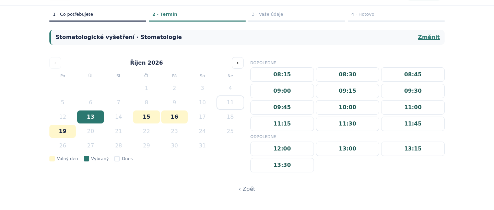
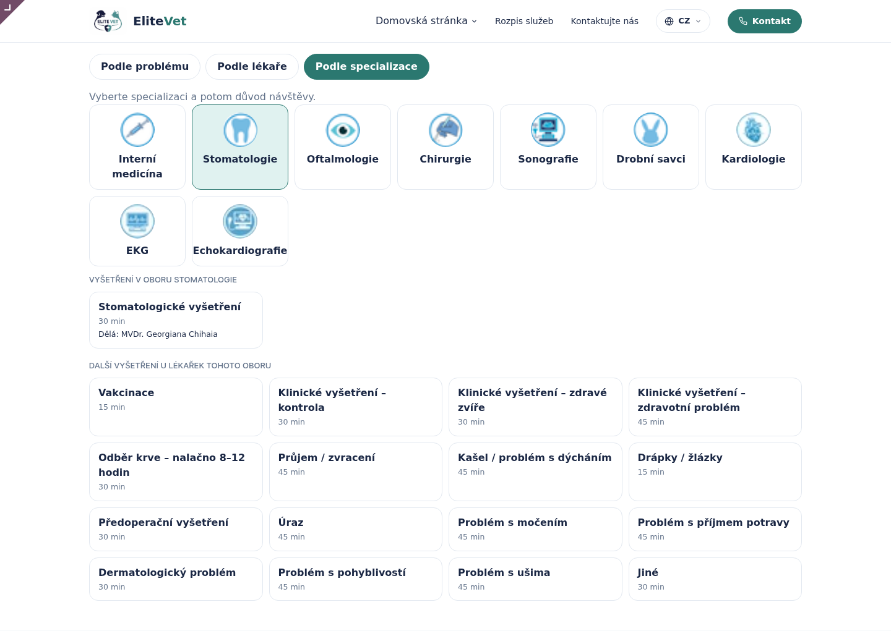
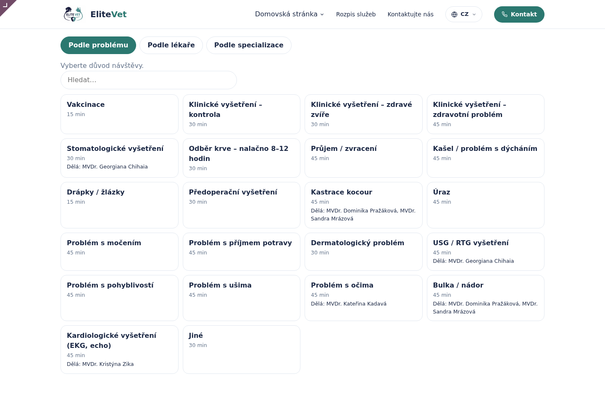
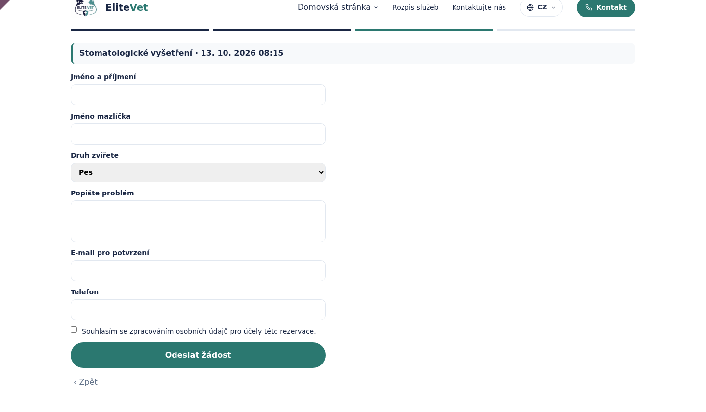
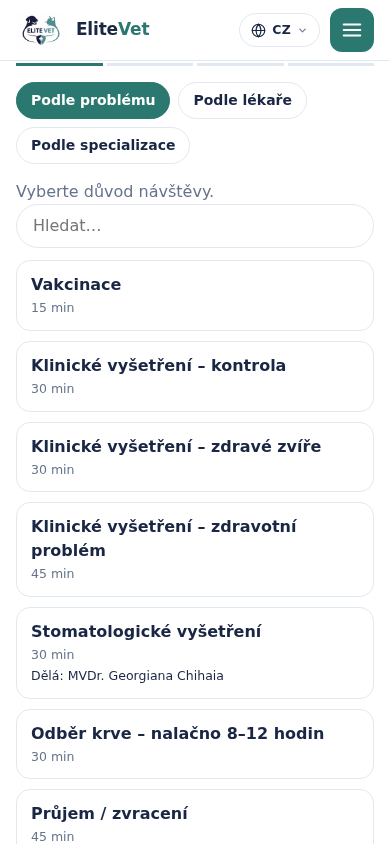

# Reservations – how it works

**What this guide is for.** It explains what the system bases the free slots on, when it offers
which doctor, what happens to a website request and why an unintended double booking does not
happen. It helps reception and managers when they wonder why the website does (or does not) offer a
time. Step-by-step procedures are in the [Reception guide](recepce.md) and the
[Guide for managers](nastaveni.md).

The screens in Odoo are in Czech, so every label below is given in Czech exactly as you see it,
with an English gloss in brackets the first time it appears in a section.

---

## 1. How free slots are calculated

For the chosen **úkon** (procedure) and **day** the system goes through every room where the
procedure is done, as follows:

1. **Opening hours** of the room on that day – from the weekly template (only the rows valid on
   that day), or from an exception if the day has one. The exception "Zavřeno celý den" (Closed all
   day) = nothing.
2. **∩ doctor's service** – the overlap with the times from **Rozpis lékařů** (Doctors' roster) when
   a doctor who does the procedure is on duty in the room. This step applies only when a doctor is
   needed:
   - the procedure has a **Specializace** (Specialization), or
   - the client chose a **particular doctor** or a **field (specialization)**, or
   - the setting **Online jen tam, kde slouží lékař** (Online only where a doctor is on duty) is on.

   Otherwise the opening hours are enough (a procedure without a specialization is offered even if
   the roster is missing).
3. **− taken time** – confirmed and completed reservations, blocks and WinVet calendar entries are
   subtracted (on the website both kinds of block, for reception only full ones – see "What blocks
   a time").
4. **Step** – in the free time that remains, start times are offered every **Krok slotů** (Slot
   step, usually 15 min), aligned to whole steps (8:15, 8:30…). A time is offered only if the
   **whole length of the procedure** fits into the free time.
5. **Minimum notice** – the website offers nothing sooner than **Nejdříve za (hodin)** (Not sooner
   than, hours). Reception (the wizard, suggestions in the calendar) has no such limit – it can book
   even for right now.
6. **Horizon** – the website offers days at most **Nejdál dopředu (dní)** (Furthest ahead, days) from
   today. Reception in the wizard up to about 400 days.
7. **Weekend and public holiday** – the website offers nothing on such a day if **Víkendy jen ručně**
   (Weekends manual only) / **Státní svátky jen ručně** (Public holidays manual only) is on in the
   settings (both on by default). Holidays are calculated automatically: fixed ones (1 Jan, 1 May,
   8 May, 5 Jul, 6 Jul, 28 Sep, 28 Oct, 17 Nov, 24–26 Dec) and the movable Good Friday and Easter
   Monday from the date of Easter. Reception does not have this step. A holiday is only **shown** (in
   the calendar, in the wizard, at the till and on the website), no record is created.

Reception can also enter a **manual time** in the wizard: steps 1, 2, 5, 6 and 7 then do not apply at
all. Only a full block prevents it; with another reservation or a WinVet entry the wizard asks and
offers **Přesto vytvořit** (Create anyway).

Example: Ordinace 1 is open 8:15–19:30, a doctor with dentistry is on duty 8:15–14:00, and there is
a confirmed reservation between 9:00 and 9:30. A dental examination (30 min) is offered at 8:15,
8:30, 9:30, 9:45… up to 13:30 (the last start at which 30 minutes end by 14:00).

On the website a time is shown once, even if several rooms are free. Reception chooses the room only
when confirming.

The website calendar highlights only days with at least one free time.

---

## 2. The doctor × procedure rule

A doctor may do a procedure when both of these hold:

1. her card in **Rozpis služeb** (Shift roster) has **Lékařka – přijímá rezervace** (Doctor – accepts
   reservations) ticked, and
2. the procedure **has no specialization** (then any doctor does it), or the doctor has **at least
   one of the procedure's specializations** on her card in **Náš tým** (Our team).

In a particular service in **Rozpis lékařů** (Doctors' roster) you can also limit it with **Jen tyto
úkony** (Only these procedures).

| Procedure | Procedure's specialization | Who does it |
|---|---|---|
| Vakcinace (Vaccination) | – | any doctor |
| Stomatologické vyšetření (Dental examination) | Stomatologie (Dentistry) | only doctors with Stomatologie |
| Kastrace kocour (Tomcat castration) | Chirurgie (Surgery) | only doctors with Chirurgie |

Where the rule shows:

- **Website**: a procedure with a specialization shows "Dělá: …" (Done by); times only in the
  services of those doctors; the **Podle lékaře** (By doctor) tab offers a doctor only her own
  procedures.
- **Reception wizard**: the **Lékařka** (Doctor) field offers only those who do the procedure.
- **Kalendář** (Calendar): the suggestions "Potvrdit → Ordinace · lékařka" (Confirm → room · doctor)
  only with a doctor who does the procedure and is on duty in the room at that time. If several are
  on duty, the one whose service starts earlier is offered (or the one the client chose).
- **Úkony** (Procedures): the **Kdo dělá** (Who does it) column shows the result of the rule.

When a card is dragged in the calendar the rule is checked, but reception can override it with
**Přesto přesunout** (Move anyway) or **Přesto potvrdit** (Confirm anyway). It is **not checked** when
reception changes the doctor by hand in the form. There reception decides.

*Older screenshot: the first tab is now called Podle úkonu.*

---

## 3. The path of a website request

This path applies when the setting **Rezervace na webu** (Reservations on the website) is **Elite Vet
(náš kalendář)** (Elite Vet, our calendar). With **WinVet (podle adresy)** (WinVet, by address) the
website shows the WinVet form and no requests reach Odoo (see the
[Guide for managers](nastaveni.md)).

*Older screenshot: the first tab is now called Podle úkonu.*

1. On the page /rezervacni-system the client goes through 4 steps: **Co potřebujete** (What do you
   need – by procedure, doctor or specialization) → **Termín** (Date and time) → **Vaše údaje** (Your
   details) → **Hotovo** (Done).
2. On sending, the system **checks again** that the time is still free. If not, the client sees a
   message and chooses another time.
3. A reservation is created with the status **Čekající z webu** (Waiting from the website) – without
   a room, with the source "Web". It does **not block** the time yet.
4. Two e-mails go out: "request received" to the client, and a notice to the clinic at **E-mail pro
   upozornění** (Notification e-mail, if **Posílat klinice upozornění**, Send notifications to the
   clinic, is on).
5. A notice pops up for everyone logged in with reservations, and the card appears in the **Čekající
   z webu** panel in the calendar.
6. Reception **confirms** the request (a suggestion, dragging, or the form with a chosen room) or
   **rejects** it.
7. On confirmation the client and pet are looked up or created, the reservation gets a room and the
   status **Potvrzená** (Confirmed), and the client gets an e-mail with the confirmation and a
   cancellation link.
8. Rejecting = status **Zrušená** (Cancelled), and the client gets a cancellation e-mail, with
   reception's message if one was written.

*Older screenshot: the Popište problém field is now called Upřesněte důvod návštěvy (Specify the reason for your visit).*

Spam protection on the website: a hidden field for robots, checks of the details (first and last
name, a valid e-mail, phone, consent) and at most 5 requests sent per 10 minutes from one address.

The website also works on a phone:

*Older screenshot: the first tab is now called Podle úkonu.*

### Website or clinic (Zdroj)

Every reservation has a **Zdroj** (Source): **Web** (the booking form and the website chat), or
**Klinika** (Clinic: the Nová rezervace wizard, the till, a second room). The source is set on
creation and does not change – not even when a website request is confirmed.

- **Kalendář** (Calendar, in Odoo and at the till): a blue **WEB** tag and a blue dashed outline on
  website reservations, a white tag with the **initials** of whoever created the reservation at the
  clinic (the user who created it; hover for the name and time of creation), a grey **WinVet** on
  WinVet entries. The browser remembers the **Vše | Web | Klinika** (All | Website | Clinic) switch;
  WinVet entries appear only under "Vše". The second room of a two-doctor procedure takes the source
  and author of the main reservation.
- **Lists** Rezervace (Reservations) and Historie rezervací (Reservation history): the columns
  **Zdroj** and **Založil(a)** (Created by), the filters **Z webu** (From the website) / **Z kliniky**
  (From the clinic), grouping by Zdroj. A website reservation has no "Založil(a)" (the website's
  public user creates it).
- The till, **Dnes › Přicházejí** (Today › Arriving): a **WEB** tag on website reservations.

### Reservation statuses

| Status | When | Blocks the time? | In the calendar |
|---|---|---|---|
| **Čekající z webu** (Waiting from the website) | Came from the website, nobody has confirmed it | no | only in the left panel |
| **Potvrzená** (Confirmed) | Reception confirmed it or created it | **yes** | white card with coloured stripes |
| **Proběhla** (Completed) | Reception marked it after the visit | **yes** | paler card |
| **Nedorazil** (No-show) | The client did not come | no | paler card |
| **Zrušená** (Cancelled) | Cancelled by the clinic or the client, or rejected | no | not visible |

---

## 4. What blocks a time

**Blocks:** confirmed reservations, completed reservations, blocks (until they are cancelled) and
WinVet calendar entries with a time (all-day entries do not). A block without a room blocks **all
rooms**. When a full block for all rooms is created over a time where some room already has a full
block, it is split by room and only the free periods are filled in.

But it depends on the kind of block and on who is booking:

| | Website (public booking) | Reception (wizard, dragging, suggestions, saving) |
|---|---|---|
| Confirmed / completed reservation | blocks | blocks, you can book over it after a warning (**Přesto…**, Anyway) |
| WinVet calendar entry with a time | blocks | blocks, you can book over it after a warning (**Přesto…**) |
| Full block | blocks | blocks, you cannot book over it |
| Website-only block | blocks | **does not block** |
| Unconfirmed website request | holds one place | **does not block** (you see it in the panel) |
| Weekend / public holiday (per settings) | blocks the whole day | does not block |
| Outside opening hours / no doctor's service | not offered | not offered, but possible with a manual time |

The rule for "what is taken" is shared by the website and reception, so they cannot drift apart. A
full block cannot be created over a confirmed reservation; a website-only block can be created at any
time.

**An unconfirmed website request holds a place.** A request has no room yet, so it "mentally" holds
the one it could be confirmed in (the first online room for the procedure that is free and has a
doctor who does the procedure on duty; an older request takes priority). When two rooms are free at
that time, the website offers the time until two requests arrive. So another client does not get a
time someone is already asking for. Rejecting the request frees the place; after confirmation the
reservation itself holds it.

**Does not block:** waiting website requests, cancelled reservations, Nedorazil (No-show).

The consequence: two website requests can arrive for the same time. After the first is confirmed, the
suggestions disappear from the second and reception reschedules it.

---

## 5. Protection against double booking

The free slot calculation only **advises** what to offer. The check on **saving** has the last word:
before it is written, every confirmed reservation and full block is compared with the others in the
same room (with reservations and full blocks, and for reservations also with WinVet entries; a
website-only block does not count and is not checked itself). If it overlaps, saving is refused with
the message "Termín … v ordinaci … je obsazený: …" (The time … in room … is taken: …).

The exception: reception can knowingly place a reservation over another reservation or a WinVet entry
with **Přesto vytvořit** (Create anyway), **Přesto přesunout** (Move anyway), **Přesto potvrdit**
(Confirm anyway) or, at the till, **Přesto objednat** (Book anyway). A note stays in the reservation
history and the cards sit side by side in the calendar. This is not possible over a full block, and
the website never offers a taken time.

When two receptionists (or a receptionist and the website) save the same time at the same moment, the
system briefly "locks" the room. The second write waits, sees the first reservation and ends with the
message about the taken time. So an unintended double booking does not happen even then.

**Rozpis lékařů** (Doctors' roster): one doctor can be on duty in two rooms at once (overlapping
shifts in different rooms are fine – free times are calculated per room, so she can be booked into
both at that time). Two services of the same doctor over each other in the **same** room cannot be
saved – it would only be a duplicate (for a shift from **Rozpis služeb**, Shift roster, the message is
"Směnu … nejde propsat do rezervací", the shift cannot be carried over to reservations).

---

## 6. Live updates

Every change to a reservation, block or Rozpis lékařů (creating, editing, deleting) sends a message to
everyone logged in from the Recepce (Reception) group (and so also managers). An open calendar redraws
itself quietly right away. A new website request and a client's cancellation request also show a
notice.

Bulk changes (copying the roster, a repeated block) send just one message. In case the connection
drops, the calendar also reloads itself once a minute.

---

## 7. Website languages

- Booking on the website is in **Czech, English, German and Russian**, depending on the website
  language the client chooses.
- Procedure names, instructions for the client and texts from the settings appear in the client's
  language if they are translated (a manager translates them directly in the record).
- The language is saved on the reservation as **Jazyk rezervace** (Reservation language) and **all
  e-mails to the client** then go in that language.
- In the reception wizard the client's language is prefilled, Czech for a new client. You can change
  it in the wizard and in the reservation form.
- A new client gets the language in their profile, also when created from a website request. An
  existing client's profile does not change.
- Notices for the clinic and the calendar are always in Czech.

---

## 8. What the system cannot do yet

- **Online deposit payment** – no payment gateway is connected. A deposit is only recorded (Čeká na
  zálohu – Waiting for the deposit / Zaplaceno – Paid / Vráceno – Refunded) and reception sends the
  payment details.
- **SMS** – reminders and confirmations go by e-mail only.
- **Changing the length by dragging** in the calendar – the length is changed in the form (the Konec
  field, End) or in the window after dragging (the Do field, To).
- **Dragging to another day** – another day is set in the window after dragging (the Datum field,
  Date) or in the form (the Začátek field, Start).
- **A weekly grid in Kalendář** – Kalendář shows one day; a weekly overview is in Rezervace → the
  calendar view.
