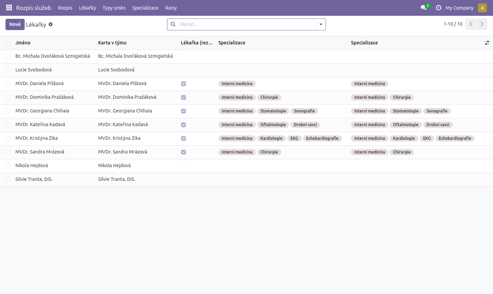
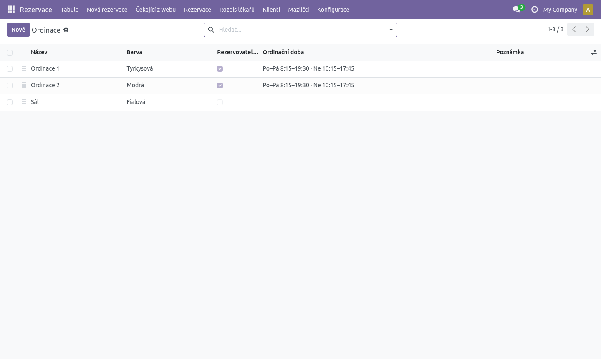
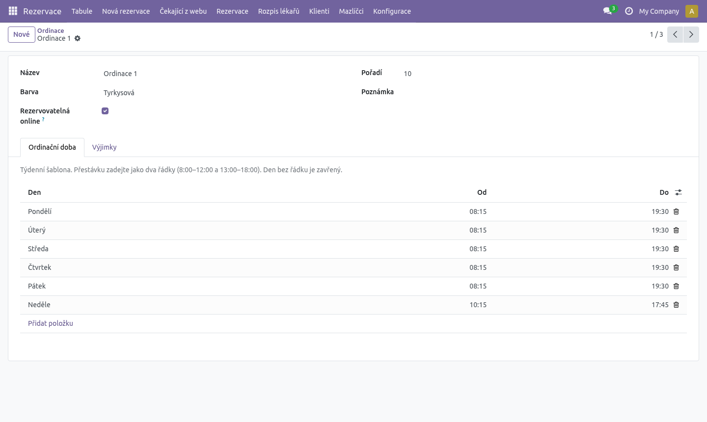
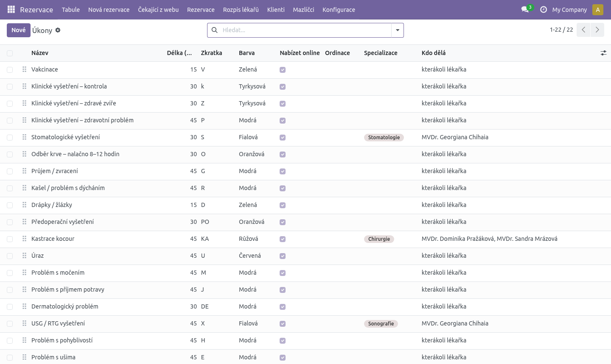
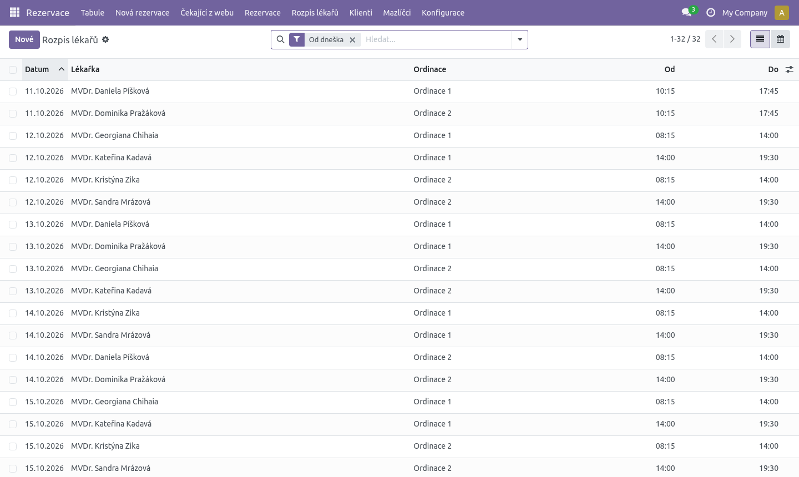
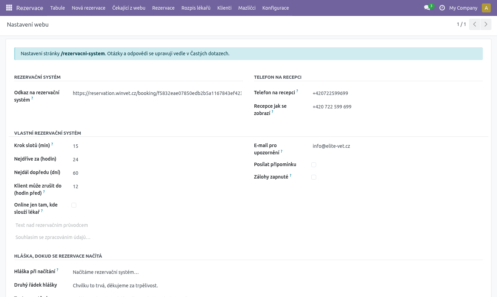

# Reservations – guide for managers (setup and maintenance)

**What this guide is for.** It takes you through the first setup of the reservation system and
its regular upkeep: doctors, procedures, rooms and opening hours, the doctors' roster, website
booking settings and e-mails. It is for the clinic's management or whoever looks after the
settings. Daily reception work is covered by the [Reception guide](recepce.md), how free slots
are calculated by [How it works](jak-to-funguje.md), and the monthly shift plan by
[Staff planning](../../../elite_vet_planning/doc/en/planovani.md).

The screens in Odoo are in Czech, so every label below is given in Czech exactly as you see it,
with an English gloss in brackets the first time it appears in a section.

The screenshots are older: the top menu in them still says "Tabule", today that item is called
**Kalendář** (Calendar).

Recommended order for the first setup: **rights → doctors → specializations → rooms and opening
hours → procedures → doctors' roster → reservation settings → checklist**.

---

## 1. User rights

In **Nastavení → Uživatelé** (Settings → Users), choose for each person in the **Rezervace**
(Reservations) part:

| Group | What they may do |
|---|---|
| **Recepce** (Reception) | Calendar, new reservation, waiting requests from the website, reservations, clients and pets, and **blocks** (create, move, edit, cancel, delete). They can only view **Rozpis lékařů** (Doctors' roster). They do not have the configuration in their menu. |
| **Správce rezervací** (Reservation manager) | Everything Reception can do, plus **Historie rezervací** (Reservation history, including the **Obnovit** (Restore) action), **Konfigurace** (Configuration: **Ordinace** (Rooms), **Výjimky ordinační doby** (Opening-hours exceptions), **Úkony** (Procedures), **Nastavení rezervace** (Reservation settings), **Časté dotazy** (FAQ)), **Nastavení kontaktu** (Contact settings), editing **Rozpis lékařů**, and the actions **Zkopírovat na další týden** (Copy to next week) and **Převzít rozpis do rezervací** (Take over the roster into reservations). |

The system administrator gets Správce rezervací automatically. The roles **Sestra** (Nurse) and
**Lékařka** (Doctor) and the room accounts have the rights of Recepce, not of Správce rezervací:
they can change blocks but not the settings. **Vedení** (Management) is Správce rezervací.

**Blocks.** Blocks are created and changed by Recepce and every role above it (Sestra, Lékařka,
room accounts, Správce rezervací). Anyone without one of these roles who tries to change a block
gets the message "Blokace může měnit jen recepce nebo správce rezervací." (Only reception or a
reservation manager can change blocks.)

**Settings for managers only.** The settings (Nastavení rezervace and Nastavení kontaktu are one
record) can be saved only by Správce rezervací. Someone who has only calendar or website manager
rights (**Hlavní stránka** (Home page), **Ceník** (Price list)) does not see the settings in the
menu, and if they open them anyway, saving ends with the message "Nastavení může měnit jen správce
rezervací." (Only a reservation manager can change the settings.) The website keeps reading the
settings for everyone.

Doctors and specializations are edited in the apps **Rozpis služeb** (Shift roster) and **Náš tým**
(Our team). You need rights in those apps too (in Rozpis služeb the group **Správce rozpisu**
(Roster manager)).

---

## 2. Doctors

*Older screenshot: today's list also has the columns Účet, Barva v kalendáři and Výchozí ordinace, and the menu has more items (Plánování, Personál…).*

The list of people is in **Rozpis služeb → Lékařky** (Shift roster → Doctors). It holds the whole
team (nurses and reception too), because the public shift roster is built from it. Only a doctor
can receive reservations, though.

For each veterinary doctor:

1. Open her in **Rozpis služeb → Lékařky**.
2. Tick **Lékařka – přijímá rezervace** (Doctor – accepts reservations); in the list the column is
   "Lékařka (rezervace)".
3. Check **Karta v týmu** (Team card), the link to her card on the Náš tým page. Specializations
   come from that card.
4. Change **Barva v kalendáři** (Calendar colour) if you wish. In the reservation calendar this
   colour is used for the left stripe on the cards of her reservations, her duty and her label.
   The colour is assigned automatically (a different one for each doctor), so you only need to
   adjust it when two look alike.
5. Fill in **Výchozí ordinace** (Default room), the room where she usually works. It is prefilled
   on each new shift in Rozpis služeb, so the shift reaches reservations by itself (see chapter 6).
   On a specific shift the room can be changed or removed.
6. Fill in **Účet** (Account), the person's login account. This is how the system knows who is
   logged in (for example in **Moje dostupnost** (My availability)). One account belongs to one
   team member only.
7. Fill in **Číslo KVL** (Veterinary Chamber number) if you wish. It is printed next to the treating
   doctor's name on the visit report.

What the tick does:

- only doctors with the tick can be entered in **Rozpis lékařů** (Doctors' roster),
- only they are offered to clients on the website (the **Podle lékaře** (By doctor) tab) and in the
  reception wizard.

At installation the tick was set for everyone with the title "MVDr." and the team card was linked
by matching name. From then on it is up to you.

## 3. Specializations (who does what)

Specializations are set **on the doctor's card in Náš tým → Členové týmu** (Our team → Team
members), field **Specializace** (Specializations). In Rozpis služeb (Shift roster) they are only
visible and cannot be changed.

Specializations have two purposes:

- the **Podle specializace** (By specialization) tab on the website is sorted by them (a field is
  offered only if at least one doctor has it),
- they tell the system **who does which procedure** (see Procedures).

A new specialization is created in **Náš tým → Specializace** (or Rozpis služeb → Specializace),
its icon in **Ikony** (Icons).

---

## 4. Rooms and opening hours

**Rezervace → Konfigurace → Ordinace** (Reservations → Configuration → Rooms). Each room is one
column in **Kalendář** (Calendar).

| Field | Meaning |
|---|---|
| **Název** (Name) | What the room is called in Kalendář and in the e-mail to the client. |
| **Barva** (Colour) | Colour of the bar above the column in Kalendář. |
| **Rezervovatelná online** (Bookable online) | Untick for the operating theatre and rooms clients should not book from the website. In Kalendář they then carry the label "interní" (internal). |
| **Pořadí** (Order) | Order of the columns in Kalendář (you can also drag rows in the list). |
| **Poznámka** (Note) | For you only. |

The list has an **Ordinační doba** (Opening hours) column with a summary, for example
"Po–Pá 8:15–19:30 · Ne 10:15–17:45" (Mon–Fri, Sun).

### Ordinační doba tab (Opening hours: the weekly template)

1. **Přidat položku** (Add a line) → **Den** (Day), **Od** (From), **Do** (To).
2. A day without a line = closed.
3. **A break** = two lines on the same day, for example 8:00–12:00 and 13:00–18:00. The lines must
   not overlap.
4. **Platí od / Platí do** (Valid from / Valid to; hidden columns, switch them on with the icon on
   the right of the table header) are for summer and winter hours. Prepare a second set of lines
   with a validity period and you do not need to delete anything. Empty = always valid.

### Výjimky tab (Exceptions: one day is different)

An exception takes priority over the template.

| Case | What to fill in |
|---|---|
| Public holiday, stocktaking, training | **Datum** (Date), tick **Zavřeno celý den** (Closed all day), **Poznámka** (Note) |
| Shorter or different hours | **Datum**, **Od** (From), **Do** (To) |
| Open as an exception (for example a Saturday) | **Datum**, **Od**, **Do** – an exception can also open a day the template does not have |

There can be only one exception per day and room. You will find the exceptions of all rooms
together in **Konfigurace → Výjimky ordinační doby** (Configuration → Opening-hours exceptions).

An exception applies to one room. If you are closing the whole clinic, enter it for every room (or
create a block in Kalendář with all rooms ticked).

Public holidays are calculated automatically and the website does not book on them (chapter 7).
Enter an exception for them only if the day should also be closed in reception's Kalendář.

---

## 5. Procedures

**Rezervace → Konfigurace → Úkony** (Reservations → Configuration → Procedures). A procedure is the
reason for the visit that the client chooses. The list can be edited directly in the rows; change
the order by dragging.

| Field | Meaning |
|---|---|
| **Název** (Name) | What the client sees on the website and in the e-mail. It can be translated (see Translations). |
| **Délka (min)** (Duration) | How long the procedure takes. A multiple of 5 minutes. |
| **Zkratka** (Abbreviation) | 1–3 characters on the card in **Kalendář** (V, P, KA…). |
| **Barva** (Colour) | Colour of the right stripe on the card in Kalendář (the card itself is neutral, the left stripe has the doctor's colour). The list has strong and light colours (light blue, yellow, mint…). |
| **Vlastní barva** (Custom colour) | Any colour you like (picked from a palette). It takes priority over **Barva**; choosing a colour from the list clears it again. The field **V kalendáři** (In the calendar; the column **Ukázka** (Preview) in the list) shows the result. |
| **Nabízet online** (Offer online) | Unticked = for reception only, not offered on the website. |
| **Ordinace** (Rooms) | Where the procedure is done. Empty = in all rooms bookable online. |
| **Specializace** (Specializations) | **Who does the procedure**: only doctors with at least one of these specializations. Empty = any doctor. |
| **Kdo dělá** (Done by; column in the list) | A check: the names of the doctors who do the procedure. "kterákoli lékařka" (any doctor) = a procedure without a specialization. "žádná lékařka – zkontrolujte specializace" (no doctor – check the specializations) = nobody does the procedure and **it will have no slots on the website**. |
| **Instrukce pro klienta** (Instructions for the client) | For example "Bring the animal fasted". Shown on the website, in the confirmation e-mail and in the reminder. |
| **Vyžaduje zálohu** (Requires a deposit) / **Záloha** (Deposit) | The deposit amount. Shown only when deposits are switched on (see Reservation settings). |

Tip: rather than deleting a procedure you no longer want to offer, **archive** it (**Akce →
Archivovat**, Action → Archive). A procedure used in reservations cannot be deleted.

Keep the procedure **Jiné** (Other) in the list: it is filled in on every reservation where reception
does not choose a procedure.

---

## 6. Doctors' roster

**Rezervace → Rozpis lékařů** (Reservations → Doctors' roster). Who works when and in which room.
The roster decides that:

- the website offers slots "with a doctor" and procedures with a specialization,
- reception sees in the column headers of **Kalendář** (Calendar) who is on duty,
- Kalendář suggests "Potvrdit → Ordinace · lékařka" (Confirm → Room · doctor),
- the new reservation wizard (a click in Kalendář and **Nová rezervace** (New reservation)) and
  booking at the till prefill the doctor who works in that room at that time (it can be changed).

### Shifts are entered once, in Rozpis služeb

Duties are not entered twice. The monthly plan for the whole team is made in **Rozpis služeb →
Plánování** (Shift roster → Planning), and every assignment in it is a shift in Rozpis služeb (see
[Staff planning](../../../elite_vet_planning/doc/en/planovani.md)). A single shift can also be entered
directly: a doctor's shift in **Rozpis služeb → Rozpis** (Shift roster → Roster; list and calendar)
has an **Ordinace** (Room) column:

1. Enter the shift as usual: **Datum** (Date), **Lékařka** (Doctor), **Směna** (Shift).
2. **Ordinace** is prefilled from the doctor's **Výchozí ordinace** (Default room; Rozpis služeb →
   Lékařky). It can be changed or removed.
3. **Čas Od–Do** (Time From–To) is prefilled from the shift type (**Rozpis služeb → Typy směn**,
   Shift roster → Shift types) and can be changed on each shift (say 9:00–13:00 instead of the whole
   morning). When the shift type changes, the time is set again from the new type. The website keeps
   showing the time of the shift's type.
4. A shift with a room **reaches Rezervace → Rozpis lékařů by itself**: date, doctor and time from
   the shift. A night duty (20:00–8:00) reaches reservations only up to midnight.
5. A shift without a room does not reach reservations. That is how it stays for nurses and reception
   (the room cannot even be filled in for them) and for a doctor who is not working in a room that
   day.

From the Rozpis služeb calendar: click a day → a small form with the date, shift, doctor and room.
Click an existing shift → **Upravit** (Edit) opens the shift, room included.

Directly from **Kalendář** (Rezervace → Kalendář), if you have the right to edit Rozpis služeb:

- **A click on the doctor's name** in the room header (or on her coloured band in the column) opens
  her shift from Rozpis služeb. You change the doctor, shift, time From–To or room, and after saving
  this reaches the roster on the website and Kalendář. A manually entered duty (custom time) opens
  its own form from Rozpis lékařů.
- **Smazat službu** (Delete duty) at the top of that window deletes the duty after you confirm: it
  disappears from the roster, from Kalendář and from the free slots on the website.
- **+ služba** (+ duty) in the room header adds a new shift to Rozpis služeb with the day from
  Kalendář and this room prefilled (the room stays even if the doctor has a different default).
- Without the right (reception) the name is only displayed and a click on the band creates a
  reservation.

What happens next:

- **A change** of the room, doctor, date, time or shift type shows up immediately in the duty in
  reservations.
- **Removing** the room, deleting the shift or changing it to a full-day note (**Zavřeno**, Closed)
  deletes the duty in reservations.
- **Changing the time of a shift type** (**Typy směn** → **Od**/**Do**) rewrites the time of shifts
  **from today on** that had the type's time; shifts with a manually changed time and days already
  worked stay as they were.
- If the doctor already had a manually entered duty that day overlapping the shift, the shift
  **takes it over** (links it and rewrites it to the room and time of the shift), so no duplicate
  appears. **Jen tyto úkony** (Only these procedures) and the note stay on it.
- Shifts of one doctor may overlap if they are in different rooms (she serves both at once).
- If a shift cannot be carried over (the doctor is already on duty in the same room at that time),
  saving ends with the message "Směnu … nejde propsat do rezervací: …" (The shift … cannot be carried
  over into reservations: …).

Duties from the roster are marked **Z rozpisu služeb** (From the shift roster; a column and a filter)
in Rozpis lékařů; in Kalendář it is in the bubble on the doctor's stripe. The doctor, room, date and
time of these duties are changed only in Rozpis služeb. Trying to edit or delete them here ends
with the message "Tato služba je z Rozpisu služeb – upravte ji tam." (This duty comes from the shift
roster – edit it there.) Only **Jen tyto úkony** and **Poznámka** (Note) can be edited here. The
exception is **Změnit ordinaci** (Change room) in the weekly calendar of Rozpis lékařů: clicking a
duty offers the rooms, and the change is written to the shift as well.

### Taking over the existing roster

Shifts entered earlier have no room. **Rozpis služeb → Převzít rozpis do rezervací** (Shift roster →
Take over the roster into reservations; only Správce rezervací / Vedení) carries them over in one
go: shifts **from today on** without a room get the doctor's default room and so reach reservations.
The message says "Propsáno X. Přeskočeno: bez výchozí ordinace Y, kolize Z." (Carried over X.
Skipped: no default room Y, clash Z.) A clash means the doctor has another duty at that time. It
does not run by itself (not even on a module update); it can be run again, and shifts already
carried over are skipped.

### Manual duties (outside the roster)

A duty that is not in Rozpis služeb (custom time, half a shift, covering for someone) can still be
entered directly here:

1. Click **Nové** (New), or add a row to the list.
2. **Datum** (Date), **Lékařka** (Doctor), **Ordinace** (Room), **Od** (From), **Do** (To).
3. Optional (hidden columns): **Jen tyto úkony** (Only these procedures) – during this duty the doctor
   does only the selected procedures (empty = all she can do); **Poznámka** (Note).

A manually entered duty is deleted with the **Smazat službu** (Delete duty) button in its form.

One doctor cannot have two overlapping duties in the same room; she may serve two different rooms
at once. Two doctors can work in the same room at the same time: **Kalendář** (Calendar) shows them as
two coloured bands side by side and a label "2 lékařky 10:00–14:00" (2 doctors) in the column header.
The room's capacity stays **one patient at a time**; a second doctor only means that either of them
can do the procedure. The website will not offer another slot, but reception may use a taken slot
after a warning (not over a full block).

The list has the default filter **Od dneška** (From today), can be grouped by **Den** (Day),
**Lékařka** and **Ordinace**, and filtered by **Z rozpisu služeb** / **Zadané ručně** (Entered
manually). At the top right you can switch to the weekly calendar.

### Copying a week

1. In the list, select the duties you want to repeat (for example filter a week and tick everything).
2. **Akce → Zkopírovat na další týden** (Action → Copy to next week).
3. The duties are copied 7 days ahead. A copy that would overlap another duty of the same doctor in
   the same room is skipped, and so is a duty of a doctor who no longer accepts reservations. The
   message says "Zkopírováno X, přeskočeno Y." (Copied X, skipped Y.)
4. Only **manual** duties are copied. Duties from the shift roster are skipped (the message counts
   them separately); the next week is entered in Rozpis služeb.

---

## 7. Reservation settings

*Older screenshot: today the Rezervace na webu switch and Adresa formuláře WinVet are at the top, and many of the fields from the table below are missing here. The table is what counts.*

**Rezervace → Konfigurace → Nastavení rezervace** (Reservations → Configuration → Reservation
settings), the part **Vlastní rezervační systém** (Own booking system).

| Field | Default | What it does |
|---|---|---|
| **Krok slotů (min)** (Slot step) | 15 | How many minutes apart start times are offered (8:15, 8:30…). A multiple of 5. Also the grid of **Kalendář** (Calendar). |
| **Nejdříve za (hodin)** (Earliest in, hours) | 24 | The website cannot book sooner than this many hours ahead. Reception has no such limit. |
| **Nejdál dopředu (dní)** (Furthest ahead, days) | 60 | How far ahead the website offers slots. Reception can go up to about 400 days. |
| **Klient může zrušit do (hodin před)** (Client can cancel until, hours before) | 12 | Up to how many hours before the appointment the cancel link in the e-mail works. A web request not yet confirmed is cancelled by the link straight away. For a confirmed reservation the link only sends a **cancellation request**: the reservation stays until reception decides in Kalendář (**Potvrdit zrušení** (Confirm cancellation) / **Ponechat** (Keep)). **0** = the client cannot cancel by link. |
| **Online jen tam, kde slouží lékař** (Online only where a doctor is on duty) | off | On: the website offers a slot only when the room has a duty entered in **Rozpis lékařů** (Doctors' roster). Off: procedures without a specialization are offered according to opening hours, even if the roster is missing. |
| **Víkendy jen ručně (web neobjednává)** (Weekends by hand only, website does not book) | on | The website offers no slots on Saturdays and Sundays. Reception keeps booking (also by entering a manual time). |
| **Státní svátky jen ručně (web neobjednává)** (Public holidays by hand only, website does not book) | on | The website offers no slots on a public holiday. Holidays (including Good Friday and Easter Monday) are calculated automatically, nothing needs entering. Reception keeps booking. |
| **Posílat klinice upozornění** (Send notifications to the clinic) | on | Off = the clinic gets no notifications (new web request, cancellation or cancellation request by a client). E-mails to clients keep going. |
| **E-mail pro upozornění** (E-mail for notifications) | rezervace@elite-vet.cz | Receives a notification about each new web request and each cancellation or cancellation request by a client. The field is visible and required only when "Posílat klinice upozornění" is on. |
| **Odesílatel e-mailů** (E-mail sender) | rezervace@elite-vet.cz | The address clients receive reservation e-mails from. It must be the mailbox Odoo sends through (see *Sending e-mails* below). You can also enter it with a name: `Elite Vet Karlovy Vary <rezervace@elite-vet.cz>`; without a name "Elite Vet Karlovy Vary" is added. |
| **Odpovědi klientů na** (Client replies to) | info@elite-vet.cz | Where a reply goes when a client answers an e-mail. Empty = to the sender. |
| **Posílat připomínku** (Send a reminder) | off | Switches on the reminder e-mail to clients. |
| **Připomínka (hodin před)** (Reminder, hours before) | 24 | How many hours before the appointment the reminder goes out (appears once switched on). |
| **Zálohy zapnuté** (Deposits on) | off | While off, deposits are not shown anywhere. |
| **Text nad rezervací** (Text above the booking) | – | Text above the booking wizard on the website. |
| **Text souhlasu pod formulářem** (Consent text under the form) | – | Consent text under the form on the website. Empty = the default sentence. |

The same form also has older parts:

- **Telefon na recepci** (Reception phone) – the fields **Telefon na recepci** and **Recepce jak se
  zobrazí** (Reception as displayed). Used when it is too late to cancel by link ("call reception").
- **Odkaz na rozpis služeb pod rezervací** (Link to the shift roster under the booking) – text and
  button under the booking on the website.
- **Rezervace na webu** (Booking on the website) and **Adresa formuláře WinVet** (WinVet form address) –
  see *Switching website booking* below.
- **Hláška, dokud se rezervace načítá** (Notice while the booking is loading; heading and second
  line) – belongs to the WinVet form only, so it is visible in the form only when **Rezervace na webu =
  WinVet**.
- **Text pod rezervacemi** (Text under the booking) – the field **Text** (for example a sentence about
  the emergency fee). It is visible and editable in both modes: on /rezervacni-system it sits under the
  booking, centred, under the WinVet frame as well as under our wizard. With WinVet it sits in the
  middle of the frame while loading and drops below it afterwards. Empty field = no text. It is not
  shown on /rozpis-lekaru.

### Switching website booking

The field **Rezervace na webu** (Booking on the website; at the top of **Nastavení rezervace**, group
*Rezervace na webu*) says which calendar is on the page **/rezervacni-system**. Only **Správce
rezervací** (Reservation manager) changes it.

| Value | What is on the website |
|---|---|
| **WinVet (podle adresy)** (WinVet, by address) – default | The WinVet form from **Adresa formuláře WinVet** (WinVet form address), including the loading notice, exactly as before. Our web booking system accepts no reservations: the page does not show it and its interface (free days, times, sending a request, booking in the chat) answers "Online rezervace najdete na stránce Rezervační systém." (You will find online booking on the Booking system page.) Instead of booking, the chat offers a link to /rezervacni-system. |
| **Elite Vet (náš kalendář)** (Elite Vet, our calendar) | Our booking wizard is in the same place on the page; web requests arrive in **Rezervace → Čekající z webu** (Reservations → Waiting from the website). The WinVet address is not used (it may stay filled in). |

- With **WinVet**, **Adresa formuláře WinVet** is required. Without it the form will not save
  ("Rezervace přes WinVet potřebují adresu formuláře WinVet…", WinVet booking needs the WinVet form
  address).
- Reception, **Kalendář** (Calendar), the **Nová rezervace** (New reservation) wizard and the till
  book the same way in both modes.
- A new installation and an update of a database without this field start on **WinVet**, so the website
  first shows what was there before. Procedure: set up rooms, procedures, doctors and the roster (the
  checklist in chapter 10), then switch to **Elite Vet (náš kalendář)** and save. You can switch back to
  WinVet at any time; requests that arrived from the website in the meantime stay in **Čekající z
  webu**.
- To check: open /rezervacni-system in a private window (or after logging out) and refresh the page.
  WinVet = the WinVet frame with the notice "Načítáme rezervační systém…" (Loading the booking system…);
  Elite Vet = the steps "1 · Co potřebujete" (1 · What you need) and procedure cards.
- The page **/rozpis-lekaru** follows the switch too. With **WinVet**, the WinVet form is embedded at
  the bottom of the page as before. With **Elite Vet** there is a short prompt in its place: one sentence
  ("Online objednávky přijímáme na stránce rezervačního systému.", We take online bookings on the
  booking system page) and the button **Objednat se online** (Book online), which leads to
  /rezervacni-system (in the page's language: /de/…, /ru/…, /en/…).

### WinVet calendar

Entries from the WinVet calendar appear in **Kalendář** (Calendar) read-only and take up slots.
Management sets which calendars belong to which rooms and which activities to which procedures in
**WinVet data → Kalendář z WinVetu** (WinVet data → Calendar from WinVet), under **Kalendáře →
ordinace** (Calendars → rooms) and **Činnosti → úkony** (Activities → procedures); it is switched off
there in **Zapnout / vypnout** (Switch on / off). What the entries mean in Kalendář is described in the
[Reception guide](recepce.md).

**Deposits:** there is **no** online payment gateway yet. With deposits switched on, the website shows
the amount and tells the client that reception will send the payment details.

---

## 8. E-mail templates

You will find the templates in **Nastavení → Technické → E-mailové šablony** (Settings → Technical →
E-mail templates; developer mode must be on). Search for "Rezervace:".

| Template | When it goes out |
|---|---|
| Rezervace: přijato z webu (received from the website) | to the client after sending a request |
| Rezervace: nová z webu (klinika) (new from the website, clinic) | to the clinic, at **E-mail pro upozornění** (E-mail for notifications) |
| Rezervace: potvrzeno (confirmed) | to the client on confirmation |
| Rezervace: změna termínu (change of appointment) | to the client when a confirmed reservation is moved to another time (not when only the room changes) |
| Rezervace: zrušeno (cancelled) | to the client on cancellation (it can include a message from the clinic from the cancel window), and to the clinic when a client withdraws an unconfirmed request by link |
| Rezervace: žádost o zrušení přijata (cancellation request received) | to the client who asks by link to cancel a confirmed reservation |
| Rezervace: klient žádá o zrušení (klinika) (client asks to cancel, clinic) | to the clinic, at E-mail pro upozornění, when a client asks to cancel a confirmed reservation |
| Rezervace: žádost o zrušení odmítnuta (cancellation request refused) | to the client when reception chooses **Ponechat** (Keep) on a cancellation request |
| Rezervace: připomínka (reminder) | to the client X hours before the appointment (runs every hour), not for a reservation with a pending cancellation request |

When moving or confirming in **Kalendář** (Calendar), the e-mail to the client can be switched off for
that one case with the tick box in the dialog.

The templates are written in English and translated into Czech, German and Russian. The client receives
the e-mail in the **Jazyk rezervace** (Reservation language): from the website that is the language of
the page, and reception chooses it in the wizard or on the reservation. If you edit the text, edit it in
all languages (the language switch next to the field). The address in the confirmation (Hybešova
167/18, Karlovy Vary) is written directly in the template text.

The sender and the reply address are set in **Nastavení rezervace** (Reservation settings; fields
**Odesílatel e-mailů** (E-mail sender) and **Odpovědi klientů na** (Client replies to)).

### Sending e-mails (Forpsi)

Mail for elite-vet.cz is at Forpsi and the domain has SPF `-all` and DMARC `quarantine`: an e-mail with
an @elite-vet.cz sender that does not go out through Forpsi ends up in spam or is refused by the
recipient. So Odoo must send through the Forpsi mail server.

1. **Mailbox.** In the Forpsi administration create the mailbox `rezervace@elite-vet.cz` (or use an
   existing one, such as info@). Make a note of the password.
2. **Outgoing server in Odoo.** Switch on developer mode, then **Nastavení → Technické → Odchozí poštovní
   servery → Nový** (Settings → Technical → Outgoing mail servers → New):

   | Field | Value |
   |---|---|
   | **Popis** (Description) | Forpsi |
   | **Autentizace** (Authentication) | **Uživatelské jméno** (Username) |
   | **SMTP server** | `smtp.forpsi.com` |
   | **SMTP port** | `465` |
   | **Šifrování** (Encryption) | SSL/TLS |
   | **Uživatelské jméno** (Username) | `rezervace@elite-vet.cz` |
   | **Heslo** (Password) | the mailbox password |
   | **Filtr FROM** (FROM filter) | `rezervace@elite-vet.cz` |

   Click **Otestovat připojení** (Test connection). (Port 587 with STARTTLS encryption works too.)
3. **Sender.** In **Nastavení rezervace** leave **Odesílatel e-mailů** = the same mailbox as in step 2.
   Forpsi would refuse an address different from the login.
4. **Web address.** The system parameter `web.base.url` = `https://www.elite-vet.cz` (the cancel link in
   the e-mail is built from it).
5. **Test.** Send yourself a test reservation from the website to your e-mail. Both the e-mail to the
   client and the notification at **E-mail pro upozornění** must arrive, and not in spam.

Forpsi limits: at most 250 e-mails per minute, 1000 per hour and 20,000 per day, which is plenty for
reservations. Forpsi allows sending only from countries on its default list; if the Odoo server runs
abroad (for example in Germany) and the connection test fails on "GeoIP", allow the country for the
mailbox in the Forpsi administration.

During development (Docker in this repository) e-mails are caught by **Mailpit**: nothing goes out and
all e-mails are visible at http://localhost:8025.

---

## 9. Translations

The website is in four languages. Names of procedures and rooms, client instructions and texts in the
settings are translated directly in the record (**not the block reason**: it is an internal note, stored
only once and seen the same by everyone, whatever language your profile is in):

1. Switch your language at the top right (or click the language code next to the field).
2. Rewrite the text.
3. Save and switch back.

Reception always sees Czech names in **Kalendář** (Calendar).

---

## 10. Checklist before launch

- [ ] Doctors have **Lékařka – přijímá rezervace** (Doctor – accepts reservations) and a linked **Karta v
      týmu** (Team card).
- [ ] The cards in **Náš tým** (Our team) have **Specializace** (Specializations).
- [ ] In **Úkony** (Procedures) no online procedure says "žádná lékařka" (no doctor) in **Kdo dělá** (Done
      by).
- [ ] Rooms have opening hours, and the operating theatre has **Rezervovatelná online** (Bookable online)
      unticked.
- [ ] Days when the clinic is closed are entered as **Výjimky** (Exceptions); public holidays are
      calculated automatically, see chapter 7.
- [ ] Doctors have a **Výchozí ordinace** (Default room) and the existing roster has been taken over
      (**Rozpis služeb → Převzít rozpis do rezervací**, Shift roster → Take over the roster into
      reservations).
- [ ] **Rozpis lékařů** (Doctors' roster) is filled in at least **Nejdál dopředu (dní)** (Furthest ahead,
      days) ahead.
- [ ] **Nastavení rezervace** (Reservation settings): e-mail for notifications, reception phone, decision on
      "Online jen tam, kde slouží lékař" (Online only where a doctor is on duty) and on reminders.
- [ ] Test reservation from the website: did both e-mails arrive (to the client and to the clinic)?
- [ ] Test cancellation by the link in the e-mail works.
- [ ] Users have the group **Recepce** (Reception) or **Správce rezervací** (Reservation manager), and team
      members have **Účet** (Account) filled in.
- [ ] Once everything is set up: **Rezervace na webu = Elite Vet (náš kalendář)** (Booking on the website =
      Elite Vet, our calendar), and a check of /rezervacni-system and /rozpis-lekaru in a private window
      (chapter 7, *Switching website booking*).

### Technical server settings (for the Odoo administrator)

- `proxy_mode = True` in `odoo.conf` if Odoo runs behind a reverse proxy (nginx). Otherwise the limit of 5
  submissions per 10 minutes from one IP address counts all clients as the single proxy address and starts
  refusing requests.
- **Odchozí poštovní server** (Outgoing mail server; Nastavení → Technické → Odchozí poštovní servery) must
  be set up and working; e-mails go through the queue (cron "Mail: Email Queue Manager").
- **Odesílatel e-mailů** (E-mail sender) in **Nastavení rezervace** must be the mailbox the outgoing server
  sends through (see Sending e-mails).
- The correct **web address** (`web.base.url`): the cancel link in the e-mail is built from it.
- After updating the module with new translations: `odoo -u elite_vet_reservation --i18n-overwrite` (without
  this, new translations of e-mail templates and texts are not overwritten).
- The cron **Rezervace: připomínky klientům** (Reservations: client reminders) runs every hour (it does
  something only when reminders are on).
- Live updating of **Kalendář** needs a working websocket (`/websocket` through the proxy, in production
  workers + gevent port). Without it Kalendář refreshes once a minute.
