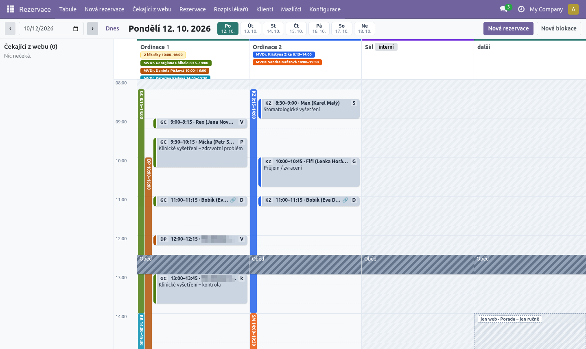
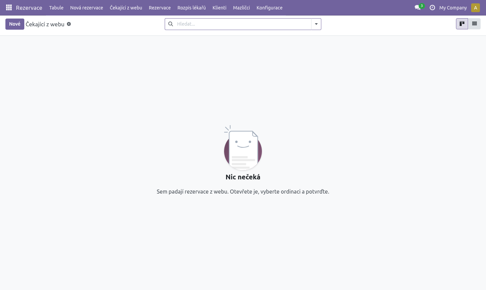
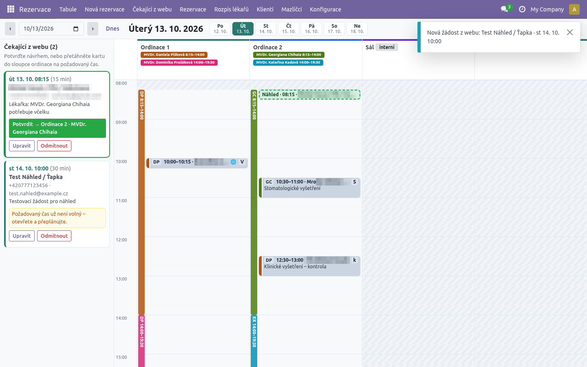
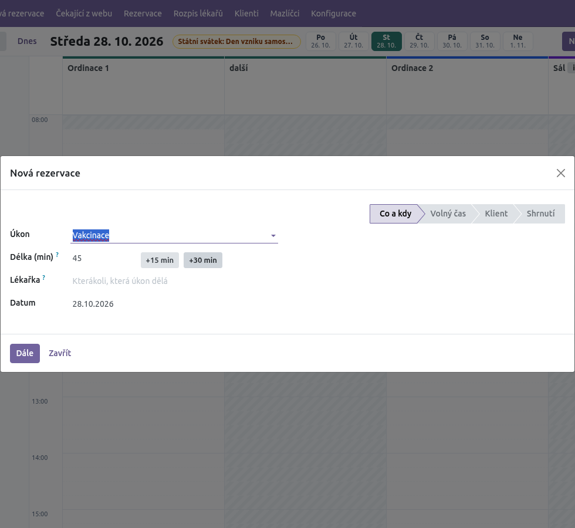
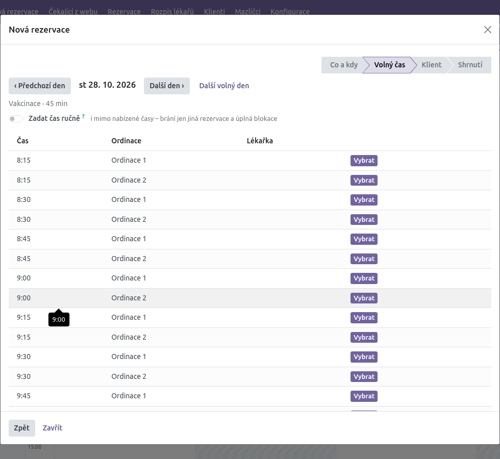
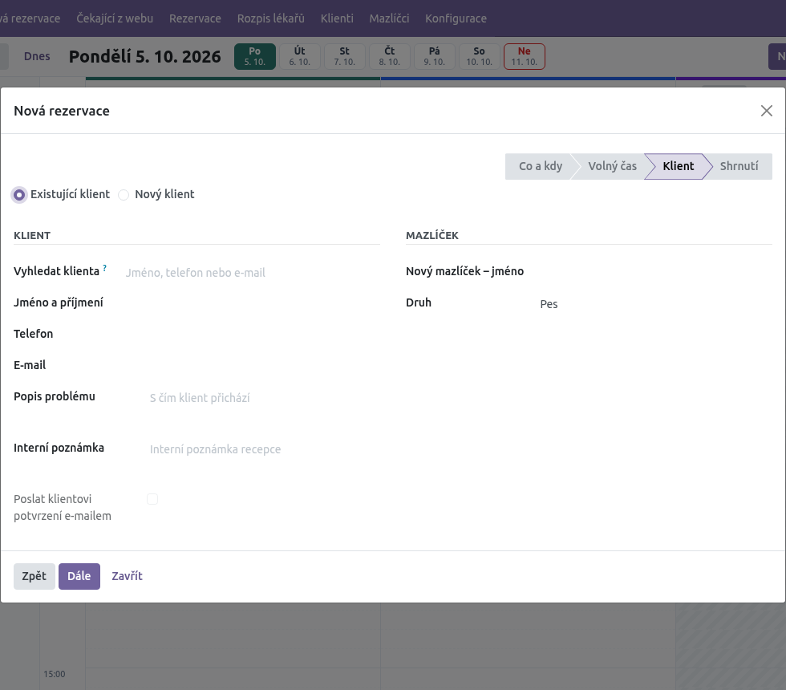
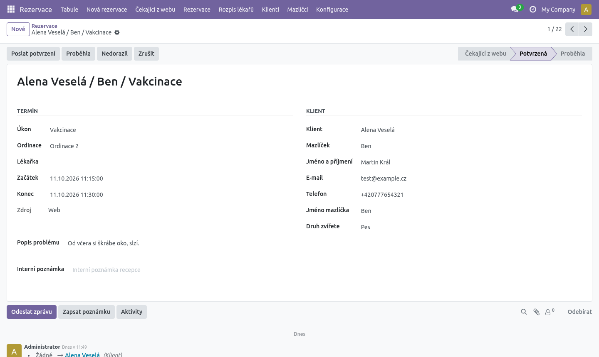

# Reservations – guide for reception

**What this guide is for.** It describes the daily work with reservations in Odoo: the calendar,
requests from the website, creating and moving reservations, blocks and e-mails to clients. It is
written for reception and needs no technical knowledge. How free slots are calculated is explained
in [How it works](jak-to-funguje.md).

The screens in Odoo are in Czech, so every label below is given in Czech exactly as you see it,
with an English gloss in brackets the first time it appears in a section.

Everything is in the **Rezervace** (Reservations) app. The menu at the top has: **Kalendář**
(Calendar), **Nová rezervace** (New reservation), **Čekající z webu** (Waiting from the website),
**Rezervace** (Reservations), **Rozpis lékařů** (Doctors' roster), **Klienti** (Clients),
**Mazlíčci** (Pets), plus **Historie rezervací** (Reservation history) and **Konfigurace**
(Configuration), which only reservation managers see.

---

## 1. Calendar

*Older screenshot: the menu still says "Tabule" and the reservation cards are coloured. Today they are white with coloured stripes, and under the top bar there is a row with the Vše | Web | Klinika switch.*

**Kalendář** (Calendar) shows **one day**. Each room has its own column, with the time axis on
the left.

### Moving between days

The chosen day stays after a page reload for as long as the browser tab is open. The next day the
calendar starts on today.

- **‹** and **›** – previous / next day.
- The date box – jump to any day.
- **Dnes** (Today) – back to today.
- Next to the day heading there is a row of **weekdays** (Mon–Sun). Click one to go to that day.
  The selected day is green, today has a red frame. A public holiday has a light red background
  and a red dot; hover over it to see its name.

The calendar has no weekly grid. To see a whole week at once, open **Rezervace** (Reservations) and
switch to the calendar view at the top right (colours follow the procedure).

### What you see in the calendar

**Where a reservation comes from (website or clinic).** Under the top bar of the calendar there is
one row with a legend and the switch **Vše | Web | Klinika** (All | Website | Clinic):

| Tag on the left of the card | Meaning |
|---|---|
| Blue **WEB** | A reservation from the website (including the website chat) – the client booked it. |
| No tag | Someone at the clinic created the reservation (the Nová rezervace wizard, the till). Hover over the card to see who and when: "Založil(a): Jana Nováková, 26. 10. 2026 9:12" (created by, date and time). |
| Grey **WinVet** | An entry from the WinVet calendar (see below). |

The **Vše | Web | Klinika** switch shows only reservations from the website, or only those from the
clinic. WinVet entries appear only under **Vše** (they are neither from the website nor created in
Odoo); blocks are always visible. The browser remembers your choice (each computer separately).
When the filter is hiding something, "skryto: N" (hidden: N) appears next to the legend – the hidden
place is still occupied.

The second room of a two-doctor procedure has the tag of the main reservation (a website booking
stays WEB in both columns).

| What | Meaning |
|---|---|
| Fine light grey hatching | The room is closed (outside opening hours or an exception). |
| Dark grey hatched band | A full block (e.g. "Oběd", lunch). A block for all rooms runs across all columns. Reservations that were there before the block lie over it; nothing new can be booked there. |
| Light dashed hatching with the tag "jen web" (website only) | A website-only block: the website offers nothing there, you may still book there. A click in it opens the wizard, a click on the tag opens the block. |
| Coloured vertical stripe on the left of the column | A doctor's service: initials and time (e.g. "GC 8:15–14:00"). Each doctor has her own colour, the same as her tag in the header. |
| Two stripes side by side | Two doctors are on duty in the room at the same time (see below). |
| White card with stripes | A reservation. The stripe on the right edge has the procedure's colour (e.g. vaccination green, health problem blue). The stripe on the left edge has the colour of the doctor the client is booked with – the same as her service and tag. A reservation without a doctor has no left stripe. |
| Letter on the right of the card | The procedure's abbreviation (V = vaccination, P = health problem, S = dentistry…). |
| Time · name | E.g. "9:00–9:15 · Rex (Jana Nováková)" = pet (owner). If the reservation has a **Popis** (Description), it comes before the name. A reservation without a client shows only the Popis. |
| Second line | The procedure name (on longer cards only). Under it is the reservation's **internal note**; on a short card (15 minutes) it shows on hover. |
| **WEB** on the left | A reservation from the website – see the legend above. Right after it come the doctor's initials. |
| 🔗 | A joint procedure of two doctors – the reservation is also in another room (hover to see where). |
| Abbreviation on a see-through background (e.g. **GC**) | The doctor's initials – on the left by her coloured stripe, after the WEB tag, if any. Hover to see the full name. |
| Paler card | **Proběhla** (Completed). A reservation marked **Nedorazil** (No-show) is not in the calendar (just like a cancelled one), so that the time shows as free. It stays in Historie rezervací. |
| Red outline and the tag **ZRUŠIT?** (Cancel?) | The client asks to cancel, reception decides (see "Cancellation requests from the client"). |
| Cards side by side | Reservations that overlap in the room (see "A reservation over a taken time"). |
| Tags in the column header | Who is on duty in the room and from when to when, e.g. "MVDr. Georgiana Chihaia 8:15–14:00", in the doctor's colour. |
| Yellow tag "2 lékařky 10:00–14:00" (2 doctors) | Two doctors are on duty in the room at the same time. |
| Red tag by the day heading | "Státní svátek: Den vzniku samostatného československého státu" (public holiday and its name) – always shown on a holiday. If the website does not book on holidays, it is followed by "· web neobjednává" (website not booking). Reception books as usual. |
| Yellow tag by the day heading | "Víkend – web neobjednává" (weekend, website not booking). The website offers nothing that day, reception books as usual. |
| "interní" (internal) by the name | A room clients cannot book from the website (e.g. Sál, the operating room). |
| Red line | The current time (today only). The time is also on the axis. |
| Thin horizontal lines | One line per booking step (usually 15 minutes); the axis is aligned to the step. |
| Light grey card with the **WinVet** tag (not hatched) | An entry from the WinVet calendar (booked in WinVet). The left stripe has the WinVet activity colour, the name is animal (owner) from the card index, otherwise the WinVet text. Read-only: it cannot be dragged or cancelled, a click shows the details. **The time is taken** – the website will not offer it, and reception and the till can book over it only after confirming a warning (see "A reservation over a taken time"). Make changes in WinVet, they appear in the calendar within a few minutes. |
| Tag **WinVet · …** in the column header | An all-day WinVet entry (e.g. a doctor's service or leave). A note only, it does not block any time. |

Cancelled reservations are not shown in the calendar. Management switches the WinVet calendar off
under **WinVet data → Kalendář z WinVetu → Zapnout / vypnout** (WinVet data → WinVet calendar →
Switch on / off); the WinVet cards then disappear and block nothing.

When you hover over a card you see the details: procedure, doctor, phone, e-mail, reason for the
visit, and who created the reservation and when (or "Z webu", from the website). Click the card to
open the whole reservation.

### Two doctors in one room

When two doctors have a service in the same room at the same time in **Rozpis lékařů** (Doctors'
roster), the calendar shows it like this:

- on the left of the column there are **two coloured stripes side by side** – each with the
  initials and service time of one doctor,
- in the column header there is a yellow tag **"2 lékařky 10:00–14:00"** (the period when both are
  on duty).

The room still has **only one place**: normally there can be only one patient there at a time. A
second doctor does not mean twice as many slots – only that either of them can do the procedure.
The initials on the left of the card show which doctor the reservation has.

### Live updates

There is no need to reload the calendar. When anyone changes something (a colleague on another
computer, a client on the website), the calendar redraws itself. When a new request comes from the
website, a notice "Nová žádost z webu: …" (New request from the website) pops up at the top right
and stays until you close it. If the connection drops, the calendar still reloads itself every
minute to be safe.

**Sound.** A new website request also rings (a short "ding-dong") and the notice appears everywhere
in Odoo, not just in the calendar. A client's cancellation request is announced the same way
("Klient žádá o zrušení: …", the client asks to cancel). You switch the sound off with the
**🔔 Zvuk** (Sound) button in the calendar (it changes to **🔕 Bez zvuku**, No sound); the choice
applies to this browser. The browser plays sound only after you have clicked on the Odoo page once,
so after opening it in the morning just click anywhere. After a page reload a request already
announced is not announced again.

---

## 2. Waiting requests from the website

A request the client sends from the website is **not confirmed yet** and **does not block the
time**. It waits for reception to confirm it. You find it:

- in the left panel of the calendar, **Čekající z webu (počet)** (Waiting from the website, with
  the count),
- in the **Čekající z webu** menu (a list of all waiting requests, including older ones).

*Older screenshot: the menu still says "Tabule", and the Nové button is no longer here.*

Each card in the panel shows the requested day and time, length, name, phone and e-mail, the chosen
doctor (if the client picked one) and the reason for the visit.

**Panel width.** The **Čekající z webu** panel can be made wider or narrower: grab its right edge
(the cursor changes to ↔) and drag. The browser remembers the width. A double-click on the edge
restores the default width.

### Preview: where the request belongs

Hover over a request in the **Čekající z webu** panel. The calendar switches to the day of the
request by itself (and stays on that day) and scrolls to the requested time:

- a **green dashed frame** shows where the reservation would go – in the rooms offered by the
  **Potvrdit → …** (Confirm) buttons,
- hovering over a particular button highlights just its room,
- a **red frame** across all rooms means the requested time is no longer free – you can see right
  away what is there.

*Older screenshot: the menu still says "Tabule", and reservation cards are white with coloured stripes today.*

### One-click confirmation (recommended)

Under the card there are green **Potvrdit → Ordinace · lékařka** (Confirm → room · doctor) buttons,
e.g. "Potvrdit → Ordinace 1 · MVDr. Daniela Píšková". The system offers them only in online rooms
where the requested time is free and a doctor who does the procedure is on duty (a procedure that
does not need a doctor is offered without one). To use an internal room such as Sál, drag the
request there.

1. Choose the right button and click it.
2. A window "Potvrdit žádost?" (Confirm the request?) opens with the fields **Datum** (Date), **Od**
   (From), **Do** (To) and **Ordinace** (Room), prefilled from the button, and a sentence like
   "Potvrdit žádost Rex (Jana Nováková) na čt 29. 10. 10:00–10:20, Ordinace 1?". You can correct the
   date, time (in booking steps, usually 15 minutes) and room before confirming, and the sentence
   changes with them. **Do** moves with **Od**; overwrite **Do** to change the length. If you change
   the room, the system picks the doctor from the roster.
3. If the request has an e-mail, the window says "Klient dostane potvrzovací e-mail (adresa)." (the
   client gets a confirmation e-mail) and below it **Poslat klientovi potvrzení** (Send the client a
   confirmation) is ticked. If you untick it, no e-mail goes out and the reservation history keeps
   the note "Klient nebyl o potvrzení informován." (The client was not told about the confirmation.)
4. **Potvrdit** (Confirm): the reservation is written to the chosen room and time. If the time is
   not free or no doctor is on duty there, the message appears right in the window and the window
   stays open – correct the time or room and try again. If **Přesto potvrdit** (Confirm anyway)
   appears in the window, you can confirm regardless and a note stays in the reservation history.
   This is not possible over a full block. **Zrušit** (Cancel) changes nothing.

**Potvrdit do obsazeného** (Confirm into a taken time). When nothing is free at the requested time, but
a room is open and the request would otherwise fit there (a doctor who does the procedure is on duty),
there are orange buttons **Potvrdit do obsazeného → room** under the card. They open the same window
with a warning about what is there and **Přesto potvrdit** (Confirm anyway) already accepted. The
cards then stand side by side in the calendar. It is never offered under a full block.

If you see the text **"Požadovaný čas už není volný – otevřete a přeplánujte."** (The requested time
is no longer free – open and reschedule.), someone has taken the time in the meantime. The text
**"Požadovaný čas už uplynul – otevřete a přeplánujte."** (The requested time has passed – open and
reschedule.) means the time has already started. In both cases follow "Editing a request".

### Dragging to a column

You can drag the card with the mouse into a room column at the chosen time. When you drop it, the
same window opens as with the button: the date, time and room follow where you dropped the card and
can still be corrected (missed by a quarter of an hour? just overwrite the time). Only after
**Potvrdit** is the reservation confirmed and the client gets the confirmation (unless you untick
it). **Zrušit** (or Esc) changes nothing, and the card stays in the waiting panel.

- You drop the card on the day currently shown in the calendar; set a different day in the window,
  in the **Datum** field.
- When dragging, the system checks that the time is free and that a doctor who does the procedure
  (or the one the client chose) is on duty in that room at that time. If not, a red message appears
  ("V 9:00 v Ordinace 1 neslouží lékařka, která dělá …", no doctor who does the procedure is on duty
  in that room at 9:00) and nothing is saved until you correct the time or click **Přesto potvrdit**.
  If only one such doctor is on duty there, she is written to the reservation automatically.

### Editing a request (the **Upravit** button)

1. Click **Upravit** (Edit). The reservation form opens.
2. Fill in **Ordinace** (Room), and change **Začátek** (Start) and **Lékařka** (Doctor) if needed.
3. Click **Potvrdit** (Confirm, top left).

Confirming is not possible without a room. On confirmation the client and pet are looked up
automatically in the card index (by e-mail, then phone), or new ones are created.

Tip: when you confirm a different time from the one the client chose, call them. The e-mail arrives
as a normal confirmation with the new time.

### Rejecting a request (the **Odmítnout** button)

1. Click **Odmítnout** (Reject).
2. A window "Odmítnout žádost" (Reject the request) opens with the question "Odmítnout rezervaci …?
   Klientovi odejde e-mail o zrušení." (the client will get a cancellation e-mail). In the field
   **Zpráva klientovi (nepovinné)** (Message for the client, optional) you can write a reason or
   offer another time. The message goes into the e-mail.
3. Click **Odmítnout**. **Zpět** (Back) changes nothing.

The request is cancelled and the client gets an e-mail saying the appointment is cancelled, with a
link for booking again.

### Cancellation requests from the client

A client can cancel a reservation with the link in an e-mail. For a confirmed reservation this is
only a **request**: the reservation stays and the left panel shows **Žádosti o zrušení (počet)**
(Cancellation requests, with the count). The card in the calendar has a red outline and the tag
**ZRUŠIT?** (Cancel?). The client gets an e-mail saying the request arrived and the appointment is
still valid. You get a notice with a sound and, if it is switched on, the clinic gets an e-mail.

- **Potvrdit zrušení** (Confirm the cancellation) – the reservation is cancelled and the client gets
  an e-mail. In the window you can add a **Zpráva klientovi (nepovinné)** (Message for the client,
  optional).
- **Ponechat** (Keep) – the reservation stays and the client gets an e-mail saying it was not
  cancelled.
- **Upravit** (Edit) – opens the reservation. Its form has the buttons **Potvrdit zrušení** and
  **Ponechat rezervaci** (Keep the reservation), but you cannot add a message for the client there.

A website request nobody has confirmed yet is cancelled by the link straight away. A client with a
waiting cancellation request gets no reminder. At the till the request shows in the **Dnes** (Today)
list and as a red outline in **Kalendář**; the decision is made in the Rezervace app.

---

## 3. New reservation (wizard)

Create reservations made by phone or in person with the wizard. You open it:

- with the **Nová rezervace** (New reservation) button in the calendar or in the top menu, or
- by **clicking an empty place in a column** of the calendar – the room and time are then prefilled.

The wizard has 4 steps: **Co a kdy** (What and when) → **Volný čas** (Free time) → **Klient**
(Client) → **Shrnutí** (Summary). You move between steps with **Dále** (Next) and **Zpět** (Back),
or by clicking a step in the row at the top: a step you have already been through can be clicked in
both directions and what you filled in stays. If a change of procedure or length makes the chosen
time invalid, the wizard takes you back to step 2 and tells you. **Zavřít** (Close) cancels the
wizard.

### Step 1 – Co a kdy (What and when)

*Older screenshot: the Popis field has since been added at the top, and the steps are clickable buttons.*

1. **Popis** (Description) – optional. A short text shown first on the card and in the reservation
   name. It is required only for a reservation **Bez klienta** (Without a client, step 3).
2. **Úkon** (Procedure) – optional. If you leave it empty, the procedure **Jiné** (Other) is saved.
3. **Délka (min)** (Length, min) – the default is the procedure's length. When you know the visit
   will take longer (e.g. one client with two dogs), extend it (multiples of 5 minutes, buttons
   **+15 min** / **+30 min**). Only times where the whole length fits are offered, and the
   reservation is saved with this length. When you change the procedure, the length goes back to
   the default.
4. **Lékařka** (Doctor) – optional. Only doctors who do the procedure are offered. If you leave it
   empty, the system takes any doctor who does the procedure and is on duty at that time. After a
   click in the calendar the doctor is filled in automatically from the service in that room and time. If
   the services of two doctors overlap there at that time, a row **Ve službě** (On duty) appears
   with both names – click the one you are booking the client with.
5. **Datum** (Date) – prefilled with the day open in the calendar.
6. Click **Dále** (Next).

If you opened the wizard by clicking in the calendar and the time in that room is free, step 2 is
skipped and you go straight to the client. If it is not free, step 2 opens with a yellow warning
saying why the prefilled time was not used. If another reservation has taken the time, the warning
has a **Přesto vytvořit** (Create anyway) button.

### Step 2 – Volný čas (Free time)

*Older screenshot: the text next to Zadat čas ručně now reads "brání jen úplná blokace, u jiné rezervace se průvodce zeptá" (only a full block prevents it, with another reservation the wizard asks).*

A list of free times on that day: **Čas** (Time), **Ordinace** (Room), **Lékařka** (Doctor).

1. Click **Vybrat** (Select) on the row you want.
2. Another day: **‹ Předchozí den** (Previous day), **Další den ›** (Next day), or **Další volný
   den** (Next free day – finds the nearest day with a free time for the procedure).

Reception can book for today and far ahead – the website limits ("not sooner than X hours", "at most
X days ahead") do not apply here. The wizard also offers rooms that are not online (e.g. Sál) if they
have opening hours. A **website-only** block, a weekend or a public holiday does not matter here.

### Manual time (outside the offered times)

Sometimes you need to book outside the usual times – after opening hours, on a Saturday, when the
doctor has no service in the roster, or into Sál. Then:

1. In step 2 switch on **Zadat čas ručně** (Enter the time manually).
2. Choose **Ordinace (ručně)** (Room, manual – any active room) and **Čas (ručně)** (Time, manual –
   in quarter hours, 6:00–21:45).
3. Click **Použít ruční čas** (Use the manual time) and continue to the client.

Manual entry is **not possible** only where there is a **full** block – the wizard tells you right
away. If there is another reservation or a WinVet entry, the wizard says what it is and offers
**Přesto vytvořit** (Create anyway). Opening hours, a doctor's service, a website-only block, a
weekend or a holiday do not matter. The doctor chosen in step 1 need not be on duty at that time; if
you choose none, the one on duty in the room is written in (if there is one). In the summary the
time is marked "(zadáno ručně)" (entered manually).

A click in the calendar **outside the offered times** (closed room, weekend, no service) is not
refused by the wizard: it prefills the manual time and room and just warns "Mimo běžnou ordinační
dobu – vkládáte ručně" (Outside normal opening hours – you are entering it manually). Check the time
and click **Použít ruční čas**.

### Step 3 – Klient (Client)

*Older screenshot: today there is also the Bez klienta option and the Jazyk rezervace field, and Popis problému is now called Důvod návštěvy.*

1. Choose **Existující klient** (Existing client), **Nový klient** (New client), or **Bez klienta**
   (Without a client). If you have just created the client in WinVet and they are not in the card
   file yet, choose **Je ve WinVetu** (Is in WinVet): a name is enough, ideally with the pet's name; no
   contact is needed. The same option is in the card file at the till when creating a client. The
   sync pairs the client by name and pet and fills in the contact. If the same name appears more
   than once, the client stays unpaired; you find them in Klienti under the filter **Čeká na
   spárování s WinVetem** (Waiting to be paired with WinVet) and merge them by hand.
2. Existing: in **Vyhledat klienta** (Find a client) type a name, phone or e-mail (part of the phone
   number is enough, spaces do not matter). If the client has just one pet, it fills in by itself;
   otherwise choose it in the **Mazlíček** (Pet) field.
3. New: fill in **Jméno a příjmení** (First and last name) and at least **Telefon** (Phone) or
   **E-mail**. If a client with the same e-mail or phone is already in the card index, that one is
   used and no new one is created.
4. Without a client: the reservation is saved with just the **Popis** from step 1 (the wizard will
   not continue without it). No client or pet record is created and no e-mail goes out. You can add
   the client later in the reservation form (chapter 5).
5. **Jazyk rezervace** (Reservation language) – the client gets the e-mails about the reservation in
   this language. The client's language is offered, Czech for a new client. A new client gets the
   language in their profile; an existing client's profile does not change.
6. New pet: **Nový mazlíček – jméno** (New pet – name) and **Druh** (Species).
7. Optionally **Důvod návštěvy** (Reason for the visit) and **Interní poznámka** (Internal note, the
   client does not see it).
8. **Poslat klientovi potvrzení e-mailem** (Send the client a confirmation by e-mail) – ticks itself
   when an e-mail is filled in. Untick it if the client does not want the e-mail.
9. Click **Dále** (Next).

### Step 4 – Shrnutí (Summary)

Check the description, procedure, time, room, doctor, client, contact, pet and whether an e-mail
will go out. A reservation over a taken time has a row **Překryv** (Overlap) in the summary. Click
**Uložit rezervaci** (Save the reservation). The reservation is confirmed right away and appears in
the calendar.

If someone has taken the time in the meantime, saving ends with a message about the taken time. Go
back to step **2. Volný čas** and choose another time.

---

## 4. Moving and changing the length

### Moving by dragging

1. Grab a card in the calendar and drag it to another time or room.
2. The time is rounded to the nearest step (usually 15 minutes).
3. When you drop it, a window "Přesunout?" (Move?) opens with the fields **Datum** (Date), **Od**
   (From), **Do** (To) and **Ordinace** (Room), prefilled from where you dropped it, and a sentence,
   e.g. "Přesunout Rex (Jan Novák) z čt 29. 10. 9:00–9:20, Ordinace 1 na čt 29. 10. 10:00–10:20,
   Ordinace 2?". If you missed, correct the time (in booking steps), date or room right in the
   window – the "na …" (to …) part of the sentence changes with them. **Do** is prefilled from the
   current length and moves with **Od**; overwrite **Do** to make the reservation longer or shorter
   (the end must be after the start). Free time and the doctor on duty are checked for the whole new
   from–to time.
4. When the client will get an e-mail about the new time (a confirmed reservation with an e-mail and
   a different day or time), the window says so, with the address, and shows **Poslat klientovi
   e-mail o změně** (Send the client an e-mail about the change) ticked. If you untick it, this one
   move goes without an e-mail and the reservation history keeps the note "Klient nebyl o změně
   informován." (The client was not told about the change.) The next move sends the e-mail normally
   again.
5. **Přesunout** (Move) moves the reservation, **Zrušit** (Cancel, or Esc) leaves everything as it
   was – so a card dropped by mistake changes nothing. Dropping on the same place asks nothing.
   Moving a block asks in the same way.

You can also move a reservation to another day in this window (the **Datum** field), or in the form
(click the card and change **Začátek** (Start) and, if needed, **Konec** (End)). In the form, after a
change of Začátek, Konec moves so that the reservation keeps its current length; you can then
overwrite Konec. So change Začátek first, then Konec.

If the target time is taken, a red message appears in the window, "Termín … v ordinaci … je obsazený:
…" (The time … in room … is taken: …). The window stays open and the reservation stays where it was –
choose another time and try **Přesunout** again. The same happens with a reservation when no doctor
who does the procedure is on duty in the target room and time ("V … v … neslouží lékařka, která dělá
…"), or the procedure is not done there. In these cases the window also has **Přesto přesunout**
(Move anyway): the reservation moves and a note stays in the history (see "A reservation over a
taken time"). This is not possible over a full block. If the current doctor is not on duty there,
the one who is on duty is written in; if several are on duty there, the **Lékařka** (Doctor) field
is cleared and you fill it in the form. For blocks the doctor is not checked.

A client with an e-mail automatically gets an e-mail **about the new time** after a confirmed
reservation moves to a different time (unless you untick "Poslat klientovi e-mail o změně" in the
window). When only the room changes (same time), no e-mail goes out.

Recepce (Reception), Sestra (Nurse) and Lékařka (Doctor) can all confirm, reject and move requests
and reservations. Doctors' services are changed only by management: the **Rozpis služeb** (Shift
roster) app and the controls in the calendar ("+ služba", a click on a doctor's name or stripe,
**Smazat službu** (Delete the service) in the service window) belong to Správce rozpisu (Roster
manager), and manual services in **Rozpis lékařů** (Doctors' roster) are edited by Správce rezervací
(Reservation manager). Others do not see these controls in the calendar and the server refuses
their change.

### A procedure for two doctors (second room)

When a procedure needs two doctors or two rooms, duplicate the reservation:

1. Click the card of a confirmed reservation.
2. Click **Přidat druhou ordinaci** (Add a second room).
3. Choose **Druhá ordinace** (Second room). The doctor on duty there at that time is prefilled. You
   choose another one in the **Druhá lékařka** (Second doctor) field.
4. Click **Přidat** (Add).

A copy appears in the second room at the same time, and both cards have the 🔗 icon. If the second
room is taken by another reservation at that time, the window says what is there and offers the
tick box **Přesto uložit** (Save anyway); with it ticked, the copy is created anyway (the cards stand
side by side). This is not possible over a full block.

The two reservations are linked:

- moving the time of one moves the other too (each stays in its own room),
- **Zrušit** (Cancel), **Proběhla** (Completed) and **Nedorazil** (No-show) on the main reservation
  apply to both,
- cancelling only the copy leaves the main reservation – the second doctor is no longer needed,
- the client gets e-mails only once (from the main reservation).

### Extending

You **cannot** change the length by dragging the edge of a card. Instead:

1. Click the card.
2. Change **Konec** (End).
3. Save.

You can also change the length in the "Přesunout?" window with the **Do** (To) field.

Watch out: when you change **Úkon** (Procedure) in the form, **Konec** is recalculated to the usual
length of the procedure. So set the extension last.

---

## 5. Reservation status: completed, no-show, cancellation

*Older screenshot: the menu still says "Tabule", the Popis and Jazyk rezervace fields have been added, and Popis problému is now called Důvod návštěvy.*

The reservation form has these buttons at the top:

| Button | When you see it | What it does |
|---|---|---|
| **Potvrdit** (Confirm) | Waiting from the website | Confirms (a room must be filled in) and sends the confirmation. |
| **Poslat potvrzení** (Send confirmation) | Confirmed, with an e-mail | Sends the confirmation e-mail again. |
| **Proběhla** (Completed) | Confirmed | Marks the visit as completed (the card turns pale). |
| **Nedorazil** (No-show) | Confirmed, from its day on | Marks that the client did not come: the card leaves the calendar and the time is free. No e-mail goes out. The client and the animal then have it in their "Nedorazil" count (chapter 7). |
| **Zrušit** (Cancel) | Waiting or confirmed | Cancels the reservation and frees the time. If the reservation has an e-mail, a window "Zrušit rezervaci" (Cancel the reservation) opens: the client gets a cancellation e-mail and you can add a message to it (optional, e.g. a reason or the offer of another time). Confirm with **Zrušit rezervaci**, **Zpět** (Back) changes nothing. Without an e-mail it only asks. |
| **Potvrdit zrušení** (Confirm the cancellation), **Ponechat rezervaci** (Keep the reservation) | The client asks to cancel | See "Cancellation requests from the client" (chapter 2). |
| **Přidat druhou ordinaci** (Add a second room) | Confirmed, with no second room | See "A procedure for two doctors" (chapter 4). |
| **Spárovat klienta** (Match the client) | Reservation without a client | Finds or creates the client and pet from the details filled in on the reservation. Do not use it without a name, phone and e-mail, or a client named "Klient" will be created. |
| **Obnovit** (Restore) | Cancelled (reservation managers only) | See below. |

On the right is the status: **Čekající z webu** (Waiting from the website) → **Potvrzená** (Confirmed)
→ **Proběhla** (Completed).

Proběhla / Nedorazil are optional and serve as an overview. Below the form is the history of changes
and messages (who changed what and when).

Fields in the form:

- **Popis** (Description) – a short text shown first on the card and in the reservation name.
- **Úkon** (Procedure) – optional, an empty one is saved as **Jiné** (Other).
- **Jazyk rezervace** (Reservation language) – the client gets the e-mails about the reservation in
  this language.
- **Jméno mazlíčka** (Pet's name) and **Druh zvířete** (Species) – when a **Mazlíček** (Pet) is
  selected, they come from its card and cannot be overwritten.

To complete a reservation without a client, choose the client in the **Klient** (Client) field, or
fill in **Jméno a příjmení** (First and last name) with a phone or e-mail and click **Spárovat
klienta**. E-mails go to the address in the reservation's **E-mail** field, so fill it in even when
you choose the client.

### Historie rezervací and Obnovit (reservation managers)

The menu **Rezervace › Historie rezervací** (Reservation history, reservation managers only) shows
all reservations – including cancelled, no-show and completed ones – newest first. The filter
**Tento měsíc** (This month) is on at the start.

- **Filters:** Zrušené (Cancelled), Nedorazil (No-show), Proběhlé (Completed), Platné (čekající,
  potvrzené) (Valid: waiting, confirmed), **Přesunuté** (Moved – the time or room changed), **Z webu**
  (From the website), **Z kliniky** (From the clinic); **Dnes** (Today), **Tento týden** (This week),
  **Tento měsíc** (This month), Datum rezervace (Reservation date), Datum zrušení (Cancellation
  date). In the search box type a client, pet, phone, e-mail, room, doctor or procedure.
- **Seskupit podle** (Group by): Klient (Client – how many times and how), Ordinace (Room), Lékařka
  (Doctor), Stav (Status), **Zdroj** (Source), Zrušil(a) (Cancelled by), Den (Day).
- The columns **Zdroj** (Web / Klinika) and **Založil(a)** (Created by) are visible straight away
  (for website reservations Založil(a) is empty).
- The columns **Důvod zrušení** (Cancellation reason), **Zrušil(a)** (Cancelled by) and **Zrušeno**
  (Cancelled, when). When reception confirms a client's cancellation request, the reason is "Klient"
  (Client) and Zrušil(a) is the person who confirmed it. For a website request cancelled directly by
  the link in the e-mail, Zrušil(a) is the website's public user. You switch on more columns
  (Naposledy změnil(a) – last changed by, Změněno – changed, Založeno – created, the pet) at the
  right of the list header.
- Click to open a reservation; at the bottom is the **history of changes**: who changed the status,
  time, room, doctor, procedure, client, pet or cancellation reason, and when.

**Obnovit** (Restore) a cancelled reservation or one marked **Nedorazil** (No-show):

1. Open the reservation and click **Obnovit** (only reservation managers see this button).
2. The window shows the original **Začátek** (Start) and **Ordinace** (Room). Click **Obnovit**.
3. If the time is still free, the reservation is **Potvrzená** (Confirmed) again and the message
   history says "Rezervaci obnovil(a) …" (Restored by …). Nothing is sent to the client unless you
   tick **Poslat klientovi potvrzení** (Send the client a confirmation; only visible for a
   reservation with an e-mail).
4. If another reservation or a block has taken the time in the meantime, the window says "Rezervaci
   nejde obnovit, termín už není volný …" (The reservation cannot be restored, the time is no longer
   free) and stays open – change the start or room and click Obnovit again (or close the window and
   the reservation stays cancelled).

A cancelled reservation in the past cannot be restored (set a new start). A **Nedorazil** reservation
can be restored in the past too, because it is marked after the appointment. A copy in a second room is
restored with the main reservation: a cancelled copy stays cancelled (add the second room again if
needed), a Nedorazil copy comes back with it.

### A room note for the day

The **+ poznámka** (+ note) button in a room's header writes a note for the selected day. It shows in
yellow above the shifts, in the Kalendář and at the till. Clients do not see it, nor does the website.

A note can repeat like a block (daily, weekly, monthly, yearly). Click a note to edit or delete it. For a
repeated note an edit applies to that day only; **Smazat i další opakování** (Delete further
repetitions too) removes this day and all later ones. Reception and higher roles add and change notes;
at the till they are read-only.

---

## 6. Blocks (lunch, meeting, closed room)

A block takes up time in a room. There are two kinds:

| Kind of block | Website | Reception (wizard, dragging, suggestions for requests) | In the calendar | When to use it |
|---|---|---|---|---|
| **Úplná** (Full, the default) | offers nothing | may not – nobody can create anything there | dark hatching | lunch, meeting, cleaning, room out of service |
| **Jen web** (Website only) | offers nothing | may | light dashed, tag "jen web" | time you want to fill only by phone (urgent cases, check-ups) |

Both kinds of block can be created over existing reservations (a full block since 16 Nov). The
reservations stay as they are, a full block lies under them in the calendar, and during the whole block
nobody books anything new, neither a client on the website nor reception. A full block cannot be
created only over another full block.

Blocks are created, moved, edited and cancelled by **reception, nurses, doctors and management**. A
click in a free place in a column (also in a website-only block) still opens the new reservation
wizard.

### New block

1. In the calendar click **Nová blokace** (New block).
2. Fill in **Důvod blokace** (Reason for the block, e.g. "Oběd", lunch). The reason is not translated:
   if you type it with an English or German profile, it is saved as it is and everybody sees it the
   same.
3. **Druh blokace** (Kind of block) – **Úplná** (Full) or **Jen web** (Website only).
4. **Ordinace** (Room) – tick where the block applies. All are prefilled = a block for the whole
   clinic. At least one room must stay ticked.
5. **Začátek** (Start) and **Konec** (End).
6. **Opakování** (Repeat) – see below. This group is there only when creating a block.
7. Save.

Reservations already in the time of the block do not matter: they stay and the block is saved under
them. Nobody cancels or moves the clients; do that yourself if needed.

When a full block is for **all rooms** and some room already has a full block at that time, nothing
is refused. The block is split by room and filled in only where there is none yet. In the calendar
you then see the block in each room separately instead of one band across all columns.

### Repeating a block

In the **Opakování** (Repeat) group choose **Neopakovat** (Do not repeat), **Denně** (Daily),
**Týdně** (Weekly), **Měsíčně** (Monthly), or **Ročně** (Yearly):

- **Opakovat každý** (Repeat every) – after how many days, weeks, months or years. For weeks, 2 means
  every second week (even / odd).
- **Dny v týdnu** (Days of the week, Weekly only) – tick the days. If you tick none, the day of the
  block applies.
- Monthly repeats on the same day of the month (a month without that day is skipped), yearly on the
  same date.
- **Konec opakování** (End of repeat) – **Bez konce** (No end – created for a year ahead), **Konec
  po** (End after – **Počet opakování**, Number of repeats, including this block), or **Konec v**
  (End on – the date in the **Opakovat do** (Repeat until) field).

The copies are created once, on saving, with the same kind, and they are ordinary separate blocks. If
a copy of a full block runs into a confirmed reservation, saving is refused and nothing is created.

### Editing a block

Click the block in the calendar (for a website-only block, click the "jen web" tag). A block created
at once in several rooms (same reason, kind and time) is edited in the form as a whole: a change of
time, reason or note applies in all its rooms, and ticking in the **Ordinace** (Room) field adds or
removes a room.

Dragging in the calendar moves only the block in that column. A block for all rooms cannot be
dragged, change it in the form.

### Cancelling a block

1. Click the block in the calendar (for a website-only block, click the "jen web" tag).
2. Click **Zrušit blokaci** (Cancel the block).

The block is cancelled in all rooms where it was created together. To cancel it in just one room,
untick that room in the **Ordinace** (Room) field and save.

The copies of a repeated block are separate – each is cancelled on its own. You find them all in
**Rezervace** (Reservations): switch off the default filters **Jen rezervace** (Reservations only)
and **Od dneška** (From today) and switch on **Jen blokace** (Blocks only). Website-only blocks have
their own filter, **Blokace jen pro web** (Website-only blocks).

### A reservation over a taken time

Reservations may overlap another reservation or a WinVet entry, but only after you confirm a
warning. This is not possible over a full block.

- **Nová rezervace** (New reservation): click in the calendar on a time where the reservation would
  overlap (a click right on a card opens that card), or enter the time manually. The wizard says
  what is there and offers **Přesto vytvořit** (Create anyway).
- **Dragging in the calendar:** the window shows **Přesto přesunout** (Move anyway), or **Přesto
  potvrdit** (Confirm anyway) for a website request.
- **Objednat** (Book) at the till: in the Čas (Time) step fill in **Obsazený čas** (Taken time) and
  the room, click **Vybrat** (Select) and then Objednat. The till asks **Přesto objednat** (Book
  anyway).

In the **reservation form**, when you change the time or room to a taken time, a warning appears at
the top. Tick **Přesto uložit přes tuto rezervaci** (Save over this reservation anyway) and save.

Overlapping cards sit side by side in the calendar. The website still does not offer the taken time.
A note stays in the reservation history.

### The doctor has a reservation elsewhere at that time

When you book a doctor who has another confirmed reservation at the same time in **another room**,
the system warns, e.g. "MVDr. Alena Malá má v tu dobu jinou rezervaci v ordinaci Ordinace 1: …"
(has another reservation at that time in Ordinace 1). The reservation can still be saved (since 23 Nov):

- **Nová rezervace** (New reservation): the warning is yellow in the Klient step and in the summary;
  **Uložit rezervaci** saves it.
- **Reservation form** (a change of doctor, time or room): the warning at the top; tick **Přesto uložit
  přes tuto rezervaci** and save.
- **Dragging in the calendar, confirming a request, a second room:** the same window as for a taken
  time, **Přesto přesunout** / **Přesto potvrdit** / **Přesto uložit**.
- **Objednat at the till:** the **Upozornění** (Warning) window with **Přesto objednat**.

The two rooms of one two-doctor procedure do not count as a clash. A note "Uloženo i přes upozornění: …"
(Saved despite the warning) stays in the reservation history.

### Weekends and public holidays

On weekends and public holidays the website itself **offers nothing** (unless the manager has switched
that off in the settings). You do not enter anything – holidays including Good Friday and Easter
Monday are calculated automatically. In the calendar there is a tag by the day heading, e.g. "Víkend –
web neobjednává" (weekend, website not booking) or a red "Státní svátek: Den boje za svobodu a
demokracii · web neobjednává" (public holiday and its name, website not booking). Reception books as
usual on such a day, with a manual time outside opening hours.

A holiday is visible everywhere a day is shown: in the calendar (tag and a dot among the weekdays), in
the **Nová rezervace** wizard (a yellow warning "Státní svátek: … – jen upozornění, rezervaci lze
uložit.", a warning only, the reservation can be saved), in the **Rezervace** calendar view, in
**Rozpis lékařů** (Doctors' roster) and **Rozpis služeb** (Shift roster, the holiday name in the day
cell) and on the website (in the booking calendar and on the Rozpis služeb page). It blocks nothing –
the clinic works nights and weekends too; whether the website books on holidays is decided only by the
setting **Státní svátky jen ručně** (Public holidays manual only).

---

## 7. Clients and pets

- **Klienti** (Clients) – the clinic's client card index. The client card has a **Mazlíčci** (Pets)
  tab (name, species, breed, note) and the field **ID ve WinVetu** (WinVet ID, filled in when data
  is transferred from WinVet).
- **Mazlíčci** (Pets) – a list of all animals with their owners.
- **Nedorazil** (No-show): when a client (or animal) has not turned up for a reservation in the last
  12 months, the top of the client and pet card shows a red button **Nedorazil N** – it opens a list
  of those reservations (date, procedure, room, doctor). It is counted automatically from reservations
  with the status Nedorazil (a copy in a second room is not counted twice). In the Nová rezervace
  wizard such a client gets a yellow warning in the Klient step and in the summary, "Klient 2×
  nedorazil, naposledy 12. 10." (the client did not come twice, last on 12 Oct); the reservation can
  still be saved normally. The same warning appears at the till (Kartotéka, Objednat).

Clients and pets are created automatically: when a website request is confirmed and when the wizard
saves (except for a reservation without a client). A client is looked up first by e-mail, then by
phone (the last 9 digits), so the same person is not created twice. A pet is looked up by name with
the same owner.

Tip: when a client enters a different e-mail or phone on the website from last time, a new client is
created. It is then a good idea to merge or correct the cards by hand.

---

## 8. E-mails to clients

E-mails go out automatically in the **Jazyk rezervace** (Reservation language: Czech, German, Russian,
English). For a website reservation it is the language the client booked in; in the wizard and in the
form you choose it yourself. They go through the mail queue, so they may arrive a few minutes late.

| E-mail | When it goes out | To whom |
|---|---|---|
| Received from the website | The client sends a request on the website | the client |
| New reservation from the website | The client sends a request on the website | the clinic (address from the settings, if notifications are on), with a link to the Čekající z webu queue |
| Confirmed | **Potvrdit** (Confirm), confirming from the calendar, dragging a request into a column, saving the wizard (if ticked), **Poslat potvrzení** (Send confirmation) | the client; contains the time, room, doctor, instructions for the procedure and a cancellation link |
| New time | The start of a confirmed reservation changes (a change of room alone sends no e-mail) | the client |
| Cancelled | **Zrušit** (Cancel), **Odmítnout** (Reject), **Potvrdit zrušení** (Confirm the cancellation), a client cancelling an unconfirmed request | the client, with the clinic's message if you write one; when a client cancels an unconfirmed request, the clinic too |
| Cancellation request received | The client asks by link to cancel a confirmed reservation | the client |
| Client asks to cancel | The client asks by link to cancel a confirmed reservation | the clinic (if notifications are on), with a link to the calendar |
| Appointment stays booked | **Ponechat** (Keep) on a cancellation request | the client |
| Reminder | X hours before the appointment, if switched on in the settings; not while a cancellation request is waiting | the client |

An e-mail goes out only when the reservation has an e-mail filled in, so a reservation without a
client gets none. **Nedorazil** (No-show) and **Proběhla** (Completed) send no e-mail. A change of
doctor or length sends no e-mail.

When to use **Poslat potvrzení**: the client says the e-mail did not arrive, or you did not send it
in the wizard at first and the client wants it now.

---

## 9. Cancelling by the client through the e-mail link

The e-mails with the confirmation, the new time and the reminder contain a cancellation link.

- The client confirms there that they want to cancel. For a confirmed reservation this is only a
  request: the reservation stays and the time remains taken until reception decides (see
  "Cancellation requests from the client" in chapter 2).
- The client gets an e-mail saying the request arrived, and the clinic gets a notice at the
  notification address.
- The calendar updates at once and the left panel shows **Žádosti o zrušení (počet)** (Cancellation
  requests, with the count).
- After **Potvrdit zrušení** (Confirm the cancellation) the reservation is cancelled (cancellation
  reason: Klient), the time is free again and the client gets a cancellation e-mail. After **Ponechat**
  (Keep) the reservation stays and the client gets an e-mail saying it was not cancelled.
- A website request nobody has confirmed yet is cancelled by the link straight away.
- Cancelling by link works only up to a certain time before the appointment (the setting "Klient může
  zrušit do", the client can cancel until, usually 12 hours). After that the client is told to call
  reception and sees the reception phone number.

---

## 10. Common situations

### The time is taken

- The message "Termín … v ordinaci … je obsazený: …" (The time … in room … is taken: …) means there is
  already a confirmed reservation, a block or a WinVet entry at that time. Nothing was saved.
- Choose another time or another room. The wizard itself offers only free times.
- You can book over another reservation or a WinVet entry after confirming a warning (see "A
  reservation over a taken time"), but not over a full block.
- Waiting website requests do not block the time – two requests for the same time can meet. After the
  first is confirmed, the suggestions disappear from the second and it has to be rescheduled.

### The client wants a particular doctor

1. In the wizard choose **Lékařka** (Doctor) in step 1.
2. Step 2 shows only the times when this doctor is on duty.
3. If the doctor is not in the list, she does not do that procedure (she does not have the required
   specialization).

You see who is on duty when in the column headers of the calendar or in **Rozpis lékařů** (Doctors'
roster). A click in the calendar prefills the doctor on duty in that room at that time; you can change
her. On the website the client chooses a doctor on the **Podle lékaře** (By doctor) tab.

### A doctor is ill

1. **Change the roster** – in **Rozpis služeb → Rozpis** (Shift roster → Roster) change the doctor on
   her shifts (to the one standing in) or delete the room / shift; it carries over to reservations by
   itself. Services entered by hand (without the mark **Z rozpisu služeb**, From the shift roster) are
   edited directly in **Rozpis lékařů** (Doctors' roster). Rozpis služeb is edited by Správce rozpisu
   (Roster manager), manual services by Správce rezervací (Reservation manager); reception can only
   view Rozpis lékařů. A service can also be deleted in the calendar: click the doctor's name or stripe
   and then **Smazat službu** (Delete the service).
2. From that moment the website stops offering times that need her.
3. **Reschedule** – reservations already booked with her stay. You find them in the calendar by her
   initials.
   - If another doctor is taking them over: open the reservation and change **Lékařka** (no e-mail goes
     to the client – call them if the doctor matters).
   - If the time has to move: drag the card or change **Začátek** (Start; the client gets an e-mail
     about the new time).
   - If there is no other way: **Zrušit** (Cancel; the client gets a cancellation e-mail).

### Closed for a whole day or part of a day

- A one-off for a few hours: **Nová blokace** (New block; all rooms ticked = the whole clinic).
- Website only (keep booking by phone): **Nová blokace** with the kind **Jen web** (Website only).
- A whole day (holiday, training): a manager enters an opening hours exception (see the
  [Guide for managers](nastaveni.md)).

### A website request is in the past

Requests whose time has already ended disappear from the panel in the calendar but stay in the
**Čekající z webu** (Waiting from the website) menu. Open them and either reschedule and confirm them,
or **Zrušit** (Cancel).

### Deposit

Online payment of a deposit does **not exist yet**. If a procedure has a deposit and deposits are
switched on, the reservation has the deposit status "Čeká na zálohu" (Waiting for the deposit) and
reception sends the client the payment details.
