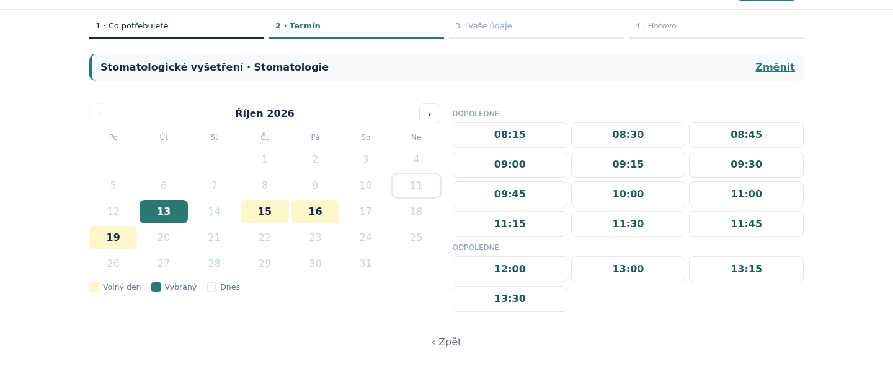
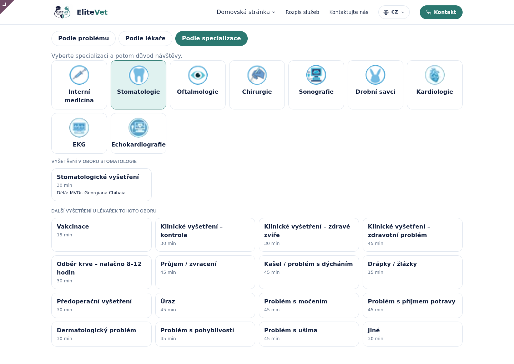
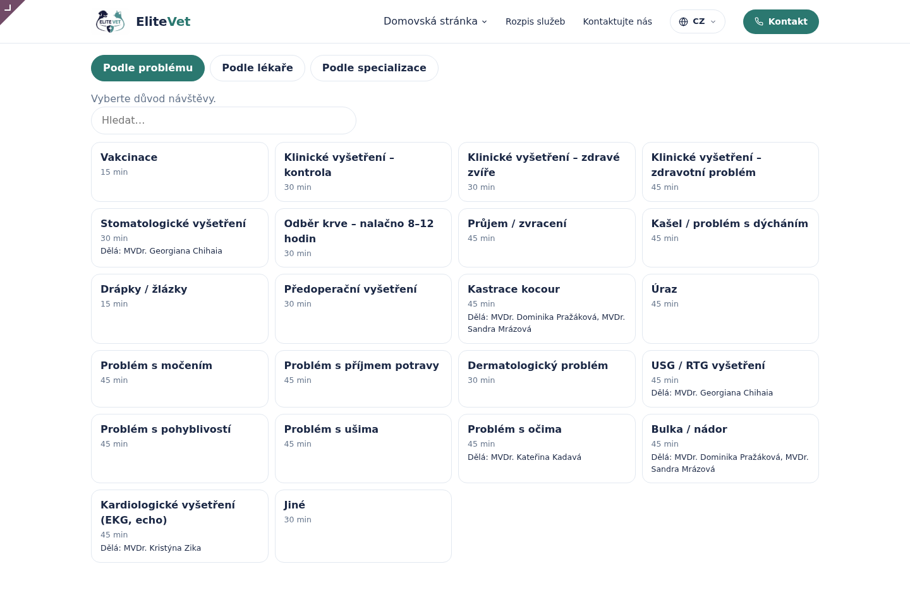
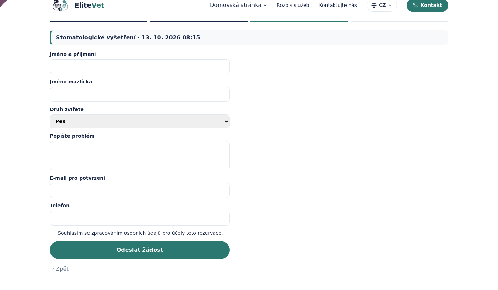
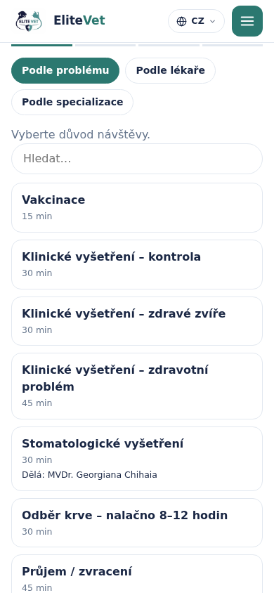

# Rezervace – jak to funguje

**K čemu je tento návod.** Vysvětluje, podle čeho systém nabízí volné termíny, kdy
nabídne kterou lékařku, co se děje se žádostí z webu a proč nemůže dojít ke dvojímu
obsazení. Hodí se recepci i správci, když se diví, proč web nějaký termín (ne)nabízí.
Postupy krok za krokem jsou v [Návodu pro recepci](recepce.md) a [Návodu pro správce](nastaveni.md).

---

## 1. Jak se počítají volné termíny

Pro zvolený **úkon** a **den** systém projde každou ordinaci, kde se úkon dělá,
a postupuje takto:

1. **Ordinační doba** ordinace v ten den – z týdenní šablony (jen řádky platné
   v ten den), nebo z výjimky, pokud na den nějaká je. Výjimka „Zavřeno celý den“ = nic.
2. **∩ služba lékařky** – průnik s časy z Rozpisu lékařů, kdy v ordinaci slouží lékařka,
   která úkon dělá. Tento krok se uplatní, jen když je lékařka potřeba:
   - úkon má **Specializaci**, nebo
   - klient si vybral **konkrétní lékařku** nebo **obor (specializaci)**, nebo
   - v nastavení je zapnuté **Online jen tam, kde slouží lékař**.

   Jinak stačí ordinační doba (úkon bez specializace se nabídne, i když rozpis chybí).
3. **− obsazené** – odečtou se potvrzené a proběhlé rezervace a blokace
   (na webu obě blokace, u recepce jen úplná – viz „Co blokuje termín“).
4. **Krok** – ve zbylém volném čase se nabízejí začátky po **Krok slotů** (obvykle 15 min),
   zarovnané na celé kroky (8:15, 8:30…). Termín se nabídne, jen když se do volna
   vejde **celá délka úkonu**.
5. **Minimální předstih** – na webu se nenabízí nic dřív než za **Nejdříve za (hodin)**.
   Recepce (průvodce, návrhy na tabuli) tento limit nemá – může objednat i na teď.
6. **Horizont** – web nabízí dny nejvýš **Nejdál dopředu (dní)** od dneška.
   Recepce v průvodci až zhruba 400 dní.
7. **Víkend a státní svátek** – web v takový den nenabídne nic, pokud je v nastavení
   zapnuté **Víkendy jen ručně** / **Státní svátky jen ručně** (výchozí obojí zapnuto).
   Svátky se počítají v kódu: pevné (1. 1., 1. 5., 8. 5., 5. 7., 6. 7., 28. 9., 28. 10.,
   17. 11., 24.–26. 12.) a pohyblivé Velký pátek a Velikonoční pondělí podle data Velikonoc.
   Recepce tento krok nemá.

Recepce může navíc v průvodci zadat **ruční čas**: kroky 1, 2, 5, 6 a 7 se pak
neuplatní vůbec – kontroluje se jen, že termín nekoliduje s jinou rezervací nebo
úplnou blokací.

Příklad: Ordinace 1 má 8:15–19:30, lékařka se stomatologií slouží 8:15–14:00, mezi 9:00
a 9:30 je potvrzená rezervace. Stomatologické vyšetření (30 min) se nabídne v 8:15, 8:30,
9:30, 9:45… až 13:30 (poslední začátek, kdy 30 minut skončí do 14:00).

Na webu se termín ukazuje jednou, i když je volno ve více ordinacích. Ordinaci vybírá
až recepce při potvrzení.

Kalendář na webu zvýrazní jen dny, kde je aspoň jeden volný termín.

---

## 2. Pravidlo lékařka × úkon

Lékařka smí úkon dělat, když platí obojí:

1. má na své kartě v Rozpisu služeb zaškrtnuto **Lékařka – přijímá rezervace**, a
2. úkon **nemá specializaci** (pak ho dělá kterákoli lékařka), nebo lékařka má na kartě
   v Náš tým **aspoň jednu ze specializací úkonu**.

Navíc v konkrétní službě v Rozpisu lékařů lze omezit **Jen tyto úkony**.

| Úkon | Specializace úkonu | Kdo ho dělá |
|---|---|---|
| Vakcinace | – | kterákoli lékařka |
| Stomatologické vyšetření | Stomatologie | jen lékařky se Stomatologií |
| Kastrace kocour | Chirurgie | jen lékařky s Chirurgií |

Kde se pravidlo projeví:

- **Web**: u úkonu se specializací se ukazuje „Dělá: …“; časy jen ve službách těchto lékařek;
  záložka **Podle lékaře** nabídne lékařce jen její úkony.
- **Průvodce recepce**: pole Lékařka nabízí jen ty, které úkon dělají.
- **Tabule**: návrhy „Potvrdit → Ordinace · lékařka“ jen s lékařkou, která úkon dělá
  a v tu dobu v ordinaci slouží. Slouží-li jich víc, nabídne se ta s dřívějším začátkem
  služby (nebo ta, kterou si vybral klient).
- **Úkony**: sloupec **Kdo dělá** ukazuje výsledek pravidla.

Pravidlo se **nekontroluje**, když recepce přetáhne kartu na tabuli nebo ručně změní
lékařku ve formuláři. Tam rozhoduje recepce.

---

## 3. Cesta žádosti z webu

1. Klient na stránce `/rezervacni-system` projde 4 kroky: **Co potřebujete**
   (podle problému, lékaře nebo specializace) → **Termín** → **Vaše údaje** → **Hotovo**.
2. Při odeslání systém **znovu ověří**, že termín je pořád volný. Pokud ne, klient
   uvidí hlášku a vybere jiný čas.
3. Vznikne rezervace ve stavu **Čekající z webu** – bez ordinace, se zdrojem „Web“.
   Termín zatím **neblokuje**.
4. Odejdou dva e-maily: klientovi „žádost přijata“, klinice upozornění na
   **E-mail pro upozornění**.
5. Na tabuli všem přihlášeným s rezervacemi vyskočí upozornění a karta se objeví
   v panelu **Čekající z webu**.
6. Recepce žádost **potvrdí** (návrh, přetažení, nebo formulář s vybranou ordinací),
   nebo **odmítne**.
7. Při potvrzení se dohledá nebo založí klient a mazlíček, rezervace dostane ordinaci,
   stav **Potvrzená**, a klientovi odejde e-mail s potvrzením a odkazem na zrušení.
8. Odmítnutí = stav **Zrušená**, klientovi odejde e-mail o zrušení.

Ochrana proti spamu na webu: skryté pole pro roboty, kontrola údajů (jméno a příjmení,
platný e-mail, telefon, souhlas) a nejvýš 5 odeslaných žádostí za 10 minut z jedné adresy.

Web funguje i na mobilu:

### Stavy rezervace

| Stav | Kdy | Blokuje termín? | Na tabuli |
|---|---|---|---|
| **Čekající z webu** | Přišla z webu, nikdo ji nepotvrdil | ne | jen v levém panelu |
| **Potvrzená** | Potvrdila recepce nebo ji recepce založila | **ano** | barevná karta |
| **Proběhla** | Recepce označila po návštěvě | **ano** | bledší karta |
| **Nedorazil** | Klient nepřišel | ne | bledší karta |
| **Zrušená** | Zrušila klinika, klient nebo odmítnuto | ne | není vidět |

---

## 4. Co blokuje termín

**Blokuje:** potvrzené rezervace, proběhlé rezervace, blokace (dokud nejsou zrušené).
Blokace bez ordinace blokuje **všechny ordinace**. Když se úplná blokace pro všechny
ordinace zakládá přes čas, kde už některá ordinace úplnou blokaci má, rozdělí se
po ordinacích a doplní jen volné úseky.

Záleží ale na druhu blokace a na tom, kdo objednává:

| | Web (veřejné objednávání) | Recepce (průvodce, přetažení, návrhy, uložení) |
|---|---|---|
| Potvrzená / proběhlá rezervace | blokuje | blokuje |
| Úplná blokace | blokuje | blokuje |
| Blokace jen pro web | blokuje | **neblokuje** |
| Nepotvrzená žádost z webu | drží jedno místo | **neblokuje** (vidíte ji v panelu) |
| Víkend / státní svátek (podle nastavení) | blokuje celý den | neblokuje |
| Mimo ordinační dobu / bez služby lékařky | nenabídne | nenabídne, ale ručním časem jde |

Pravidlo „co je obsazené“ je v kódu na jednom místě (web a recepce se liší jen
přepínačem), takže se web a recepce nemůžou rozejít. Úplnou blokaci nejde založit
přes potvrzenou rezervaci; blokaci jen pro web jde založit kdykoli.

**Nepotvrzená žádost z webu drží místo.** Žádost ještě nemá ordinaci, proto si
„v duchu“ podrží tu, kam by šla potvrdit (první online ordinace úkonu, kde je volno
a slouží lékařka, která úkon dělá; starší žádost má přednost). Když jsou v tu dobu
volné dvě ordinace, web čas nabízí, dokud nepřijdou dvě žádosti. Další klient
tak nedostane čas, o který už někdo žádá. Odmítnutí žádosti místo uvolní;
po potvrzení ho drží už samotná rezervace.

**Neblokuje:** čekající žádosti z webu, zrušené rezervace, Nedorazil.

Důsledek: na stejný čas mohou přijít dvě žádosti z webu. Potvrdit jde jen první;
u druhé zmizí návrhy a recepce ji přeplánuje.

---

## 5. Ochrana proti dvojímu zabrání

Výpočet volných termínů jen **radí**, co nabídnout. Poslední slovo má kontrola
při **uložení**: každá potvrzená rezervace a úplná blokace se před zápisem porovná
s ostatními v téže ordinaci (s rezervacemi a úplnými blokacemi; blokace jen pro web se
nepočítá a sama se nekontroluje). Když se překrývá, uložení se odmítne hláškou
„Termín … v ordinaci … je obsazený: …“.

Když dvě recepční (nebo recepční a web) ukládají stejný čas ve stejnou chvíli,
systém ordinaci na okamžik „zamkne“. Druhý zápis počká, uvidí první rezervaci
a skončí hláškou o obsazeném termínu. Dvojí obsazení tak nevznikne ani při souběhu.

Stejně se kontroluje i Rozpis lékařů: jedna lékařka nemůže mít dvě služby přes sebe.
Platí to i pro služby propsané z Rozpisu služeb: směnu, která by se překrývala s jinou
službou téže lékařky, nejde uložit (hláška „Směnu … nejde propsat do rezervací“).

---

## 6. Živá aktualizace

Každá změna rezervace, blokace nebo Rozpisu lékařů (založení, úprava, smazání) pošle
zprávu všem přihlášeným ze skupiny Recepce (a tedy i správcům). Otevřená tabule se
na ni hned tiše překreslí. Nová žádost z webu navíc zobrazí upozornění s jejím popisem.

Hromadné změny (kopírování rozpisu, opakovaná blokace) pošlou jen jednu zprávu.
Pro případ výpadku spojení se tabule ještě sama obnovuje jednou za minutu.

---

## 7. Jazyky webu

- Rezervace na webu je v **češtině, angličtině, němčině a ruštině** podle jazyka webu,
  který si klient zvolí.
- Názvy úkonů, instrukce pro klienta a texty z nastavení se zobrazí v jazyce klienta,
  pokud jsou přeložené (překládá je správce přímo v záznamu).
- Jazyk se u rezervace uloží a **všechny e-maily klientovi** pak chodí v tomto jazyce.
  U rezervací založených recepcí se použije jazyk z karty klienta.
- Upozornění pro kliniku a tabule jsou vždy česky.

---

## 8. Co systém zatím neumí

- **Online platba zálohy** – platební brána není napojená. Záloha se jen eviduje
  (Čeká na zálohu / Zaplaceno / Vráceno) a platební údaje posílá recepce.
- **SMS** – připomínky a potvrzení chodí jen e-mailem.
- **Import klientů z WinVetu** – pole ID ve WinVetu je připravené, import zatím není.
- **Změna délky přetažením** na tabuli – délka se mění ve formuláři (pole Konec).
- **Přetažení na jiný den** – jiný den se nastavuje ve formuláři (pole Začátek).
- **Týdenní tabule** – tabule ukazuje jeden den; týdenní přehled je v Rezervace → kalendář.
