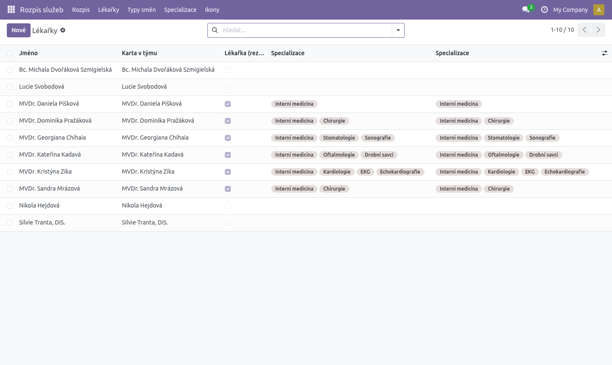
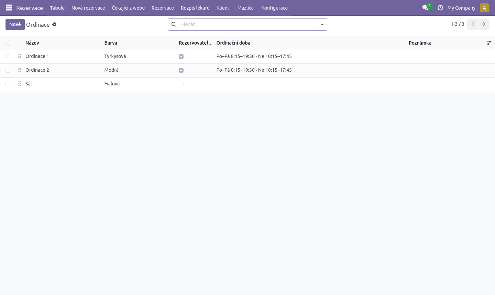
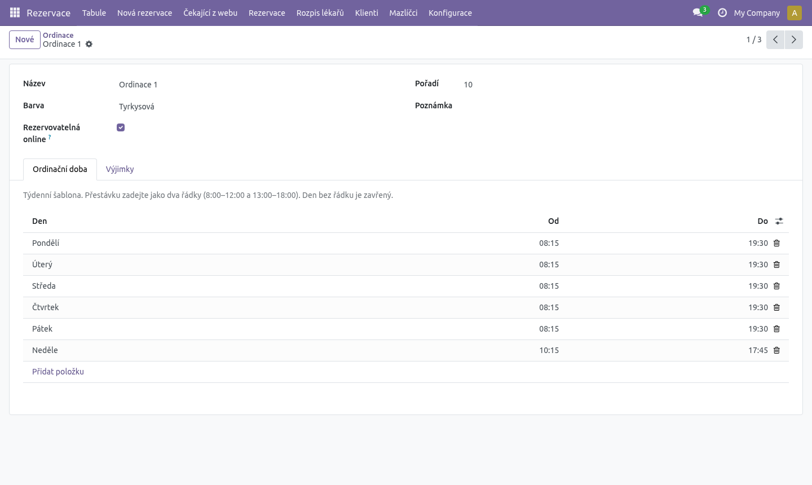
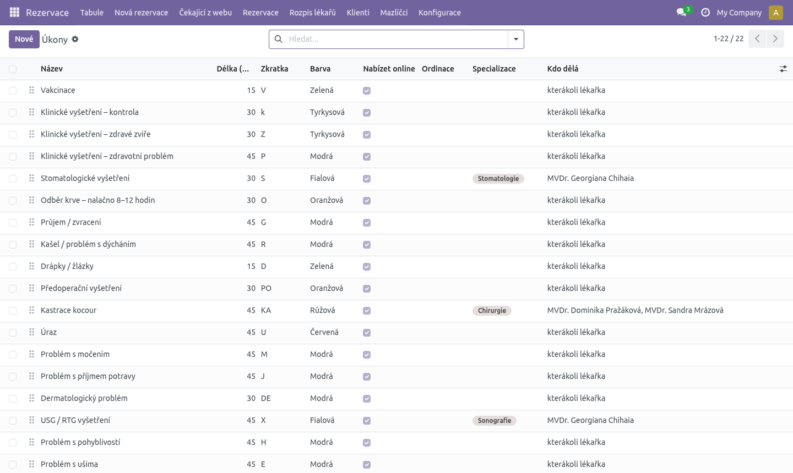
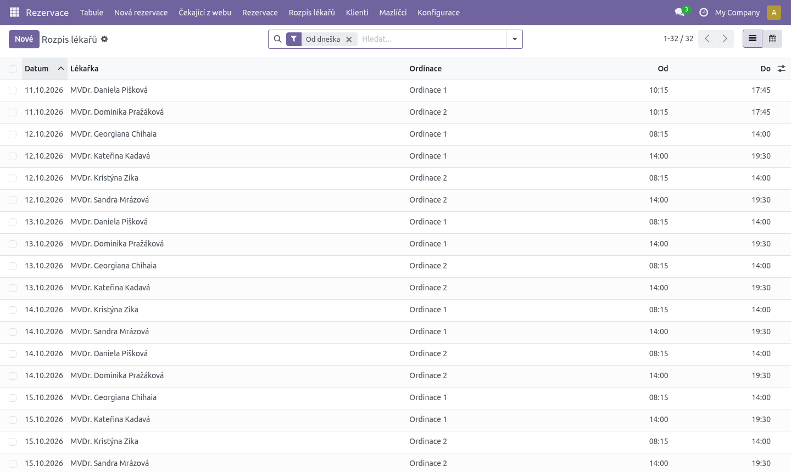
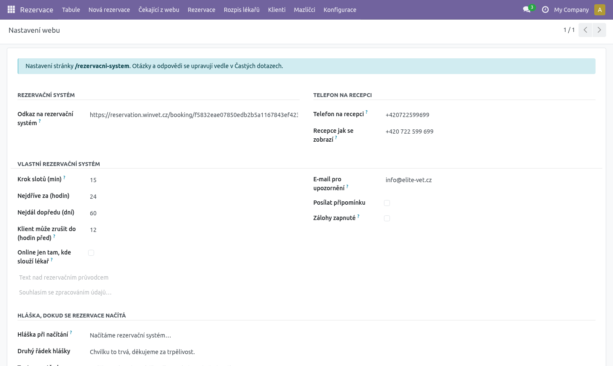

# Rezervace – návod pro správce (nastavení a údržba)

**K čemu je tento návod.** Provede vás prvním nastavením rezervačního systému a jeho
běžnou údržbou: lékařky, úkony, ordinace a ordinační doba, rozpis lékařů, nastavení
webové rezervace a e-maily. Je pro vedoucí kliniky nebo toho, kdo má na starosti
nastavení. Denní práci recepce popisuje [Návod pro recepci](recepce.md), logiku výpočtu
termínů [Jak to funguje](jak-to-funguje.md).

Doporučené pořadí prvního nastavení: **práva → lékařky → specializace → ordinace
a ordinační doba → úkony → rozpis lékařů → nastavení rezervace → kontrolní seznam**.

---

## 1. Práva uživatelů

V **Nastavení → Uživatelé** u každého člověka v části **Rezervace** zvolte:

| Skupina | Co smí |
|---|---|
| **Recepce** | Tabule, nová rezervace, čekající z webu, rezervace, klienti a mazlíčci. **Blokace jen vidí** (na tabuli se otevřou jen ke čtení). Rozpis lékařů, ordinace, úkony a nastavení jen vidí. |
| **Správce rezervací** | Vše jako Recepce a navíc **blokace** (zakládá, přesouvá, upravuje, ruší, maže), **Konfigurace** (Ordinace, Výjimky ordinační doby, Úkony, Nastavení rezervace, Časté dotazy), **Nastavení kontaktu**, úpravy **Rozpis lékařů** a akce **Zkopírovat na další týden**. |

Správce systému (administrátor) má Správce rezervací automaticky. Role Sestra, Lékařka
a účty ordinací mají práva Recepce, ne Správce rezervací; blokace a nastavení tedy také jen
vidí. Vedení je Správce rezervací.

**Blokace a nastavení jen správce.** Tabule bez práva správce neukazuje tlačítko **Nová
blokace**, blokace na ní nejde přetáhnout a klik na blokaci ji otevře jen ke čtení. Klik do
sloupce (i do blokace jen pro web) dál otevře průvodce novou rezervací. Kdo není správce
a pokusí se blokaci změnit jinudy (seznam Rezervace), dostane hlášku „Blokace může měnit jen
správce rezervací.“ Nastavení (Nastavení rezervace i Nastavení kontaktu, je to jeden záznam)
ukládá jen Správce rezervací. Kdo má jen práva správce kalendáře / webu (Hlavní stránka, Ceník),
nastavení nevidí v menu, a kdyby ho otevřel, uložení skončí hláškou „Nastavení může měnit jen
správce rezervací.“ Web nastavení čte dál pro všechny.

Lékařky a specializace se upravují v aplikacích **Rozpis služeb** a **Náš tým**.
K nim je potřeba mít práva i v těchto aplikacích.

---

## 2. Lékařky

Seznam lidí je v **Rozpis služeb → Lékařky**. Je v něm celý tým (i sestry a recepce),
protože se z něj skládá i veřejný rozpis služeb. Rezervace ale smí dostat jen lékařka.

U každé veterinární lékařky:

1. Otevřete ji v **Rozpis služeb → Lékařky**.
2. Zaškrtněte **Lékařka – přijímá rezervace** (v seznamu sloupec „Lékařka (rezervace)“).
3. Zkontrolujte **Karta v týmu** – propojení na její kartu na stránce Náš tým.
   Z karty se berou specializace.
4. Případně změňte **Barva v kalendáři**. V této barvě se na tabuli
   zobrazuje proužek na kartách jejích rezervací, její služba a štítek. Barva se přidělí automaticky
   (každá lékařka jinou), stačí ji upravit, když se dvě podobají.
5. Vyplňte **Výchozí ordinace** – ordinaci, kde obvykle slouží. Předvyplní se jí
   u každé nové směny v Rozpisu služeb, a směna se tak sama propíše do rezervací
   (viz kapitola 6). U konkrétní směny jde ordinaci změnit nebo smazat.

Co příznak dělá:

- jen lékařky s příznakem jde zapsat do **Rozpis lékařů**,
- jen ty se nabízejí klientům na webu (záložka Podle lékaře) a v průvodci recepce.

Při instalaci se příznak nastavil všem s titulem „MVDr.“ a karta v týmu se propojila
podle shodného jména. Dál už je to na vás.

## 3. Specializace (kdo co umí)

Specializace se nastavují **na kartě lékařky v Náš tým → Členové týmu**, pole
**Specializace**. V Rozpisu služeb jsou jen vidět (nedají se tam měnit).

Specializace mají dva účely:

- na webu se podle nich řadí záložka **Podle specializace** (nabízí se jen obor,
  který má aspoň jedna lékařka),
- podle nich systém pozná, **kdo který úkon dělá** (viz Úkony).

Nová specializace se zakládá v **Náš tým → Specializace** (nebo Rozpis služeb → Specializace),
ikona v **Ikony**.

---

## 4. Ordinace a ordinační doba

**Rezervace → Konfigurace → Ordinace.** Každá ordinace je jeden sloupec na tabuli.

| Pole | Význam |
|---|---|
| **Název** | Jak se ordinace jmenuje na tabuli a v e-mailu klientovi. |
| **Barva** | Barva pruhu nad sloupcem tabule. |
| **Rezervovatelná online** | Odškrtněte u sálu a místností, kam se klienti z webu objednávat nemají. Na tabuli pak mají štítek „interní“. |
| **Pořadí** | Pořadí sloupců na tabuli (v seznamu lze i přetahovat). |
| **Poznámka** | Jen pro vás. |

V seznamu je sloupec **Ordinační doba** se souhrnem, např. „Po–Pá 8:15–19:30 · Ne 10:15–17:45“.

### Záložka Ordinační doba (týdenní šablona)

1. **Přidat položku** → **Den**, **Od**, **Do**.
2. Den bez řádku = zavřeno.
3. **Přestávka** = dva řádky na stejný den, např. 8:00–12:00 a 13:00–18:00.
   Řádky se nesmí překrývat.
4. **Platí od / Platí do** (skryté sloupce, zapnete ikonou vpravo v hlavičce tabulky) –
   pro letní a zimní režim. Připravte druhou sadu řádků s platností a nic nemusíte mazat.
   Prázdné = platí stále.

### Záložka Výjimky (jeden den jinak)

Výjimka má přednost před šablonou.

| Případ | Co vyplnit |
|---|---|
| Svátek, inventura, školení | **Datum**, zaškrtnout **Zavřeno celý den**, **Poznámka** |
| Kratší / jiné hodiny | **Datum**, **Od**, **Do** |
| Mimořádně otevřeno (např. sobota) | **Datum**, **Od**, **Do** – výjimka umí otevřít i den, který šablona nemá |

Na jeden den a ordinaci jde jen jedna výjimka. Výjimky všech ordinací najdete
přehledně v **Konfigurace → Výjimky ordinační doby**.

Výjimka platí pro jednu ordinaci. Zavíráte-li celou kliniku, zadejte ji u každé
ordinace (nebo použijte blokaci bez ordinace na tabuli).

---

## 5. Úkony

**Rezervace → Konfigurace → Úkony.** Úkon je důvod návštěvy, který si klient vybírá.
Seznam lze upravovat přímo v řádcích; pořadí se mění přetažením.

| Pole | Význam |
|---|---|
| **Název** | Co klient vidí na webu a v e-mailu. Překládá se (viz Překlady). |
| **Délka (min)** | Jak dlouho úkon trvá. Násobek 5 minut. |
| **Zkratka** | 1–3 znaky na kartě v tabuli (V, P, KA…). |
| **Barva** | Barva karty na tabuli. V seznamu jsou syté i světlé barvy (světle modrá, žlutá, mátová…). |
| **Vlastní barva** | Jakákoli barva podle přání (výběr z palety). Má přednost před **Barvou**; výběr barvy ze seznamu ji zase smaže. Pole **Na tabuli** ukazuje výsledek. |
| **Nabízet online** | Odškrtnuté = jen pro recepci, na webu se nenabízí. |
| **Ordinace** | Kde se úkon dělá. Prázdné = ve všech ordinacích rezervovatelných online. |
| **Specializace** | **Kdo úkon dělá**: jen lékařky s aspoň jednou z těchto specializací. Prázdné = kterákoli lékařka. |
| **Kdo dělá** (sloupec v seznamu) | Kontrola: jména lékařek, které úkon dělají. „kterákoli lékařka“ = úkon bez specializace. „žádná lékařka – zkontrolujte specializace“ = úkon nikdo nedělá a **na webu nebude mít žádné termíny**. |
| **Instrukce pro klienta** | Např. „Zvíře přiveďte nalačno“. Ukáže se na webu a v e-mailu s potvrzením a v připomínce. |
| **Vyžaduje zálohu** / **Záloha** | Částka zálohy. Ukazuje se jen při zapnutých zálohách (viz Nastavení rezervace). |

Tip: Úkon, který nechcete nabízet, raději **archivujte** (Akce → Archivovat) než mažte.
Úkon použitý v rezervacích smazat nejde.

---

## 6. Rozpis lékařů

**Rezervace → Rozpis lékařů.** Kdo kdy ve které ordinaci slouží. Podle rozpisu:

- web nabízí termíny „k lékaři“ a úkony se specializací,
- recepce vidí v hlavičce sloupců tabule, kdo slouží,
- tabule navrhuje „Potvrdit → Ordinace · lékařka“,
- průvodce novou rezervací (klik do tabule i **Nová rezervace**) a objednání v pokladně
  předvyplní lékařku, která v té ordinaci a v tu dobu slouží (jde ji změnit).

### Směny se zadávají jednou – v Rozpisu služeb

Služby se nezadávají dvakrát. Směna lékařky v aplikaci **Rozpis služeb → Rozpis**
(seznam i kalendář) má sloupec **Ordinace**:

1. Zadejte směnu jako dosud: **Datum**, **Lékařka**, **Směna**.
2. **Ordinace** se předvyplní z **Výchozí ordinace** lékařky (Rozpis služeb → Lékařky).
   Jde ji změnit, nebo smazat.
3. **Čas Od–Do** se předvyplní z typu směny (Rozpis služeb → Typy směn) a u každé směny
   jde změnit (třeba 9:00–13:00 místo celé ranní). Po změně typu směny se čas nastaví
   znovu podle nového typu. Web dál ukazuje u směny čas jejího typu.
4. Směna s ordinací se **sama propíše** do Rezervace → Rozpis lékařů: datum, lékařka a čas
   ze směny. Noční služba (20:00–8:00) se do rezervací propíše do půlnoci.
5. Bez ordinace se směna do rezervací nepropíše – tak to zůstane u sester a recepce
   (u nich ordinace ani nejde vyplnit) a u lékařky, která ten den v ordinaci nepracuje.

Z kalendáře Rozpisu služeb: klikněte na den → malý formulář s datem, směnou, lékařkou
a ordinací. Klik na existující směnu → **Upravit** otevře směnu i s ordinací.

Přímo z **Tabule** (Rezervace → Tabule), když máte právo upravovat Rozpis služeb:

- **Klik na jméno lékařky** v hlavičce ordinace (nebo na její barevný pruh ve sloupci)
  otevře její směnu z Rozpisu služeb – změníte lékařku, směnu, čas Od–Do nebo ordinaci a po uložení
  se to propíše do rozpisu na webu i na tabuli. Ručně zadaná služba (vlastní čas) otevře
  svůj formulář z Rozpisu lékařů.
- **+ služba** v hlavičce ordinace přidá novou směnu do Rozpisu služeb s předvyplněným
  dnem tabule a touto ordinací (ordinace zůstane, i když lékařka má jinou výchozí).
- Bez práva (recepce) se jméno jen zobrazí a klik na pruh založí rezervaci jako dřív.

Co se děje dál:

- **Změna** ordinace, lékařky, data nebo typu směny se hned promítne do služby v rezervacích.
- **Smazání** ordinace, smazání směny nebo změna na celodenní poznámku (Zavřeno) službu
  v rezervacích smaže.
- **Změna času typu směny** (Typy směn → Od/Do) přepíše čas směn **od dneška dál**, které
  měly čas typu; směny s ručně změněným časem a odsloužené dny zůstanou, jak byly.
- Měla-li lékařka ten den už ručně zadanou službu, která se se směnou překrývá, směna ji
  **převezme** (propojí a přepíše na ordinaci a čas ze směny) – žádný duplikát nevznikne.
  „Jen tyto úkony“ a poznámka u ní zůstanou.
- Směny jedné lékařky se smí překrývat, když jsou v různých ordinacích (slouží naráz ve dvou).
- Když směnu propsat nejde (lékařka už v tu dobu slouží ve stejné ordinaci), uložení skončí hláškou
  „Směnu … nejde propsat do rezervací: …“.

Služby z rozpisu jsou v Rozpisu lékařů označené **Z rozpisu služeb** (sloupec a filtr),
na tabuli je to v bublině proužku lékařky. Lékařka, ordinace, datum a čas se u nich
mění jen v Rozpisu služeb – pokus o úpravu nebo smazání tady skončí hláškou
„Tato služba je z Rozpisu služeb – upravte ji tam.“ Upravit tu jde jen **Jen tyto úkony**
a **Poznámka**.

### Převzetí stávajícího rozpisu

Směny zadané dřív nemají ordinaci. Jednorázově je propíše **Rozpis služeb → Převzít rozpis
do rezervací** (jen Správce rezervací / Vedení): směnám **od dneška dál** bez ordinace
nastaví výchozí ordinaci lékařky a tím je propíše. Hláška ukáže „Propsáno X. Přeskočeno:
bez výchozí ordinace Y, kolize Z.“ – kolize = lékařka má v tu dobu jinou službu. Nespouští
se samo (ani při aktualizaci modulu); jde ho spustit znovu, už propsané směny se přeskočí.

### Ruční služby (mimo rozpis)

Službu, která v Rozpisu služeb není (vlastní čas, půl směny, záskok), jde dál zadat
přímo tady:

1. Klikněte **Nové** (nebo přidejte řádek v seznamu).
2. **Datum**, **Lékařka**, **Ordinace**, **Od**, **Do**.
3. Volitelně (skryté sloupce): **Jen tyto úkony** – v této službě dělá lékařka jen
   vybrané úkony (prázdné = všechny, které umí); **Poznámka**.

Jedna lékařka nemůže mít dvě služby přes sebe. Ve stejné ordinaci mohou sloužit
dvě lékařky současně – tabule je ukáže jako dva barevné proužky vedle sebe a štítek
„2 lékařky 10:00–14:00“ v hlavičce sloupce. Kapacita ordinace zůstává **jeden pacient
naráz**; druhá lékařka znamená jen to, že úkon může dělat kterákoli z nich.

Seznam má výchozí filtr **Od dneška**, seskupit lze podle **Den**, **Lékařka**,
**Ordinace**, filtrovat **Z rozpisu služeb** / **Zadané ručně**. Vpravo nahoře lze
přepnout na týdenní kalendář.

### Kopírování týdne

1. V seznamu označte služby, které chcete zopakovat (např. filtrujte týden a zaškrtněte vše).
2. **Akce → Zkopírovat na další týden**.
3. Služby se zkopírují o 7 dní dál. Kopie, která by se překrývala s jinou službou téže
   lékařky, se přeskočí; stejně tak služba lékařky, která už nepřijímá rezervace.
   Hláška ukáže „Zkopírováno X, přeskočeno Y.“
4. Kopírují se jen **ruční** služby. Služby z rozpisu služeb se přeskočí (hláška je
   spočítá zvlášť) – další týden se zadává v Rozpisu služeb.

---

## 7. Nastavení rezervace

**Rezervace → Konfigurace → Nastavení rezervace**, část **Vlastní rezervační systém**.

| Pole | Výchozí | Co dělá |
|---|---|---|
| **Krok slotů (min)** | 15 | Po kolika minutách se nabízejí začátky (8:15, 8:30…). Násobek 5. Zároveň mřížka tabule. |
| **Nejdříve za (hodin)** | 24 | Na web nejde objednat dřív než za tolik hodin. Recepce toto omezení nemá. |
| **Nejdál dopředu (dní)** | 60 | Jak daleko dopředu web nabízí termíny. Recepce může až ~400 dní. |
| **Klient může zrušit do (hodin před)** | 12 | Do kolika hodin před termínem funguje odkaz na zrušení v e-mailu. **0** = klient rušit odkazem nemůže. |
| **Online jen tam, kde slouží lékař** | vypnuto | Zapnuto: web nabízí termín jen v čase, kdy má ordinace v Rozpisu lékařů zapsanou službu. Vypnuto: úkony bez specializace se nabízejí podle ordinační doby, i když rozpis chybí. |
| **Víkendy jen ručně (web neobjednává)** | zapnuto | Web v sobotu a v neděli nenabízí žádné termíny. Recepce objednává dál (i ručním časem). |
| **Státní svátky jen ručně (web neobjednává)** | zapnuto | Web ve státní svátek nenabízí žádné termíny. Svátky (i Velký pátek a Velikonoční pondělí) se počítají samy, nic se nezadává. Recepce objednává dál. |
| **Posílat klinice upozornění** | zapnuto | Vypnuté = klinice nechodí žádné upozornění (nová žádost z webu, zrušení klientem). E-maily klientům chodí dál. |
| **E-mail pro upozornění** | rezervace@elite-vet.cz | Sem chodí upozornění na každou novou žádost z webu a na zrušení klientem (jen když je zapnuté „Posílat klinice upozornění“). |
| **Odesílatel e-mailů** | rezervace@elite-vet.cz | Adresa, ze které klientům chodí e-maily k rezervacím. Musí to být schránka, přes kterou Odoo odesílá (viz *Odesílání e-mailů* níže). Jde zadat i se jménem: `Elite Vet Karlovy Vary <rezervace@elite-vet.cz>`; bez jména se doplní „Elite Vet Karlovy Vary“. |
| **Odpovědi klientů na** | info@elite-vet.cz | Kam dojde odpověď, když klient na e-mail odpoví. Prázdné = na odesílatele. |
| **Posílat připomínku** | vypnuto | Zapne připomínkový e-mail klientům. |
| **Připomínka (hodin před)** | 24 | Kolik hodin před termínem připomínka odejde (ukáže se po zapnutí). |
| **Zálohy zapnuté** | vypnuto | Dokud je vypnuté, záloha se nikde neukazuje. |
| **Text nad rezervací** | – | Text nad rezervačním průvodcem na webu. |
| **Text souhlasu pod formulářem** | – | Text souhlasu pod formulářem na webu. Prázdné = výchozí věta. |

Ve stejném formuláři jsou i starší části:

- **Telefon na recepci** – **Telefon na recepci** a **Recepce jak se zobrazí**. Používá se,
  když je na zrušení odkazem pozdě („zavolejte na recepci“).
- **Odkaz na rozpis služeb pod rezervací** – text a tlačítko pod rezervací na webu.
- **Rezervace na webu** a **Adresa formuláře WinVet** – viz *Přepnutí rezervací na webu* níže.
- **Hláška, dokud se rezervace načítá** (nadpis a druhý řádek) – patří jen k formuláři WinVet,
  proto je ve formuláři vidět jen při **Rezervace na webu = WinVet**.
- **Text pod rezervacemi** – pole **Text** (např. věta o pohotovostním poplatku). Je vidět
  a upravuje se v obou režimech: na /rezervacni-system stojí pod rezervacemi, vycentrovaný,
  pod rámečkem WinVet i pod naším průvodcem. U WinVetu je během načítání uprostřed rámečku
  a po načtení klesne pod něj. Prázdné pole = žádný text. Na /rozpis-lekaru se neukazuje.

### Přepnutí rezervací na webu

Pole **Rezervace na webu** (nahoře v Nastavení rezervace, skupina *Rezervace na webu*) říká, který
kalendář je na stránce **/rezervacni-system**. Mění ho jen **Správce rezervací**.

| Hodnota | Co je na webu |
|---|---|
| **WinVet (podle adresy)** – výchozí | Formulář WinVet z **Adresy formuláře WinVet** i s hláškou při načítání, přesně jako dřív. Náš webový rezervační systém žádné rezervace nepřijímá: stránka ho neukazuje a jeho rozhraní (volné dny, časy, odeslání žádosti, objednání v chatu) odpoví „Online rezervace najdete na stránce Rezervační systém.“. Chat místo objednání nabídne odkaz na /rezervacni-system. |
| **Elite Vet (náš kalendář)** | Na stejném místě stránky je náš rezervační průvodce; žádosti z webu chodí do **Rezervace → Čekající z webu**. Adresa WinVet se nepoužívá (může zůstat vyplněná). |

- Při **WinVet** je **Adresa formuláře WinVet** povinná. Bez ní formulář neuloží
  („Rezervace přes WinVet potřebují adresu formuláře WinVet…“).
- Recepce, tabule, průvodce **Nová rezervace** a pokladna objednávají v obou režimech stejně.
- Nová instalace i aktualizace databáze, která pole ještě nemá, začíná na **WinVet** – na webu
  se tedy nejdřív ukáže to, co tam bylo. Postup: nastavit ordinace, úkony, lékařky a rozpis
  (kontrolní seznam v kapitole 10), pak přepnout na **Elite Vet (náš kalendář)** a uložit.
  Zpátky na WinVet jde přepnout kdykoli; žádosti, které mezitím přišly z webu, zůstávají
  v Čekajících.
- Ověření: otevřít /rezervacni-system v anonymním okně (nebo po odhlášení) a obnovit stránku.
  WinVet = rámeček WinVet s hláškou „Načítáme rezervační systém…“; Elite Vet = kroky
  „1 · Co potřebujete“ a karty úkonů.
- Stránka **/rozpis-lekaru** přepínač také sleduje. Při **WinVet** je dole na stránce vložený
  formulář WinVet jako dřív. Při **Elite Vet** je na jeho místě krátká výzva: jedna věta
  („Online objednávky přijímáme na stránce rezervačního systému.“) a tlačítko **Objednat se
  online**, které vede na /rezervacni-system (v jazyce stránky: /de/…, /ru/…, /en/…).

**Zálohy:** online platební brána zatím **není**. Při zapnutých zálohách se na webu ukáže
částka a klient dostane informaci, že platební údaje mu pošle recepce.

---

## 8. E-mailové šablony

Šablony najdete v **Nastavení → Technické → E-mailové šablony** (je potřeba zapnout
režim vývojáře), hledejte „Rezervace:“.

| Šablona | Kdy odchází |
|---|---|
| Rezervace: přijato z webu | klientovi po odeslání žádosti |
| Rezervace: nová z webu (klinika) | klinice na E-mail pro upozornění |
| Rezervace: potvrzeno | klientovi při potvrzení |
| Rezervace: změna termínu | klientovi při přesunu potvrzené rezervace na jiný čas (ne při změně jen ordinace) |
| Rezervace: zrušeno | klientovi při zrušení (a klinice při zrušení klientem) |
| Rezervace: připomínka | klientovi X hodin před termínem (běží každou hodinu) |

Šablony jsou psané anglicky a přeložené do češtiny, němčiny a ruštiny. Klient dostane
e-mail v jazyce, ve kterém rezervoval. Upravujete-li text, upravte ho ve všech jazycích
(přepínač jazyka u pole). Adresa v potvrzení (Hybešova 167/18, Karlovy Vary) je přímo
v textu šablony.

Odesílatel a adresa pro odpovědi se nastavují v **Nastavení rezervace** (pole
**Odesílatel e-mailů** a **Odpovědi klientů na**).

### Odesílání e-mailů (Forpsi)

Pošta pro elite-vet.cz je u Forpsi a doména má SPF `-all` a DMARC `quarantine`:
e-mail s odesílatelem @elite-vet.cz, který neodejde přes Forpsi, skončí ve spamu
nebo ho příjemce odmítne. Odoo proto musí posílat přes poštovní server Forpsi.

1. **Schránka.** V administraci Forpsi založte schránku `rezervace@elite-vet.cz`
   (nebo použijte existující, např. info@). Heslo si poznamenejte.
2. **Odchozí server v Odoo.** Zapněte vývojářský režim, pak **Nastavení → Technické →
   Odchozí poštovní servery → Nový**:

   | Pole | Hodnota |
   |---|---|
   | Popis | Forpsi |
   | Autentizace | Uživatelské jméno |
   | SMTP server | `smtp.forpsi.com` |
   | SMTP port | `465` |
   | Šifrování | SSL/TLS |
   | Uživatelské jméno | `rezervace@elite-vet.cz` |
   | Heslo | heslo schránky |
   | Filtr FROM | `rezervace@elite-vet.cz` |

   Klikněte **Otestovat připojení**. (Port 587 se šifrováním STARTTLS funguje taky.)
3. **Odesílatel.** V **Nastavení rezervace** nechte **Odesílatel e-mailů** =
   stejná schránka jako v kroku 2. Jiná adresa než přihlašovací by Forpsi odmítl.
4. **Webová adresa.** Systémový parametr `web.base.url` = `https://www.elite-vet.cz`
   (z něj je odkaz na zrušení v e-mailu).
5. **Zkouška.** Pošlete si zkušební rezervaci z webu na svůj e-mail; musí dorazit
   e-mail klientovi i upozornění na **E-mail pro upozornění**, ne do spamu.

Omezení Forpsi: nejvýš 250 e-mailů za minutu, 1000 za hodinu a 20 000 za den – pro
rezervace bohatě stačí. Forpsi pouští odesílání jen ze zemí na svém výchozím
seznamu; běží-li server Odoo v zahraničí (např. Německo) a test připojení selže na
„GeoIP“, povolte zemi v administraci Forpsi u schránky.

Při vývoji (Docker v tomto repozitáři) e-maily zachytí **Mailpit**: nic neodchází
ven a všechny e-maily jsou vidět na http://localhost:8025.

---

## 9. Překlady

Web je ve čtyřech jazycích. Názvy úkonů, ordinací, instrukce pro klienta a texty
v nastavení se překládají přímo v záznamu (**důvod blokace ne** – je to interní poznámka, ukládá
se jen jednou a všichni ho vidí stejně, ať ho napíšete v jakémkoli jazyce profilu):

1. Vpravo nahoře přepněte svůj jazyk (nebo u pole klikněte na zkratku jazyka).
2. Přepište text.
3. Uložte a přepněte zpět.

Recepce na tabuli vidí vždy české názvy.

---

## 10. Kontrolní seznam před spuštěním

- [ ] Lékařky mají **Lékařka – přijímá rezervace** a propojenou **Karta v týmu**.
- [ ] Na kartách v Náš tým jsou **Specializace**.
- [ ] V **Úkony** nemá žádný online úkon v „Kdo dělá“ text „žádná lékařka“.
- [ ] Ordinace mají ordinační dobu, sál má odškrtnuté **Rezervovatelná online**.
- [ ] Svátky na nejbližší měsíce jsou zadané jako **Výjimky**.
- [ ] Lékařky mají **Výchozí ordinaci** a stávající rozpis je převzatý
      (**Rozpis služeb → Převzít rozpis do rezervací**).
- [ ] **Rozpis lékařů** je vyplněný aspoň na **Nejdál dopředu (dní)** dopředu.
- [ ] **Nastavení rezervace**: e-mail pro upozornění, telefon na recepci, rozhodnutí
      o „Online jen tam, kde slouží lékař“ a připomínkách.
- [ ] Zkušební rezervace z webu: dorazily oba e-maily (klientovi i klinice)?
- [ ] Zkušební zrušení odkazem z e-mailu funguje.
- [ ] Uživatelé mají skupinu **Recepce** nebo **Správce rezervací**.
- [ ] Až je všechno nastavené: **Rezervace na webu = Elite Vet (náš kalendář)** a kontrola
      /rezervacni-system a /rozpis-lekaru v anonymním okně (kapitola 7, *Přepnutí rezervací
      na webu*).

### Technické nastavení serveru (pro správce Odoo)

- `proxy_mode = True` v `odoo.conf`, běží-li Odoo za reverzní proxy (nginx). Jinak
  limit 5 odeslání za 10 minut z jedné IP adresy počítá všechny klienty jako jednu
  adresu proxy a začne odmítat žádosti.
- **Odchozí poštovní server** (Nastavení → Technické → Odchozí poštovní servery)
  musí být nastavený a funkční; e-maily jdou přes frontu (cron „Mail: Email Queue Manager“).
- **Odesílatel e-mailů** v Nastavení rezervace musí být schránka, přes kterou odchozí server posílá (viz Odesílání e-mailů).
- Správná **webová adresa** (`web.base.url`) – z ní se skládá odkaz na zrušení v e-mailu.
- Po aktualizaci modulu s novými překlady:
  `odoo -u elite_vet_reservation --i18n-overwrite` (bez toho se nové překlady
  e-mailových šablon a textů nepřepíšou).
- Cron **Rezervace: připomínky klientům** běží každou hodinu (dělá něco jen při zapnutých připomínkách).
- Živá aktualizace tabule potřebuje funkční websocket (`/websocket` přes proxy,
  v produkci workers + gevent port). Bez něj se tabule obnovuje jednou za minutu.
