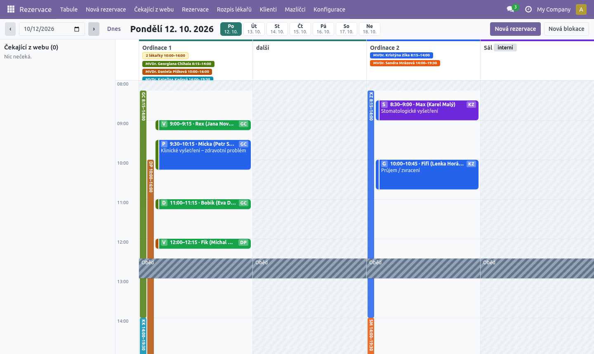
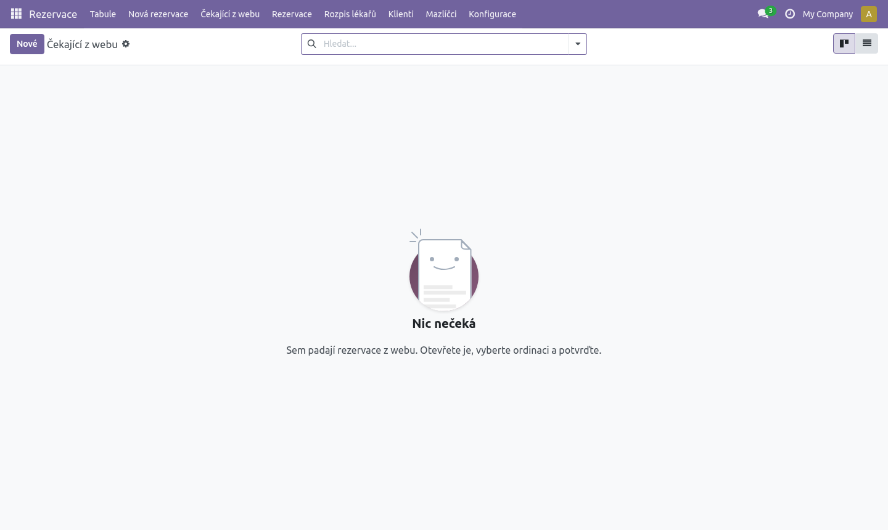
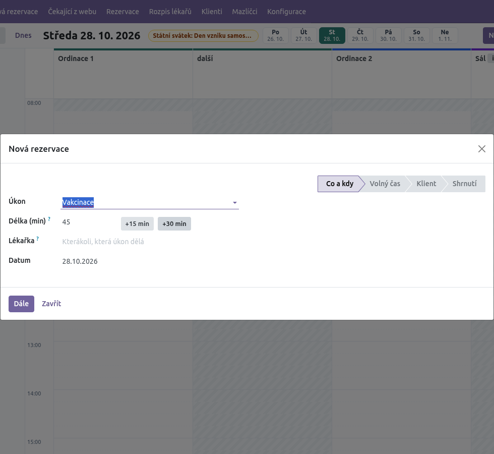
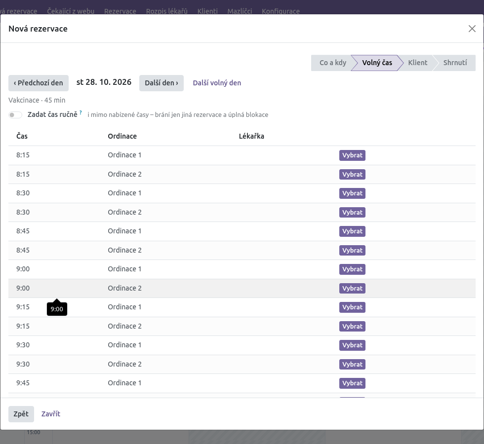
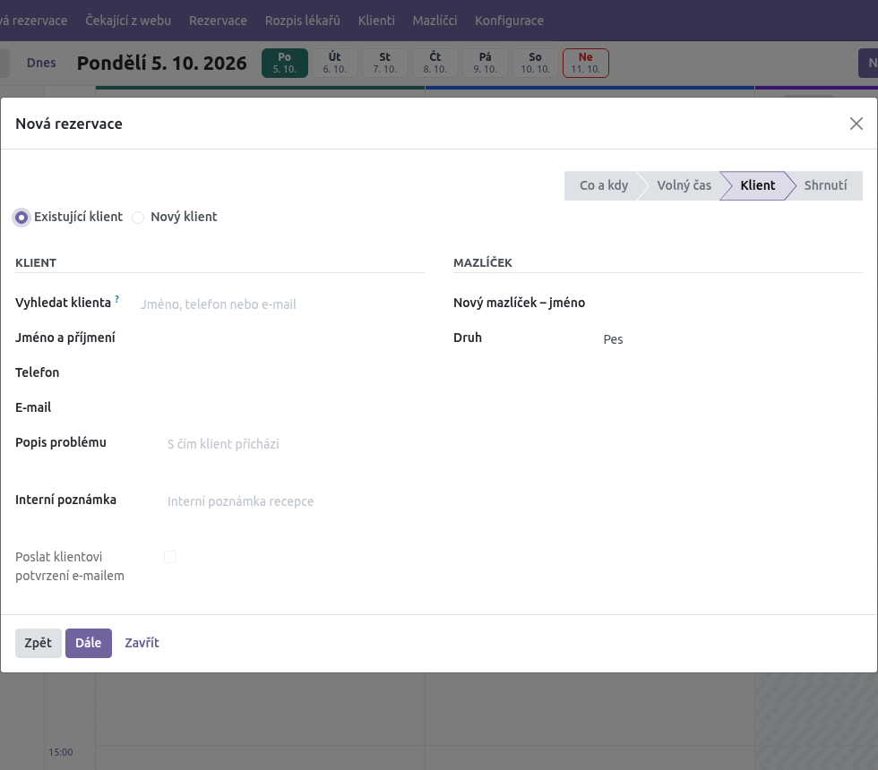
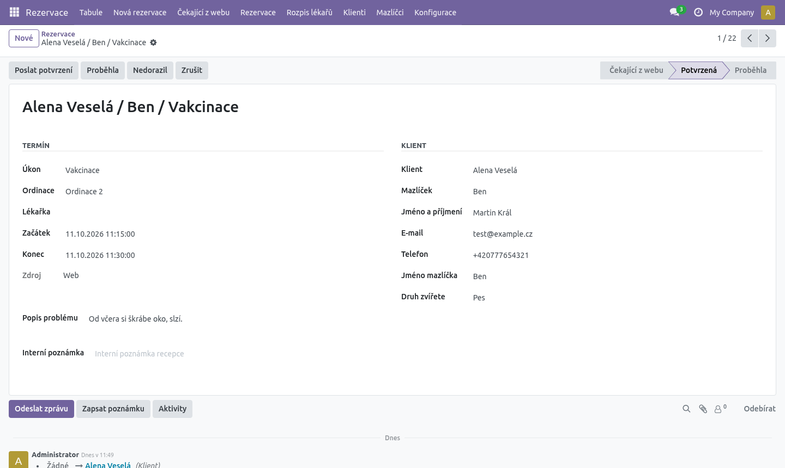

# Rezervace – návod pro recepci

**K čemu je tento návod.** Popisuje denní práci s rezervacemi v Odoo: tabuli, žádosti z webu,
zakládání a přesouvání rezervací, blokace a e-maily klientům. Je pro recepci, nepotřebujete
k němu žádné technické znalosti. Jak se počítají volné termíny, vysvětluje
[Jak to funguje](jak-to-funguje.md).

Vše najdete v aplikaci **Rezervace**. Nahoře je nabídka: **Tabule**, **Nová rezervace**,
**Čekající z webu**, **Rezervace**, **Rozpis lékařů**, **Klienti**, **Mazlíčci**
(a **Konfigurace**, kterou vidí jen správce).

---

## 1. Tabule

Tabule ukazuje **jeden den**. Každá ordinace má svůj sloupec, vlevo je časová osa.

### Pohyb po dnech

- **‹** a **›** – předchozí / další den.
- Políčko s datem – skok na libovolný den.
- **Dnes** – návrat na dnešek.
- Vedle nadpisu dne je řada **dnů v týdnu** (po–ne). Kliknutím přejdete na daný den.
  Vybraný den je zelený, dnešek má červený rámeček.

Tabule nemá týdenní mřížku. Když chcete vidět celý týden najednou, otevřete
**Rezervace** a přepněte vpravo nahoře na zobrazení kalendáře (barvy podle úkonu).

### Co na tabuli vidíte

| Co | Význam |
|---|---|
| Světle šedé šrafování | Ordinace je zavřená (mimo ordinační dobu nebo výjimka). |
| Tmavě šedý šrafovaný pruh | Úplná blokace (např. „Oběd“). Blokace pro všechny ordinace se táhne přes všechny sloupce. |
| Světlé čárkované šrafování se štítkem „jen web“ | Blokace jen pro web: web tam nic nenabízí, vy tam objednat smíte. Klik do ní otevře průvodce, klik na štítek otevře blokaci. |
| Barevný svislý proužek vlevo ve sloupci | Služba lékařky: iniciály a čas (např. „GC 8:15–14:00“). Každá lékařka má svou barvu, stejnou i ve štítku v hlavičce. |
| Dva proužky vedle sebe | V ordinaci slouží současně dvě lékařky (viz níže). |
| Barevná karta | Rezervace. Barva karty patří úkonu (např. vakcinace zelená, problém modrý). Proužek na levém okraji karty má barvu lékařky, ke které je klient objednaný – stejnou jako její služba a štítek. Rezervace bez lékařky proužek nemá. |
| Písmeno vlevo na kartě | Zkratka úkonu (V = vakcinace, P = zdravotní problém, S = stomatologie…). |
| Čas · jméno | Např. „9:00–9:15 · Rex (Jana Nováková)“ = mazlíček (majitel). |
| Druhý řádek | Název úkonu (jen u delších karet). |
| 🌐 | Rezervace přišla z webu. |
| Zkratka vpravo (např. **GC**) | Iniciály lékařky. Po najetí myší uvidíte celé jméno. |
| Bledší karta | Proběhla nebo Nedorazil. |
| Štítky v hlavičce sloupce | Kdo v ordinaci slouží a od kdy do kdy, např. „MVDr. Georgiana Chihaia 8:15–14:00“, v barvě lékařky. |
| Žlutý štítek „2 lékařky 10:00–14:00“ | V tomto čase slouží v ordinaci dvě lékařky současně. |
| Žlutý štítek u nadpisu dne | „Víkend – web neobjednává“ nebo „Státní svátek: … – web neobjednává“. Web ten den nic nenabízí, recepce objednává normálně. |
| „interní“ u názvu | Ordinace, kam se klienti z webu objednat nemohou (např. Sál). |
| Červená čára | Aktuální čas (jen u dneška). Čas je i na ose. |

Zrušené rezervace se na tabuli neukazují.

Najedete-li myší na kartu, zobrazí se podrobnosti: úkon, lékařka, telefon, e-mail
a popis problému. Kliknutím na kartu otevřete celou rezervaci.

### Dvě lékařky v jedné ordinaci

Mají-li v Rozpisu lékařů dvě lékařky službu ve stejné ordinaci ve stejnou dobu, tabule
to ukáže takto:

- vlevo ve sloupci jsou **dva barevné proužky vedle sebe** – každý s iniciálami a časem
  služby jedné lékařky,
- v hlavičce sloupce je žlutý štítek **„2 lékařky 10:00–14:00“** (úsek, kdy slouží obě).

Ordinace má pořád **jen jedno místo**: v jednu chvíli tam může být jen jeden pacient.
Druhá lékařka tedy neznamená dvojnásobek termínů – jen to, že úkon může dělat kterákoli
z nich. Kterou lékařku rezervace má, ukazují iniciály vpravo na kartě.

### Živá aktualizace

Tabuli není třeba obnovovat. Když kdokoli (kolegyně na druhém počítači, klient z webu)
něco změní, tabule se sama překreslí. Při nové žádosti z webu vyskočí vpravo nahoře
upozornění „Nová žádost z webu: …“, které zůstane, dokud ho nezavřete. Kdyby spojení vypadlo, tabule se pro jistotu
obnoví sama každou minutu.

---

## 2. Čekající žádosti z webu

Žádost, kterou klient pošle z webu, ještě **není potvrzená** a **neblokuje termín**.
Čeká, až ji recepce potvrdí. Najdete ji:

- v levém panelu tabule **Čekající z webu (počet)**,
- v nabídce **Čekající z webu** (seznam všech čekajících, i starších).

Každá karta v panelu ukazuje požadovaný den a čas, délku, jméno, telefon a e-mail,
vybranou lékařku (pokud si ji klient zvolil) a popis problému.

### Potvrzení jedním klikem (doporučeno)

Pod kartou jsou zelená tlačítka **Potvrdit → Ordinace · lékařka**, např.
„Potvrdit → Ordinace 1 · MVDr. Daniela Píšková“. Systém je nabízí jen tam, kde je
požadovaný čas volný a kde slouží lékařka, která úkon dělá.

1. Vyberte vhodné tlačítko a klikněte.
2. Rezervace se zapíše do ordinace v požadovaném čase a klient dostane e-mail
   s potvrzením.

Když se objeví text **„Požadovaný čas už není volný – otevřete a přeplánujte.“**,
termín mezitím někdo obsadil. Text **„Požadovaný čas už uplynul – otevřete
a přeplánujte.“** znamená, že termín už začal. V obou případech postupujte podle
části „Úprava žádosti“.

### Přetažení do sloupce

Kartu můžete myší přetáhnout do sloupce ordinace na zvolený čas. Pustíte-li ji,
rezervace se rovnou **potvrdí** v tomto čase a ordinaci a klient dostane potvrzení.

- Pozor: kartu pouštíte na den, který je právě na tabuli. Chcete-li jiný den,
  nejdřív si ho na tabuli otevřete.
- Při přetažení se kontroluje, že čas je volný a že v té ordinaci v tu dobu slouží
  lékařka, která úkon dělá (nebo ta, kterou si vybral klient). Když ne, objeví se
  červená hláška „V 9:00 v Ordinace 1 neslouží lékařka, která dělá …“ a nic se neuloží.
  Slouží-li tam jediná taková lékařka, zapíše se k rezervaci sama.

### Úprava žádosti (tlačítko **Upravit**)

1. Klikněte na **Upravit**. Otevře se formulář rezervace.
2. Vyplňte **Ordinace**, případně změňte **Začátek** a **Lékařka**.
3. Klikněte na **Potvrdit** (nahoře vlevo).

Bez vyplněné ordinace potvrdit nejde. Při potvrzení se klient a mazlíček automaticky
dohledají v kartotéce (podle e-mailu, pak telefonu), nebo se založí noví.

Doporučení: když potvrzujete jiný čas, než si klient vybral, zavolejte mu.
E-mail mu přijde jako běžné potvrzení s novým časem.

### Odmítnutí (tlačítko **Odmítnout**)

1. Klikněte na **Odmítnout**.
2. Potvrďte dotaz „Odmítnout rezervaci …? Klientovi odejde e-mail o zrušení.“

Žádost se zruší a klient dostane e-mail, že termín je zrušený, s odkazem na nové objednání.

---

## 3. Nová rezervace (průvodce)

Rezervaci po telefonu nebo na místě zakládejte průvodcem. Otevřete ho:

- tlačítkem **Nová rezervace** na tabuli nebo v horní nabídce, nebo
- **kliknutím do prázdného místa ve sloupci** tabule – pak je předvyplněná ordinace a čas.

Průvodce má 4 kroky: **Co a kdy → Volný čas → Klient → Shrnutí**.
Mezi kroky se pohybujete tlačítky **Dále** a **Zpět**, **Zavřít** průvodce zruší.

### Krok 1 – Co a kdy

1. **Úkon** – povinné.
2. **Lékařka** – nepovinné. Nabízí se jen lékařky, které daný úkon dělají.
   Necháte-li prázdné, systém vezme kteroukoli, která úkon dělá a v tu dobu slouží.
3. **Datum** – předvyplněný je den otevřený na tabuli.
4. **Délka (min)** – výchozí je délka úkonu. Když víte, že návštěva potrvá déle
   (např. jeden klient se dvěma psy), prodlužte ji (násobky 5 minut, tlačítka **+15 min** / **+30 min**).
   Nabídnou se jen časy, kam se celá délka vejde, a rezervace se uloží s touto délkou.
   Při změně úkonu se délka vrátí na výchozí.
5. Klikněte **Dále**.

Pokud jste průvodce otevřeli kliknutím do tabule a čas v ordinaci je volný,
krok 2 se přeskočí a jdete rovnou na klienta. Když volný není, krok 2 se otevře
se žlutým upozorněním, proč se předvyplněný čas nepoužil.

### Krok 2 – Volný čas

Seznam volných časů v daný den: **Čas**, **Ordinace**, **Lékařka**.

1. U vhodného řádku klikněte **Vybrat**.
2. Jiný den: **‹ Předchozí den**, **Další den ›**, nebo **Další volný den**
   (najde nejbližší den, kdy je pro úkon volno).

Recepce může objednávat i na dnešek a daleko dopředu – omezení pro web
(„nejdříve za X hodin“, „nejdál X dní“) tady neplatí. Průvodce nabízí i ordinace,
které nejsou online (např. Sál), pokud mají ordinační dobu. Blokace **jen pro web**,
víkend ani státní svátek tu nevadí.

### Ruční čas (mimo nabízené časy)

Někdy potřebujete objednat mimo běžné časy – po ordinační době, v sobotu, když lékařka
nemá v rozpisu službu, nebo do Sálu. Pak:

1. V kroku 2 zapněte **Zadat čas ručně**.
2. Vyberte **Ordinaci** (kteroukoli aktivní) a **Čas** (po čtvrthodinách 6:00–21:45).
3. Klikněte **Použít ruční čas** a pokračujte na klienta.

Ručně vložit **nejde** jen tam, kde už je jiná rezervace nebo **úplná** blokace – průvodce
to hned řekne. Ordinační doba, služba lékařky, blokace jen pro web, víkend ani svátek
nevadí. Lékařka zvolená v kroku 1 nemusí mít v tu dobu službu; když žádnou nezvolíte,
zapíše se ta, která v ordinaci zrovna slouží (pokud nějaká). Ve shrnutí je u termínu
„(zadáno ručně)“.

Klik do tabule **mimo nabízené časy** (zavřená ordinace, víkend, bez služby) průvodce
neodmítne: předvyplní ruční čas a ordinaci a jen upozorní „Mimo běžnou ordinační dobu –
vkládáte ručně“. Zkontrolujte čas a klikněte **Použít ruční čas**.

### Krok 3 – Klient

1. Zvolte **Existující klient** nebo **Nový klient**.
2. Existující: do **Vyhledat klienta** napište jméno, telefon nebo e-mail
   (telefon stačí i část, mezery nevadí). Má-li klient jen jednoho mazlíčka,
   doplní se sám; jinak ho vyberte v poli **Mazlíček**.
3. Nový: vyplňte **Jméno a příjmení** a aspoň **Telefon** nebo **E-mail**.
   Pokud už klient se stejným e-mailem nebo telefonem v kartotéce je, použije se
   ten a nový se nezakládá.
4. Nový mazlíček: **Nový mazlíček – jméno** a **Druh**.
5. Volitelně **Popis problému** a **Interní poznámka** (klient ji nevidí).
6. **Poslat klientovi potvrzení e-mailem** – zaškrtne se samo, když je vyplněný e-mail.
   Odškrtněte, pokud klient e-mail nechce.
7. Klikněte **Dále**.

### Krok 4 – Shrnutí

Zkontrolujte úkon, termín, ordinaci, lékařku, klienta, kontakt, mazlíčka
a zda odejde e-mail. Klikněte **Uložit rezervaci**. Rezervace je hned potvrzená
a objeví se na tabuli.

Pokud mezitím termín někdo obsadil, uložení skončí hláškou o obsazeném termínu.
Vraťte se **Zpět** a vyberte jiný čas.

---

## 4. Přesun a změna délky

### Přesun přetažením

1. Chyťte kartu na tabuli a přetáhněte ji na jiný čas nebo do jiné ordinace.
2. Čas se zaokrouhlí na nejbližší krok (obvykle 15 minut).

Přetahovat jde jen v rámci zobrazeného dne. Na jiný den přesunete rezervaci
ve formuláři: klikněte na kartu a změňte **Začátek**.

Je-li cílový čas obsazený, objeví se červená hláška „Termín … v ordinaci … je obsazený: …“
a karta zůstane na původním místě. Stejně tak u rezervace, když v cílové ordinaci
a čase neslouží lékařka, která úkon dělá („V … v … neslouží lékařka, která dělá …“).
Neslouží-li tam dosavadní lékařka, zapíše se ta, která tam slouží (blokace jdou
přesunout kamkoli).

Klient s e-mailem dostane po přesunu potvrzené rezervace na jiný čas automaticky
e-mail **o změně termínu**. Při změně jen ordinace (stejný čas) e-mail nechodí.

### Prodloužení

Přetažením okraje karty délku změnit **nejde**. Postup:

1. Klikněte na kartu.
2. Změňte **Konec**.
3. Uložte.

Pozor: když ve formuláři změníte **Začátek** nebo **Úkon**, **Konec** se přepočítá
na běžnou délku úkonu. Prodloužení proto nastavujte až jako poslední.

---

## 5. Stav rezervace: proběhla, nedorazil, zrušení

Ve formuláři rezervace jsou nahoře tlačítka:

| Tlačítko | Kdy je vidět | Co udělá |
|---|---|---|
| **Potvrdit** | Čekající z webu | Potvrdí (musí být vyplněná ordinace), pošle potvrzení. |
| **Poslat potvrzení** | Potvrzená s e-mailem | Pošle potvrzovací e-mail znovu. |
| **Proběhla** | Potvrzená | Označí návštěvu jako proběhlou (karta zbledne). |
| **Nedorazil** | Potvrzená | Označí, že klient nepřišel (karta zbledne). E-mail neodchází. |
| **Zrušit** | Čekající nebo potvrzená | Zruší rezervaci. Má-li klient e-mail, odejde mu e-mail o zrušení (budete na to upozorněni). Termín se uvolní. |
| **Spárovat klienta** | Rezervace bez klienta | Dohledá nebo založí klienta a mazlíčka z údajů z webu. |

Vpravo je stav: **Čekající z webu → Potvrzená → Proběhla**.

Proběhla / Nedorazil jsou nepovinné, slouží pro přehled. Pod formulářem je historie
změn a zpráv (kdo co kdy změnil).

---

## 6. Blokace (oběd, porada, zavřená ordinace)

Blokace zabere čas v ordinaci. Jsou dva druhy:

| Druh blokace | Web | Recepce (průvodce, přetažení, návrhy u žádostí) | Na tabuli | Kdy použít |
|---|---|---|---|---|
| **Úplná** (výchozí) | nenabízí | nesmí – nikdo tam nic nevytvoří | tmavé šrafování | oběd, porada, úklid, ordinace mimo provoz |
| **Jen web** | nenabízí | smí | světlé čárkované, štítek „jen web“ | čas, který chcete obsazovat jen po telefonu (akutní případy, kontroly) |

Úplnou blokaci nejde založit přes potvrzenou rezervaci. Blokaci jen pro web založíte
kdykoli, i přes existující rezervace – ty zůstanou, jak jsou.

### Nová blokace

1. Na tabuli klikněte **Nová blokace**.
2. Vyplňte **Důvod blokace** (např. „Oběd“).
3. **Druh blokace** – **Úplná**, nebo **Jen web**.
4. **Ordinace** – vyberte jednu, nebo nechte prázdné = **všechny ordinace**.
5. **Začátek** a **Konec**.
6. Opakování: **Opakovat týdně do** – blokace se zkopíruje na stejný den v týdnu
   každý týden až do zadaného data (nejvýš na rok dopředu), se stejným druhem. Pole je jen při zakládání.
7. Uložte.

Úplnou blokaci nejde založit přes již potvrzenou rezervaci – nejdřív rezervaci přesuňte.

Když je úplná blokace pro **všechny ordinace** a některá ordinace už v tu dobu úplnou
blokaci má, nic se neodmítne. Blokace se rozdělí po ordinacích a doplní se jen tam,
kde ještě není. Na tabuli pak místo jednoho pruhu přes všechny sloupce uvidíte
blokaci v každé ordinaci zvlášť.

### Zrušení blokace

1. Klikněte na blokaci na tabuli (u blokace jen pro web na štítek „jen web“).
2. Klikněte **Zrušit blokaci**.

Opakovaná blokace jsou samostatné kopie – každý týden se ruší zvlášť.
Všechny najdete v **Rezervace** s filtrem **Jen blokace** (blokace jen pro web má
vlastní filtr **Blokace jen pro web**).

### Víkendy a státní svátky

O víkendech a ve státní svátky web sám **nic nenabízí** (pokud to správce v nastavení
nevypnul). Nic se nezadává – svátky včetně Velkého pátku a Velikonočního pondělí se
počítají samy. Na tabuli je u nadpisu dne žlutý štítek, např. „Víkend – web neobjednává“.
Recepce v takový den objednává normálně, mimo ordinační dobu ručním časem.

---

## 7. Klienti a mazlíčci

- **Klienti** – kartotéka klientů kliniky. Na kartě klienta je záložka **Mazlíčci**
  (jméno, druh, plemeno, poznámka) a pole **ID ve WinVetu** (zatím se nevyplňuje).
- **Mazlíčci** – seznam všech zvířat s majitelem.

Klient a mazlíček se zakládají sami: při potvrzení žádosti z webu a při uložení
průvodce. Klient se hledá nejdřív podle e-mailu, pak podle telefonu (posledních
9 číslic), takže stejný člověk se nezakládá dvakrát. Mazlíček se hledá podle jména
u téhož majitele.

Tip: Když klient napíše z webu jiný e-mail nebo telefon než minule, vznikne nový
klient. Pak je dobré karty ručně sloučit nebo opravit.

---

## 8. E-maily klientům

E-maily odcházejí automaticky v jazyce, ve kterém klient rezervoval na webu
(čeština, němčina, ruština, angličtina). Odcházejí přes frontu pošty, takže
mohou dorazit s několikaminutovým zpožděním.

| E-mail | Kdy odchází | Komu |
|---|---|---|
| Přijato z webu | Klient odešle žádost na webu | klientovi |
| Nová rezervace z webu | Klient odešle žádost na webu | klinice (adresa z nastavení), s odkazem na frontu Čekající z webu |
| Potvrzeno | **Potvrdit**, potvrzení z tabule, přetažení žádosti do sloupce, uložení průvodce (je-li zaškrtnuté), **Poslat potvrzení** | klientovi; obsahuje čas, ordinaci, lékařku, instrukce k úkonu a odkaz na zrušení |
| Změna termínu | Potvrzené rezervaci se změní začátek (samotná změna ordinace e-mail neposílá) | klientovi |
| Zrušeno | **Zrušit**, **Odmítnout**, zrušení klientem | klientovi; při zrušení klientem i klinice |
| Připomínka | X hodin před termínem, je-li zapnutá v nastavení | klientovi |

E-mail odchází jen tehdy, když má rezervace vyplněný e-mail. **Nedorazil** a
**Proběhla** e-mail neposílají. Změna lékařky ani délky e-mail neposílá.

Kdy použít **Poslat potvrzení**: klient tvrdí, že e-mail nedostal, nebo jste
v průvodci e-mail nejdřív neposlali a klient ho teď chce.

---

## 9. Zrušení klientem odkazem z e-mailu

V e-mailu s potvrzením, změnou termínu a připomínkou je odkaz na zrušení.

- Klient na něm potvrdí zrušení a rezervace se sama zruší (důvod zrušení: Klient).
- Klient dostane e-mail o zrušení, klinika kopii na adresu pro upozornění.
- Tabule se hned aktualizuje, termín je znovu volný.
- Zrušit odkazem jde jen do určité doby před termínem (nastavení „Klient může zrušit
  do“, obvykle 12 hodin). Později se klientovi ukáže, ať zavolá na recepci,
  a telefon recepce.

---

## 10. Časté situace

### Termín je obsazený

- Hláška „Termín … v ordinaci … je obsazený: …“ znamená, že v tom čase už je
  potvrzená rezervace nebo blokace. Nic se neuložilo.
- Vyberte jiný čas nebo jinou ordinaci. Průvodce sám nabízí jen volné časy.
- Čekající žádosti z webu termín neblokují – dvě žádosti na stejný čas se mohou sejít.
  Potvrdit jde jen jednu, u druhé zmizí návrhy a je třeba ji přeplánovat.

### Klient chce ke konkrétní lékařce

1. V průvodci vyberte v kroku 1 **Lékařka**.
2. Krok 2 ukáže jen časy, kdy tato lékařka slouží.
3. Pokud lékařka v seznamu chybí, daný úkon nedělá (nemá potřebnou specializaci).

Kdo kdy slouží, vidíte v hlavičce sloupců tabule nebo v **Rozpis lékařů**.
Na webu si klient lékařku vybírá v záložce **Podle lékaře**.

### Lékařka onemocněla

1. **Upravit rozpis** – v **Rozpis lékařů** smažte nebo přepište její služby
   (např. na zastupující lékařku). Úpravy rozpisu smí jen **Správce rezervací**;
   recepce rozpis jen vidí.
2. Web od té chvíle přestane nabízet časy, které vyžadují právě ji.
3. **Přeplánovat** – rezervace, které už na ni byly, zůstávají. Najdete je na tabuli
   podle jejích iniciál.
   - Přebírá-li je jiná lékařka: otevřete rezervaci a změňte **Lékařka** (klientovi
     e-mail neodchází – zavolejte mu, pokud na lékařce záleží).
   - Musí-li se termín posunout: přetáhněte kartu nebo změňte **Začátek**
     (klient dostane e-mail o změně termínu).
   - Nelze-li jinak: **Zrušit** (klient dostane e-mail o zrušení).

### Zavřeno celý den nebo část dne

- Jednorázově na pár hodin: **Nová blokace** (bez ordinace = celá klinika).
- Jen pro web (po telefonu objednávat dál): **Nová blokace** s druhem **Jen web**.
- Celý den (svátek, školení): správce zadá výjimku ordinační doby
  (viz [Nastavení](nastaveni.md)).

### Žádost z webu je v minulosti

Žádosti, jejichž termín už skončil, z panelu na tabuli zmizí, ale zůstávají
v nabídce **Čekající z webu**. Otevřete je a buď je přeplánujte a potvrďte,
nebo **Zrušit**.

### Záloha

Online platba zálohy zatím **není**. Je-li u úkonu záloha a zálohy jsou zapnuté,
rezervace má stav zálohy „Čeká na zálohu“ a platební údaje klientovi posílá recepce.
