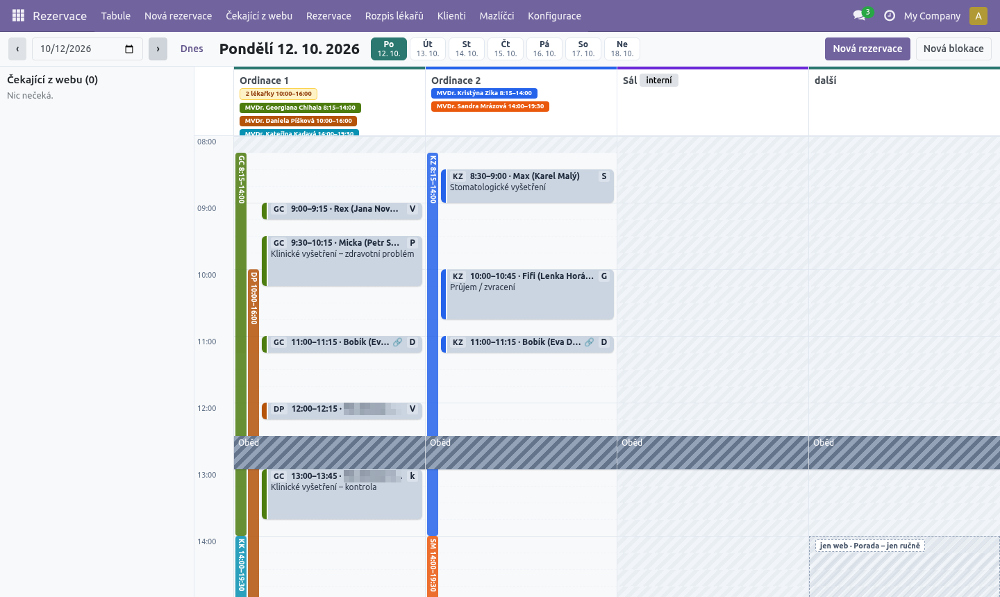
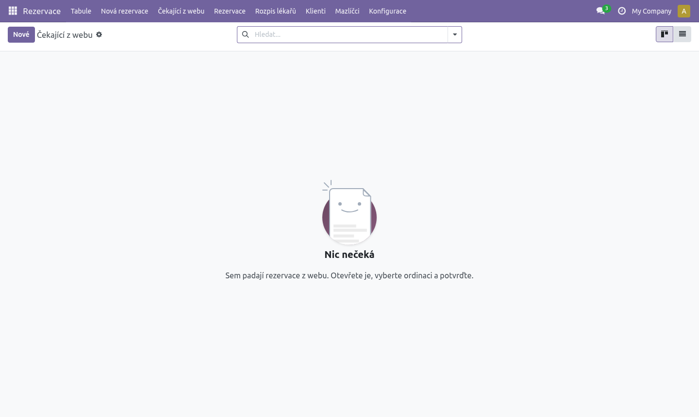
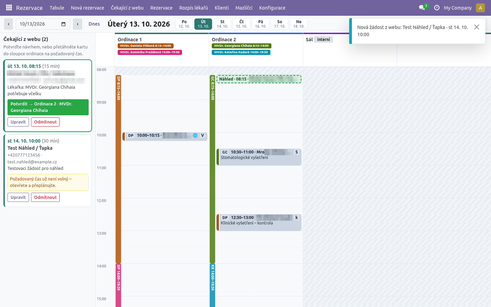
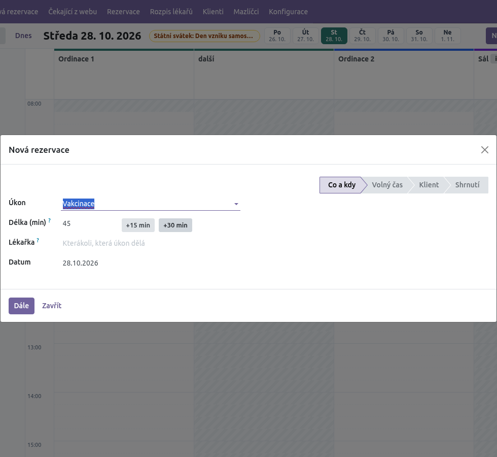
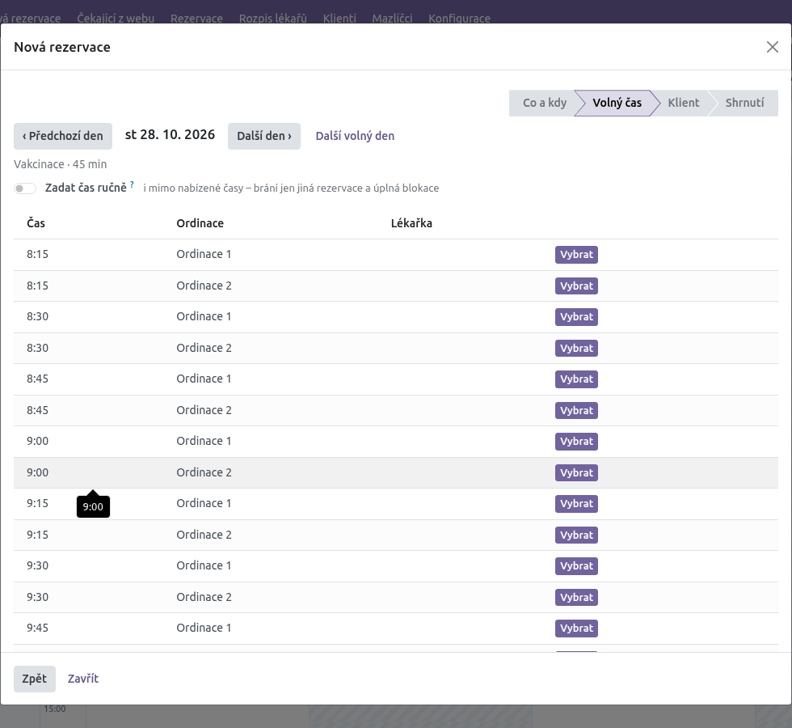
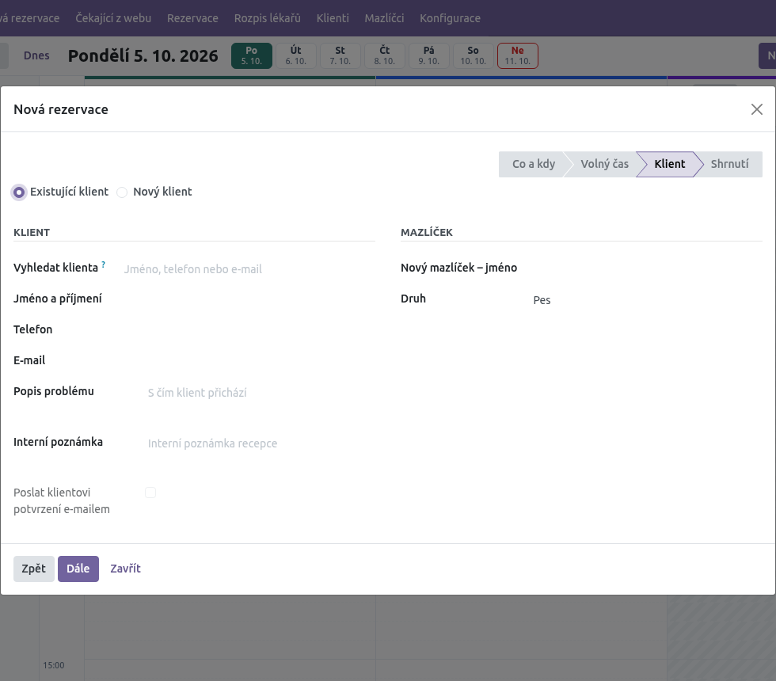
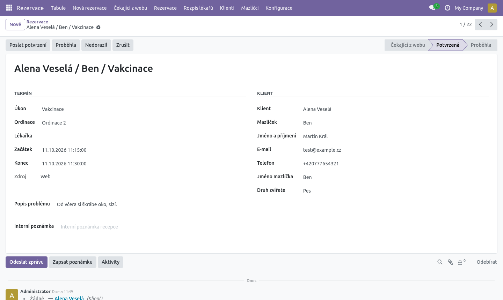

# Rezervace – návod pro recepci

**K čemu je tento návod.** Popisuje denní práci s rezervacemi v Odoo: kalendář, žádosti z webu,
zakládání a přesouvání rezervací, blokace a e-maily klientům. Je pro recepci, nepotřebujete
k němu žádné technické znalosti. Jak se počítají volné termíny, vysvětluje
[Jak to funguje](jak-to-funguje.md).

Vše najdete v aplikaci **Rezervace**. Nahoře je nabídka: **Kalendář**, **Nová rezervace**,
**Čekající z webu**, **Rezervace**, **Rozpis lékařů**, **Klienti**, **Mazlíčci**
(a **Historie rezervací** a **Konfigurace**, které vidí jen správce rezervací).

---

## 1. Kalendář

*Starší snímek: v nabídce je ještě „Tabule“ a karty rezervací jsou barevné. Dnes jsou bílé s barevnými proužky a pod horní lištou je řádek s přepínačem Vše | Web | Klinika.*

Kalendář ukazuje **jeden den**. Každá ordinace má svůj sloupec, vlevo je časová osa.

### Pohyb po dnech

Vybraný den zůstane i po obnovení stránky, dokud je panel prohlížeče otevřený. Další den kalendář začne na dnešku.

- **‹** a **›** – předchozí / další den.
- Políčko s datem – skok na libovolný den.
- **Dnes** – návrat na dnešek.
- Vedle nadpisu dne je řada **dnů v týdnu** (po–ne). Kliknutím přejdete na daný den.
  Vybraný den je zelený, dnešek má červený rámeček. Státní svátek má světle červené pozadí
  a červenou tečku; najetím myší se ukáže jeho název.

Kalendář nemá týdenní mřížku. Když chcete vidět celý týden najednou, otevřete
**Rezervace** a přepněte vpravo nahoře na zobrazení kalendáře (barvy podle úkonu).

### Co v kalendáři vidíte

**Odkud rezervace je (web, nebo klinika).** Pod horní lištou kalendáře je jeden řádek s legendou
a přepínačem **Vše | Web | Klinika**:

| Štítek vlevo na kartě | Význam |
|---|---|
| Modrý **WEB** | Rezervace z webu (i z chatu na webu) – objednal(a) se klient sám. |
| Bez štítku | Rezervaci založil(a) někdo z kliniky (průvodce Nová rezervace, pokladna). Kdo a kdy, ukáže najetí myší na kartu: „Založil(a): Jana Nováková, 26. 10. 2026 9:12“. |
| Šedý **WinVet** | Záznam z kalendáře WinVetu (viz níže). |

Přepínač **Vše | Web | Klinika** ukáže jen rezervace z webu, nebo jen ty z kliniky.
Záznamy z WinVetu jsou jen ve **Vše** (ani z webu, ani založené v Odoo); blokace jsou vidět
vždy. Volbu si pamatuje prohlížeč (každý počítač zvlášť). Když filtr něco skrývá, je vedle
legendy „skryto: N“ – skryté místo je pořád obsazené.

Druhá ordinace u zákroku pro dvě lékařky má štítek podle hlavní rezervace (web zůstane WEB
v obou sloupcích).

| Co | Význam |
|---|---|
| Jemné světle šedé šrafování | Ordinace je zavřená (mimo ordinační dobu nebo výjimka). |
| Tmavě šedý šrafovaný pruh | Úplná blokace (např. „Oběd“). Blokace pro všechny ordinace se táhne přes všechny sloupce. Rezervace, které tam byly před blokací, leží nad ní; nové tam objednat nejde. |
| Světlé čárkované šrafování se štítkem „jen web“ | Blokace jen pro web: web tam nic nenabízí, vy tam objednat smíte. Klik do ní otevře průvodce, klik na štítek otevře blokaci. |
| Barevný svislý proužek vlevo ve sloupci | Služba lékařky: iniciály a čas (např. „GC 8:15–14:00“). Každá lékařka má svou barvu, stejnou i ve štítku v hlavičce. |
| Dva proužky vedle sebe | V ordinaci slouží současně dvě lékařky (viz níže). |
| Bílá karta s proužky | Rezervace. Proužek na pravém okraji má barvu úkonu (např. vakcinace zelená, problém modrý). Proužek na levém okraji má barvu lékařky, ke které je klient objednaný – stejnou jako její služba a štítek. Rezervace bez lékařky levý proužek nemá. |
| Písmeno vpravo na kartě | Zkratka úkonu (V = vakcinace, P = zdravotní problém, S = stomatologie…). |
| Čas · jméno | Např. „9:00–9:15 · Rex (Jana Nováková)“ = mazlíček (majitel). Má-li rezervace **Popis**, stojí před jménem. Rezervace bez klienta má jen Popis. |
| Druhý řádek | Název úkonu (jen u delších karet). Pod ním je **interní poznámka** rezervace; u krátké karty (15 minut) se ukáže po najetí myší. |
| **WEB** vlevo | Rezervace z webu – viz legenda výše. Hned za ním jsou iniciály lékařky. |
| 🔗 | Společný zákrok dvou lékařek – rezervace je i v jiné ordinaci (najeďte myší, ukáže se kde). |
| Zkratka na průsvitném podkladu (např. **GC**) | Iniciály lékařky – vlevo u jejího barevného proužku, za případným štítkem WEB. Po najetí myší uvidíte celé jméno. |
| Bledší karta | Proběhla. Rezervace se stavem **Nedorazil** v kalendáři není (stejně jako zrušená), aby bylo vidět, že je čas volný. Zůstává v Historii rezervací. |
| Červený obrys a štítek **ZRUŠIT?** | Klient žádá o zrušení, rozhoduje recepce (viz „Žádosti o zrušení od klienta“). |
| Karty vedle sebe | Rezervace, které se v ordinaci překrývají (viz „Rezervace přes obsazený termín“). |
| Štítky v hlavičce sloupce | Kdo v ordinaci slouží a od kdy do kdy, např. „MVDr. Georgiana Chihaia 8:15–14:00“, v barvě lékařky. |
| Žlutý štítek „2 lékařky 10:00–14:00“ | V tomto čase slouží v ordinaci dvě lékařky současně. |
| Červený štítek u nadpisu dne | „Státní svátek: Den vzniku samostatného československého státu“ – ukáže se ve svátek vždy. Když web ve svátky neobjednává, je za ním „· web neobjednává“. Recepce objednává normálně. |
| Žlutý štítek u nadpisu dne | „Víkend – web neobjednává“. Web ten den nic nenabízí, recepce objednává normálně. |
| „interní“ u názvu | Ordinace, kam se klienti z webu objednat nemohou (např. Sál). |
| Červená čára | Aktuální čas (jen u dneška). Čas je i na ose. |
| Tenké vodorovné čáry | Jedna čára na každý krok rezervací (obvykle 15 minut), osa je na krok zarovnaná. |
| Světle šedá karta se štítkem **WinVet** (bez šrafování) | Záznam z kalendáře WinVetu (objednáno ve WinVetu). Proužek vlevo má barvu činnosti z WinVetu, název je zvíře (majitel) z kartotéky, jinak text z WinVetu. Jen pro čtení: nejde přetáhnout ani zrušit, klik ukáže podrobnosti. **Termín je obsazený** – web ho nenabídne a recepce i pokladna přes něj objednají jen po potvrzení upozornění (viz „Rezervace přes obsazený termín“). Změny dělejte ve WinVetu, v kalendáři se ukážou do pár minut. |
| Štítek **WinVet · …** v hlavičce sloupce | Celodenní záznam z WinVetu (např. služba lékařky nebo dovolená). Jen poznámka, termíny neblokuje. |

Zrušené rezervace se v kalendáři neukazují. Kalendář z WinVetu vypíná vedení (WinVet data →
Kalendář z WinVetu → Zapnout / vypnout); pak karty WinVet zmizí a nic neblokují.

Najedete-li myší na kartu, zobrazí se podrobnosti: úkon, lékařka, telefon, e-mail,
důvod návštěvy a kdo a kdy rezervaci založil (nebo „Z webu“). Kliknutím na kartu
otevřete celou rezervaci.

### Dvě lékařky v jedné ordinaci

Mají-li v Rozpisu lékařů dvě lékařky službu ve stejné ordinaci ve stejnou dobu, kalendář
to ukáže takto:

- vlevo ve sloupci jsou **dva barevné proužky vedle sebe** – každý s iniciálami a časem
  služby jedné lékařky,
- v hlavičce sloupce je žlutý štítek **„2 lékařky 10:00–14:00“** (úsek, kdy slouží obě).

Ordinace má pořád **jen jedno místo**: běžně tam v jednu chvíli může být jen jeden pacient.
Druhá lékařka tedy neznamená dvojnásobek termínů – jen to, že úkon může dělat kterákoli
z nich. Kterou lékařku rezervace má, ukazují iniciály vlevo na kartě.

### Živá aktualizace

Kalendář není třeba obnovovat. Když kdokoli (kolegyně na druhém počítači, klient z webu)
něco změní, kalendář se sám překreslí. Při nové žádosti z webu vyskočí vpravo nahoře
upozornění „Nová žádost z webu: …“, které zůstane, dokud ho nezavřete. Kdyby spojení vypadlo, kalendář se pro jistotu
obnoví sám každou minutu.

**Zvuk.** Nová žádost z webu zároveň zazvoní (krátké „ding-dong“) a upozornění
vyskočí v celém Odoo, ne jen v kalendáři. Stejně se ohlásí žádost klienta o zrušení
(„Klient žádá o zrušení: …“). Zvuk vypnete tlačítkem **🔔 Zvuk** v kalendáři
(přepne se na **🔕 Bez zvuku**); volba platí pro tento prohlížeč. Prohlížeč pustí zvuk
až poté, co na stránku Odoo jednou kliknete – po ranním otevření tedy stačí kamkoli
kliknout. Po obnovení stránky se už ohlášená žádost znovu neohlásí.

---

## 2. Čekající žádosti z webu

Žádost, kterou klient pošle z webu, ještě **není potvrzená** a **neblokuje termín**.
Čeká, až ji recepce potvrdí. Najdete ji:

- v levém panelu kalendáře **Čekající z webu (počet)**,
- v nabídce **Čekající z webu** (seznam všech čekajících, i starších).

*Starší snímek: v nabídce je ještě „Tabule“ a tlačítko Nové tu dnes není.*

Každá karta v panelu ukazuje požadovaný den a čas, délku, jméno, telefon a e-mail,
vybranou lékařku (pokud si ji klient zvolil) a důvod návštěvy.

**Šířka panelu.** Panel **Čekající z webu** jde rozšířit nebo zúžit: chyťte jeho pravý
okraj (kurzor se změní na ↔) a táhněte. Šířku si prohlížeč zapamatuje. Dvojklik
na okraj vrátí výchozí šířku.

### Náhled: kam žádost patří

Najeďte myší na žádost v panelu **Čekající z webu**. Kalendář se sám přepne na den
žádosti (a na tom dni zůstane) a odroluje na požadovaný čas:

- **zelený přerušovaný rámeček** ukazuje, kam by rezervace šla – v ordinacích,
  které nabízejí tlačítka **Potvrdit → …**,
- při najetí na konkrétní tlačítko se zvýrazní jen jeho ordinace,
- **červený rámeček** přes všechny ordinace znamená, že požadovaný čas už není volný –
  hned vidíte, co tam je.

*Starší snímek: v nabídce je ještě „Tabule“ a karty rezervací jsou dnes bílé s barevnými proužky.*

### Potvrzení jedním klikem (doporučeno)

Pod kartou jsou zelená tlačítka **Potvrdit → Ordinace · lékařka**, např.
„Potvrdit → Ordinace 1 · MVDr. Daniela Píšková“. Systém je nabízí jen v online ordinacích, kde je
požadovaný čas volný a kde slouží lékařka, která úkon dělá (úkon, který lékařku nepotřebuje,
se nabídne i bez ní). Do interní ordinace, např. Sálu, žádost přetáhněte.

1. Vyberte vhodné tlačítko a klikněte.
2. Otevře se okno „Potvrdit žádost?“ s políčky **Datum**, **Od**, **Do** a **Ordinace**
   (předvyplněné podle tlačítka) a větou „Potvrdit žádost Rex (Jana Nováková) na čt 29. 10.
   10:00–10:20, Ordinace 1?“. Datum, čas (po krocích rezervací, obvykle 15 minut) i ordinaci
   můžete před potvrzením opravit, věta se mění s nimi. **Do** se posouvá s **Od**; přepsáním **Do**
   změníte délku. Změníte-li ordinaci, lékařku vybere systém podle rozpisu.
3. Když má žádost e-mail, okno napíše „Klient dostane potvrzovací e-mail (adresa).“ a pod tím
   je zaškrtnuté **Poslat klientovi potvrzení**. Odškrtnete-li ho, e-mail neodejde a v historii
   rezervace zůstane poznámka „Klient nebyl o potvrzení informován.“
4. **Potvrdit**: rezervace se zapíše do zvolené ordinace a času. Není-li čas volný nebo tam
   neslouží lékařka, hláška se ukáže přímo v okně a okno zůstane otevřené – opravte čas nebo
   ordinaci a zkuste to znovu. Když se v okně ukáže **Přesto potvrdit**, můžete potvrdit i tak
   a v historii rezervace zůstane poznámka. Přes úplnou blokaci to nejde. **Zrušit** nic nezmění.

**Potvrdit do obsazeného.** Když v požadovaném čase není nikde volno, ale ordinace je otevřená
a v obsazeném čase by žádost jinak šla (slouží lékařka, která úkon dělá), jsou pod kartou oranžová
tlačítka **Potvrdit do obsazeného → Ordinace**. Otevřou stejné okno s upozorněním, co tam je,
a s už odsouhlaseným **Přesto potvrdit**. Karty pak stojí v kalendáři vedle sebe. Pod úplnou
blokaci to nenabídne nikdy.

Když se objeví text **„Požadovaný čas už není volný – otevřete a přeplánujte.“**,
termín mezitím někdo obsadil. Text **„Požadovaný čas už uplynul – otevřete
a přeplánujte.“** znamená, že termín už začal. V obou případech postupujte podle
části „Úprava žádosti“.

### Přetažení do sloupce

Kartu můžete myší přetáhnout do sloupce ordinace na zvolený čas. Pustíte-li ji,
otevře se stejné okno jako u tlačítka: datum, čas a ordinace podle místa, kam jste kartu
pustili, a dají se ještě opravit (netrefili jste se o čtvrthodinu? stačí přepsat čas). Teprve po
**Potvrdit** se rezervace potvrdí a klient dostane potvrzení (pokud ho neodškrtnete).
**Zrušit** (nebo Esc) nic nezmění, karta zůstane v Čekajících.

- Kartu pouštíte na den, který je právě v kalendáři; jiný den nastavíte v okně v políčku **Datum**.
- Při přetažení se kontroluje, že čas je volný a že v té ordinaci v tu dobu slouží
  lékařka, která úkon dělá (nebo ta, kterou si vybral klient). Když ne, objeví se
  červená hláška „V 9:00 v Ordinace 1 neslouží lékařka, která dělá …“ a nic se neuloží, dokud
  čas neopravíte, nebo nekliknete **Přesto potvrdit**.
  Slouží-li tam jediná taková lékařka, zapíše se k rezervaci sama.

### Úprava žádosti (tlačítko **Upravit**)

1. Klikněte na **Upravit**. Otevře se formulář rezervace.
2. Vyplňte **Ordinace**, případně změňte **Začátek** a **Lékařka**.
3. Klikněte na **Potvrdit** (nahoře vlevo).

Bez vyplněné ordinace potvrdit nejde. Při potvrzení se klient a mazlíček automaticky
dohledají v kartotéce (podle e-mailu, pak telefonu), nebo se založí noví.

Doporučení: když potvrzujete jiný čas, než si klient vybral, zavolejte mu.
E-mail mu přijde jako běžné potvrzení s novým časem.

### Odmítnutí (tlačítko **Odmítnout**)

1. Klikněte na **Odmítnout**.
2. Otevře se okno „Odmítnout žádost“ s dotazem „Odmítnout rezervaci …? Klientovi odejde e-mail
   o zrušení.“ Do pole **Zpráva klientovi (nepovinné)** můžete napsat důvod nebo nabídku jiného
   termínu. Zpráva se vloží do e-mailu.
3. Klikněte **Odmítnout**. **Zpět** nic nezmění.

Žádost se zruší a klient dostane e-mail, že termín je zrušený, s odkazem na nové objednání.

### Žádosti o zrušení od klienta

Klient může rezervaci zrušit odkazem v e-mailu. U potvrzené rezervace to je jen **žádost**: rezervace
zůstává a v panelu vlevo se ukáže **Žádosti o zrušení (počet)**. Karta v kalendáři má červený obrys a štítek
**ZRUŠIT?**. Klient dostane e-mail, že žádost došla a termín zatím platí. Přijde upozornění se zvukem,
a pokud je to zapnuté, i e-mail klinice.

- **Potvrdit zrušení** – rezervace se zruší a klient dostane e-mail. V okně můžete připsat
  **Zprávu klientovi (nepovinné)**.
- **Ponechat** – rezervace zůstane a klient dostane e-mail, že nebyla zrušena.
- **Upravit** – otevře rezervaci. V jejím formuláři jsou tlačítka **Potvrdit zrušení** a
  **Ponechat rezervaci**, zprávu klientovi tam ale připsat nejde.

Žádost z webu, kterou ještě nikdo nepotvrdil, se odkazem zruší rovnou. Klientovi s čekající žádostí o
zrušení neodchází připomínka. U pokladny je žádost vidět v seznamu Dnes a červeným obrysem v Kalendáři,
rozhoduje se v aplikaci Rezervace.

---

## 3. Nová rezervace (průvodce)

Rezervaci po telefonu nebo na místě zakládejte průvodcem. Otevřete ho:

- tlačítkem **Nová rezervace** v kalendáři nebo v horní nabídce, nebo
- **kliknutím do prázdného místa ve sloupci** kalendáře – pak je předvyplněná ordinace a čas.

Průvodce má 4 kroky: **Co a kdy → Volný čas → Klient → Shrnutí**.
Mezi kroky se pohybujete tlačítky **Dále** a **Zpět**, nebo klikem na krok v řádku nahoře: krok, kterým jste už prošli, je klikací tam i zpět a vyplněné údaje zůstanou. Když po změně úkonu nebo délky vybraný termín přestane platit, průvodce vás vrátí na krok 2 a upozorní vás. **Zavřít** průvodce zruší.

### Krok 1 – Co a kdy

*Starší snímek: nahoře dnes přibylo pole Popis a kroky jsou klikací tlačítka.*

1. **Popis** – nepovinné. Krátký text, který se ukáže jako první na kartě a v názvu rezervace.
   Povinný je jen u rezervace **Bez klienta** (krok 3).
2. **Úkon** – nepovinné. Necháte-li prázdné, uloží se úkon **Jiné**.
3. **Délka (min)** – výchozí je délka úkonu. Když víte, že návštěva potrvá déle
   (např. jeden klient se dvěma psy), prodlužte ji (násobky 5 minut, tlačítka **+15 min** / **+30 min**).
   Nabídnou se jen časy, kam se celá délka vejde, a rezervace se uloží s touto délkou.
   Při změně úkonu se délka vrátí na výchozí.
4. **Lékařka** – nepovinné. Nabízí se jen lékařky, které daný úkon dělají.
   Necháte-li prázdné, systém vezme kteroukoli, která úkon dělá a v tu dobu slouží.
   Po kliknutí do kalendáře se lékařka vybere sama podle služby v té ordinaci a čase.
   Když se tam v tu dobu překrývají služby dvou lékařek, objeví se řádek **Ve službě**
   s oběma jmény – klikněte na tu, ke které klienta objednáváte.
5. **Datum** – předvyplněný je den otevřený v kalendáři.
6. Klikněte **Dále**.

Pokud jste průvodce otevřeli kliknutím do kalendáře a čas v ordinaci je volný,
krok 2 se přeskočí a jdete rovnou na klienta. Když volný není, krok 2 se otevře
se žlutým upozorněním, proč se předvyplněný čas nepoužil. Je-li čas obsazený jinou
rezervací, je v upozornění tlačítko **Přesto vytvořit**.

### Krok 2 – Volný čas

*Starší snímek: text u Zadat čas ručně dnes zní „brání jen úplná blokace, u jiné rezervace se průvodce zeptá“.*

Seznam volných časů v daný den: **Čas**, **Ordinace**, **Lékařka**.

1. U vhodného řádku klikněte **Vybrat**.
2. Jiný den: **‹ Předchozí den**, **Další den ›**, nebo **Další volný den**
   (najde nejbližší den, kdy je pro úkon volno).

Recepce může objednávat i na dnešek a daleko dopředu – omezení pro web
(„nejdříve za X hodin“, „nejdál X dní“) tady neplatí. Průvodce nabízí i ordinace,
které nejsou online (např. Sál), pokud mají ordinační dobu. Blokace **jen pro web**,
víkend ani státní svátek tu nevadí.

### Ruční čas (mimo nabízené časy)

Někdy potřebujete objednat mimo běžné časy – po ordinační době, v sobotu, když lékařka
nemá v rozpisu službu, nebo do Sálu. Pak:

1. V kroku 2 zapněte **Zadat čas ručně**.
2. Vyberte **Ordinace (ručně)** (kteroukoli aktivní) a **Čas (ručně)** (po čtvrthodinách 6:00–21:45).
3. Klikněte **Použít ruční čas** a pokračujte na klienta.

Ručně vložit **nejde** jen tam, kde je **úplná** blokace – průvodce to hned řekne. Když je tam
jiná rezervace nebo záznam z WinVetu, průvodce napíše co a nabídne **Přesto vytvořit**. Ordinační doba, služba lékařky, blokace jen pro web, víkend ani svátek
nevadí. Lékařka zvolená v kroku 1 nemusí mít v tu dobu službu; když žádnou nezvolíte,
zapíše se ta, která v ordinaci zrovna slouží (pokud nějaká). Ve shrnutí je u termínu
„(zadáno ručně)“.

Klik do kalendáře **mimo nabízené časy** (zavřená ordinace, víkend, bez služby) průvodce
neodmítne: předvyplní ruční čas a ordinaci a jen upozorní „Mimo běžnou ordinační dobu –
vkládáte ručně“. Zkontrolujte čas a klikněte **Použít ruční čas**.

### Krok 3 – Klient

*Starší snímek: dnes je tu navíc volba Bez klienta a pole Jazyk rezervace, Popis problému se jmenuje Důvod návštěvy.*

1. Zvolte **Existující klient**, **Nový klient**, nebo **Bez klienta**. Když klienta právě založíte
   ve WinVetu a v kartotéce ještě není, zvolte **Je ve WinVetu**: stačí jméno, ideálně i jméno
   zvířete, kontakt není potřeba. Stejná volba je v kartotéce u pokladny při zakládání klienta.
   Synchronizace klienta spáruje podle jména a zvířete a doplní kontakt. Když je stejné jméno
   víckrát, klient zůstane nespárovaný, najdete ho v Klientech pod filtrem **Čeká na spárování
   s WinVetem** a sloučíte ho ručně.
2. Existující: do **Vyhledat klienta** napište jméno, telefon nebo e-mail
   (telefon stačí i část, mezery nevadí). Má-li klient jen jednoho mazlíčka,
   doplní se sám; jinak ho vyberte v poli **Mazlíček**.
3. Nový: vyplňte **Jméno a příjmení** a aspoň **Telefon** nebo **E-mail**.
   Pokud už klient se stejným e-mailem nebo telefonem v kartotéce je, použije se
   ten a nový se nezakládá.
4. Bez klienta: rezervace se uloží jen s **Popisem** z kroku 1 (bez něj průvodce nepustí dál).
   Nezakládá se klient ani mazlíček a e-mail nikomu neodchází. Klienta jde doplnit později
   ve formuláři rezervace (kapitola 5).
5. **Jazyk rezervace** – v tomto jazyce klient dostane e-maily k rezervaci. Nabídne se jazyk
   klienta, u nového čeština. Novému klientovi se jazyk zapíše do profilu, existujícímu se
   profil nemění.
6. Nový mazlíček: **Nový mazlíček – jméno** a **Druh**.
7. Volitelně **Důvod návštěvy** a **Interní poznámka** (klient ji nevidí).
8. **Poslat klientovi potvrzení e-mailem** – zaškrtne se samo, když je vyplněný e-mail.
   Odškrtněte, pokud klient e-mail nechce.
9. Klikněte **Dále**.

### Krok 4 – Shrnutí

Zkontrolujte popis, úkon, termín, ordinaci, lékařku, klienta, kontakt, mazlíčka
a zda odejde e-mail. U rezervace přes obsazený termín je ve shrnutí řádek **Překryv**.
Klikněte **Uložit rezervaci**. Rezervace je hned potvrzená a objeví se v kalendáři.

Pokud mezitím termín někdo obsadil, uložení skončí hláškou o obsazeném termínu.
Vraťte se na krok **2. Volný čas** a vyberte jiný čas.

---

## 4. Přesun a změna délky

### Přesun přetažením

1. Chyťte kartu v kalendáři a přetáhněte ji na jiný čas nebo do jiné ordinace.
2. Čas se zaokrouhlí na nejbližší krok (obvykle 15 minut).
3. Po puštění se otevře okno „Přesunout?“ s políčky **Datum**, **Od**, **Do** a **Ordinace**
   předvyplněnými podle místa puštění a větou, např. „Přesunout Rex (Jan Novák) z čt 29. 10.
   9:00–9:20, Ordinace 1 na čt 29. 10. 10:00–10:20, Ordinace 2?“. Netrefili-li jste se, opravte
   čas (po krocích rezervací), datum nebo ordinaci přímo v okně – věta „na …“ se mění s nimi.
   **Do** je předvyplněné podle dosavadní délky a posouvá se s **Od**; přepsáním **Do** rezervaci
   prodloužíte nebo zkrátíte (konec musí být po začátku). Volný čas a lékařka ve službě se
   kontrolují pro celý nový čas od–do.
4. Když klient dostane e-mail o změně termínu (potvrzená rezervace s e-mailem a jiný den nebo
   čas), okno to napíše i s adresou a ukáže zaškrtnuté **Poslat klientovi e-mail o změně**.
   Odškrtnete-li ho, tento jeden přesun proběhne bez e-mailu a v historii rezervace zůstane
   poznámka „Klient nebyl o změně informován.“ Další přesun už e-mail pošle zase normálně.
5. **Přesunout** rezervaci přesune, **Zrušit** (nebo Esc) nechá vše, jak bylo – omylem
   puštěná karta tak nic nezmění. Puštění na stejné místo se na nic neptá. Stejně se ptá
   i přesun blokace.

Na jiný den přesunete rezervaci také v tomto okně (políčko **Datum**), nebo ve formuláři
(klikněte na kartu a změňte **Začátek** a případně **Konec**). Ve formuláři se po změně
Začátku Konec posune tak, aby rezervace měla stejnou délku jako dosud; pak můžete Konec
přepsat. Nejdřív tedy měňte Začátek, potom Konec.

Je-li cílový čas obsazený, objeví se v okně červená hláška „Termín … v ordinaci … je
obsazený: …“, okno zůstane otevřené a rezervace na původním místě – zvolte jiný čas a zkuste
**Přesunout** znovu. Stejně tak u rezervace, když v cílové ordinaci
a čase neslouží lékařka, která úkon dělá („V … v … neslouží lékařka, která dělá …“), nebo se tam
úkon nedělá. V těchto případech je v okně i **Přesto přesunout**: rezervace se přesune a v historii
zůstane poznámka (viz „Rezervace přes obsazený termín“). Přes úplnou blokaci to nejde.
Neslouží-li tam dosavadní lékařka, zapíše se ta, která tam slouží; slouží-li jich tam víc, pole
Lékařka se vymaže a vyplňte ho ve formuláři. U blokací se lékařka nekontroluje.

Klient s e-mailem dostane po přesunu potvrzené rezervace na jiný čas automaticky
e-mail **o změně termínu** (pokud v okně neodškrtnete „Poslat klientovi e-mail o změně“).
Při změně jen ordinace (stejný čas) e-mail nechodí.

Potvrzovat, odmítat a přesouvat žádosti i rezervace může Recepce, Sestra i Lékařka. Služby
lékařek mění jen vedení: aplikaci **Rozpis služeb** a ovládání v kalendáři („+ služba“, klik na
jméno nebo pruh lékařky, **Smazat službu** v okně služby) má Správce rozpisu, ruční služby
v **Rozpis lékařů** upravuje Správce rezervací. Ostatním se tyto ovládací prvky v kalendáři
neukážou a server jejich změnu odmítne.

### Zákrok pro dvě lékařky (druhá ordinace)

Když zákrok potřebuje dvě lékařky nebo dvě ordinace, rezervaci zduplikujte:

1. Klikněte na kartu potvrzené rezervace.
2. Klikněte **Přidat druhou ordinaci**.
3. Vyberte **Druhou ordinaci**. Lékařka, která tam v tu dobu slouží, se předvyplní.
   Jinou vyberete v poli **Druhá lékařka**.
4. Klikněte **Přidat**.

V druhé ordinaci vznikne kopie ve stejném čase, obě karty mají ikonku 🔗.
Je-li druhá ordinace v tu dobu obsazená jinou rezervací, okno napíše čím a nabídne zaškrtávátko
**Přesto uložit**; po zaškrtnutí kopie vznikne i tak (karty stojí vedle sebe). Přes úplnou blokaci
to nejde.

Obě rezervace jsou propojené:

- přesun času jedné posune i druhou (každá zůstane ve své ordinaci),
- **Zrušit**, **Proběhla** a **Nedorazil** u hlavní rezervace platí pro obě,
- zrušení jen kopie hlavní rezervaci nechá – druhá lékařka už není potřeba,
- klient dostává e-maily jen jednou (z hlavní rezervace).

### Prodloužení

Přetažením okraje karty délku změnit **nejde**. Postup:

1. Klikněte na kartu.
2. Změňte **Konec**.
3. Uložte.

Délku jde změnit i v okně „Přesunout?“ políčkem **Do**.

Pozor: když ve formuláři změníte **Úkon**, **Konec** se přepočítá na běžnou délku úkonu.
Prodloužení proto nastavujte až jako poslední.

---

## 5. Stav rezervace: proběhla, nedorazil, zrušení

*Starší snímek: v nabídce je ještě „Tabule“, přibylo pole Popis a Jazyk rezervace, Popis problému se jmenuje Důvod návštěvy.*

Ve formuláři rezervace jsou nahoře tlačítka:

| Tlačítko | Kdy je vidět | Co udělá |
|---|---|---|
| **Potvrdit** | Čekající z webu | Potvrdí (musí být vyplněná ordinace), pošle potvrzení. |
| **Poslat potvrzení** | Potvrzená s e-mailem | Pošle potvrzovací e-mail znovu. |
| **Proběhla** | Potvrzená | Označí návštěvu jako proběhlou (karta zbledne). |
| **Nedorazil** | Potvrzená, nejdřív v její den | Označí, že klient nepřišel: karta z kalendáře zmizí a čas se uvolní. E-mail neodchází. Klient i zvíře to pak mají v počtu „Nedorazil“ (kapitola 7). |
| **Zrušit** | Čekající nebo potvrzená | Zruší rezervaci a uvolní termín. Má-li rezervace e-mail, otevře se okno „Zrušit rezervaci“: klient dostane e-mail o zrušení a můžete do něj připsat zprávu (nepovinné, např. důvod nebo nabídku jiného termínu). Potvrďte **Zrušit rezervaci**, **Zpět** nic nezmění. Bez e-mailu se jen zeptá. |
| **Potvrdit zrušení**, **Ponechat rezervaci** | Klient žádá o zrušení | Viz „Žádosti o zrušení od klienta“ (kapitola 2). |
| **Přidat druhou ordinaci** | Potvrzená bez druhé ordinace | Viz „Zákrok pro dvě lékařky“ (kapitola 4). |
| **Spárovat klienta** | Rezervace bez klienta | Dohledá nebo založí klienta a mazlíčka podle údajů vyplněných v rezervaci. Bez jména, telefonu a e-mailu ho nepoužívejte, založil by se klient se jménem „Klient“. |
| **Obnovit** | Zrušená (jen správce rezervací) | Viz níže. |

Vpravo je stav: **Čekající z webu → Potvrzená → Proběhla**.

Proběhla / Nedorazil jsou nepovinné, slouží pro přehled. Pod formulářem je historie
změn a zpráv (kdo co kdy změnil).

Pole ve formuláři:

- **Popis** – krátký text, který se ukáže jako první na kartě a v názvu rezervace.
- **Úkon** – nepovinné, prázdné se uloží jako **Jiné**.
- **Jazyk rezervace** – v tomto jazyce klient dostává e-maily k rezervaci.
- **Jméno mazlíčka** a **Druh zvířete** – je-li vybraný **Mazlíček**, berou se z jeho karty a přepsat
  je nejde.

Rezervaci bez klienta doplníte takto: vyberte klienta v poli **Klient**, nebo vyplňte **Jméno
a příjmení** s telefonem nebo e-mailem a klikněte **Spárovat klienta**. E-maily odcházejí na adresu
v poli **E-mail** rezervace, proto ji vyplňte i při výběru klienta.

### Historie rezervací a Obnovit (správce rezervací)

Menu **Rezervace › Historie rezervací** (jen pro správce rezervací) ukazuje všechny rezervace –
i zrušené, „nedorazil“ a proběhlé – od nejnovější. Na začátku je zapnutý filtr **Tento měsíc**.

- **Filtry:** Zrušené, Nedorazil, Proběhlé, Platné (čekající, potvrzené), **Přesunuté** (změnil se
  čas nebo ordinace), **Z webu**, **Z kliniky**; **Dnes**, **Tento týden**, **Tento měsíc**, Datum rezervace, Datum
  zrušení. Do hledání napište klienta, mazlíčka, telefon, e-mail, ordinaci, lékařku nebo úkon.
- **Seskupit podle:** Klient (kolikrát a jak), Ordinace, Lékařka, Stav, **Zdroj**, Zrušil(a), Den.
- Sloupce **Zdroj** (Web / Klinika) a **Založil(a)** jsou vidět hned (u rezervací z webu je
  Založil(a) prázdné).
- Sloupce **Důvod zrušení**, **Zrušil(a)** a **Zrušeno** (kdy). Když žádost klienta o zrušení
  potvrdí recepce, je důvod „Klient“ a „Zrušil(a)“ je ten, kdo ji potvrdil. U žádosti z webu zrušené
  rovnou odkazem z e-mailu je jako „Zrušil(a)“ veřejný uživatel webu. Další sloupce
  (Naposledy změnil(a), Změněno, Založeno, mazlíček) zapnete vpravo v hlavičce seznamu.
- Kliknutím otevřete rezervaci; dole je **historie změn**: kdo a kdy změnil stav, čas, ordinaci,
  lékařku, úkon, klienta, mazlíčka nebo důvod zrušení.

**Obnovit** zrušenou rezervaci nebo rezervaci se stavem **Nedorazil**:

1. Otevřete rezervaci a klikněte **Obnovit** (tlačítko vidí jen správce rezervací).
2. V okně je původní **Začátek** a **Ordinace**. Klikněte **Obnovit**.
3. Je-li termín pořád volný, rezervace je znovu **Potvrzená** a v historii zpráv je „Rezervaci
   obnovil(a) …“. Klientovi se nic nepošle, pokud nezaškrtnete **Poslat klientovi potvrzení**
   (je vidět jen u rezervace s e-mailem).
4. Když termín mezitím obsadila jiná rezervace nebo blokace, okno napíše „Rezervaci nejde
   obnovit, termín už není volný …“ a zůstane otevřené – změňte začátek nebo ordinaci a klikněte
   znovu Obnovit (nebo okno zavřete, rezervace zůstane zrušená).

Zrušenou rezervaci v minulosti obnovit nejde (nastavte nový začátek). Rezervaci **Nedorazil** obnovit
jde i v minulosti, protože se označuje až po termínu. Kopii ve druhé ordinaci obnovíte s hlavní
rezervací: u zrušené kopie zůstane zrušená (druhou ordinaci případně přidejte znovu), u Nedorazil se
vrátí s ní.

---

### Poznámka k ordinaci na den

Tlačítkem **+ poznámka** v hlavičce ordinace zapíšete poznámku k vybranému dni. Zobrazí se žlutě nad službami, v Kalendáři i u pokladny. Klientům ani na webu se neukazuje.

Poznámka se může opakovat stejně jako blokace (denně, týdně, měsíčně, ročně). Klikem na poznámku ji upravíte nebo smažete. U opakované poznámky platí úprava jen pro ten den, **Smazat i další opakování** odstraní tento den a všechny další. Přidávat a měnit poznámky může Recepce a vyšší role, u pokladny jsou jen ke čtení.

## 6. Blokace (oběd, porada, zavřená ordinace)

Blokace zabere čas v ordinaci. Jsou dva druhy:

| Druh blokace | Web | Recepce (průvodce, přetažení, návrhy u žádostí) | V kalendáři | Kdy použít |
|---|---|---|---|---|
| **Úplná** (výchozí) | nenabízí | nesmí – nikdo tam nic nevytvoří | tmavé šrafování | oběd, porada, úklid, ordinace mimo provoz |
| **Jen web** | nenabízí | smí | světlé čárkované, štítek „jen web“ | čas, který chcete obsazovat jen po telefonu (akutní případy, kontroly) |

Obě blokace jde založit i přes existující rezervace (úplnou od 16. 11.). Rezervace zůstanou, jak
jsou, úplná blokace leží v kalendáři pod nimi a v celém jejím čase už nikdo nic nového neobjedná,
ani klient z webu, ani recepce. Úplnou blokaci nejde založit jen přes jinou úplnou blokaci.

Blokace zakládá, přesouvá, upravuje a ruší **recepce, sestry, lékařky i vedení**.
Klik do volného místa sloupce (i do blokace jen pro web) dál otevře průvodce novou rezervací.

### Nová blokace

1. V kalendáři klikněte **Nová blokace**.
2. Vyplňte **Důvod blokace** (např. „Oběd“). Důvod se nepřekládá: napíšete-li ho s profilem
   v angličtině nebo němčině, uloží se tak, jak je, a stejně ho uvidí všichni.
3. **Druh blokace** – **Úplná**, nebo **Jen web**.
4. **Ordinace** – zaškrtněte, kde blokace platí. Předvyplněné jsou všechny = blokace celé kliniky.
   Aspoň jedna ordinace musí zůstat zaškrtnutá.
5. **Začátek** a **Konec**.
6. **Opakování** – viz níže. Skupina je jen při zakládání.
7. Uložte.

Rezervace, které už v čase blokace jsou, nevadí: zůstanou a blokace se uloží pod ně. Klienty
nikdo neruší ani nepřesouvá, to udělejte sami, pokud je potřeba.

Když je úplná blokace pro **všechny ordinace** a některá ordinace už v tu dobu úplnou
blokaci má, nic se neodmítne. Blokace se rozdělí po ordinacích a doplní se jen tam,
kde ještě není. V kalendáři pak místo jednoho pruhu přes všechny sloupce uvidíte
blokaci v každé ordinaci zvlášť.

### Opakování blokace

Ve skupině **Opakování** vyberte **Neopakovat**, **Denně**, **Týdně**, **Měsíčně**, nebo **Ročně**:

- **Opakovat každý** – po kolika dnech, týdnech, měsících nebo letech. U týdnů znamená 2 každý
  druhý týden (sudý / lichý).
- **Dny v týdnu** (jen u Týdně) – zaškrtněte dny. Když žádný nezaškrtnete, platí den blokace.
- Měsíčně se blokace opakuje stejný den v měsíci (měsíc bez takového dne se přeskočí), ročně
  stejné datum.
- **Konec opakování** – **Bez konce** (založí se na rok dopředu), **Konec po** (**Počet opakování**
  včetně této blokace), nebo **Konec v** (datum v poli **Opakovat do**).

Kopie vzniknou jednou při uložení, se stejným druhem, a jsou to běžné samostatné blokace.
Narazí-li některá kopie úplné blokace na potvrzenou rezervaci, uložení se odmítne a nevznikne nic.

### Úprava blokace

Klikněte na blokaci v kalendáři (u blokace jen pro web na štítek „jen web“). Blokace založená
najednou ve více ordinacích (stejný důvod, druh a čas) se ve formuláři upravuje jako celek: změna
času, důvodu nebo poznámky platí ve všech jejích ordinacích a zaškrtnutím v poli **Ordinace**
ordinaci přidáte nebo odeberete.

Přetažení v kalendáři přesune jen blokaci v tom sloupci. Blokaci pro všechny ordinace přetáhnout
nejde, změňte ji ve formuláři.

### Zrušení blokace

1. Klikněte na blokaci v kalendáři (u blokace jen pro web na štítek „jen web“).
2. Klikněte **Zrušit blokaci**.

Blokace se zruší ve všech ordinacích, kde byla založená společně. Chcete-li ji zrušit jen v jedné,
odškrtněte tu ordinaci v poli **Ordinace** a uložte.

Kopie opakované blokace jsou samostatné – každá se ruší zvlášť. Všechny najdete v **Rezervace**:
vypněte výchozí filtry **Jen rezervace** a **Od dneška** a zapněte **Jen blokace** (blokace jen pro
web má vlastní filtr **Blokace jen pro web**).

### Rezervace přes obsazený termín

Rezervace se smí překrývat s jinou rezervací nebo se záznamem z WinVetu, ale jen po potvrzení
upozornění. Přes úplnou blokaci to nejde.

- **Nová rezervace:** klikněte do kalendáře na čas, kde by se rezervace překryla (klik přímo na
  kartu otevře tu kartu), nebo zadejte čas ručně. Průvodce napíše, co tam je, a nabídne
  **Přesto vytvořit**.
- **Přetažení v kalendáři:** v okně se ukáže **Přesto přesunout**, u žádosti z webu **Přesto potvrdit**.
- **Objednat u pokladny:** v kroku Čas vyplňte **Obsazený čas** a ordinaci, klikněte **Vybrat** a
  potom Objednat. Pokladna se zeptá **Přesto objednat**.

Ve **formuláři rezervace** se při změně času nebo ordinace na obsazený termín nahoře ukáže
upozornění. Zaškrtněte **Přesto uložit přes tuto rezervaci** a uložte.

Překrývající se karty stojí v kalendáři vedle sebe. Na web se obsazený termín dál nenabízí.
V historii rezervace zůstane poznámka.

### Lékařka má v tu dobu rezervaci jinde

Když rezervaci zapíšete k lékařce, která má ve stejný čas jinou potvrzenou rezervaci v **jiné
ordinaci**, systém upozorní, např. „MVDr. Alena Malá má v tu dobu jinou rezervaci v ordinaci
Ordinace 1: Rex (Jana Nováková) (9:00–9:30).“ Rezervaci jde i tak uložit (od 23. 11.):

- **Nová rezervace:** upozornění je žlutě v kroku Klient a ve Shrnutí; **Uložit rezervaci** ji uloží.
- **Formulář rezervace** (změna lékařky, času nebo ordinace): upozornění nahoře, zaškrtněte
  **Přesto uložit přes tuto rezervaci** a uložte.
- **Přetažení v kalendáři, potvrzení žádosti, druhá ordinace:** stejné okno jako u obsazeného času,
  **Přesto přesunout** / **Přesto potvrdit** / **Přesto uložit**.
- **Objednat u pokladny:** okno **Upozornění** s tlačítkem **Přesto objednat**.

Obě ordinace jednoho zákroku pro dvě lékařky se za kolizi nepovažují. V historii rezervace zůstane
poznámka „Uloženo i přes upozornění: …“.

### Víkendy a státní svátky

O víkendech a ve státní svátky web sám **nic nenabízí** (pokud to správce v nastavení
nevypnul). Nic se nezadává – svátky včetně Velkého pátku a Velikonočního pondělí se
počítají samy. V kalendáři je u nadpisu dne štítek, např. „Víkend – web neobjednává“
nebo červený „Státní svátek: Den boje za svobodu a demokracii · web neobjednává“.
Recepce v takový den objednává normálně, mimo ordinační dobu ručním časem.

Svátek je vidět všude, kde je den: v kalendáři (štítek a tečka ve dnech týdne), v průvodci
**Nová rezervace** (žluté upozornění „Státní svátek: … – jen upozornění, rezervaci lze
uložit.“), v kalendáři **Rezervace**, v **Rozpisu lékařů** a v **Rozpisu služeb** (název
svátku v buňce dne) a na webu (v kalendáři objednání i na stránce Rozpis služeb).
Nic neblokuje – klinika ordinuje i v noci a o víkendech; jestli web ve svátky objednává,
řídí jen nastavení **Státní svátky jen ručně**.

---

## 7. Klienti a mazlíčci

- **Klienti** – kartotéka klientů kliniky. Na kartě klienta je záložka **Mazlíčci**
  (jméno, druh, plemeno, poznámka) a pole **ID ve WinVetu** (vyplní se při přenosu dat z WinVetu).
- **Mazlíčci** – seznam všech zvířat s majitelem.
- **Nedorazil:** když klient (nebo zvíře) v posledních 12 měsících nedorazil na rezervaci, je na
  kartě klienta i mazlíčka nahoře červené tlačítko **Nedorazil N** – otevře seznam těch
  rezervací (datum, úkon, ordinace, lékařka). Počítá se samo z rezervací ve stavu Nedorazil
  (kopie ve druhé ordinaci se nepočítá dvakrát). V průvodci Nová rezervace se u takového klienta
  v kroku Klient a ve shrnutí ukáže žluté upozornění „Klient 2× nedorazil, naposledy 12. 10.“;
  rezervaci jde uložit normálně. Stejné upozornění je v pokladně (Kartotéka, Objednat).

Klient a mazlíček se zakládají sami: při potvrzení žádosti z webu a při uložení
průvodce (kromě rezervace bez klienta). Klient se hledá nejdřív podle e-mailu, pak podle telefonu (posledních
9 číslic), takže stejný člověk se nezakládá dvakrát. Mazlíček se hledá podle jména
u téhož majitele.

Tip: Když klient napíše z webu jiný e-mail nebo telefon než minule, vznikne nový
klient. Pak je dobré karty ručně sloučit nebo opravit.

---

## 8. E-maily klientům

E-maily odcházejí automaticky v **Jazyku rezervace** (čeština, němčina, ruština,
angličtina). U rezervace z webu je to jazyk, ve kterém klient rezervoval, v průvodci
a ve formuláři ho volíte sami. Odcházejí přes frontu pošty, takže
mohou dorazit s několikaminutovým zpožděním.

| E-mail | Kdy odchází | Komu |
|---|---|---|
| Přijato z webu | Klient odešle žádost na webu | klientovi |
| Nová rezervace z webu | Klient odešle žádost na webu | klinice (adresa z nastavení, jsou-li upozornění zapnutá), s odkazem na frontu Čekající z webu |
| Potvrzeno | **Potvrdit**, potvrzení z kalendáře, přetažení žádosti do sloupce, uložení průvodce (je-li zaškrtnuté), **Poslat potvrzení** | klientovi; obsahuje čas, ordinaci, lékařku, instrukce k úkonu a odkaz na zrušení |
| Změna termínu | Potvrzené rezervaci se změní začátek (samotná změna ordinace e-mail neposílá) | klientovi |
| Zrušeno | **Zrušit**, **Odmítnout**, **Potvrdit zrušení**, zrušení nepotvrzené žádosti klientem | klientovi, i se zprávou od kliniky, pokud ji napíšete; u zrušení nepotvrzené žádosti klientem i klinice |
| Žádost o zrušení přijata | Klient odkazem požádá o zrušení potvrzené rezervace | klientovi |
| Klient žádá o zrušení | Klient odkazem požádá o zrušení potvrzené rezervace | klinice (jsou-li upozornění zapnutá), s odkazem na kalendář |
| Termín zůstává platný | **Ponechat** u žádosti o zrušení | klientovi |
| Připomínka | X hodin před termínem, je-li zapnutá v nastavení; ne, dokud čeká žádost o zrušení | klientovi |

E-mail odchází jen tehdy, když má rezervace vyplněný e-mail, rezervaci bez klienta
tedy žádný neodchází. **Nedorazil** a
**Proběhla** e-mail neposílají. Změna lékařky ani délky e-mail neposílá.

Kdy použít **Poslat potvrzení**: klient tvrdí, že e-mail nedostal, nebo jste
v průvodci e-mail nejdřív neposlali a klient ho teď chce.

---

## 9. Zrušení klientem odkazem z e-mailu

V e-mailu s potvrzením, změnou termínu a připomínkou je odkaz na zrušení.

- Klient na něm potvrdí, že chce zrušit. U potvrzené rezervace tím jen požádá: rezervace zůstává
  a termín je dál obsazený, dokud nerozhodne recepce (viz „Žádosti o zrušení od klienta“ v kapitole 2).
- Klient dostane e-mail, že žádost došla, klinika upozornění na adresu pro upozornění.
- Kalendář se hned aktualizuje a v panelu vlevo se ukáže **Žádosti o zrušení (počet)**.
- Po **Potvrdit zrušení** se rezervace zruší (důvod zrušení: Klient), termín je znovu volný a klient
  dostane e-mail o zrušení. Po **Ponechat** rezervace zůstane a klient dostane e-mail, že nebyla zrušena.
- Žádost z webu, kterou ještě nikdo nepotvrdil, se odkazem zruší rovnou.
- Zrušit odkazem jde jen do určité doby před termínem (nastavení „Klient může zrušit
  do“, obvykle 12 hodin). Později se klientovi ukáže, ať zavolá na recepci,
  a telefon recepce.

---

## 10. Časté situace

### Termín je obsazený

- Hláška „Termín … v ordinaci … je obsazený: …“ znamená, že v tom čase už je
  potvrzená rezervace, blokace nebo záznam z WinVetu. Nic se neuložilo.
- Vyberte jiný čas nebo jinou ordinaci. Průvodce sám nabízí jen volné časy.
- Přes jinou rezervaci nebo záznam z WinVetu jde objednat po potvrzení upozornění
  (viz „Rezervace přes obsazený termín“), přes úplnou blokaci ne.
- Čekající žádosti z webu termín neblokují – dvě žádosti na stejný čas se mohou sejít.
  Po potvrzení první u druhé zmizí návrhy a je třeba ji přeplánovat.

### Klient chce ke konkrétní lékařce

1. V průvodci vyberte v kroku 1 **Lékařka**.
2. Krok 2 ukáže jen časy, kdy tato lékařka slouží.
3. Pokud lékařka v seznamu chybí, daný úkon nedělá (nemá potřebnou specializaci).

Kdo kdy slouží, vidíte v hlavičce sloupců kalendáře nebo v **Rozpis lékařů**. Klik do kalendáře
předvyplní lékařku, která v té ordinaci a v tu dobu slouží; jde ji změnit.
Na webu si klient lékařku vybírá v záložce **Podle lékaře**.

### Lékařka onemocněla

1. **Upravit rozpis** – v **Rozpis služeb → Rozpis** změňte u jejích směn lékařku
   (na zastupující) nebo smažte ordinaci / směnu; do rezervací se to propíše samo.
   Ručně zadané služby (bez označení **Z rozpisu služeb**) se upravují přímo
   v **Rozpis lékařů**. Rozpis služeb upravuje Správce rozpisu, ruční služby Správce rezervací;
   recepce Rozpis lékařů jen vidí. Službu jde smazat i v kalendáři: klik na jméno nebo pruh
   lékařky a **Smazat službu**.
2. Web od té chvíle přestane nabízet časy, které vyžadují právě ji.
3. **Přeplánovat** – rezervace, které už na ni byly, zůstávají. Najdete je v kalendáři
   podle jejích iniciál.
   - Přebírá-li je jiná lékařka: otevřete rezervaci a změňte **Lékařka** (klientovi
     e-mail neodchází – zavolejte mu, pokud na lékařce záleží).
   - Musí-li se termín posunout: přetáhněte kartu nebo změňte **Začátek**
     (klient dostane e-mail o změně termínu).
   - Nelze-li jinak: **Zrušit** (klient dostane e-mail o zrušení).

### Zavřeno celý den nebo část dne

- Jednorázově na pár hodin: **Nová blokace** (všechny ordinace zaškrtnuté = celá klinika).
- Jen pro web (po telefonu objednávat dál): **Nová blokace** s druhem **Jen web**.
- Celý den (svátek, školení): správce zadá výjimku ordinační doby
  (viz [Nastavení](nastaveni.md)).

### Žádost z webu je v minulosti

Žádosti, jejichž termín už skončil, z panelu v kalendáři zmizí, ale zůstávají
v nabídce **Čekající z webu**. Otevřete je a buď je přeplánujte a potvrďte,
nebo **Zrušit**.

### Záloha

Online platba zálohy zatím **není**. Je-li u úkonu záloha a zálohy jsou zapnuté,
rezervace má stav zálohy „Čeká na zálohu“ a platební údaje klientovi posílá recepce.
