# Till and stock – a guide for reception

**What this guide is for.** It explains how a bill gets from the patient card to the till, how
reception takes payment (by card, in cash, by bank transfer, with a deposit or an invoice), how to
make a refund and close the till, and how reception receives goods with a scanner and keeps an eye
on the stock. The till and the stock are available to users in the group **Pokladna a sklad (recepce)**
(Till and stock (reception)). Reception gets it with its role and management always has it. Doctors
and nurses cannot see the till or the stock (a nurse can receive goods only if management switches
the group on for her by hand). Technical settings (for the administrator) are in the
[module README](../../README.md), section „Pro správce“ (For the administrator). A full working day
of reception in the till (the tabs **Dnes** (Today), **Kartotéka…** (Card index), **Objednat** (Book)
and **Kalendář** (Calendar)) is described in the guide
[Reception in the till](../../../elite_vet_reception/doc/en/recepce-v-pokladne.md).

Where to find things:

- **Pokladna Recepce** (Reception till) – it opens by itself for reception after logging in to Odoo.
  Otherwise open the app **Prodejní místa** (Point of Sale) → till **Recepce** (Reception) →
  **Otevřít pokladnu** (Open register), or **Pokračovat v prodeji** (Continue selling) if it is already open.
- **Příjem zboží** (Goods receipt) – app **Sklady → Příjem zboží** (Inventory → Goods receipt).
- **Přehled skladu** (Stock overview) – app **Sklady → Přehled skladu** (Inventory → Stock overview).

In the **Sklady** app reception has only these two items. The other stock menus and the
**Fakturace** (Invoicing) app are visible to management only.

> **Zkušební provoz** (Trial run). While WinVet is still in live use, WinVet runs the price list and
> the stock. Odoo takes over its state after every synchronisation. You can try out sales at the till
> and goods receipts, but the stock level is overwritten with the WinVet state at the next
> synchronisation and a goods receipt does not record an expense.
>
> **Jen pro čtení** (Read only). The system administrator can switch on a mode in which all work is
> done in WinVet only. The top bar of the till then shows the label **Jen pro čtení**. The till opens
> and shows everything but does not save a payment („Pokladna je zatím jen pro čtení – prodává se ve
> WinVetu. Účet se neuloží.“ – The till is read only for now, sales are made in WinVet, the bill will
> not be saved), and nothing can be saved in the patient card either. Management is not affected by
> this mode.

---

# Part A – reception

## 1. How a bill gets to the till

The bill is created in the **karta pacienta** (patient card). The doctor (or nurse) adds procedures
(**+ Úkon** (+ Procedure)), medicines (**+ Lék ze skladu** (+ Medicine from stock)) or a bundle
(**Přidat balíček** (Add bundle)) to the **Účet** (Bill) section and adjusts the quantities.

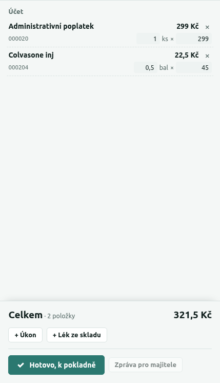

At the end of the visit she clicks **Hotovo, k pokladně** (Done, to the till) and confirms:

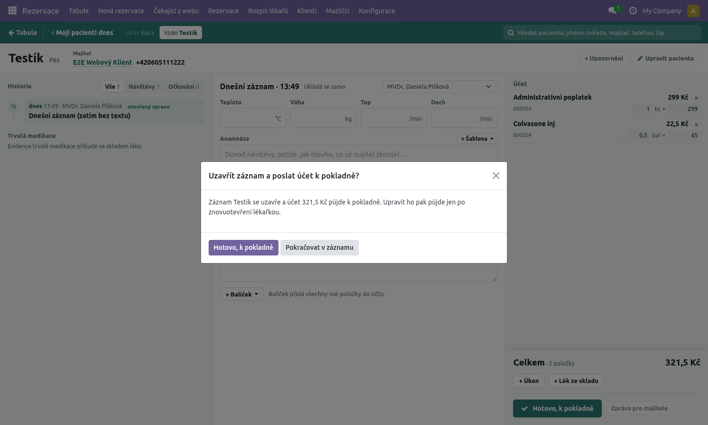

*The patient card pictures still show the old name: **Tabule** (Board) is now **Kalendář** (Calendar) everywhere.*

From that moment:

- the record is closed and the card shows the label **Čeká na platbu · S00400** (Waiting for payment,
  with the order number under which you will find the bill at the till) and the note „Recepce účet
  najde v pokladně pod tlačítkem Objednávka“ (Reception finds the bill in the till under the Order
  button, which means **Akce → Nabídka/Objednávka** (Actions → Quotation/Order)),
- in the **Kalendář** the reservation has a yellow label **k pokladně** (to the till),
- in the till the bill is on the **Dnes** tab in the **K pokladně** (To the till) column.

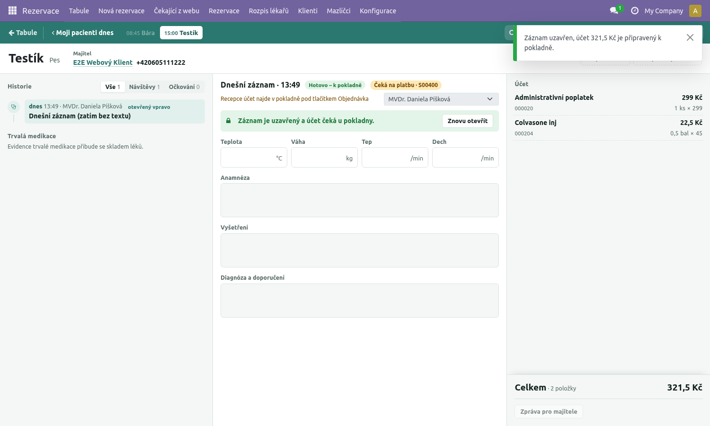

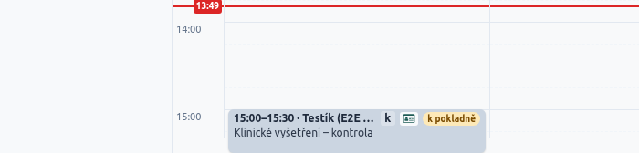

If the doctor reopens the record and adds to it, a new **Hotovo** overwrites the bill. It is still the
same order, nothing is duplicated. But if reception has the bill open in the till at that moment,
**Hotovo** ends with the message „Recepce účet právě vyřizuje v pokladně – počkejte na dokončení
platby.“ (Reception is handling the bill at the till, wait until the payment is finished). Wait until
reception finishes the payment (or cancels the order in the till) and try again.

## 2. Paying a bill (settling the order)

The shortest way is the **Dnes** tab → column **K pokladně** → **Zaplatit** (Pay). The till loads the
bill with its customer and opens the payment by itself, so you go straight to step 5 (details in the
guide [Reception in the till](../../../elite_vet_reception/doc/en/recepce-v-pokladne.md), section
Zaplatit).

You can also find the bill by hand on the **Pokladna** (Till) tab:

1. In the till, click **Akce** (Actions) at the bottom left and then **Nabídka/Objednávka** (Quotation/Order).

   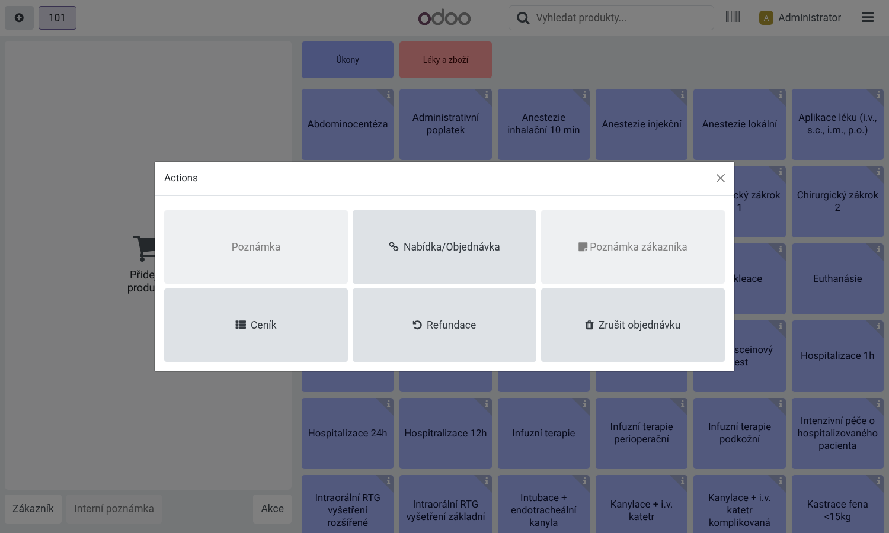

   *The till pictures are from an older version: the top bar now also has the tabs, and the button
   **Zákazník** (Customer) is now called **Klient** (Client).*

2. A list of orders opens. Find the bill by its number (S…) or by the owner's name and click the row.

   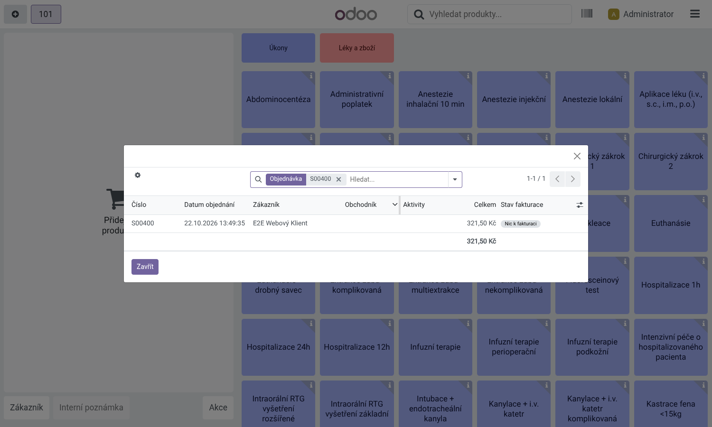

3. In the window **Co chcete udělat?** (What do you want to do?) choose **Vyrovnat objednávku** (Settle the order).

   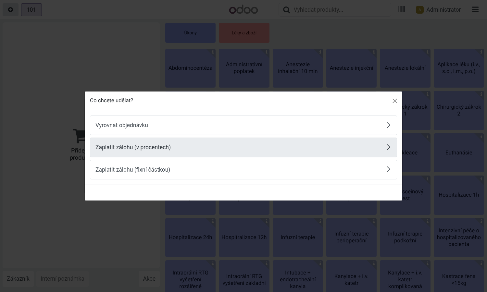

4. The bill items load into the till together with the customer (the owner). Check them and click
   **Platba** (Payment).

   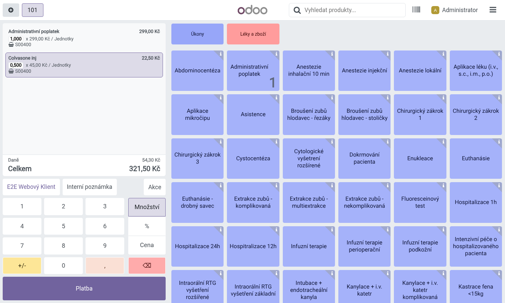

5. Choose the payment method: **Kartou** (By card), **Hotově** (In cash) or **Převodem** (By transfer).
   - **Kartou:** the till is not connected to a payment terminal. **Type the amount from the screen**
     (the big green number) **into the bank's terminal** and let the client pay. This is the only
     manual step.
   - **Hotově:** type how much the client gave you (or use +10/+20/+50). The till works out the change.
   - **Převodem:** payment by bank transfer to the clinic's account.
6. If the client wants an invoice, switch on **Faktura** (Invoice), see the next chapter.
7. Click **Potvrdit** (Validate).

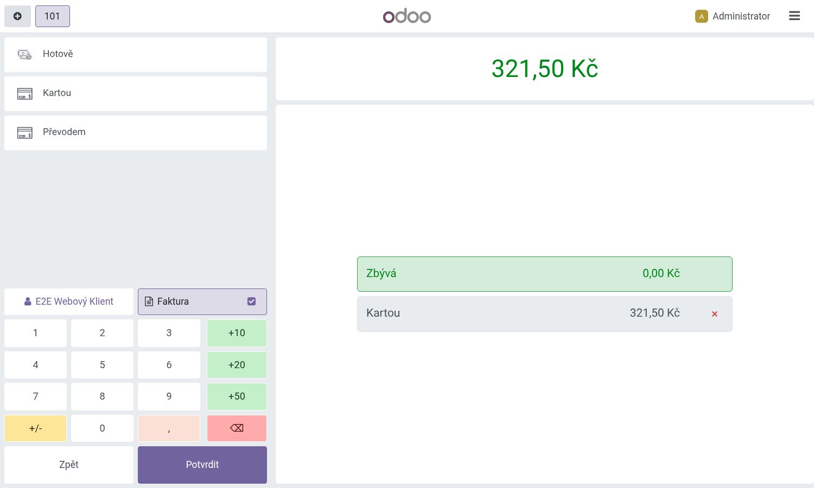

You will see **Platba byla úspěšná** (Payment successful) and a receipt preview.
**Vytisknout účtenku** (Print receipt) prints it, **Nová objednávka** (New order) starts another empty
bill, and the **Dnes** tab takes you back to the overview. The e-mail field and the button next to it
**send the receipt to the client by e-mail**. Use it only if the client wants it. Picked the wrong
payment method? **Editovat platbu** (Edit payment) can still correct it.

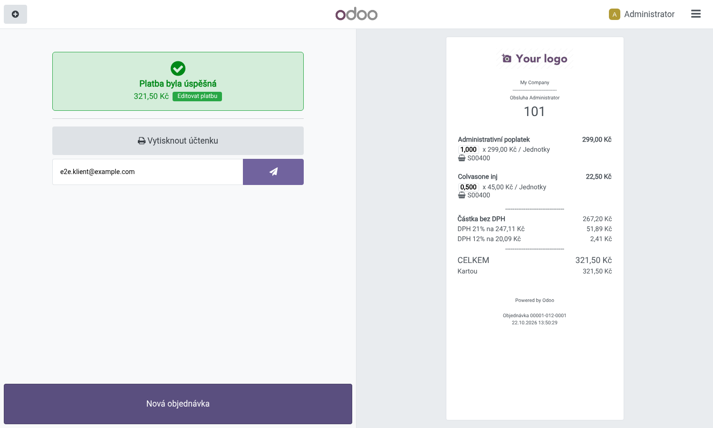

After payment:

- the patient card shows the label **Zaplaceno** (Paid) and the calendar a green label **zaplaceno**,
- medicines are taken off the stock, always from the lot with the **nearest expiry date**. The till
  does not ask for the lot.

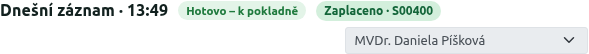

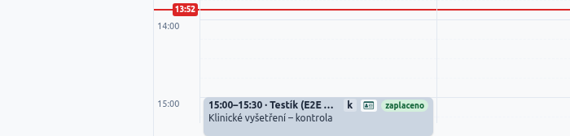

## 3. Invoice

On the payment screen click **Faktura** (Invoice), the checkbox switches on. The invoice is issued to
the customer of the order, which is the owner of the patient. After **Potvrdit** (Validate) the
invoice is created as paid (number INV/…). Management can also find it in Odoo under
**Fakturace → Zákazníci → Faktury** (Invoicing → Customers → Invoices).

A bill from the patient card cannot be moved to a different customer. If you pick another client for
it in the **Kartotéka** (Card index; the button **Klient** (Client) or **Zákazník** (Customer) on the
payment screen), the till starts a new empty bill and the original one stays unpaid in **K pokladně**
(To the till). So an invoice to a company works only if the company itself is the patient's owner in
the card index, or for a sale without a visit, where you pick the company with the **Klient** button
before payment (**Vybrat k účtu** (Select for the bill)). In other cases ask management.

## 4. Deposit

1. **Akce → Nabídka/Objednávka** (Actions → Quotation/Order) → the bill → instead of „Vyrovnat
   objednávku“ choose **Zaplatit zálohu (fixní částkou)** (Pay a deposit, fixed amount) or
   **Zaplatit zálohu (v procentech)** (Pay a deposit, percentage).
2. Enter the amount (or percentage), **Platba** (Payment), the payment method, **Potvrdit** (Validate).

The record then has the state **Částečně zaplaceno** (Partly paid) and the calendar keeps the label
**k pokladně** (to the till; hovering over it shows „Částečně zaplaceno“). You pay the rest the same
way as a whole bill (**Dnes → K pokladně → Zaplatit**, or **Akce → Nabídka/Objednávka → Vyrovnat
objednávku**). The paid deposit is deducted automatically.

Once a deposit has been paid on a bill, the doctor can no longer reopen the record („Na účet už je
zaplacená záloha…“ – a deposit has already been paid on the bill). Changes have to be made in the till.

## 5. Refund

A paid record can no longer be reopened or cancelled. When money has to be returned (a returned
medicine, a mistake in the bill), make a **refund in the till**:

1. Till menu (☰ top right) → **Objednávky** (Orders), and switch the search to paid orders. Or at the
   bottom left **Akce → Refundace** (Actions → Refund), which opens the list of paid orders directly.
2. Find the order, select the lines being returned and click **Refundace** (Refund).
3. Pay out the refund the same way the client paid (for a card, return the money on the terminal).

The record in the card stays **Zaplaceno** (Paid). The refund is a separate document in the till.

## 6. When the doctor reopens a bill that has already been paid

It can happen that the doctor reopens a record and reception pays the bill in the meantime. When the
doctor clicks **Hotovo** (Done), the record closes but the **bill items do not change**, and the
record history shows „Účet už byl zaplacen v pokladně – položky účtu se nezměnily.“ (The bill has
already been paid at the till, the bill items were not changed). If the doctor added something, take
payment for it separately in the till (a new order), or return it with a refund.

## 7. Closing the till (end of the day)

1. Till menu (☰) → **Zavřít pokladnu** (Close register).
2. Count the cash in the till and write the amount into **Počítané** (Counted) next to **Hotově** (Cash).
   Check card and transfer payments against the terminal statement.
3. If there is a difference, explain it in the note.
4. Click **Zavřít relaci** (Close session). The day's sales are posted. Open the till again the next day.

This is the daily closing of the till in Odoo. **Uzávěrka (PDF)** (Cash closure PDF), which management
prints, is something else: it is calculated from WinVet data, see the guide
[Data and reports](../../../elite_vet_winvet/doc/en/data-a-prehledy.md).

---

# Part B – goods receipt and stock (reception)

## 8. Barcode scanner

For medicines you need a **2D scanner** (it reads the DataMatrix code on the boxes), set up to
**send the GS1 group separator (FNC1)**. Without it the lot and expiry date cannot be reliably split
out of the code. In "keyboard" mode the scanner sends FNC1 as **Ctrl+]**, which Odoo recognises. How to
switch it on is in the scanner's manual (usually by scanning a setup code „GS1 / FNC1 → GS (0x1D)“ or
„Ctrl+]“). The scanner should send **Enter** after the code.

Check: scan the DataMatrix code of a medicine. If both the lot and the expiry date fill in on the row,
the scanner is set up correctly.

## 9. Goods receipt

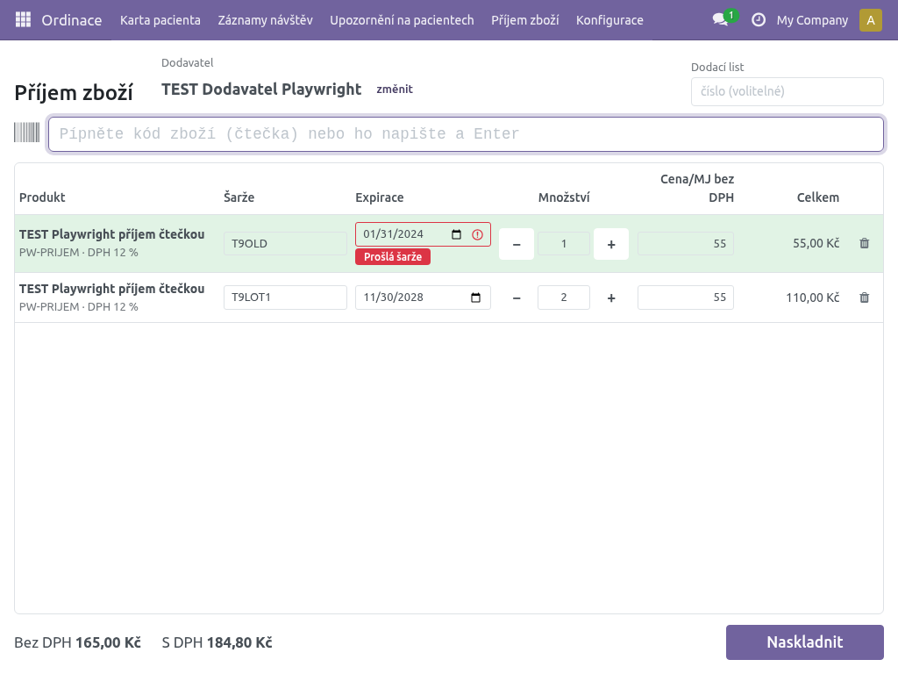

*The pictures are from the **Ordinace** (Consulting rooms) app, where management has this screen.
Reception opens it in the **Sklady** (Inventory) app.*

1. Open **Sklady → Příjem zboží** (Inventory → Goods receipt).
2. **Dodavatel** (Supplier): start typing the name. Recently used suppliers are at the top. A new
   supplier is created with just a name.
3. Optionally **Dodací list** (Delivery note): the delivery note number (it can also be scanned).
4. **Scan.** The scanner field always has the cursor, you do not have to click anything.
   - A code from the box (DataMatrix) fills in the **product, lot and expiry date**.
   - An ordinary barcode (EAN) fills in the product. The lot and expiry date are pre-filled from the
     last receipt, so check them and correct them if needed.
   - Scanning the same lot again adds **+1 ks** (+1 piece). You can also change the quantity with the
     − / + buttons. Delete a row with the bin icon.
   - **Neznámý kód** (Unknown code): a window of the same name opens. Search for the product and select
     it. The code is saved and recognised next time (you only do this once).
   - **Missing lot:** for a medicine tracked by lot, when the code has no lot, the cursor moves to the
     **Šarže** (Lot) field. Type it in (or scan it) and add the expiry date.
   - **Prošlá šarže** (Expired lot): a row with a past expiry date gets a red warning **Prošlá šarže**.
     Check whether the goods really arrived expired. They can still be received.
5. **Cena/MJ bez DPH** (Price per unit excl. VAT) is pre-filled with the last purchase price. Correct
   it according to the delivery note.
6. Click **Naskladnit** (Stock in). The button becomes active once a supplier is chosen and every row
   has a lot. The text at the bottom tells you what is missing („Vyberte dodavatele.“ – choose a
   supplier, „Doplňte šarži u 2 řádků.“ – add the lot on 2 rows). The goods go into stock on their lots
   with expiry dates, and an expense (category Léky a zdravotnický materiál – Medicines and medical
   supplies) is recorded in **Přehled tržeb a výdajů** (Revenue and expense overview), which management
   sees. Free goods (price 0) do not record an expense.

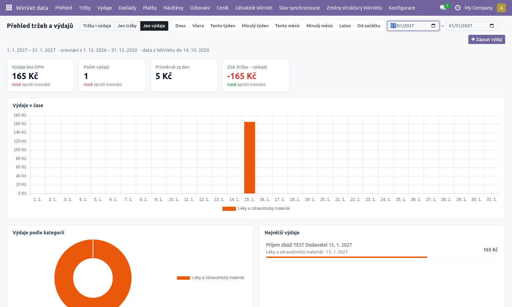

**Zkušební provoz** (Trial run). While WinVet runs the stock, there is a yellow warning at the top.
The receipt goes through, but **no expense is recorded** and the stock level is overwritten at the
next synchronisation from WinVet. Keep receiving goods in WinVet as well.

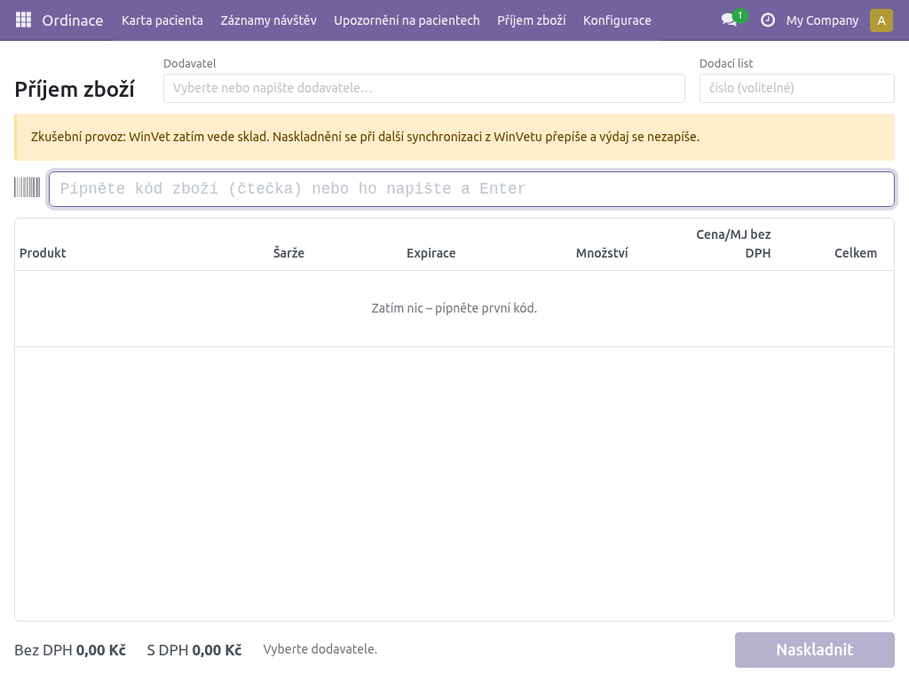

## 10. Stock overview

**Sklady → Přehled skladu** (Inventory → Stock overview) shows what is in stock, by lot: product, lot,
expiry date and quantity. The rows are grouped by product. Click a product to see its lots.

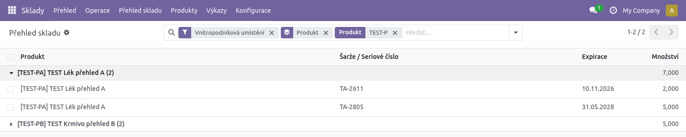

*The pictures show the management menu. Reception has only **Přehled skladu** and **Příjem zboží** in
the **Sklady** app.*

A row with a negative quantity is shown in red.

The search (the arrow on the right of the search field) has these filters:

| Filter | What it shows |
|---|---|
| **Dochází** (Running low) | Goods below the minimum of their reordering rule, and goods with a negative stock (sold although Odoo had none in stock). |
| **Expiruje do 30 dní** (Expires within 30 days) | Lots in stock that expire within the next 30 days. |
| **Prošlé** (Expired) | Lots in stock that have already expired. |

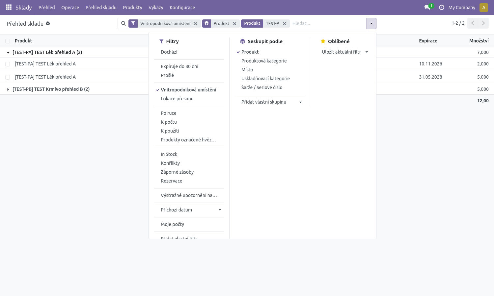

Completely sold-out goods (stock 0) are not in the overview. Management can find them under
**Sklady → Operace → Doplňování zboží → Doplňování** (Inventory → Operations → Procurement →
Replenishment). The same filters are also in **Sklady → Produkty → Šarže / sériová čísla** (Inventory →
Products → Lots / Serial numbers), also for management only.

The minimum for **Dochází** is set by management as a reordering rule on the product (Sklady → Operace →
Doplňování zboží → Doplňování, or on the product form → Min/Max).
