# Pokladna a sklad – návod pro recepci a sestry

**K čemu je tento návod.** Popisuje, jak účet z karty pacienta dojde do pokladny, jak ho
recepce zaplatí (kartou, hotově, převodem, se zálohou nebo fakturou), jak se dělá vratka
a uzávěrka, a jak sestra přijímá zboží čtečkou a hlídá sklad. Technické nastavení (pro
správce) je v [README modulu](../README.md), část „Pro správce“.

Kde co najdete:

- **Pokladna Recepce** – aplikace **Prodejní místa** → pokladna **Recepce** → **Otevřít pokladnu**
  (nebo **Pokračovat v prodeji**, když už je otevřená).
- **Příjem zboží** – aplikace **Ordinace → Příjem zboží**, nebo **Sklady → Operace → Příjem zboží**.
- **Přehled skladu** – aplikace **Sklady → Přehled skladu**.

> **Zkušební provoz.** Dokud ve WinVetu běží ostrý provoz, vede ceník a sklad WinVet. Odoo jeho
> stav po každé synchronizaci převezme. Prodej v pokladně i příjem zboží si můžete vyzkoušet,
> ale stav skladu se při další synchronizaci přepíše stavem WinVetu a příjem nezapisuje výdaj.

---

# Část A – recepce

## 1. Jak se účet dostane k pokladně

Účet vzniká v **kartě pacienta**. Lékařka (nebo sestra) přidá do části **Účet** úkony
(**+ Úkon**), léky (**+ Lék ze skladu**) nebo balíček a upraví množství.

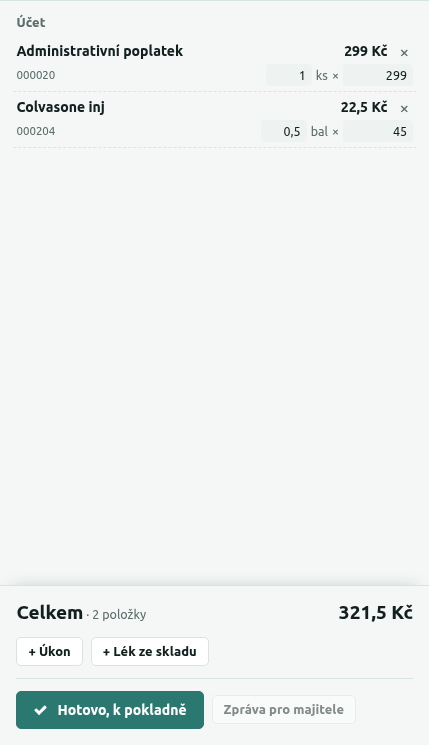

Na konci návštěvy klikne **Hotovo, k pokladně** a potvrdí:

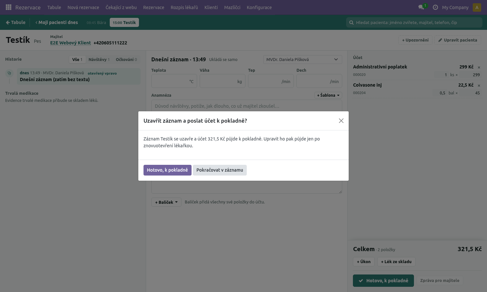

Od té chvíle:

- záznam je uzavřený a v kartě je štítek **Čeká na platbu · S00400** (číslo objednávky,
  pod kterým účet najdete v pokladně) s poznámkou pro recepci, kde účet v pokladně najde
  (**Akce → Nabídka/Objednávka**),
- na **tabuli** má rezervace žlutý štítek **k pokladně**.

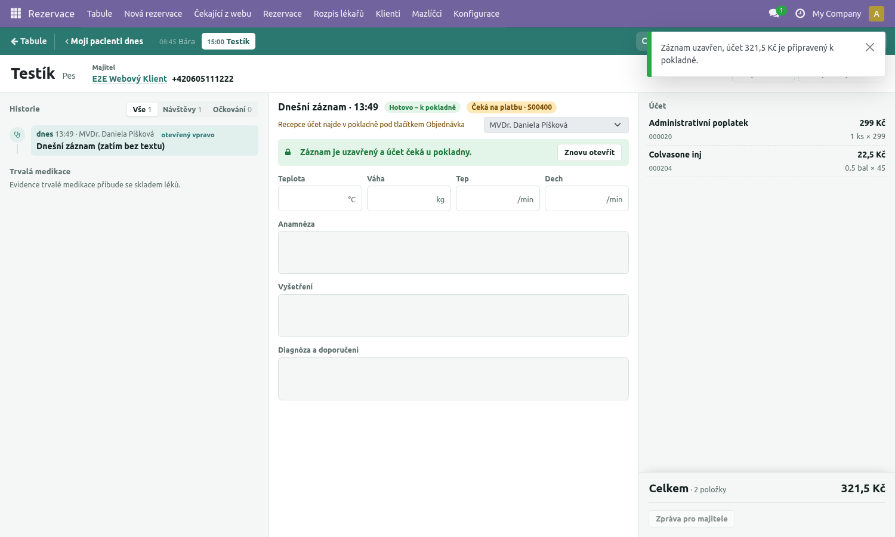

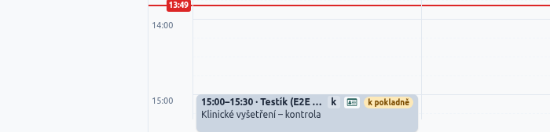

Když lékařka záznam znovu otevře a doplní, nové **Hotovo** účet přepíše – pořád je to tatáž
objednávka, nic se nezdvojí. Má-li ale recepce účet právě rozpracovaný v pokladně, **Hotovo** skončí
hláškou „Recepce účet právě vyřizuje v pokladně – počkejte na dokončení platby.“ – počkejte,
až recepce platbu dokončí (nebo objednávku v pokladně zruší), a zkuste to znovu.

## 2. Zaplacení účtu (vyrovnání objednávky)

1. V pokladně klikněte vlevo dole na **Akce** a pak na **Nabídka/Objednávka**.

   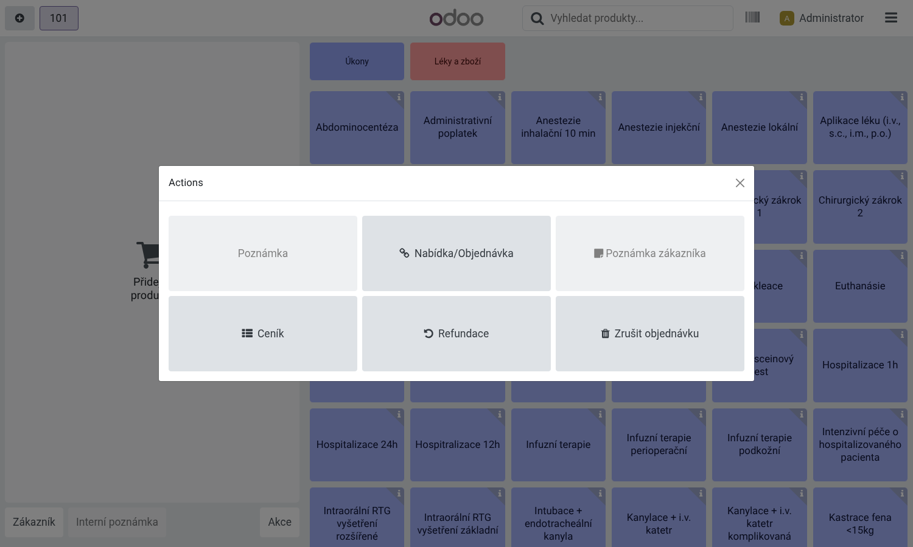

2. Otevře se seznam objednávek. Najděte účet podle čísla (S…) nebo podle jména majitele
   a klikněte na řádek.

   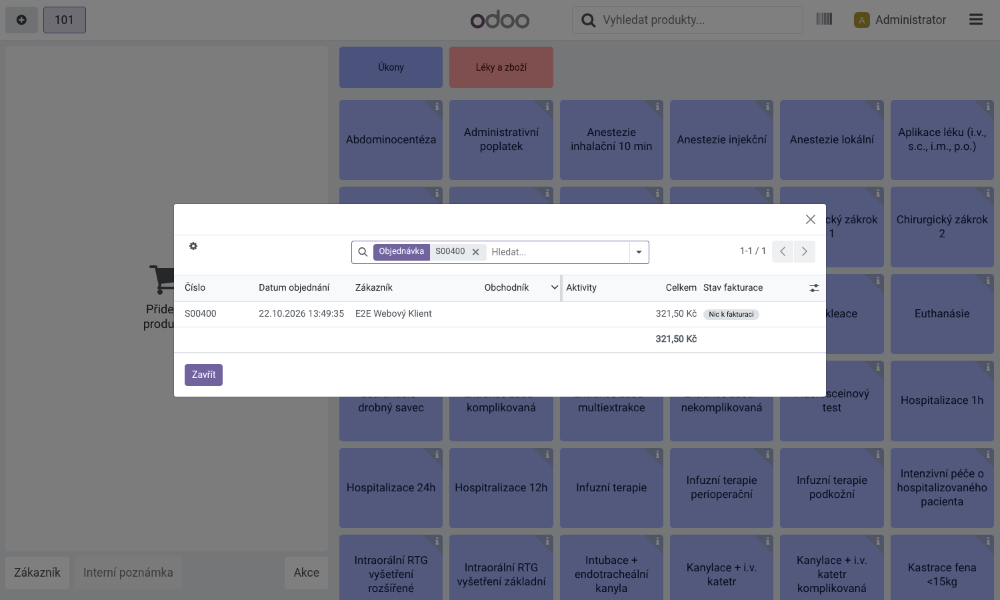

3. V okně **Co chcete udělat?** zvolte **Vyrovnat objednávku**.

   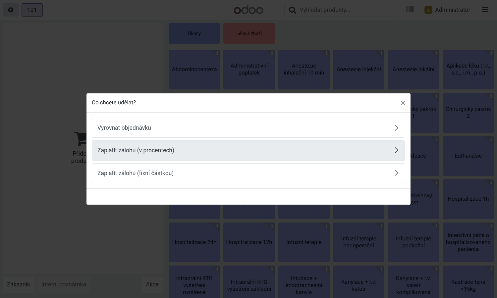

4. Položky účtu se načtou do pokladny i se zákazníkem (majitel). Zkontrolujte je
   a klikněte na **Platba**.

   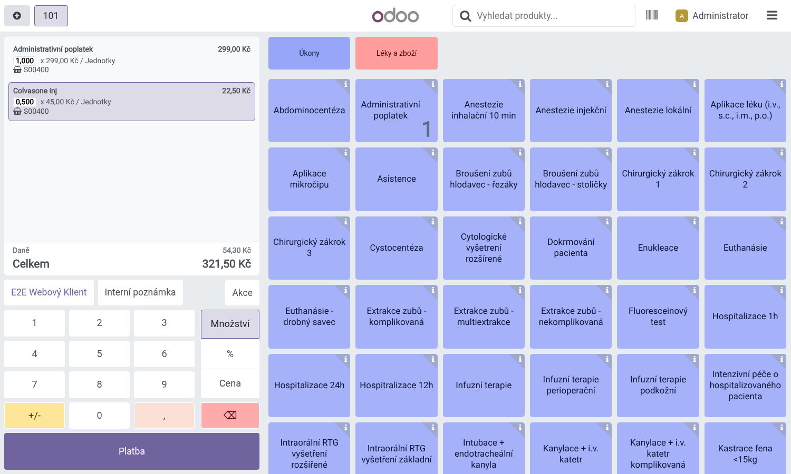

5. Zvolte způsob platby: **Kartou**, **Hotově** nebo **Převodem**.
   - **Kartou:** pokladna není spojená s platebním terminálem. Částku z obrazovky
     (velké zelené číslo) **opište do terminálu banky** a nechte klienta zaplatit. To je
     jediný ruční krok.
   - **Hotově:** napište, kolik klient dal (nebo použijte +10/+20/+50); pokladna spočítá,
     kolik vrátit.
   - **Převodem:** platba převodem na účet kliniky.
6. Chce-li klient fakturu, zapněte **Faktura** (viz další kapitola).
7. Klikněte **Potvrdit**.

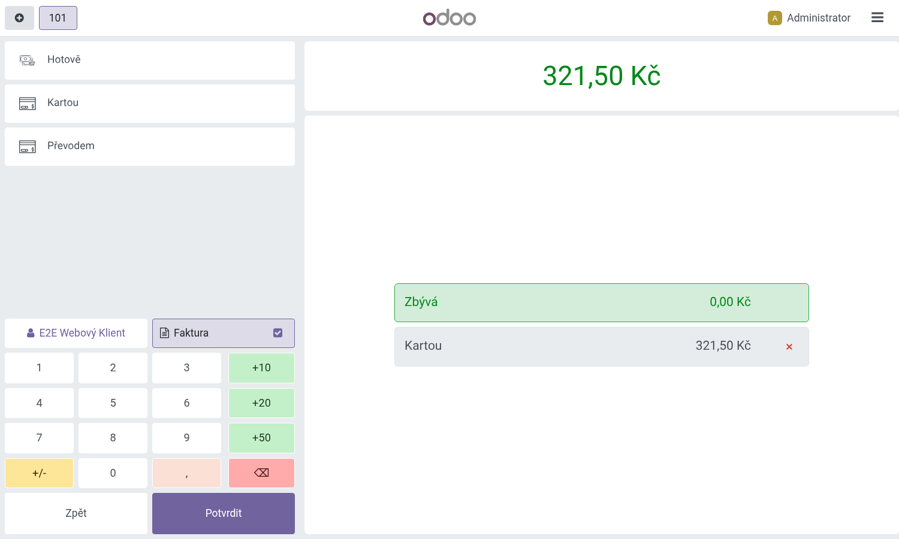

Zobrazí se **Platba byla úspěšná** a náhled účtenky. **Vytisknout účtenku** ji vytiskne,
**Nová objednávka** vás vrátí na začátek. Pole s e-mailem a tlačítko vedle něj účtenku
**pošle klientovi e-mailem** – použijte ho, jen když o to klient stojí. Spletli jste se ve
způsobu platby? **Editovat platbu** ji ještě opraví.

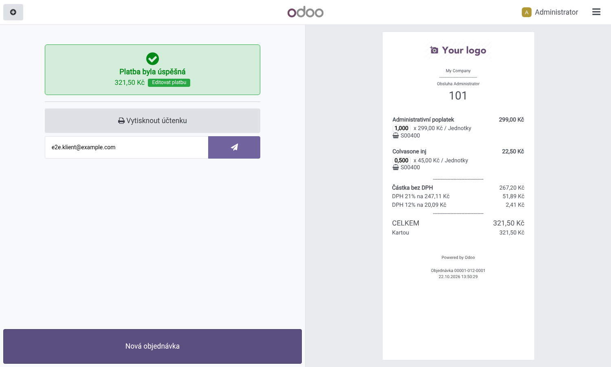

Po zaplacení:

- v kartě pacienta je štítek **Zaplaceno**, na tabuli zelený štítek **zaplaceno**,
- léky se odepíšou ze skladu, a to vždy ze šarže s **nejbližší expirací** – na šarži se
  pokladna neptá.

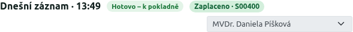

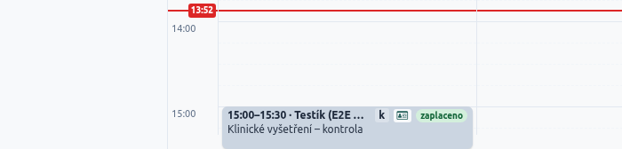

## 3. Faktura

Na platební obrazovce klikněte na **Faktura** (zaškrtávací políčko se zapne). Faktura se vystaví na
zákazníka z objednávky, tedy majitele pacienta. Po **Potvrdit** se faktura vytvoří jako
zaplacená (číslo INV/…); najdete ji i v Odoo v **Fakturace → Zákazníci → Faktury**. Má-li být faktura na firmu, vyberte před platbou
zákazníka (tlačítko se jménem majitele) a firmu.

## 4. Záloha

1. **Akce → Nabídka/Objednávka** → účet → místo „Vyrovnat objednávku“ zvolte **Zaplatit zálohu
   (fixní částkou)** nebo **Zaplatit zálohu (v procentech)**.
2. Zadejte částku (nebo procento), **Platba**, způsob platby, **Potvrdit**.

Záznam má potom stav **Částečně zaplaceno** a na tabuli zůstává štítek **k pokladně**
(po najetí myší „Částečně zaplaceno“). Zbytek doplatíte stejně jako celý účet
(**Akce → Nabídka/Objednávka → Vyrovnat objednávku**) – zaplacená záloha se odečte sama.

Na účet se zálohou už lékařka nemůže záznam znovu otevřít („Na účet už je zaplacená
záloha…“) – změny je třeba vyřešit v pokladně.

## 5. Vratka

Zaplacený záznam už nejde znovu otevřít ani zrušit. Když je potřeba vrátit peníze (vrácený lék,
chyba v účtu), udělejte **vratku v pokladně**:

1. Menu pokladny (☰ vpravo nahoře) → **Objednávky**, v hledání přepněte na zaplacené –
   nebo vlevo dole **Akce → Refundace** (otevře rovnou seznam zaplacených objednávek).
2. Najděte objednávku, vyberte řádky, které se vracejí, a klikněte na **Refundace**.
3. Zaplaťte vratku stejným způsobem, jakým klient platil (u karty vraťte peníze v terminálu).

Záznam v kartě zůstane **Zaplaceno** – vratka je samostatný doklad v pokladně.

## 6. Když lékařka znovu otevře už zaplacený účet

Může se stát, že lékařka záznam znovu otevře a recepce mezitím účet zaplatí. Až lékařka
klikne **Hotovo**, záznam se uzavře, ale **položky účtu se už nezmění** a do historie záznamu
se zapíše „Účet už byl zaplacen v pokladně – položky účtu se nezměnily.“ Pokud lékařka něco
přidala, zaplaťte to v pokladně zvlášť (nová objednávka), případně vraťte vratkou.

## 7. Uzávěrka (konec dne)

1. Menu pokladny (☰) → **Zavřít pokladnu**.
2. Přepočítejte hotovost v pokladně a napište ji do **Počítané** u Hotově. Karty a převody
   zkontrolujte proti výpisu z terminálu.
3. Rozdíl, pokud nějaký je, vysvětlete v poznámce.
4. Klikněte **Zavřít relaci**. Tržby dne se zaúčtují; další den otevřete pokladnu znovu.

---

# Část B – sestry

## 8. Čtečka čárových kódů

Na léky je potřeba **2D čtečka** (čte DataMatrix na krabičkách), nastavená tak, aby
**posílala oddělovač skupin GS1 (FNC1)**. Bez něj se šarže a expirace z kódu nedají
spolehlivě rozdělit. V režimu „klávesnice“ čtečka posílá FNC1 jako **Ctrl+]** – Odoo ho
rozpozná. Jak to zapnout, najdete v návodu ke čtečce (obvykle naskenováním
nastavovacího kódu „GS1 / FNC1 → GS (0x1D)“ nebo „Ctrl+]“). Čtečka má za kódem posílat **Enter**.

Kontrola: naskenujte DataMatrix léku. Když se v řádku vyplní šarže i expirace, je čtečka
nastavená správně.

## 9. Příjem zboží

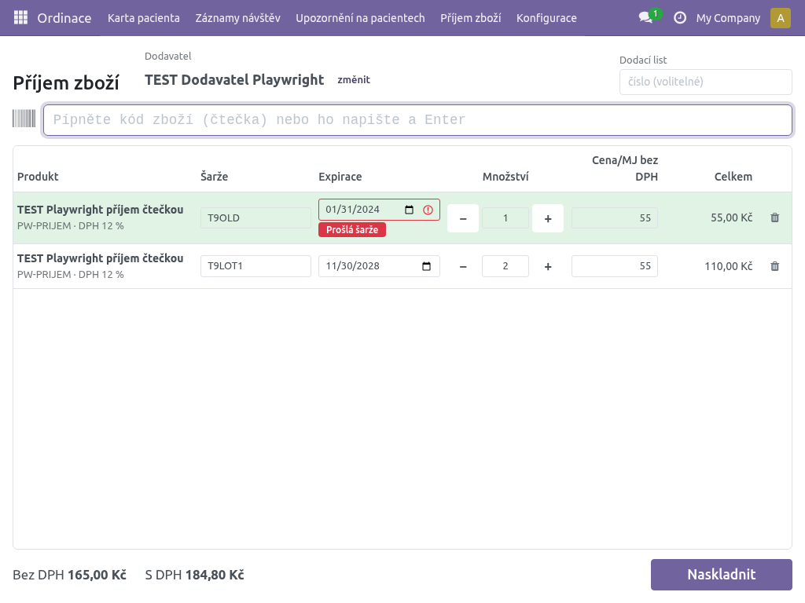

1. Otevřete **Ordinace → Příjem zboží** (nebo Sklady → Operace → Příjem zboží).
2. **Dodavatel:** začněte psát název; naposledy použití dodavatelé jsou nahoře. Nový
   dodavatel se založí jen se jménem.
3. Volitelně **Dodací list** – číslo dodacího listu (dá se i naskenovat).
4. **Pípejte.** Pole pro čtečku má kurzor pořád, nic nemusíte kliknout.
   - Kód z krabičky (DataMatrix) vyplní **produkt, šarži a expiraci**.
   - Obyčejný čárový kód (EAN) vyplní produkt; šarže a expirace se předvyplní z posledního
     příjmu – zkontrolujte je a případně opravte.
   - Další pípnutí stejné šarže přidá **+1 ks**. Množství jde změnit i tlačítky − / +.
   - **Neznámý kód:** otevře se okno **Neznámý kód** – vyhledejte produkt a vyberte ho.
     Kód se uloží a příště se pozná sám (stačí jednou).
   - **Chybí šarže:** u léku se šaržemi bez šarže v kódu se kurzor přesune do pole Šarže –
     napište ji (nebo ji naskenujte) a doplňte expiraci.
   - **Prošlá šarže:** řádek s prošlou expirací dostane červené upozornění **Prošlá šarže**.
     Zkontrolujte, jestli zboží opravdu přišlo prošlé; přijmout ho jde.
5. **Cena/MJ bez DPH** je předvyplněná poslední nákupní cenou – podle dodacího listu ji opravte.
6. Klikněte **Naskladnit**. Zboží se naskladní na šarže s expiracemi a zapíše se výdaj
   (kategorie Léky a zdravotnický materiál) do **Přehledu tržeb a výdajů**.

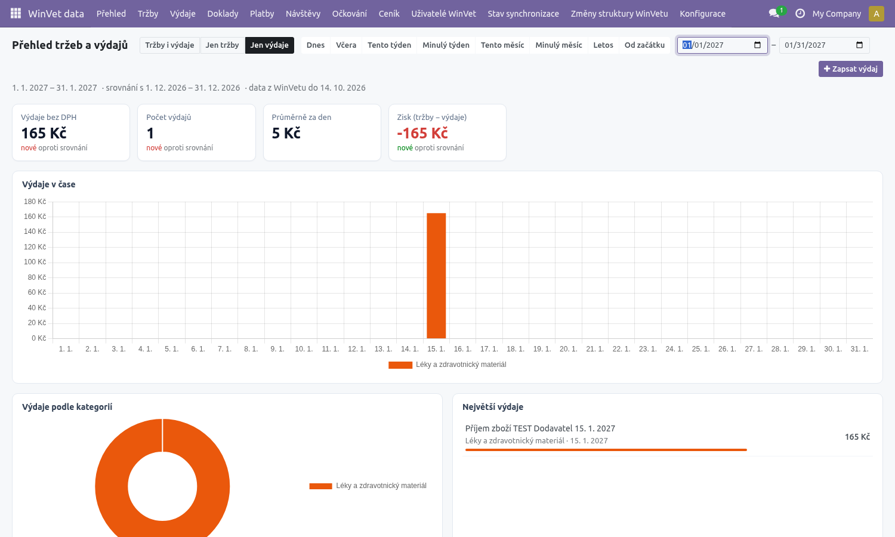

**Zkušební provoz.** Dokud sklad vede WinVet, je nahoře žluté upozornění. Příjem se provede,
ale **výdaj se nezapíše** a stav skladu se při další synchronizaci z WinVetu přepíše. Zboží
dál přijímejte i ve WinVetu.

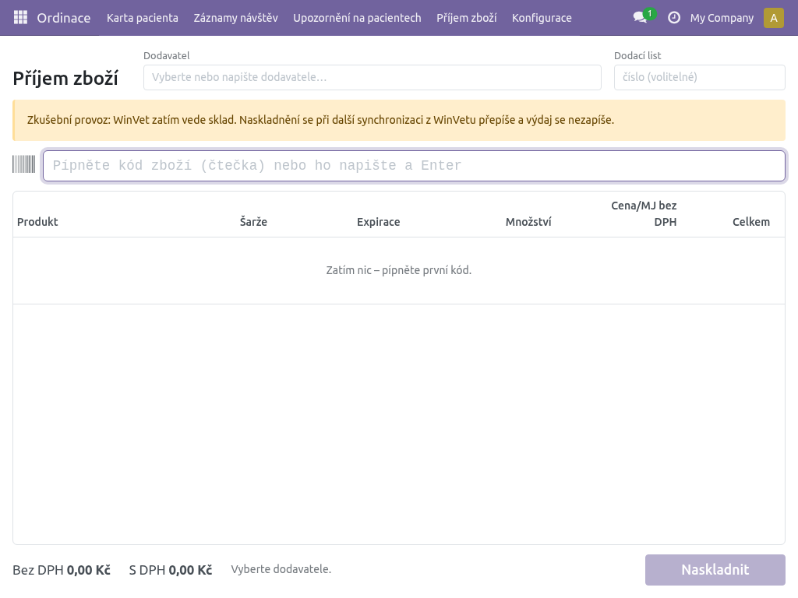

## 10. Přehled skladu

**Sklady → Přehled skladu** (recepce: **Ordinace → Přehled skladu**, jen ke čtení) ukazuje, co je na skladě, po šaržích: produkt, šarže, expirace
a množství. Řádky jsou seskupené podle produktu – kliknutím na produkt uvidíte jeho šarže.

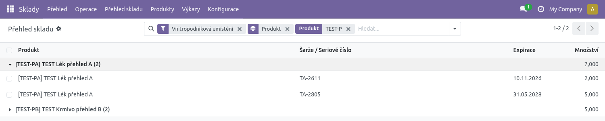

Ve vyhledávání (šipka vpravo v poli hledání) jsou filtry:

| Filtr | Co ukáže |
|---|---|
| **Dochází** | Zboží pod minimem z pravidla doplnění a zboží se záporným stavem (prodané, i když podle Odoo na skladě nebylo). |
| **Expiruje do 30 dní** | Šarže, které jsou na skladě a projdou během příštích 30 dní. |
| **Prošlé** | Šarže, které jsou na skladě a už prošly. |

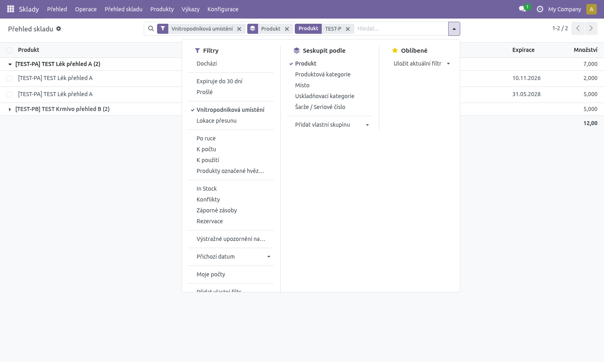

Úplně vyprodané zboží (stav 0) v přehledu není – najdete ho v **Sklady → Operace →
Doplňování zboží → Doplňování**. Stejné filtry jsou i v **Sklady → Produkty → Šarže / sériová čísla**.

Minimum pro „Dochází“ nastaví správce skladu jako pravidlo doplnění u produktu
(Sklady → Operace → Doplňování zboží → Doplňování, nebo na kartě produktu → Min/Max).
